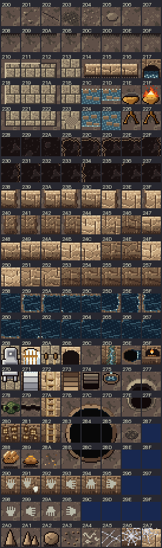
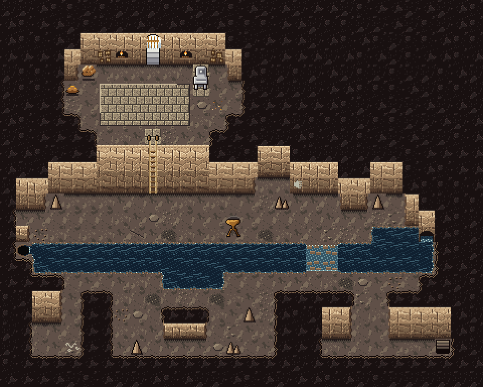
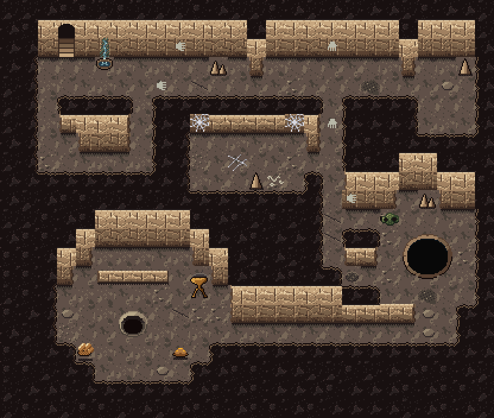

# Trophonios's cave: the tileset and the maps

The oracle's cave under Lebadeia's precinct (SCRIPT.md Part 5, beats 35B-35C): the
priests' paved chamber inside the bronze grille with the throne of Mnemosyne, a rope
ladder into the dark, the underground Herkyna, the pilgrims' chalk handprints, the
snake's cleft, the black pool that reflects nothing, and the bread-oven hole in the
oracle's floor. One secondary, `gTileset_Trophonios`, on the `aethos` primary, for
`MAP_TROPHONIOS_CAVE_B1F` and `_B2F`.

**Generated.** The catalog below is written by `tools/ichor/art/trophonios_build.py`
(painters: `trophonios_kit.py`, `trophonios_props.py`; palettes and helpers in
`trophonios_lib.py`). The maps' part, from "The maps" on, is written by hand and kept
across rebuilds.

```bash
/usr/bin/python3 tools/ichor/maps/trophonios.py --shapes   # list the wall and water shapes the maps use
/usr/bin/python3 tools/ichor/art/trophonios_build.py       # paint, compile, verify, catalog
/usr/bin/python3 tools/ichor/maps/trophonios.py            # build both floors, render them
```

## How it fits together

**Where it started.** Batch 1's `gTileset_KithaironCave` (Antiope's cave) was the
model: the crag rock turned into cave walls on a floor, and the bronze brazier. Its
walls read flat (one grey for rock and floor, a 14 px face), so this set redraws them:
a near-black umber **cap** for the rock seen from above, and a warm ochre limestone
**face**, two or three cells tall, along every south edge, so each wall reads as a wall
with height. The floor is a cooler grey-brown clay, darker than the face and lighter
than the cap, so walkable and blocked never blur.

**Self-contained.** Like `gTileset_KithaironCave`, the set is compiled against an empty
stand-in primary and draws only its own tiles and palettes 6-12, so it works on any
primary. Outside the torch's circle the GBA shows black whatever the primary.

**Layers.** Walls' ends, props and furniture stand in the middle layer over the plain
floor's bottom tiles, so the floor is stored once and every 8x8 tile keeps to one palette
group. Full-width faces and the cap's interior are bottom-layer only.

**Walls are auto-tiled** by `tools/ichor/maps/trophonios.py` from a grid of rock and
floor: every rock cell above a floor cell is the face's base, the cells above it are the
face's upper rows (two tall under the cap; three where the upper chamber's cliff drops to
the cave), and the rest is the cap, picked by blob shape key. Place other pieces by key
and cell name from `build/trophonios/catalog.json`, never by raw id.

**Palettes.** Six groups, one per secondary palette; every 8x8 tile draws from one.

| Group | Use |
|---|---|
| rock | the cap, the face, chalk prints and seeps on the face, stalagmites |
| floor | the clay floor, damp, contact shadows, chalk on the floor, the priests' paving, the stairs down, the oracle's hole |
| water | the underground Herkyna and its banks and ford, the spring, the outlet and sink, the black pool |
| fire | bronze braziers and their flames, the lamps, the bread offerings and honey cakes |
| stone | the throne of Mnemosyne, the grille and its daylight, the rope ladder, the votive tablets |
| life | the snake's coils, cobwebs, old bones |

**The glow copy** (SYSTEMS.md section 2). The chalk is two colors, `ch1` and `ch2`, in
the rock and floor palettes: faint grey-white on the rock in torchlight. The build writes
`data/tilesets/secondary/trophonios/glow/00.pal`-`15.pal`, a copy of the set's palettes
with every color black except the chalk, which glows green (as Phase 2's Hecate's chalk).
The engine doesn't load a glow copy on douse yet (ENGINE_API section 2: doused is "black:
glow-paint only, once its palettes exist"), so it isn't registered in
`src/data/tilesets/graphics.h`; until it is, the chalk is read by torchlight and by its
signs (below).

**Scripted swaps** (`include/constants/metatile_labels.h`): `METATILE_Trophonios_Brazier_ColdTop`,
`_Cold`, `_LitTop`, `_Lit`; `METATILE_Trophonios_Cleft_Coils`, `_Cleft_Empty`.

## Budget

`gTileset_Trophonios`: **464 of 504 tiles**, 168 of 512 metatiles. The chalk sits at palette slots [(7, 12), (7, 14), (8, 11), (8, 14)] (palette, index).



## The kit: floor, paving, walls, the stream

### The cave floor

`floor`, 8 wide by 2 tall. `plain` (and `plain_b`, `plain_c`, mottled differently), `pebbles`, `crack`, `damp`, `gravel` and `flat` (a stone set in the clay); `sh` the floor below a face, in its shadow (`sh_b`, `sh_c` vary it; `shW`, `shE`, `shB` where the face above ends on that side).

```text
0x200 0x201 0x202 0x203 0x204 0x205 0x206 0x207   . . . . . . . .
0x208 0x209 0x20A 0x20B 0x20C 0x20D 0x20E 0x20F   . . . . . . . .
```

Pieces: `plain` 0x200, `pebbles` 0x201, `crack` 0x202, `damp` 0x203, `gravel` 0x204, `flat` 0x205, `plain_b` 0x206, `plain_c` 0x207, `sh` 0x208, `shW` 0x209, `shE` 0x20A, `shB` 0x20B, `sh_b` 0x20C, `sh_c` 0x20D.

### The priests' paving

`pave`, 4 wide by 3 tall. Cut limestone flags in the upper chamber: a rectangle of `tl` `t` `tr` / `l` `c` `r` / `bl` `b` `br`; `c2`, `c3` and `worn` vary the middle.

```text
0x210 0x211 0x212 0x213   . . . .
0x218 0x219 0x21A 0x21B   . . . .
0x220 0x221 0x222 0x223   . . . .
```

Pieces: `tl` 0x210, `t` 0x211, `tr` 0x212, `l` 0x218, `c` 0x219, `r` 0x21A, `bl` 0x220, `b` 0x221, `br` 0x222, `c2` 0x213, `c3` 0x21B, `worn` 0x223.

### A rock ledge (jump south)

`ledge`, 3 wide by 1 tall. A low step in the floor, hopped down southward: `W` `M` `E`.

```text
0x214 0x215 0x216   J J J
```

Pieces: `W` 0x214, `M` 0x215, `E` 0x216.

### The ford

`ford`, 2 wide by 2 tall. The stream shallow over flat stones, walkable: `top` over `bot` across a two-row stream, `one` across a one-row stream (banks on both sides), `stones` a shallow cell with no banks. MB_SHALLOW_WATER.

```text
0x21C 0x21D   . .
0x224 0x225   . .
```

Pieces: `top` 0x21C, `bot` 0x224, `one` 0x21D, `stones` 0x225.

### Rock seen from above: the cap

`cap`, 8 wide by 2 tall. The dark top of every rock mass. Names are blob shape keys over the rock region (face cells count as rock); edge pieces draw the rock in the middle layer over the plain floor. Impassable.

15 shapes, from 0x228.

### The limestone face

`face`, 8 wide by 4 tall. The south face of every rock mass, 1 to 3 cells tall. Names are `H r t e`: height, row (0 = top), top (`c` under the cap, `f` with floor above) and ends (`M` none, `W`, `E`, `B` both). Impassable.

29 shapes, from 0x238.

### The underground Herkyna

`water`, 8 wide by 2 tall. Dark running water with pebbly banks, the river Herkyna under the hill. Names are blob shape keys. Not surfable: blocked.

12 shapes, from 0x258.

## The furniture

### The bronze brazier, cold and lit

`brazier`, 2 wide by 2 tall. A wide bronze bowl on a tripod, on the cave floor: `cold_top` over `cold`, and lit, `lit_top` over `lit`. Swap both cells to light it: METATILE_Trophonios_Brazier_*.

```text
0x21E 0x21F   X X
0x226 0x227   X X
```

Pieces: `cold_top` 0x21E, `cold` 0x226, `lit_top` 0x21F, `lit` 0x227.

### The throne of Mnemosyne

`throne`, 1 wide by 2 tall. A white stone chair on the paving: its high back (`back`) over the seat (`seat`), where the pilgrims are set after the descent. The player is placed on `seat` for beat 35C.

```text
0x268   X
0x270   X
```

Pieces: `back` 0x268, `seat` 0x270.

### The bronze grille and its steps

`grille`, 1 wide by 2 tall. In a face two tall under the cap: `arch` (the grille, daylight behind its bars) over `steps` (cut steps up to it, walkable; MB_NORTH_ARROW_WARP: the warp out to Lebadeia).

```text
0x269   X
0x271   .
```

Pieces: `arch` 0x269, `steps` 0x271.

### The rope ladder

`ladder`, 1 wide by 4 tall. `stakes` (on the paving at the cliff's edge) over the ladder down a face three tall with floor above: `top`, `mid`, `foot`. All walkable.

```text
0x26A   .
0x272   .
0x27A   .
0x282   .
```

Pieces: `stakes` 0x26A, `top` 0x272, `mid` 0x27A, `foot` 0x282.

### Stairs down and up

`stairs`, 2 wide by 2 tall. `down` steps cut into the floor going down into the dark (MB_LADDER: the warp to the floor below); `up` steps cut into a face's base going up, under `up_arch` (the face's top row): MB_LADDER, the warp up. `down_rim` is plain floor beside it.

```text
0x26B 0x26C   X .
0x273 0x274   . .
```

Pieces: `up_arch` 0x26B, `up` 0x273, `down` 0x274, `down_rim` 0x26C.

### The spring from the rock

`spring`, 1 wide by 2 tall. `seep` (the base row of a face two tall) with cold water running down the rock, over `basin`, a rock basin on the floor it fills: B2F's midpoint rest.

```text
0x26D   X
0x275   X
```

Pieces: `seep` 0x26D, `basin` 0x275.

### Where the stream comes out of the rock

`outlet`, 1 wide by 1 tall. The base row of a face two tall, with a low black arch the stream runs out of. Put the stream's first water cell below it.

```text
0x217   X
```

Pieces: `outlet` 0x217.

### Where the stream goes into the ground

`sink`, 1 wide by 1 tall. A black hole in the floor the stream pours into from the east. Put it at the west end of the stream; blocked.

```text
0x26E   X
```

Pieces: `sink` 0x26E.

### The black pool

`pool`, 3 wide by 3 tall. A still round pool in a stone rim, black even in torchlight: it reflects nothing. 3 x 3, blocked; the rim's corners let the floor show.

```text
0x27B 0x27C 0x27D   X X X
0x283 0x284 0x285   X X X
0x28B 0x28C 0x28D   X X X
```

Pieces: `00` 0x27B, `10` 0x27C, `20` 0x27D, `01` 0x283, `11` 0x284, `21` 0x285, `02` 0x28B, `12` 0x28C, `22` 0x28D.

### The hole in the oracle's floor

`hole`, 2 wide by 2 tall. A round black hole in the middle of the oracle's chamber, with a worn lip like a bread oven's mouth. 2 x 2, blocked; the descent's last step.

```text
0x276 0x277   X X
0x27E 0x27F   X X
```

Pieces: `tl` 0x276, `tr` 0x277, `bl` 0x27E, `br` 0x27F.

### The pilgrims' chalk handprints

`prints`, 6 wide by 2 tall. Chalk hands in the glow paint (`ch1`, `ch2`). Wall prints sit on the base row of a face two tall: `one`, `two` (a big hand and a smaller one), and fingers pointing `N`, `E`, `S`, `W`. Floor prints: `fN` `fE` `fS` `fW`, walkable.

```text
0x290 0x291 0x292 0x293 0x294 0x295   X X X X X X
0x298 0x299 0x29A 0x29B 0x29C 0x29D   . . . . . .
```

Pieces: `one` 0x290, `two` 0x291, `N` 0x292, `E` 0x293, `S` 0x294, `W` 0x295, `fN` 0x298, `fE` 0x299, `fS` 0x29A, `fW` 0x29B.

### The snake's cleft

`cleft`, 2 wide by 1 tall. A low cleft across a passage one cell wide: `coils` with something very large lying in it (the snake object, invisible, blocks it until fed), `empty` once it has gone back into the rock. Walkable art: the object does the blocking.

```text
0x278 0x279   . .
```

Pieces: `coils` 0x278, `empty` 0x279.

### Bread offerings and honey cakes

`offerings`, 3 wide by 1 tall. `bread` a basket heaped with round loaves, `cakes` honey cakes on a clay dish (the pilgrims' gift for the snakes), `crumbs` old cake broken on the floor (walkable).

```text
0x288 0x289 0x28A   X X .
```

Pieces: `bread` 0x288, `cakes` 0x289, `crumbs` 0x28A.

### Votive tablets on the wall

`tablets`, 2 wide by 1 tall. Small wooden tablets hung on pegs on a face cell (the base row of a face two tall): each one a pilgrim's account. `a` and `b` vary.

```text
0x280 0x281   X X
```

Pieces: `a` 0x280, `b` 0x281.

### A lamp in a wall niche

`lamp`, 1 wide by 1 tall. A niche in a face cell (base row of a two-tall face) with a burning clay lamp: the priests' light in the upper chamber.

```text
0x26F   X
```

Pieces: `lamp` 0x26F.

### Rocks and stalagmites

`rocks`, 4 wide by 1 tall. On the floor: `stal` a stalagmite, `stal_pair` two, `boulder` a fallen block (all blocked); `scree` loose stones (walkable).

```text
0x2A0 0x2A1 0x2A2 0x2A3   X X X .
```

Pieces: `stal` 0x2A0, `stal_pair` 0x2A1, `boulder` 0x2A2, `scree` 0x2A3.

### Bones and webs

`lair`, 4 wide by 1 tall. `bones` old bones on the floor and `strands` loose web across it (walkable); `web_face` a cobweb over a face's base row, `web_corner` a web in the top corner of a face's top row under the cap (both blocked).

```text
0x2A4 0x2A5 0x2A6 0x2A7   . . X X
```

Pieces: `bones` 0x2A4, `strands` 0x2A5, `web_face` 0x2A6, `web_corner` 0x2A7.

### Turned earth on the cave floor

`dig`, 1 wide by 1 tall. A fixed dig spot on the floor (walkable): the earth here has been turned.

```text
0x286   .
```

Pieces: `dig` 0x286.

## The maps

Written by hand; kept across rebuilds. Both floors are built by `tools/ichor/maps/trophonios.py`
(grids carved out of solid rock, then auto-tiled; events written into each `map.json`), with
`"requires_flash": true`, `MAP_TYPE_UNDERGROUND`, `MUS_ICHOR_HOLLOW` (`ICHOR_STUB_MUSIC`), and the
cave's one encounter table from Part 4 (already folded in). The builder checks that every item,
person and exit can be reached once the relic obstacles are cleared, and fails otherwise.

The descent follows Part 5: **teach** the dark (one brazier, one chalk hand) on B1F, **test** the
hands at three forks on B2F, then **combine** them with the pilgrims' custom (honey for the snake)
at the far end; a midpoint rest (the spring), a payoff (the reading), and the hole as the
shortcut out.

### B1F, the descent (30 x 24)



| Where | What |
|---|---|
| (9,2)-(9,3) | **The bronze grille**, inside: daylight through the bars, cut steps below. Warp 0 on the steps (MB_NORTH_ARROW_WARP) to `MAP_LEBADEIA` warp 3; arriving from the grille lands here. |
| (4-14, 4-8) | **The upper chamber**: the priests' paving, votive tablets (6,3) and (13,3), clay lamps (7,3) and (11,3), bread (5,4) and honey cakes (4,5), and **the throne of Mnemosyne** (12,4)-(12,5). Lit by the day through the grille (a lit zone keyed on `FLAG_ICHOR_TROPHONIOS_GRILLE_OPEN`, so always lit while you can be inside). Hidden Honey (13,4), in the corner by the throne. |
| (9,8)-(9,11) | **The rope ladder** down the chamber's cliff (a face three tall). Coord events at (9,9) and (9,10) switch between the upper chamber's light and the stream's. |
| (9,12) | The ladder's foot: "The ladder ends in the dark. Water is running somewhere close." (once per visit; not when coming up from B2F). Escape Rope (8,13). |
| (14,13)-(14,14) | **Brazier 1**, `FLAG_ICHOR_BRAZIERS_START + 0x21`: lights the stream chamber (rows 10-17, and the outcrop room open off the south bank) for good. Lit-zone coord events on the zone's two exits, (4,17)/(4,18) and (22-23,17)/(22-23,18). |
| (15,15) | **Herkyna's goose**, a Halcyling standing in the stream (`FLAG_ICHOR_FOUND_HERKYNAS_GOOSE`). Talk from the bank; YES sends it home. |
| (18,11) | **The first chalk hand**, on the wall past the brazier, fingers pointing east toward the ford and the stair. Its sign reads it by torchlight and doused. |
| (1,15)-(26,16) | **The underground Herkyna**: out of the east wall at (26,14), into a sink in the floor at (1,15); a deep pool where it bends below the brazier (10-13,17). The ford (19-20,15-16), shallow over stones (MB_SHALLOW_WATER). Hidden Bronze Obol (8,16), faced from the south bank. |
| (4,19) | **Marble rubble** (`EventScript_RockSmash`, the Bronze Hammer) closing the passage to the Max Repel's nook (2,21), with old bones. A rock-smash table is wanted (below). |
| (20,21) | **Philomelos** (trainer 193), facing the stair, sight 3: the passage down from the bank meets his corridor at (22-23,21), in his sight. Mandatory. |
| (27,21) | **The stair down** (MB_LADDER), warp 1 to B2F's warp 0. |
| (12,7), (11,7), (14,6) | Saon, a priest and Alethea, for the reading only (hidden by `FLAG_TEMP_11` unless the player arrives on the throne). |

### B2F, the deep (26 x 22)



| Where | What |
|---|---|
| (3,1)-(3,2) | **The stair up** (MB_LADDER), warp 0 to B1F's warp 1. |
| (5,2)-(5,3) | **The spring**: water running down the rock into a basin. The midpoint rest (heals). |
| (7,4) | **Fork A.** The chalk hand at (9,2) and on the floor at (8,4) point east. The wrong branch loops round a pillar and back to the stair (hidden Ether at (2,8), in the loop's far corner). |
| (17,4) | **Fork B.** The hand at (17,2) and on the floor at (17,6) point south. The wrong branch, east, is a dead end with the Max Ether (24,6). |
| (16,8) | **The cobweb curtain** (`EventScript_IchorCobweb`, the Torch; it re-spins each visit) off the way south, closing **the web den** (10-15,7-9): webs, bones, the Spell Tag (11,8). |
| (17,11) | **Fork C.** The hand at (18,10) points east ("Under it, smaller: honey."). Ahead, south, is a dead end with the Hyper Potion (17,13). |
| (20,11) | **The snake's cleft.** An invisible object (`MOVEMENT_TYPE_INVISIBLE`) over the coils' metatile, hidden by `FLAG_ICHOR_TROPHONIOS_SNAKE_FED`; Honey moves it, and the metatile swaps to the empty cleft (ON_LOAD keeps it so). |
| (21-23,12-14) | **The black pool**, in its round chamber. Melampos (trainer 194) at (20,12) beside it, facing the water: optional. Hidden Dusk Stone (24,13) on the far rim. |
| (19,14) | **The great boulder** (`EventScript_IchorGreatBoulder`, Hephaestus's Hammer), a 32 x 32 object wedged in a niche's mouth, hidden for good by `FLAG_ICHOR_HIDE_TROPHONIOS_GREAT_BOULDER`. Behind it the fixed dig (18,14), `FLAG_ICHOR_DIG_FIXED_START + 0x12`, a Rare Bone (`ICHOR_STUB_DIG`: turned-earth text until the dig API lands). |
| (3-11,13-19) | **The oracle's chamber**, round, at the very bottom. Brazier 2 (10,14)-(10,15), `FLAG_ICHOR_BRAZIERS_START + 0x22`, lights it (coord events at its mouth, (11,17) and (12,17)). A shelf a step up along its north side with the TM (5,13) (`ICHOR_STUB_TMS`: Skill Swap stands in for Future Sight), its ledge hopped south. **The hole** (6-7,16-17), with bread and honey cakes beside it. |

### Beat 35C: the reading, and the way out

- **The first YES at the hole**: the music fades, the screen goes black for 120 frames with no
  text, `FLAG_ICHOR_TROPHONIOS_READING` is set, and the player is warped silently onto the
  throne's seat on B1F (12,5). B1F's ON_TRANSITION sees the player there, shows Saon, a priest and
  Alethea, lights the chamber and starts the scene (ON_FRAME): Saon's three lines, the player
  looking left and right, "...Nothing?", the priests' silent look at each other, "Write it down." /
  "Write what?" / "Write that we asked.", the priests walking out through the grille, Alethea's two
  lines, and Alethea leaving. The cave's music comes back as the player gets up. No music plays
  under the throne (Part 9's silences): the hole fades it out, and the warp keeps the same track
  stopped.
- **Every later YES** is the way out: "Feet first. You're getting good at this." and
  `warp(MAP_LEBADEIA, 3)`, the grille. A door warp lands the player on the grille's tile and the
  game walks them out to the tile in front of it (if Lebadeia's grille is MB_NON_ANIMATED_DOOR, as
  a door should be). The parnassos agent keeps that tile walkable.

### Deviations

1. **The throne of Mnemosyne is in the cave, not in Lebadeia.** SCRIPT.md 35C warps the player to
   "the stone chair between the springs" in Lebadeia, with Saon, a priest and Alethea in front of
   it. Lebadeia is the parnassos agent's map, and the scene needs three objects and an ON_FRAME
   script there; the brief puts the throne in this tileset instead. So the reading plays in the
   cave's upper chamber, just inside the grille (Pausanias's throne stood "not far from the
   shrine"), and the hole leads to Lebadeia only after it. Lebadeia's chair between the springs
   (the parnassos agent's art) can stay as the springs' furniture; its priest's line ("When they
   come up, we sit them in this chair") still reads true of the custom.
2. **The chalk shows faintly by torchlight.** Part 5 has the hands show "only in full darkness".
   The engine darkens a doused map to black and doesn't load a glow copy yet, so a doused player
   would see nothing at all. The hands are drawn in the two glow colors, faint in torchlight (as
   Phase 2's Hecate's chalk is), so the forks can be read now; the glow copy is written for the
   engine (above). The first hand's sign says "Rough rock. Something pale is smeared on it, too
   faint to read by torchlight." in place of "Rough rock. Nothing on it.", and reads the hand when
   doused. When the engine loads the glow copy, the art can go back to invisible-in-light by
   making `ch1` match the rock in the normal palettes.
3. **Hidden items.** Part 8 lists one (the Bronze Obol); the coordinator asked for curiosity's
   rewards, so the cave has four in its vanilla range 0x330-0x333: the Bronze Obol (8,16) on B1F,
   Honey by the throne (13,4) on B1F, an Ether in fork A's loop (2,8) and a Dusk Stone on the black
   pool's far rim (24,13) on B2F. The Bronze Obol is `ITEM_RELIC_COPPER`, whose in-game name is
   still "Relic Copper".
4. **The two obstacle sprites** are new: `OBJ_EVENT_GFX_ICHOR_COBWEB` (16 x 16) and
   `OBJ_EVENT_GFX_ICHOR_GREAT_BOULDER` (32 x 32), in the cast palette
   (`tools/ichor/art/trophonios_objects.py`). ENGINE_API says any sprite works and a web sprite is
   coming; if the art team's lands, swap the graphics id.
5. **The marble rubble and the web respawn** each visit (a temp hide flag), as vanilla rock-smash
   rocks do; the great boulder and the snake stay gone (their own flags).

### Engine notes

- **`EventScript_IchorEnterLitZone` hangs if the map is already fully lit.** Its `animateflash(0)`
  eases from radius 200 to 200; `StartUpdateFlashLevelEffect` sets the step to -1 when the radii
  are equal, so the radius shrinks forever and the script never resumes. Both floors keep
  `VAR_TEMP_2` (1 while fully lit) and only call it from the dark. The engine should return early
  when the level is already 0.
- The rock-smash table for the rubble is the coordinator's to stage. By Part 4's band: Pebblith
  28-29 (60%), Pebblith 29-30 (30%), Cairnolith 29-30 (5%), Cairnolith 30-31 (4%), Spalunk 30-31 (1%).

### Render-and-critique passes

**Pass 1** (the first full drafts, the kit as first painted).
- The cap read as a quilted grid of lumps, one 16 px pattern repeated; it pulled the eye from
  everything else.
- The faces were plank-like: evenly spaced vertical flutes, too light, the same cell in every run.
- The damp patches read as green holes in the floor; the floor itself was flat brown.
- The throne read as a stove (a dark panel in its seat); the brazier was a squat stool; the chalk
  hands were bright white gloves.
- The stream was a ruler-straight band; the south half was rectangles, and one-cell rocks drew as
  little crates.
- B2F's TM ledge read as a thin rail, and the oracle's chamber was a box, not "a small round room".

**Pass 2** (`img/TrophoniosCave_B1F_pass2.png`, `_B2F_pass2.png`). The textures were redrawn
from periodic noise in a few variants each: a low-contrast cap with sparse lumps (three variants
scattered by position), faces with wandering bedding lines and joints (three variants per column,
strata meeting across cells), six floor variants (mottled plain, pebbles, a crack, gravel, a set
stone, a wet sheen in place of the green patches) and shadow variants under faces. The throne was
redrawn as a chair with a carved back and arms; the brazier as a wide bowl on a tall tripod with
tall flames; the chalk dimmed to its faint color. The stream got a pool where it bends and a wider
mouth at its outlet; the north wall bulges into the bank; the outcrop room and the rubble's nook
were re-carved so no wall is a one-cell crate; B2F's top passage got two jutting buttresses, the
oracle's chamber was carved round with its shelf along the north side, and the ledge became a real
step (a short face with a lip and a shadow). Still wrong: the floor's mottle repeats where it's
wide and empty, and B1F's south half is still boxy.

**Pass 3** (in game, from the test's screenshots): see below.
