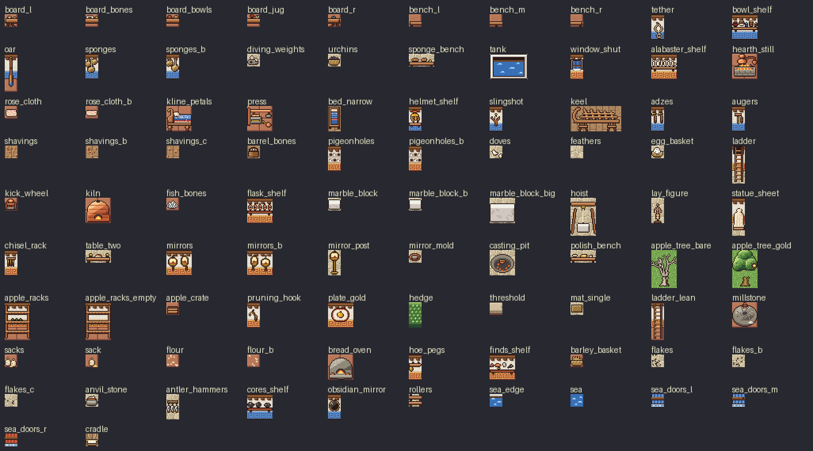
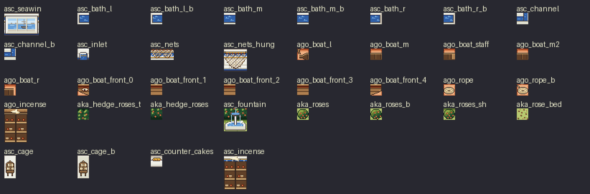

# The Aegean islands' interiors: tilesets and pieces

Kythera's and Melos's 19 interiors (`tools/ichor/maps/kythera_homes.py`, the rooms of `SCRIPT.md` Part 2) are furnished for whoever lives or works in them: the knapper's floor is deep in obsidian flakes, the mill turns round its millstone, the shipwright's keel stands on its trestles in the shavings. This file says where those pieces live, how much room is left, and how to add more.



## Where the pieces live

The slice's interior secondaries are full and fixed:
- `gTileset_Oikia` and `gTileset_Civic` carry the slice's rooms, whose metatile ids must not move.
- Neither has room for a region's worth of new pieces: oikia uses 371 of its tiles and civic 464 of 504.

So each region gets its own secondaries instead, each holding **exactly the cells its rooms use**. The Aegean islands have four:

| Tileset | Rooms | Its pieces |
|---|---|---|
| `gTileset_OikiaSkandeia` | Skandeia's five homes | `tools/ichor/art/aegean_skandeia.py` |
| `gTileset_OikiaPaphia` | Paphia's two homes and three workshops | `tools/ichor/art/aegean_paphia.py` |
| `gTileset_OikiaMelos` | Melos's households (four rooms) and Myles's mill, the country houses | `tools/ichor/art/aegean_melos.py` |
| `gTileset_CivicKythera` | the two Asclepeions and two Agoras | `tools/ichor/art/aegean_civic.py` |

- The oikia kind holds oikia's floors, walls and rugs, every oikia piece its rooms use, and the town's own pieces. They are drawn in oikia's style and palettes; `aegean_art.py` holds the palettes, a small drawing canvas, and the yards' grass.
- The civic kind holds every `gTileset_Civic` metatile its halls use, plus the halls' own. Names keep civic's scheme (`asc_`, `ago_`, `aka_`).
- Pygmalion's workshop, the mirror-house and the orchard house were civic rooms. They are now homes on `gTileset_OikiaPaphia`, so they share Paphia's whitewash and red dado and can use oikia's hearths, beds and tables.

**How a tileset is built.**
- `kythera_homes.py` composes every room, collects each tileset's unique cells, and compiles all four. It uses `tools/ichor/art/interiors_lib.py`, run in Porytiles' scratch project against an empty stand-in primary.
- Each tileset therefore uses only its own tiles and palettes 6-12, and works on oikos.
- The builder then checks every metatile entry and the 504-tile door limit. It renders every room through the compiled tileset and fails unless the render matches the art pixel for pixel.

```bash
/usr/bin/python3 tools/ichor/maps/kythera_homes.py               # compile the tilesets, write the rooms
/usr/bin/python3 tools/ichor/maps/kythera_homes.py --no-compile --review /tmp/rooms   # compose and look
```

**Ids move when the rooms change.** A tileset's metatile ids follow the cells its rooms use:
- Oikia's basics come first and never move.
- Everything after them is in room order.

So never hand-edit these rooms' `map.bin`. Change the room in `kythera_homes.py` and rerun it; it rewrites every room's blockdata. A script that swaps metatiles takes its ids from the "Script swaps" table below, which the builder regenerates.

## Adding a piece

**A home piece.**
1. Add a `stamp(...)` to the town's module. Draw it as a character grid or on a `Canvas`, in one of `aegean_art.PALETTES`. Keep every 8x8 tile in one palette; the builder names any tile that mixes two.
2. Place it in a room's `stamps`.
3. Rerun the builder.

A piece that needs a color its palette lacks keeps that color to its own 8x8 tiles in another palette. The golden apple does this: it is wood's bronze among olive leaves, inside a nature-palette crown.

**A hall piece.**
1. Add `art(...)` and its `mt(...)` or `obj(...)` to `aegean_civic.define()`.
2. Place it in the hall's `Civic` grid.
3. Rerun the builder.

**Budget.** The "Tilesets as built" table below has the current counts. `gTileset_OikiaPaphia` and `gTileset_OikiaSkandeia` are the fullest. If one runs short:
- Trim the variant pieces first (`_b`/`_c` stamps).
- Or move a room to a tileset with room to spare: give `room()` a `tiles=` argument.

## A later region (Lakonia, Delphoi)

Repeat the recipe instead of growing these tilesets:
1. Write a `<region>_art.py`, or one module per town, with the region's pieces. They register into `aegean_art.STAMPS`, or a dict of your own passed to `OikiaKit`.
2. In the region's rooms script, compose with `interiors_lib.OikiaKit` and `CivicKit`, as `kythera_homes.compose_all` does.
3. Register each new tileset in `src/data/tilesets/{headers,graphics,metatiles}.h`, in the same form as `gTileset_OikiaSkandeia`. `interiors_lib.compile_secondary` creates its Porytiles files the first time.

## What isn't done

- **The millstone doesn't turn.** Animating it needs three things, so it wasn't cheap enough to do here:
  - a callback for `gTileset_OikiaMelos` in `src/tileset_anims.c` that copies frames over the runner stone's tiles;
  - the stone's tiles at fixed indices, using Porytiles' `anim/` sources;
  - frames drawn for the stone's furrows turning.
- **The mirrors don't show the player.** The mirror-house's mirrors reflect a dim figure, not the player's sprite (SCRIPT.md asks for the player four times over). That needs an object event per mirror, or a field effect.

<!-- kythera_homes: begin generated -->

Tilesets as built:

| Tileset | Rooms | Metatiles | Tiles (of 504) |
|---|---|---|---|
| `gTileset_OikiaSkandeia` | Skandeia_AxylosHouse, Skandeia_DiversHouse, Skandeia_PerfumersHouse, Skandeia_NikareteHouse, Skandeia_ShipwrightsHouse | 200 | 466 |
| `gTileset_OikiaPaphia` | Paphia_Dovecote, Paphia_PottersHouse, Paphia_PygmalionsWorkshop, Paphia_MirrorHouse, Paphia_OrchardHouse | 200 | 481 |
| `gTileset_OikiaMelos` | NeraidaFalls_Mill, Melos_Farmhouse, Melos_KnappersHouse, Melos_Boathouse, Melos_BoathouseLoft | 176 | 413 |
| `gTileset_CivicKythera` | Skandeia_Asclepeion, Skandeia_Agora, Paphia_Asclepeion, Paphia_Agora | 144 | 346 |

### The homes' pieces

Stamps for `room(... stamps=[(name, x, y)])`, drawn in oikia's palettes (). Oikia's own pieces (`design/phase1/TILES_oikia.md`) can be used too.

| Stamp | Cells | Palette | Used in | What it is |
|---|---|---|---|---|
| `board_l` | 1x1 | wood | Skandeia_AxylosHouse | Axylos's long board, its left end and trestle; a bowl and a cup |
| `board_bones` | 1x1 | wood | Skandeia_AxylosHouse | the long board: a plate of fish bones and a bronze cup |
| `board_bowls` | 1x1 | wood | Skandeia_AxylosHouse | the long board: a red-figure bowl in a wooden one, and a loaf |
| `board_jug` | 1x1 | wood | Skandeia_AxylosHouse | the long board: a red jug and a dish of olives |
| `board_r` | 1x1 | wood | Skandeia_AxylosHouse | the long board's right end and trestle; an empty blue bowl |
| `bench_l` | 1x1 | wood | Paphia_OrchardHouse, Skandeia_AxylosHouse | a long plank bench (walkable: whoever stands on it sits) |
| `bench_m` | 1x1 | wood | Skandeia_AxylosHouse | a long plank bench (walkable: whoever stands on it sits) |
| `bench_r` | 1x1 | wood | Paphia_OrchardHouse, Skandeia_AxylosHouse | a long plank bench (walkable: whoever stands on it sits) |
| `tether` | 1x2 | nature | Skandeia_AxylosHouse | a goat's tether coiled on its peg, the collar empty |
| `bowl_shelf` | 2x2 | wood | Skandeia_AxylosHouse | a shelf of mismatched bowls: red-figure, white, blue, bronze, wood, more than one man needs |
| `oar` | 1x3 | wood | Melos_Boathouse, Skandeia_AxylosHouse, Skandeia_ShipwrightsHouse | a single oar with a blue blade, leaning on the wall |
| `sponges` | 1x2 | nature | Skandeia_DiversHouse | sponges drying on cords from the beam |
| `sponges_b` | 1x2 | nature | Melos_BoathouseLoft, Skandeia_DiversHouse | two big sponges drying on cords |
| `diving_weights` | 1x1 | clay | Melos_Boathouse, Skandeia_DiversHouse | a skandalopetra: the diver's flat stone weight on its cord |
| `urchins` | 1x1 | nature | Melos_Boathouse, Skandeia_DiversHouse | a basket of black sea urchins |
| `sponge_bench` | 2x1 | wood | Skandeia_DiversHouse | the long bench where sponges are beaten and trimmed, a knife by them |
| `tank` | 3x2 | bronze | Skandeia_DiversHouse | a stone tank sunk in the floor, full of sea water |
| `window_shut` | 1x2 | wall | Skandeia_PerfumersHouse | a window with its blue shutters closed and barred |
| `alabaster_shelf` | 2x2 | wood | Skandeia_PerfumersHouse | a shelf of little alabaster scent bottles |
| `hearth_still` | 2x2 | clay | Skandeia_PerfumersHouse | the hearth with a copper still bubbling on it, its pipe running to a jar |
| `rose_cloth` | 1x1 | cloth | Skandeia_PerfumersHouse | rose petals drying on a linen cloth on the floor |
| `rose_cloth_b` | 1x1 | cloth | Skandeia_PerfumersHouse | rose petals drying on a cloth |
| `kline_petals` | 2x2 | wood | Skandeia_PerfumersHouse | the kline, rose petals drying on its coverlet |
| `press` | 2x2 | clay | Skandeia_PerfumersHouse | the rose press: a stone bed, a basket of petals under a long beam, weight stones, the oil running to a jar |
| `bed_narrow` | 1x2 | wood | Paphia_PygmalionsWorkshop, Skandeia_NikareteHouse | a narrow bed, still made: a linen pillow, a blue blanket with a red band |
| `helmet_shelf` | 1x2 | clay | Skandeia_NikareteHouse | a clay Titan helmet a boy made, crest and cheek-guards, painted badly gold, on a little shelf |
| `slingshot` | 1x2 | wood | Skandeia_NikareteHouse | a boy's slingshot hanging on a nail |
| `keel` | 4x2 | wood | Skandeia_ShipwrightsHouse | a half-built keel on trestles: the stem post, three frames and one strake |
| `adzes` | 1x2 | wood | Skandeia_ShipwrightsHouse | two adzes hung on pegs, their bronze blades out |
| `augers` | 1x2 | wood | Skandeia_ShipwrightsHouse | a T-handled auger and a mallet on the wall |
| `shavings` | 1x1 | wood | Skandeia_ShipwrightsHouse | curls of wood shavings, ankle-deep (walkable) |
| `shavings_b` | 1x1 | wood | Skandeia_ShipwrightsHouse | curls of wood shavings, ankle-deep (walkable) |
| `shavings_c` | 1x1 | wood | Skandeia_ShipwrightsHouse | curls of wood shavings, ankle-deep (walkable) |
| `barrel_bones` | 1x1 | wood | Skandeia_ShipwrightsHouse | a barrel for a table, and on it a bowl of knucklebones |
| `pigeonholes` | 1x2 | wall | Paphia_Dovecote | nesting holes in the wall, doves looking out of three |
| `pigeonholes_b` | 1x2 | wall | Paphia_Dovecote | nesting holes in the wall, doves in three |
| `doves` | 1x1 | wall | Paphia_Dovecote | two doves pecking at spilled seed |
| `feathers` | 1x1 | wall | Paphia_Dovecote | feathers drifted down from the nesting floor (walkable) |
| `egg_basket` | 1x1 | nature | Paphia_Dovecote | a wool basket with one big speckled egg in it, not a dove's |
| `ladder` | 1x3 | wood | NeraidaFalls_Mill, Paphia_Dovecote, Paphia_MirrorHouse, Paphia_PottersHouse | a ladder up through a hatch in the ceiling |
| `kick_wheel` | 1x1 | clay | Paphia_PottersHouse | the kick-wheel in its frame, a wet pot thrown on its head, the flywheel below |
| `kiln` | 2x2 | clay | Paphia_PottersHouse | the beehive kiln, its firing mouth glowing |
| `fish_bones` | 1x1 | nature | Paphia_PottersHouse | a heap of fish bones nobody has thrown away |
| `flask_shelf` | 2x2 | clay | Paphia_PottersHouse | perfume flasks drying on a shelf, every one with the same little painted fish |
| `marble_block` | 1x1 | bronze | Paphia_PygmalionsWorkshop | a raw block of marble, chisel-marked |
| `marble_block_b` | 1x1 | bronze | Paphia_PygmalionsWorkshop | a sawn marble block |
| `marble_block_big` | 2x2 | bronze | Paphia_PygmalionsWorkshop | a great block of marble |
| `hoist` | 2x3 | wood+bronze | Paphia_PygmalionsWorkshop | shear legs with a block and tackle, a marble block hanging |
| `lay_figure` | 1x2 | wood | Paphia_PygmalionsWorkshop | a wooden model of a woman, her joints pinned to move |
| `statue_sheet` | 1x3 | wood | Paphia_PygmalionsWorkshop | a statue under a dust sheet on its plinth; the shape of a woman's shoulder |
| `chisel_rack` | 1x2 | wood | Paphia_PygmalionsWorkshop | chisels in a rack, bronze points down |
| `table_two` | 2x1 | wood | Paphia_PygmalionsWorkshop | a small table set for two: two cups and a loaf between them |
| `mirrors` | 2x2 | bronze | Paphia_MirrorHouse | bronze mirrors hung at different angles, dimly reflecting |
| `mirrors_b` | 2x2 | bronze | Paphia_MirrorHouse | bronze mirrors hung at different angles |
| `mirror_post` | 1x2 | bronze | Paphia_MirrorHouse | a mirror turning on its post, as in the rose court |
| `mirror_mold` | 1x1 | clay | Paphia_MirrorHouse | a clay mold for a round mirror |
| `casting_pit` | 2x2 | clay | Paphia_MirrorHouse | the casting pit: a crucible of bronze on the embers |
| `polish_bench` | 2x1 | wood | Melos_KnappersHouse, Paphia_MirrorHouse | the polishing bench: a pot of sand, felt pads, a mirror half-polished |
| `apple_tree_bare` | 2x3 | wall | Paphia_OrchardHouse | the old apple tree: gray, twisted, leafless (crown drawn over the player) |
| `apple_tree_gold` | 2x3 | nature+wood | Paphia_OrchardHouse (gold) | the old apple tree in leaf, one golden apple on it (for after the quest) |
| `apple_racks` | 2x3 | wood | Paphia_OrchardHouse | apple racks along the wall, all empty but one tray with three small green apples |
| `apple_racks_empty` | 2x3 | wood | Paphia_OrchardHouse | empty apple racks |
| `apple_crate` | 1x1 | wood | Paphia_OrchardHouse | an empty apple crate |
| `pruning_hook` | 1x2 | wood | Paphia_OrchardHouse | a pruning hook on a peg |
| `plate_gold` | 2x2 | clay | Paphia_OrchardHouse | a painted plate on the wall: a golden apple on white |
| `hedge` | 1x2 | nature | Paphia_PygmalionsWorkshop | a clipped myrtle hedge, the yard's back wall |
| `threshold` | 1x1 | floor | Paphia_OrchardHouse | the limestone threshold and its step down into the yard (walkable) |
| `mat_single` | 1x1 | nature | Paphia_MirrorHouse, Paphia_OrchardHouse, Paphia_PygmalionsWorkshop | a reed mat for a one-tile door; a south-arrow warp |
| `ladder_lean` | 1x3 | wood | Paphia_OrchardHouse | a ladder leaning on the wall |
| `millstone` | 2x2 | clay | NeraidaFalls_Mill | the great millstone turning on its shaft, meal at its lip |
| `sacks` | 1x1 | cloth | NeraidaFalls_Mill | sacks of grain, tied at the neck |
| `sack` | 1x1 | cloth | NeraidaFalls_Mill | a sack of grain, a little spilled |
| `flour` | 1x1 | cloth | NeraidaFalls_Mill | flour dusted over the floor (walkable) |
| `flour_b` | 1x1 | cloth | NeraidaFalls_Mill | a little flour on the floor (walkable) |
| `bread_oven` | 2x2 | clay | NeraidaFalls_Mill | the bread oven, domed and whitewashed, loaves on its ledge |
| `hoe_pegs` | 1x2 | wood | Melos_Farmhouse | the hoe that found the goddess, laid on two pegs, its blade down |
| `finds_shelf` | 2x2 | clay | Melos_Farmhouse | his shelf of finds: a sherd, a clay lamp, a coin, a marble toe, an obsidian blade |
| `barley_basket` | 1x1 | nature | Melos_Farmhouse | a basket of barley |
| `flakes` | 1x1 | clay | Melos_KnappersHouse | black obsidian flakes on the floor, glinting (walkable) |
| `flakes_b` | 1x1 | clay | Melos_KnappersHouse | obsidian flakes (walkable) |
| `flakes_c` | 1x1 | clay | Melos_KnappersHouse | a few obsidian flakes (walkable) |
| `anvil_stone` | 1x1 | clay | Melos_KnappersHouse | the knee-high anvil stone with its leather pad |
| `antler_hammers` | 1x2 | nature | Melos_KnappersHouse | antler hammers hung in a row by their thongs, the burrs at the bottom |
| `cores_shelf` | 2x2 | clay | Melos_KnappersHouse | cores of black glass on a shelf |
| `obsidian_mirror` | 1x2 | clay | Melos_KnappersHouse | a round mirror of polished black glass; it reflects, darkly |
| `rollers` | 1x1 | wood | Melos_Boathouse | log rollers across the slip's timber ways (walkable) |
| `sea_edge` | 1x1 | bronze | Melos_Boathouse | sea water at the foot of the slip |
| `sea` | 1x1 | bronze | (none yet) | sea water |
| `sea_doors_l` | 1x1 | wall | Melos_Boathouse | the painted sea doors, the sea under them |
| `sea_doors_m` | 1x1 | wall | Melos_Boathouse | the painted sea doors, barred |
| `sea_doors_r` | 1x1 | wall | Melos_Boathouse | the sea doors' red leaf |
| `cradle` | 1x1 | nature | Melos_BoathouseLoft | a wicker cradle hung from the beam on ropes |

### The halls' pieces

Named metatiles for the civic rooms' `Civic` grids, added to gTileset_Civic's (). A piece of several cells is `<prefix>_<x>_<y>`; put it with `r.put(prefix, x, y, w, h)`.

| Piece | Cells |
|---|---|
| `asc_seawin` | 3x2 |
| `asc_bath_l` | 1x1 |
| `asc_bath_l_b` | 1x1 |
| `asc_bath_m` | 1x1 |
| `asc_bath_m_b` | 1x1 |
| `asc_bath_r` | 1x1 |
| `asc_bath_r_b` | 1x1 |
| `asc_channel` | 1x1 |
| `asc_channel_b` | 1x1 |
| `asc_inlet` | 1x1 |
| `asc_nets` | 2x1 |
| `asc_nets_hung` | 2x2 |
| `ago_boat_l` | 1x1 |
| `ago_boat_m` | 1x1 |
| `ago_boat_staff` | 1x1 |
| `ago_boat_m2` | 1x1 |
| `ago_boat_r` | 1x1 |
| `ago_boat_front_0` | 1x1 |
| `ago_boat_front_1` | 1x1 |
| `ago_boat_front_2` | 1x1 |
| `ago_boat_front_3` | 1x1 |
| `ago_boat_front_4` | 1x1 |
| `ago_rope` | 1x1 |
| `ago_rope_b` | 1x1 |
| `ago_incense` | 2x3 |
| `aka_hedge_roses_top` | 1x1 |
| `aka_hedge_roses` | 1x1 |
| `asc_fountain` | 2x2 |
| `aka_roses` | 1x1 |
| `aka_roses_b` | 1x1 |
| `aka_roses_sh` | 1x1 |
| `aka_rose_bed` | 1x1 |
| `asc_cage` | 1x2 |
| `asc_cage_b` | 1x2 |
| `asc_counter_cakes` | 1x1 |
| `asc_incense` | 2x3 |

### Script swaps

`MAP_KYTHERA_PAPHIA_ORCHARD_HOUSE`, gold (`apple_tree_bare` to `apple_tree_gold`), on `gTileset_OikiaPaphia`:

| Cell | As built | Swapped in |
|---|---|---|
| (6,7) | `0x2B5` | `0x2C0` |
| (7,7) | `0x2B6` | `0x2C1` |
| (6,8) | `0x2B9` | `0x2C2` |
| (7,8) | `0x2BA` | `0x2C3` |
| (6,9) | `0x2BB` | `0x2C4` |
| (7,9) | `0x2BC` | `0x2C5` |

<!-- kythera_homes: end generated -->
