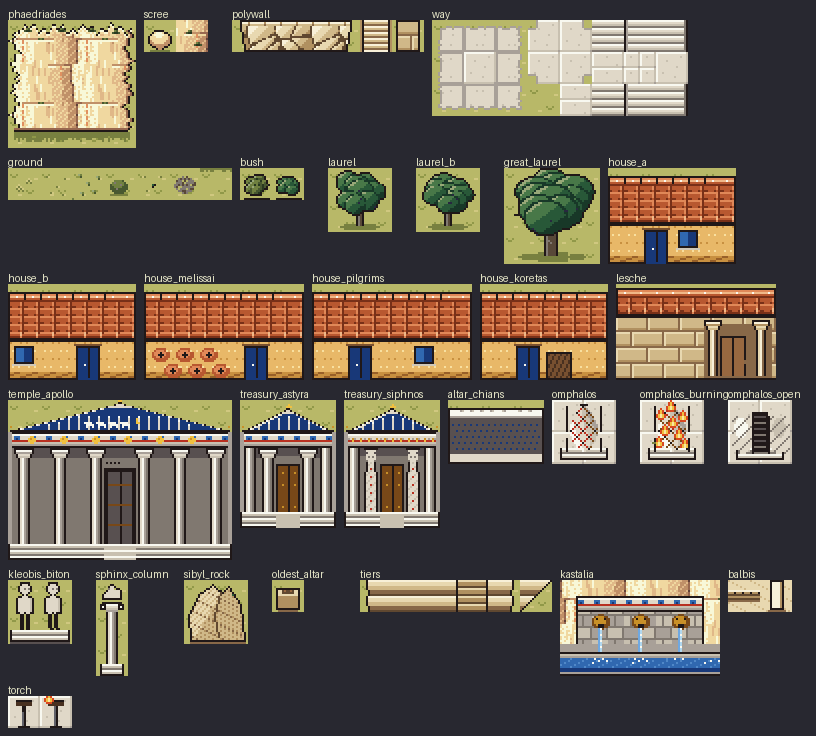

# delphoi tileset catalog

`gTileset_Delphoi` is Delphoi, on the `aethos` primary. **Generated** by `tools/ichor/art/delphoi_build.py delphoi`; the art is `tools/ichor/art/delphoi_art.py`.

Built: **476** tiles of 504.

Map builders place pieces by key and name (`tools/ichor/maps/delphoi_maps.py`, `build/delphoi/catalog.json`), never by raw id.

| Key | Size | Section | What it is | Names |
|---|---|---|---|---|
| `phaedriades` | 4x4 | land | The Phaedriades: cliff kit | `crest_W`, `crest`, `crest2`, `crest_E`, `face_W`, `face`, `face2`, `face_E`, `faceb_W`, `faceb`, `faceb2`, `faceb_E`, `foot_W`, `foot`, `foot2`, `foot_E` |
| `scree` | 2x1 | land | Fallen blocks under the cliffs | `block`, `face_scrub` |
| `polywall` | 6x1 | land | The polygonal wall | `W`, `M`, `M2`, `E`, `stair`, `pier` |
| `way` | 8x3 | land | The Sacred Way: flags, kerbs, inner corners, steps | `TL`, `T`, `TR`, `L`, `C`, `R`, `BL`, `B`, `BR`, `in_NW`, `in_NE`, `in_SW`, `in_SE`, `steps`, `steps_W`, `steps_E`, `flag2`, `flag4`, `worn`, `C2`, `steps2`, `steps2_W`, `steps2_E` |
| `ground` | 7x1 | land | Ground variants on grass | `tuft`, `pebbles`, `leaves`, `thyme`, `stones`, `worn`, `shade_N` |
| `bush` | 2x1 | land | Maquis: a mastic bush, a young laurel | `mastic`, `laurel` |
| `laurel` | 2x2 | trees | Bay laurel |  |
| `laurel_b` | 2x2 | trees | Bay laurel, second shape |  |
| `great_laurel` | 3x3 | trees | The great laurel of the grove |  |
| `house_a` | 4x3 | town | Lower-town house (door west) | `door` |
| `house_b` | 4x3 | town | Lower-town house (door east) | `door` |
| `house_melissai` | 5x3 | town | The House of the Melissai (hive wall) | `door` |
| `house_pilgrims` | 5x3 | town | The Pilgrims' House | `door` |
| `house_koretas` | 4x3 | town | Koretas's house and byre | `door` |
| `lesche` | 5x3 | town | The Lesche of the Knidians | `door` |
| `temple_apollo` | 7x5 | sanctuary | The Temple of Apollo (front) | `door`, `inscription` |
| `treasury_astyra` | 3x4 | sanctuary | The treasury of Astyra | `door` |
| `treasury_siphnos` | 3x4 | sanctuary | The treasury of the Siphnians | `door` |
| `altar_chians` | 3x2 | sanctuary | The altar of the Chians |  |
| `omphalos` | 2x2 | sanctuary | The Omphalos (whole) |  |
| `omphalos_burning` | 2x2 | sanctuary | The Omphalos (burning) |  |
| `omphalos_open` | 2x2 | sanctuary | The Omphalos (open) |  |
| `kleobis_biton` | 2x2 | sanctuary | Kleobis and Biton |  |
| `sphinx_column` | 1x3 | sanctuary | The Naxians' sphinx on her column | `top` |
| `sibyl_rock` | 2x2 | sanctuary | The Rock of the Sibyl |  |
| `oldest_altar` | 1x1 | sanctuary | The oldest altar |  |
| `tiers` | 6x1 | sanctuary | Theatre and stadium tiers | `W`, `M`, `M2`, `aisle`, `E`, `curve_E` |
| `kastalia` | 5x3 | sanctuary | The Kastalian spring's fountain house | `basin` |
| `balbis` | 2x1 | sanctuary | The stadium's starting sill and turning post | `sill`, `post` |
| `torch` | 2x1 | sanctuary | A torch stand (cold, lit) | `cold`, `lit` |
