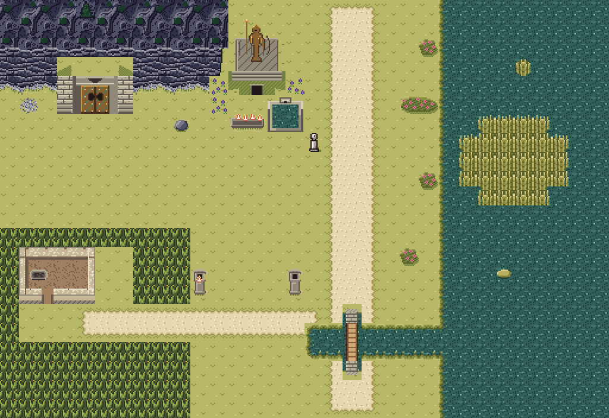

# eurotas tileset catalog

`gTileset_Eurotas` is Route 25, up the Eurotas (Act III, Lakonia; SCRIPT.md Part 10). It serves Route 25. Pair it with the `aethos` primary, which supplies the open grass, paths, sand, sea, olives, cypresses and stone pines.

**This file is generated.** `tools/ichor/art/lakonia_build.py eurotas` paints the tileset, compiles it, registers it and rewrites this catalog. The art is in `tools/ichor/art/lakonia_*.py` (the plane tree is Kythera's), the palette plan, the water and the soft-edge autotiles in `lakonia_lib.py`.

| Image | Shows |
|---|---|
| [`img/eurotas_amyklai.png`](img/eurotas_amyklai.png) | Route 25 at Amyklai: the throne over the tomb, the altar's fire, the spring, the hyacinths, the Vapheio door in the hillside, the river and its reed beds |
| [`img/eurotas_pieces.png`](img/eurotas_pieces.png) | Every structure on its ground |
| [`img/eurotas_sheet.png`](img/eurotas_sheet.png) | The numbered metatile sheet, rendered from the compiled tileset |



It is one of the Lakonia family of secondaries; see [`TILES_lakonia.md`](TILES_lakonia.md) for why the art is split and which seams then need aethos-only strips.

**What comes from aethos (or elsewhere), not from here.** The valley's terrace walls and their ledges are aethos's dry-stone ledges (`TILES_aethos.md`); the west fields' barley is aethos's tall grass and its olives are aethos's; the great herm at Amyklai is aethos's herm (`0x01B`); the reed thicket Demeter's Sickle cuts is an object event (Gen 3 cuts objects, not metatiles), which can stand in a `reeds` bed.

## How to use it

**Ids.** Each grid lists metatile ids as Porymap shows them, row by row. Each section
starts on a fixed row of the sheet (water at 0x200, route at 0x280, land at 0x310). Structures are placed first-fit in build
order, so appending a new one never moves an old one. Map builders should place pieces
by key and name, never by raw id: `tools/ichor/maps/lakonia_tiles.py` holds every
Lakonia-family catalog as a Python dict (`mid('eurotas', 'house', 'door')`, and
`blob_key(mask, x, y)` for the soft-edged pieces), and `build/eurotas/catalog.json` is
the same as JSON.

**Walk codes** (the grid beside each structure, and the cell tables):

| Code | Meaning |
|---|---|
| `X` | Impassable: set collision 1. |
| `.` | Passable. |
| `T` | Passable, drawn over the player, who walks behind it. |
| `G` | Tall grass: `MB_TALL_GRASS`, wild encounters. Passable. |
| `D` | Door: `MB_NON_ANIMATED_DOOR`. Put the warp here. |
| `W` | Sea: `MB_OCEAN_WATER`, surfable (collision 0). |
| `P` | Fresh water: `MB_POND_WATER`, surfable. |
| `C` | A sea current: `MB_WESTWARD_CURRENT`, surfable. |
| `J` | Ledge: `MB_JUMP_SOUTH`. |

**Soft-edged pieces** (`yard`, `sands`, `river`, `reeds`, `marsh`, `marsh_reeds`,
`curtain`, `scree`...) are drawn as all 47 blob shapes and named by shape key: `1|`
then the cell's N NE E SE S SW W NW neighbours (1 = in the region; a diagonal counts
only when both its sides do). `blob_key(mask, x, y)` in `lakonia_tiles.py` computes it.
Each 8x8 quadrant depends only on its own two sides and corner, so a whole set costs
about a dozen tiles.

**Borrowed ground.** Cells marked *grass*, *path*, *sand*, *sea* or *shallow* draw
no ground of their own: after Porytiles compiles, the build points their bottom-layer
tiles at aethos's grass (`0x001`), limestone path (`0x1D9`), sand (`0x124`), animated
sea (`0x170`) or animated turquoise shallows (`0x0D1`). They meet aethos ground exactly
and cost no tiles. Rebuild whenever aethos is repainted. A borrowed cell's own art is
in one layer: the middle (`COVERED`, under the player) or the top (`SPLIT`, over him).

**Fresh water** is Lakonia's own: the Eurotas's slow green water and Stymphalia's black
water are animated textures in the bottom layer of every water cell (the same few
tiles under all of them), with banks, reeds, planks and stone on the middle layer.

**Animations.** Porytiles animations in this tileset, driven by `InitTilesetAnim_PorytilesManaged_Eurotas` (`include/porytiles_generated/tilesets/eurotas/generated_anim_code.h`): `eurotas`: the river's slow ripples drifting (3 frames); `flame`: fire in an altar, a hearth or a herm-shrine's lamp (3 frames). Every 8x8 tile that changes between frames is an animated tile; frame 0 is the key drawn in the sheet. Borrowed sea and shallows keep aethos's own animations.

**Layer types** in the cell tables: `NORMAL` (bottom and middle under the player),
`COVERED` (ground under the middle layer), `SPLIT` (ground under, art over the player).

**Palettes.** Every 8x8 tile, in every animation frame, draws from one of seven color
groups, one per secondary palette (`lakonia_lib.GROUPS`), passed to Porytiles as packing
hints:

| Group | Use |
|---|---|
| red | Lakonian red and bronze: cloaks, shields, doors, awnings, the bronze gods |
| stone | Plain stone, plaster and clay roofs: houses, the stoa, stelai, bridges, the causeway |
| vegb | Trees with Route 25's flowers: hyacinths and oleander |
| river | The Eurotas: green water, its banks, reeds and pink oleander |
| mount | Taygetos and the Skiritis: dark rock, scree, black pine; Malea's foam |
| wood | Timber and thatch: boardwalks, the stilt hut, racks, the barracks' roof, posts |

**Tile budget.** 323 of 504 tiles (296 metatiles). The door animations copy their
frames into tiles 504-511 (`DOOR_TILE_START_SIZE1`, `src/field_door.c`), so the build
fails past 504. Static tiles within two pixels of one another are merged.

**Scripted swaps.** The build writes the ids scripts swap to the `gTileset_Eurotas` block at the end of `include/constants/metatile_labels.h`: `METATILE_Eurotas_Hearth_Lit_L`, `METATILE_Eurotas_Hearth_Lit_R`, `METATILE_Eurotas_Hearth_L`, `METATILE_Eurotas_Hearth_R`, `METATILE_Eurotas_FarmRoof_TL`, `METATILE_Eurotas_Shrine_Lit`, `METATILE_Eurotas_Shrine_Unlit`, `METATILE_Eurotas_VapheioDoor_TL`, `METATILE_Eurotas_VapheioOpen_TL`, `METATILE_Eurotas_Reeds`.

## Fresh water

### The Eurotas: green water, soft banks

`river`, 8 wide by 7 tall. The Eurotas, the Platanistas's moat and every stream: slow green water (animated) between soft grass banks with a fringe of reeds, as all 47 soft-edge shapes; kythera_lib.blob_key gives a cell's key from a water mask, and `1|11111111` is open water. Every cell is fresh water (`MB_POND_WATER`, surfable; fish from the bank). Extra open-water cells: `rock`, a flat rock the fisher stands on (impassable); `ford`, stepping stones across a side stream (walkable: lay a line of them); `tuft`, a clump of reeds in midstream (impassable).

Shape keys (`blob_key`) and their ids:

| Shape key | Id |
|---|---|
| `1|00000000` | 0x200 |
| `1|00000010` | 0x201 |
| `1|00001000` | 0x202 |
| `1|00001010` | 0x203 |
| `1|00001110` | 0x204 |
| `1|00100000` | 0x205 |
| `1|00100010` | 0x206 |
| `1|00101000` | 0x207 |
| `1|00101010` | 0x208 |
| `1|00101110` | 0x209 |
| `1|00111000` | 0x20A |
| `1|00111010` | 0x20B |
| `1|00111110` | 0x20C |
| `1|10000000` | 0x20D |
| `1|10000010` | 0x20E |
| `1|10000011` | 0x20F |
| `1|10001000` | 0x210 |
| `1|10001010` | 0x211 |
| `1|10001011` | 0x212 |
| `1|10001110` | 0x213 |
| `1|10001111` | 0x214 |
| `1|10100000` | 0x215 |
| `1|10100010` | 0x216 |
| `1|10100011` | 0x217 |
| `1|10101000` | 0x218 |
| `1|10101010` | 0x219 |
| `1|10101011` | 0x21A |
| `1|10101110` | 0x21B |
| `1|10101111` | 0x21C |
| `1|10111000` | 0x21D |
| `1|10111010` | 0x21E |
| `1|10111011` | 0x21F |
| `1|10111110` | 0x220 |
| `1|10111111` | 0x221 |
| `1|11100000` | 0x222 |
| `1|11100010` | 0x223 |
| `1|11100011` | 0x224 |
| `1|11101000` | 0x225 |
| `1|11101010` | 0x226 |
| `1|11101011` | 0x227 |
| `1|11101110` | 0x228 |
| `1|11101111` | 0x229 |
| `1|11111000` | 0x22A |
| `1|11111010` | 0x22B |
| `1|11111011` | 0x22C |
| `1|11111110` | 0x22D |
| `1|11111111` | 0x22E |

Every shape cell: walk `P`, `MB_POND_WATER`.

Extra cells:

| Id | Piece | Walk | Behavior | Layer |
|---|---|---|---|---|
| 0x22F | `rock` | `X` | `MB_NORMAL` | COVERED |
| 0x230 | `ford` | `.` | `MB_NORMAL` | COVERED |
| 0x231 | `tuft` | `X` | `MB_NORMAL` | COVERED |

### Eurotas reed beds in the shallows (tall grass)

`reeds`, 8 wide by 6 tall. The reed beds the agoge's boys cut barehanded for their beds: dense reeds standing in the river's green water, as all 47 soft-edge shapes (the region is the reeds; open water round it is `river`'s `1|11111111`). `MB_TALL_GRASS`: walk in, knee-deep, and meet Pokémon. Also the Sickle's reed thicket on Route 25, and Orthia's marshy bank.

Shape keys (`blob_key`) and their ids:

| Shape key | Id |
|---|---|
| `1|00000000` | 0x238 |
| `1|00000010` | 0x239 |
| `1|00001000` | 0x23A |
| `1|00001010` | 0x23B |
| `1|00001110` | 0x23C |
| `1|00100000` | 0x23D |
| `1|00100010` | 0x23E |
| `1|00101000` | 0x23F |
| `1|00101010` | 0x240 |
| `1|00101110` | 0x241 |
| `1|00111000` | 0x242 |
| `1|00111010` | 0x243 |
| `1|00111110` | 0x244 |
| `1|10000000` | 0x245 |
| `1|10000010` | 0x246 |
| `1|10000011` | 0x247 |
| `1|10001000` | 0x248 |
| `1|10001010` | 0x249 |
| `1|10001011` | 0x24A |
| `1|10001110` | 0x24B |
| `1|10001111` | 0x24C |
| `1|10100000` | 0x24D |
| `1|10100010` | 0x24E |
| `1|10100011` | 0x24F |
| `1|10101000` | 0x250 |
| `1|10101010` | 0x251 |
| `1|10101011` | 0x252 |
| `1|10101110` | 0x253 |
| `1|10101111` | 0x254 |
| `1|10111000` | 0x255 |
| `1|10111010` | 0x256 |
| `1|10111011` | 0x257 |
| `1|10111110` | 0x258 |
| `1|10111111` | 0x259 |
| `1|11100000` | 0x25A |
| `1|11100010` | 0x25B |
| `1|11100011` | 0x25C |
| `1|11101000` | 0x25D |
| `1|11101010` | 0x25E |
| `1|11101011` | 0x25F |
| `1|11101110` | 0x260 |
| `1|11101111` | 0x261 |
| `1|11111000` | 0x262 |
| `1|11111010` | 0x263 |
| `1|11111011` | 0x264 |
| `1|11111110` | 0x265 |
| `1|11111111` | 0x266 |

Every shape cell: walk `G`, `MB_TALL_GRASS`.

### Oleander

`oleander`, 3 wide by 1 tall. Pink oleander, the riverbank shrub: `bush`, and a two-cell thicket `thicket_L` `thicket_R`. Impassable, on borrowed grass. Poisonous; the goats know.

```text
ids                    walk
0x268 0x269 0x26A   X X X
```

| Id | Piece | Walk | Behavior | Layer | Ground |
|---|---|---|---|---|---|
| 0x268 | `bush` | `X` | `MB_NORMAL` | COVERED | grass |
| 0x269 | `thicket_L` | `X` | `MB_NORMAL` | COVERED | grass |
| 0x26A | `thicket_R` | `X` | `MB_NORMAL` | COVERED | grass |

### The plain stone bridge, and footbridges

`bridge`, 4 wide by 1 tall. Plank footbridges, one cell wide, over the river and its side streams: `foot_V` north-south (ended on the banks by `foot_V_N` `foot_V_S`, stone landings), `foot_H` east-west. Walkable.

```text
ids                          walk
0x26B 0x26C 0x26D 0x26E   . . . .
```

| Id | Piece | Walk | Behavior | Layer | Ground |
|---|---|---|---|---|---|
| 0x26B | `foot_V` | `.` | `MB_NORMAL` | COVERED |  |
| 0x26C | `foot_H` | `.` | `MB_NORMAL` | COVERED |  |
| 0x26D | `foot_V_N` | `.` | `MB_NORMAL` | COVERED |  |
| 0x26E | `foot_V_S` | `.` | `MB_NORMAL` | COVERED |  |

## The road

### The throne of Amyklai

`throne`, 3 wide by 4 tall. Apollo of Amyklai (an object): an old bronze god like a column, helmeted, with spear and bow, seated on a stone throne the size of a house, which stands on the mound of Hyakinthos's tomb. 3 x 4; the god's helmet and spear (top row) are drawn over the player. Put the hyacinths beside the tomb, the altar in front. On borrowed grass at the top corners.

```text
ids                    walk
0x280 0x281 0x282   T T T
0x288 0x289 0x28A   X X X
0x290 0x291 0x292   X X X
0x298 0x299 0x29A   X X X
```

| Id | Piece | Walk | Behavior | Layer | Ground |
|---|---|---|---|---|---|
| 0x280 | `crown_L` | `T` | `MB_NORMAL` | SPLIT | grass |
| 0x281 | `crown` | `T` | `MB_NORMAL` | SPLIT | grass |
| 0x282 | `crown_R` | `T` | `MB_NORMAL` | COVERED | grass |
| 0x288 | `body_L` | `X` | `MB_NORMAL` | COVERED |  |
| 0x289 | `body` | `X` | `MB_NORMAL` | COVERED |  |
| 0x28A | `body_R` | `X` | `MB_NORMAL` | COVERED |  |
| 0x290 | `seat_L` | `X` | `MB_NORMAL` | COVERED |  |
| 0x291 | `seat` | `X` | `MB_NORMAL` | COVERED |  |
| 0x292 | `seat_R` | `X` | `MB_NORMAL` | COVERED |  |
| 0x298 | `tomb_L` | `X` | `MB_NORMAL` | COVERED |  |
| 0x299 | `tomb` | `X` | `MB_NORMAL` | COVERED |  |
| 0x29A | `tomb_R` | `X` | `MB_NORMAL` | COVERED |  |

### Altars: Amyklai's fire, the Phoibaion

`altar`, 4 wide by 1 tall. A long stone altar, 2 x 1. `fire_L` `fire_R`: Amyklai's, where Polyboia keeps the fire (animated): Apollo's daily prayer, and the flame Hestia's test carries. `cold_L` `cold_R`: the Phoibaion on Route 26, the little old altar where the two teams made their offering; its step holds the visible item. On borrowed grass; impassable.

```text
ids                          walk
0x283 0x284 0x285 0x286   X X X X
```

| Id | Piece | Walk | Behavior | Layer | Ground |
|---|---|---|---|---|---|
| 0x283 | `fire_L` | `X` | `MB_NORMAL` | COVERED | grass |
| 0x284 | `fire_R` | `X` | `MB_NORMAL` | COVERED | grass |
| 0x285 | `cold_L` | `X` | `MB_NORMAL` | COVERED | grass |
| 0x286 | `cold_R` | `X` | `MB_NORMAL` | COVERED | grass |

### A spring in a stone basin

`spring`, 2 wide by 2 tall. A spring welling into a stone basin under a carved spout, 2 x 2: Amyklai's spring beside the throne and the Karyai spring under the walnuts (both heal: put the bg event on the basin). The water is the Eurotas's, animated. Impassable; on borrowed grass outside the kerb.

```text
ids              walk
0x28B 0x28C   X X
0x293 0x294   X X
```

| Id | Piece | Walk | Behavior | Layer | Ground |
|---|---|---|---|---|---|
| 0x28B | `TL` | `X` | `MB_NORMAL` | COVERED |  |
| 0x28C | `TR` | `X` | `MB_NORMAL` | COVERED |  |
| 0x293 | `BL` | `X` | `MB_NORMAL` | COVERED |  |
| 0x294 | `BR` | `X` | `MB_NORMAL` | COVERED |  |

### Roadside herm-shrines

`herm_shrine`, 2 wide by 2 tall. A roadside herm-shrine: a stone pillar with a little roofed niche for a lamp, 1 x 2 (the top drawn over the player, the base impassable). `lit` (the lamp burning, animated) and `unlit`; Hestia's test relights a carried flame at a lit one (swap `lit` over `unlit`). On borrowed grass.

```text
ids              walk
0x28D 0x28E   T T
0x295 0x296   X X
```

| Id | Piece | Walk | Behavior | Layer | Ground |
|---|---|---|---|---|---|
| 0x28D | `lit` | `T` | `MB_NORMAL` | SPLIT | grass |
| 0x28E | `unlit` | `T` | `MB_NORMAL` | SPLIT | grass |
| 0x295 | `lit_base` | `X` | `MB_NORMAL` | COVERED | grass |
| 0x296 | `unlit_base` | `X` | `MB_NORMAL` | COVERED | grass |

### The roofless farmhouse

`farmhouse`, 4 wide by 5 tall. Hestia's theoxenia (E2): a farmhouse in the west fields with its roof beams taken by the Titans, 4 x 3: thick mudbrick walls seen from above round an open room, the cold hearth in its middle (`hearth_L` `hearth_R`, the bg event), the doorway in the front wall (`door`, walkable: the room is part of the map). `hearth_lit`'s two cells are the hearth burning: swap them in after Hestia's visit. `roof_*` (4 x 2) is the roof the farmer rebuilds after the climax: swap it over the top two rows. Walls impassable.

```text
ids                          walk
0x29B 0x29C 0x29D 0x29E   X X X X
0x2A3 0x2A4 0x2A5 0x2A6   X . . X
0x2AB 0x2AC 0x2AD 0x2AE   X D X X
0x2B3 0x2B4 0x2B5 0x2B6   X X X X
0x2BB 0x2BC 0x2BD 0x2BE   X X X X
```

| Id | Piece | Walk | Behavior | Layer | Ground |
|---|---|---|---|---|---|
| 0x29B | `back_L` | `X` | `MB_NORMAL` | COVERED |  |
| 0x29C | `back` | `X` | `MB_NORMAL` | COVERED |  |
| 0x29D | `back_b` | `X` | `MB_NORMAL` | COVERED |  |
| 0x29E | `back_R` | `X` | `MB_NORMAL` | COVERED |  |
| 0x2A3 | `room_L` | `X` | `MB_NORMAL` | COVERED |  |
| 0x2A4 | `hearth_L` | `.` | `MB_NORMAL` | COVERED |  |
| 0x2A5 | `hearth_R` | `.` | `MB_NORMAL` | COVERED |  |
| 0x2A6 | `room_R` | `X` | `MB_NORMAL` | COVERED |  |
| 0x2AB | `front_L` | `X` | `MB_NORMAL` | COVERED |  |
| 0x2AC | `door` | `D` | `MB_NORMAL` | COVERED |  |
| 0x2AD | `front` | `X` | `MB_NORMAL` | COVERED |  |
| 0x2AE | `front_R` | `X` | `MB_NORMAL` | COVERED |  |
| 0x2B3 | `roof_BL` | `X` | `MB_NORMAL` | COVERED |  |
| 0x2B4 | `roof_B` | `X` | `MB_NORMAL` | COVERED |  |
| 0x2B5 | `roof_B2` | `X` | `MB_NORMAL` | COVERED |  |
| 0x2B6 | `roof_BR` | `X` | `MB_NORMAL` | COVERED |  |
| 0x2BB | `roof_FL` | `X` | `MB_NORMAL` | COVERED |  |
| 0x2BC | `roof_F` | `X` | `MB_NORMAL` | COVERED |  |
| 0x2BD | `roof_F2` | `X` | `MB_NORMAL` | COVERED |  |
| 0x2BE | `roof_FR` | `X` | `MB_NORMAL` | COVERED |  |

### The farmhouse hearth, burning

`hearth_lit`, 2 wide by 1 tall. The farmhouse's hearth after Hestia's visit, burning steadily (animated; rain never reaches it): swap `lit_L` `lit_R` over `farmhouse`'s `hearth_L` `hearth_R`. Impassable.

```text
ids              walk
0x2A0 0x2A1   X X
```

| Id | Piece | Walk | Behavior | Layer | Ground |
|---|---|---|---|---|---|
| 0x2A0 | `lit_L` | `X` | `MB_NORMAL` | COVERED |  |
| 0x2A1 | `lit_R` | `X` | `MB_NORMAL` | COVERED |  |

### The Vapheio door: a beehive tomb's bronze door

`vapheio`, 6 wide by 3 tall. The Vapheio tholos in the hillside below Amyklai (one of LABYRINTH §9's five Minoan vaults): a grassy mound, a passage of dressed stone cut into it (the dromos), and at its end a bronze door with no handle, only a hollow shaped like a double axe, under a great lintel and its relieving triangle. 4 x 3, impassable. `open_*` (2 x 2) is the door swung in, dark beyond: swap it over `door_*` after the Labrys opens it (its bottom cells are doors, `MB_NON_ANIMATED_DOOR`). The mound's top row stands on borrowed grass.

```text
ids                                      walk
0x2C0 0x2C1 0x2C2 0x2C3 0x2C4 0x2C5   X X X X X X
0x2C8 0x2C9 0x2CA 0x2CB 0x2CC 0x2CD   X X X X X X
0x2D0 0x2D1 0x2D2 0x2D3 0x2D4 0x2D5   X X X X D D
```

| Id | Piece | Walk | Behavior | Layer | Ground |
|---|---|---|---|---|---|
| 0x2C0 | `mound_L` | `X` | `MB_NORMAL` | COVERED | grass |
| 0x2C1 | `mound_TL` | `X` | `MB_NORMAL` | COVERED |  |
| 0x2C2 | `mound_TR` | `X` | `MB_NORMAL` | COVERED |  |
| 0x2C3 | `mound_R` | `X` | `MB_NORMAL` | COVERED | grass |
| 0x2C4 | (4, 0) | `X` | `MB_NORMAL` | COVERED | grass |
| 0x2C5 | (5, 0) | `X` | `MB_NORMAL` | COVERED | grass |
| 0x2C8 | `dromos_L` | `X` | `MB_NORMAL` | COVERED |  |
| 0x2C9 | `door_TL` | `X` | `MB_NORMAL` | COVERED |  |
| 0x2CA | `door_TR` | `X` | `MB_NORMAL` | COVERED |  |
| 0x2CB | `dromos_R` | `X` | `MB_NORMAL` | COVERED |  |
| 0x2CC | `open_TL` | `X` | `MB_NORMAL` | COVERED |  |
| 0x2CD | `open_TR` | `X` | `MB_NORMAL` | COVERED |  |
| 0x2D0 | `steps_L` | `X` | `MB_NORMAL` | COVERED |  |
| 0x2D1 | `door_BL` | `X` | `MB_NORMAL` | COVERED |  |
| 0x2D2 | `door_BR` | `X` | `MB_NORMAL` | COVERED |  |
| 0x2D3 | `steps_R` | `X` | `MB_NORMAL` | COVERED |  |
| 0x2D4 | `open_BL` | `D` | `MB_NON_ANIMATED_DOOR` | COVERED |  |
| 0x2D5 | `open_BR` | `D` | `MB_NON_ANIMATED_DOOR` | COVERED |  |

### Hyacinths

`flowers`, 2 wide by 1 tall. Hyacinths, dark blue-violet, by the tomb under Amyklai's throne (the object beside the tomb): AI AI written on their petals. Walkable, on borrowed grass.

```text
ids              walk
0x2A8 0x2A9   . .
```

| Id | Piece | Walk | Behavior | Layer | Ground |
|---|---|---|---|---|---|
| 0x2A8 | `hyacinths` | `.` | `MB_NORMAL` | COVERED | grass |
| 0x2A9 | `hyacinths_b` | `.` | `MB_NORMAL` | COVERED | grass |

### Plane tree and apple trees

`plane`, 3 wide by 3 tall. The oriental plane (3 x 3), Lakonia's tree: a broad crown of maple-like leaves over a mottled pale trunk, on borrowed grass. Its top row is drawn over the player (`T`); the rest is impassable. (Kythera's painter: `kythera_land.trees`.)

```text
ids                    walk
0x2D8 0x2D9 0x2DA   T T T
0x2E0 0x2E1 0x2E2   X X X
0x2E8 0x2E9 0x2EA   X X X
```

| Id | Piece | Walk | Behavior | Layer | Ground |
|---|---|---|---|---|---|
| 0x2D8 | `plane_00` | `T` | `MB_NORMAL` | SPLIT | grass |
| 0x2D9 | `plane_10` | `T` | `MB_NORMAL` | SPLIT | grass |
| 0x2DA | `plane_20` | `T` | `MB_NORMAL` | SPLIT | grass |
| 0x2E0 | `plane_01` | `X` | `MB_NORMAL` | COVERED | grass |
| 0x2E1 | `plane_11` | `X` | `MB_NORMAL` | COVERED | grass |
| 0x2E2 | `plane_21` | `X` | `MB_NORMAL` | COVERED | grass |
| 0x2E8 | `plane_02` | `X` | `MB_NORMAL` | COVERED | grass |
| 0x2E9 | `plane_12` | `X` | `MB_NORMAL` | COVERED | grass |
| 0x2EA | `plane_22` | `X` | `MB_NORMAL` | COVERED | grass |

## The land

### Taygetos: the dark wall

`taygetos`, 8 wide by 3 tall. The mountain wall behind Lakonia, and the rock walls of the hill routes. Fill the mountain's body with `mass_00` `mass_10` / `mass_01` `mass_11`, a 2 x 2 block that tiles (put `mass_XY` at x % 2, y % 2; `mass_pine` breaks it up). A south-facing wall is `lip` over `face` over `foot`, the foot standing on grass (`_b` are variants to break a long run; `_L` `_R` end one); `pine_face` is a face with a black pine on a ledge. `side_E` / `side_W` run north-south down the mountain's east or west flank (with `side_E_foot` / `side_W_foot` where a flank meets a south face's foot row); `back` and `back_NW` `back_NE` finish a free-standing rock's north edge onto grass. `in_E` `in_W` turn a south face's lip into a flank. `gully` and `gully_foot` are a dry watercourse down the face. Loose pieces on grass: `boulder`, `boulders` (impassable), `scree` (walkable). Cape Malea's sea cliffs: `foot_sea` `foot_sea_b`, the face dropping into borrowed sea with foam at its foot, and `stack`, a dark rock standing in the sea. All impassable except `scree`.

```text
ids                                                  walk
0x310 0x311 0x312 0x313 0x314 0x315 0x316 0x317   X X X X X X X X
0x318 0x319 0x31A 0x31B 0x31C 0x31D 0x31E 0x31F   X X X X X X X X
0x320 0x321 0x322 0x323 0x324 0x325 0x326 0x327   X X . . . . . .
```

| Id | Piece | Walk | Behavior | Layer | Ground |
|---|---|---|---|---|---|
| 0x310 | `mass_00` | `X` | `MB_NORMAL` | COVERED |  |
| 0x311 | `mass_10` | `X` | `MB_NORMAL` | COVERED |  |
| 0x312 | `mass_01` | `X` | `MB_NORMAL` | COVERED |  |
| 0x313 | `mass_11` | `X` | `MB_NORMAL` | COVERED |  |
| 0x314 | `mass_pine` | `X` | `MB_NORMAL` | COVERED |  |
| 0x315 | `lip` | `X` | `MB_NORMAL` | COVERED |  |
| 0x316 | `lip_b` | `X` | `MB_NORMAL` | COVERED |  |
| 0x317 | `lip_L` | `X` | `MB_NORMAL` | COVERED |  |
| 0x318 | `lip_R` | `X` | `MB_NORMAL` | COVERED |  |
| 0x319 | `face` | `X` | `MB_NORMAL` | COVERED |  |
| 0x31A | `face_b` | `X` | `MB_NORMAL` | COVERED |  |
| 0x31B | `face_L` | `X` | `MB_NORMAL` | COVERED |  |
| 0x31C | `face_R` | `X` | `MB_NORMAL` | COVERED |  |
| 0x31D | `foot` | `X` | `MB_NORMAL` | COVERED | grass |
| 0x31E | `foot_b` | `X` | `MB_NORMAL` | COVERED | grass |
| 0x31F | `foot_L` | `X` | `MB_NORMAL` | COVERED | grass |
| 0x320 | `foot_R` | `X` | `MB_NORMAL` | COVERED | grass |
| 0x321 | `boulder` | `X` | `MB_NORMAL` | COVERED | grass |
| 0x322 | `scree` | `.` | `MB_NORMAL` | COVERED | grass |
| 0x323 | (3, 2) | `.` | `MB_NORMAL` | COVERED | grass |
| 0x324 | (4, 2) | `.` | `MB_NORMAL` | COVERED | grass |
| 0x325 | (5, 2) | `.` | `MB_NORMAL` | COVERED | grass |
| 0x326 | (6, 2) | `.` | `MB_NORMAL` | COVERED | grass |
| 0x327 | (7, 2) | `.` | `MB_NORMAL` | COVERED | grass |
