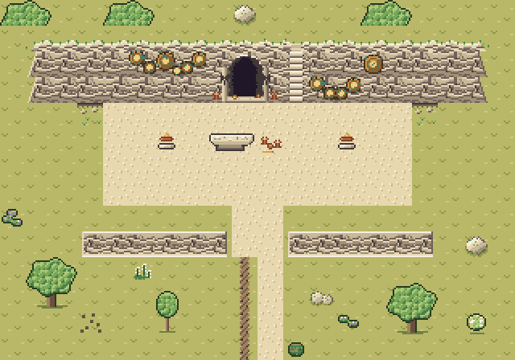

# ida tileset catalog

`gTileset_Ida` is Mount Ida and the caves (Act III, Knossa; LABYRINTH.md §2-§3, §11; SCRIPT.md Part 10). It serves the Ida path (`MAP_KNOSSA_IDA_PATH`), the cradle shrine (`MAP_KNOSSA_CRADLE_SHRINE`), the Idaean Cave (`MAP_KNOSSA_IDAEAN_CAVE`) and the Cave of Eileithyia (`MAP_KNOSSA_CAVE_OF_EILEITHYIA`). Pair it with the `aethos` primary, which supplies the open grass, paths, sand, sea, olives, cypresses, ledges and the Asclepeion and Agora fronts.

**This file is generated.** `tools/ichor/art/knossa_build.py ida` paints the tileset, compiles it, registers it and rewrites this catalog. The art is in `tools/ichor/art/knossa_*.py`, the palette plan in `knossa_lib.py`, what each tileset holds in `knossa_specs.py`; `knossa_scene.py` renders the mock scenes.

| Image | Shows |
|---|---|
| [`img/knossa_ida_path.png`](img/knossa_ida_path.png) | The Ida path: holm oaks and goat pastures, the cradle shrine's forecourt, its shields and cradle-altar, the Idaean Cave's mouth |
| [`img/knossa_caves.png`](img/knossa_caves.png) | The Idaean Cave (Epimenides's ledge, Amalthea's horn) and the Cave of Eileithyia (the birth-stone) |
| [`img/ida_pieces.png`](img/ida_pieces.png) | Every structure on its ground |
| [`img/ida_sheet.png`](img/ida_sheet.png) | The numbered metatile sheet, rendered from the compiled tileset |



It is one of the Knossa family of secondaries; see [`TILES_amnisos.md`](TILES_amnisos.md) for why the art is split and which seams then need aethos-only strips.

## How to use it

**Ids.** Each grid lists metatile ids as Porymap shows them, row by row. Each section
starts on a fixed row of the sheet (ida at 0x200, cave at 0x280). Structures are placed first-fit in build
order, so appending a new one never moves an old one. Map builders should place pieces
by key and name, never by raw id: `tools/ichor/maps/knossa_tiles.py` holds every Knossa
catalog as a Python dict (`mid('ida', 'oaks', 'acorns', ...)`, `place(...)`, `front(...)`),
and `build/ida/catalog.json` is the same as JSON.

**Walk codes** (the grid beside each structure, and the cell tables):

| Code | Meaning |
|---|---|
| `X` | Impassable: set collision 1. |
| `.` | Passable. |
| `T` | Passable, drawn over the player, who walks behind it. |
| `G` | Tall grass: `MB_TALL_GRASS`, wild encounters. Passable. |
| `D` | Door: `MB_NON_ANIMATED_DOOR`. Put the warp here. |
| `W` | Sea: `MB_OCEAN_WATER`, surfable (collision 0). |
| `P` | Fresh water: `MB_POND_WATER`, surfable. |
| `J` | Ledge: `MB_JUMP_SOUTH`. |
| `^` | Ledge down to the north: `MB_JUMP_NORTH`. |
| `S` | Sand: `MB_SAND`. |

**Borrowed ground.** Cells marked *grass*, *path*, *sand*, *sea* or *shallow* draw no
ground of their own: after Porytiles compiles, the build points their bottom-layer tiles
at aethos's grass (`0x001`), limestone path (`0x1D9`), sand (`0x124`), animated sea
(`0x170`) or animated turquoise shallows (`0x0D1`). They meet aethos ground exactly and
cost no tiles. Rebuild whenever aethos is repainted; the build checks every borrowed
entry. A borrowed cell's own art is in one layer: the middle (`COVERED`, under the
player) or the top (`SPLIT`, over the player).

**Animations.** None of its own; the borrowed sea and shallows animate.

**Layer types** in the cell tables: `NORMAL` (bottom and middle under the player),
`COVERED` (ground under the middle layer), `SPLIT` (ground under, art over the player).

**Palettes.** Every 8x8 tile, in every animation frame, draws from one of these color
groups, one per secondary palette (`knossa_lib.GROUPS`), passed to Porytiles as packing
hints:

| Group | Use |
|---|---|
| stone | Cretan limestone on aethos grass: cliffs, terrace and town walls, the goat path |
| green | Vines and grapes, holm oak, phrygana and thyme, on aethos grass |
| bronze | Bronze and verdigris (Talos's foot, the Kouretes' shields, door fittings), and the marble herm |
| minoan | Minoan red, ochre, gypsum, black and terracotta (labyrinth_art's): red columns, black capitals, horns of consecration, labrys marks, pithoi, the houses, the hives |
| cave | The caves' dark limestone, the worn floor, the polished birth-stone |

**Tile budget.** 344 of 504 tiles (176 metatiles). The door animations copy their
frames into tiles 504-511 (`DOOR_TILE_START_SIZE1`, `src/field_door.c`), so the build
fails past 504. Static tiles within two pixels of one another are merged.

## Mount Ida

### Holm oaks, boulders and the goat track

`oaks`, 5 wide by 2 tall. The Ida path's goat pastures (on borrowed grass). **The holm oak**, 2 x 2: `oak_TL` `oak_TR` (its dense evergreen crown, drawn over the player) over `oak_BL` `oak_BR` (the crown's skirt and the grey trunk, impassable). `young_top` over `young`, a young oak. `boulder` and `boulders`, grey limestone on the grass (impassable). Walkable: `acorns`, fallen acorns and leaves under an oak; `goat_track`, a narrow track worn by hooves (lay it in a line).

```text
ids                                walk
0x200 0x201 0x202 0x203 0x204   T T T X .
0x208 0x209 0x20A 0x20B 0x20C   X X X X .
```

| Id | Piece | Walk | Behavior | Layer | Ground |
|---|---|---|---|---|---|
| 0x200 | `oak_TL` | `T` | `MB_NORMAL` | SPLIT | grass |
| 0x201 | `oak_TR` | `T` | `MB_NORMAL` | SPLIT | grass |
| 0x202 | `young_top` | `T` | `MB_NORMAL` | SPLIT | grass |
| 0x203 | `boulder` | `X` | `MB_NORMAL` | COVERED | grass |
| 0x204 | `acorns` | `.` | `MB_NORMAL` | COVERED | grass |
| 0x208 | `oak_BL` | `X` | `MB_NORMAL` | COVERED | grass |
| 0x209 | `oak_BR` | `X` | `MB_NORMAL` | COVERED | grass |
| 0x20A | `young` | `X` | `MB_NORMAL` | COVERED | grass |
| 0x20B | `boulders` | `X` | `MB_NORMAL` | COVERED | grass |
| 0x20C | `goat_track` | `.` | `MB_NORMAL` | COVERED | grass |

### The cradle shrine: the Kouretes' shields, the cradle-altar

`cradle_shrine`, 4 wide by 2 tall. The Idaean Cave's mouth (`MAP_KNOSSA_CRADLE_SHRINE`, SCRIPT.md Part 2), where the Kymbash clang: bronze shields nailed to the rock face, the Kouretes' who clashed them so Kronos would never hear the baby cry. `shields_L` `shields` `shields_R` are a row of the limestone cliff's `face` hung with shields (lay them in a `face` row either side of the cave's mouth, `shield_one` for a single one); the Throat Spray hides behind them. `altar_L` `altar_R`: the stone cradle-altar, a low trough of stone rocked on its base, honey cakes and flowers in it (impassable; bg event). `offerings` (walkable): clay figures, a pot of honey, a bronze pin on the ground before it. `lamp`: an oil lamp on a stone (impassable). The altar row stands on borrowed path, the forecourt's beaten floor; its wall is the `terrace` kit.

```text
ids                          walk
0x210 0x211 0x212 0x213   X X X X
0x218 0x219 0x21A 0x21B   X X . X
```

| Id | Piece | Walk | Behavior | Layer | Ground |
|---|---|---|---|---|---|
| 0x210 | `shields_L` | `X` | `MB_NORMAL` | COVERED |  |
| 0x211 | `shields` | `X` | `MB_NORMAL` | COVERED |  |
| 0x212 | `shields_R` | `X` | `MB_NORMAL` | COVERED |  |
| 0x213 | `shield_one` | `X` | `MB_NORMAL` | COVERED |  |
| 0x218 | `altar_L` | `X` | `MB_NORMAL` | COVERED | path |
| 0x219 | `altar_R` | `X` | `MB_NORMAL` | COVERED | path |
| 0x21A | `offerings` | `.` | `MB_NORMAL` | COVERED | path |
| 0x21B | `lamp` | `X` | `MB_NORMAL` | COVERED | path |

### Low limestone cliffs

`cliff`, 8 wide by 2 tall. Crete's grey-gold limestone, Kythera's cliff kit in Knossa's stone. A cliff whose face looks south is `lip` (the plateau's edge, on borrowed grass) over `face` over a foot: `foot_sea` (borrowed sea, foam breaking at the base, animated), `foot_sand` or `foot_grass` (walkable ground with fallen stones). `_L` / `_R` end a run. Stack `face` rows for a taller cliff. The plateau's other edges: `side_E` (plateau to the west, the drop to the east), `side_W`, `back` (plateau to the south, the drop to the north, the face hidden), `back_NW` / `back_NE`; `corner_in_E` / `_W` turn a south face into a side going north. `seep` is the face where a spring runs out. Lip and face cells are impassable. On Ida, stack two or three `face` rows for the mountain's crags.

```text
ids                                                  walk
0x220 0x221 0x222 0x223 0x224 0x225 0x226 0x227   X X X X X X X X
0x228 0x229 0x22A 0x22B 0x22C 0x22D 0x22E 0x22F   X X X X X X X .
```

| Id | Piece | Walk | Behavior | Layer | Ground |
|---|---|---|---|---|---|
| 0x220 | `lip_L` | `X` | `MB_NORMAL` | COVERED | grass |
| 0x221 | `lip` | `X` | `MB_NORMAL` | COVERED | grass |
| 0x222 | `lip_b` | `X` | `MB_NORMAL` | COVERED | grass |
| 0x223 | `lip_R` | `X` | `MB_NORMAL` | COVERED | grass |
| 0x224 | `face_L` | `X` | `MB_NORMAL` | COVERED | grass |
| 0x225 | `face` | `X` | `MB_NORMAL` | COVERED |  |
| 0x226 | `face_b` | `X` | `MB_NORMAL` | COVERED |  |
| 0x227 | `face_R` | `X` | `MB_NORMAL` | COVERED | grass |
| 0x228 | `side_E` | `X` | `MB_NORMAL` | COVERED | grass |
| 0x229 | `side_W` | `X` | `MB_NORMAL` | COVERED | grass |
| 0x22A | `back` | `X` | `MB_NORMAL` | COVERED | grass |
| 0x22B | `back_NW` | `X` | `MB_NORMAL` | COVERED | grass |
| 0x22C | `back_NE` | `X` | `MB_NORMAL` | COVERED | grass |
| 0x22D | `corner_in_E` | `X` | `MB_NORMAL` | COVERED | grass |
| 0x22E | `corner_in_W` | `X` | `MB_NORMAL` | COVERED | grass |
| 0x22F | `foot_grass` | `.` | `MB_NORMAL` | COVERED | grass |

### The forecourt's wall

`terrace`, 7 wide by 2 tall. The cradle shrine's walled forecourt and the Ida path's field walls, dry-stone limestone (Kythera's terrace kit): a `top_*` row over `L` `M` (`M2`) `R`; `steps` through it; `niche` for a votive.

```text
ids                                            walk
0x230 0x231 0x232 0x233 0x234 0x235 0x236   X X X X . X X
0x238 0x239 0x23A 0x23B 0x23C 0x23D 0x23E   . . . . T . .
```

| Id | Piece | Walk | Behavior | Layer | Ground |
|---|---|---|---|---|---|
| 0x230 | `L` | `X` | `MB_NORMAL` | COVERED | grass |
| 0x231 | `M` | `X` | `MB_NORMAL` | COVERED |  |
| 0x232 | `M2` | `X` | `MB_NORMAL` | COVERED |  |
| 0x233 | `R` | `X` | `MB_NORMAL` | COVERED | grass |
| 0x234 | `steps` | `.` | `MB_NORMAL` | COVERED |  |
| 0x235 | `niche` | `X` | `MB_NORMAL` | COVERED |  |
| 0x236 | `spout` | `X` | `MB_NORMAL` | COVERED |  |
| 0x238 | `top_L` | `.` | `MB_NORMAL` | COVERED | grass |
| 0x239 | `top` | `.` | `MB_NORMAL` | COVERED | grass |
| 0x23A | `top_M2` | `.` | `MB_NORMAL` | COVERED | grass |
| 0x23B | `top_R` | `.` | `MB_NORMAL` | COVERED | grass |
| 0x23C | `top_steps` | `T` | `MB_NORMAL` | COVERED | grass |
| 0x23D | `top_niche` | `.` | `MB_NORMAL` | COVERED | grass |
| 0x23E | `top_spout` | `.` | `MB_NORMAL` | COVERED | grass |

### The Cave of Eileithyia's mouth, and the goat path

`cave_mouth`, 4 wide by 3 tall. Set into a two-row stretch of the limestone cliff above Amnisos's west end (SCRIPT.md Part 2; stack two `cliff.face` rows either side): the brow (`lip_L` `lip` `lip_R`, on borrowed grass) over `arch_*` over `sill_L` `door` `sill_R`. A low cave mouth, its jambs squared by old hands and cut with double axes; clay figurines, a honey cake and a lamp left on the sill. `door` is `MB_NON_ANIMATED_DOOR`, the warp into the cave. The goat path climbs beside it: `stair_lip` over `stair` over `stair_foot`, rough steps cut up the face (walkable; give them elevation 0, as for stairs).

```text
ids                          walk
0x240 0x241 0x242 0x243   X X X .
0x248 0x249 0x24A 0x24B   X X X .
0x250 0x251 0x252 0x253   X D X .
```

| Id | Piece | Walk | Behavior | Layer | Ground |
|---|---|---|---|---|---|
| 0x240 | `lip_L` | `X` | `MB_NORMAL` | COVERED | grass |
| 0x241 | `lip` | `X` | `MB_NORMAL` | COVERED | grass |
| 0x242 | `lip_R` | `X` | `MB_NORMAL` | COVERED | grass |
| 0x243 | `stair_lip` | `.` | `MB_NORMAL` | COVERED | grass |
| 0x248 | `arch_L` | `X` | `MB_NORMAL` | COVERED |  |
| 0x249 | `arch` | `X` | `MB_NORMAL` | COVERED |  |
| 0x24A | `arch_R` | `X` | `MB_NORMAL` | COVERED |  |
| 0x24B | `stair` | `.` | `MB_NORMAL` | COVERED |  |
| 0x250 | `sill_L` | `X` | `MB_NORMAL` | COVERED |  |
| 0x251 | `door` | `D` | `MB_NON_ANIMATED_DOOR` | COVERED |  |
| 0x252 | `sill_R` | `X` | `MB_NORMAL` | COVERED |  |
| 0x253 | `stair_foot` | `.` | `MB_NORMAL` | COVERED |  |

### Phrygana: thyme, sage, spiny burnet, asphodel

`phrygana`, 5 wide by 1 tall. Crete's low scrub on borrowed grass, on the goat pastures, where the bees work. Walkable: `thyme` and `thyme_b` (flowering cushions), `asphodel` (white spikes). Impassable: `sage` (Jerusalem sage, grey leaves), `burnet` (a spiny cushion).

```text
ids                                walk
0x258 0x259 0x25A 0x25B 0x25C   . X X . .
```

| Id | Piece | Walk | Behavior | Layer | Ground |
|---|---|---|---|---|---|
| 0x258 | `thyme` | `.` | `MB_NORMAL` | COVERED | grass |
| 0x259 | `sage` | `X` | `MB_NORMAL` | COVERED | grass |
| 0x25A | `burnet` | `X` | `MB_NORMAL` | COVERED | grass |
| 0x25B | `asphodel` | `.` | `MB_NORMAL` | COVERED | grass |
| 0x25C | `thyme_b` | `.` | `MB_NORMAL` | COVERED | grass |

## The caves

### The cave kit: rock, faces, floors

`cave`, 8 wide by 4 tall. The Idaean Cave and the Cave of Eileithyia: Ida's limestone in the dark. **Rock**: `rock` is the cave's mass seen from above (the border, and every cell that is not cave); a wall facing you is a `face` row under it (`face_b` breaks it up; `face_L` / `face_R` end it); `side_W` (rock to the west) and `side_E` edge the floor; `in_NW` / `in_NE` turn a face into a side, `out_SW` / `out_SE` finish a rock mass's foot. `dark`: a passage on into the dark (impassable, or a warp). **Floor** (walkable): `floor`, `floor_b`, and the path worn by pilgrims' feet, `path` (north-south) and `path_H`; `steps` cut in the floor where it drops (walkable); `glow`, daylight fallen in from the mouth; `drip`, a puddle under a dripping stalactite; `bones`, old offerings' bones (walkable). **Features** (impassable): `stalagmite`, `stalagmites`, `col_top` over `col` (a column where stalactite met stalagmite, its top drawn over the player), `pool_L` `pool_R` (a still black pool), `ledge_L` `ledge_R` (a rock shelf: Epimenides sleeps on it), `rubble`, `shelf` (a low rock shelf for offerings), `crack` (a narrow fissure). `exit`: the cave mouth seen from inside, daylight beyond (`MB_SOUTH_ARROW_WARP`, the warp out).

```text
ids                                                  walk
0x280 0x281 0x282 0x283 0x284 0x285 0x286 0x287   X X X X X X X X
0x288 0x289 0x28A 0x28B 0x28C 0x28D 0x28E 0x28F   . . . . X X X X
0x290 0x291 0x292 0x293 0x294 0x295 0x296 0x297   X X X X X X X X
0x298 0x299 0x29A 0x29B 0x29C 0x29D 0x29E 0x29F   . . X . . . X X
```

| Id | Piece | Walk | Behavior | Layer | Ground |
|---|---|---|---|---|---|
| 0x280 | `rock` | `X` | `MB_NORMAL` | COVERED |  |
| 0x281 | `face_L` | `X` | `MB_NORMAL` | COVERED |  |
| 0x282 | `face` | `X` | `MB_NORMAL` | COVERED |  |
| 0x283 | `face_b` | `X` | `MB_NORMAL` | COVERED |  |
| 0x284 | `face_R` | `X` | `MB_NORMAL` | COVERED |  |
| 0x285 | `side_W` | `X` | `MB_NORMAL` | COVERED |  |
| 0x286 | `side_E` | `X` | `MB_NORMAL` | COVERED |  |
| 0x287 | `dark` | `X` | `MB_NORMAL` | COVERED |  |
| 0x288 | `floor` | `.` | `MB_NORMAL` | COVERED |  |
| 0x289 | `floor_b` | `.` | `MB_NORMAL` | COVERED |  |
| 0x28A | `path` | `.` | `MB_NORMAL` | COVERED |  |
| 0x28B | `path_H` | `.` | `MB_NORMAL` | COVERED |  |
| 0x28C | `in_NW` | `X` | `MB_NORMAL` | COVERED |  |
| 0x28D | `in_NE` | `X` | `MB_NORMAL` | COVERED |  |
| 0x28E | `out_SW` | `X` | `MB_NORMAL` | COVERED |  |
| 0x28F | `out_SE` | `X` | `MB_NORMAL` | COVERED |  |
| 0x290 | `stalagmite` | `X` | `MB_NORMAL` | COVERED |  |
| 0x291 | `stalagmites` | `X` | `MB_NORMAL` | COVERED |  |
| 0x292 | `col_top` | `X` | `MB_NORMAL` | SPLIT |  |
| 0x293 | `pool_L` | `X` | `MB_NORMAL` | COVERED |  |
| 0x294 | `pool_R` | `X` | `MB_NORMAL` | COVERED |  |
| 0x295 | `ledge_L` | `X` | `MB_NORMAL` | COVERED |  |
| 0x296 | `ledge_R` | `X` | `MB_NORMAL` | COVERED |  |
| 0x297 | `rubble` | `X` | `MB_NORMAL` | COVERED |  |
| 0x298 | `exit` | `.` | `MB_SOUTH_ARROW_WARP` | COVERED |  |
| 0x299 | `glow` | `.` | `MB_NORMAL` | COVERED |  |
| 0x29A | `col` | `X` | `MB_NORMAL` | COVERED |  |
| 0x29B | `drip` | `.` | `MB_NORMAL` | COVERED |  |
| 0x29C | `bones` | `.` | `MB_NORMAL` | COVERED |  |
| 0x29D | `steps` | `.` | `MB_NORMAL` | COVERED |  |
| 0x29E | `shelf` | `X` | `MB_NORMAL` | COVERED |  |
| 0x29F | `crack` | `X` | `MB_NORMAL` | COVERED |  |

### Amalthea's horn, Eileithyia's birth-stone

`cave_shrines`, 4 wide by 2 tall. On the cave floor, both 2 x 2 and impassable. **Amalthea's horn** (`horn_*`), at the back of the Idaean Cave: a great goat's horn lying on a rock, brimming with fruit that never rots (bg event: place Capricornus). **The birth-stone** (`stone_*`), at the end of the Cave of Eileithyia: a stalagmite polished smooth by hands inside its little stone wall, tiny clay babies and honey cakes left round it (bg event: Hera Favor; Gennaia stands by it).

```text
ids                          walk
0x2A0 0x2A1 0x2A2 0x2A3   X X X X
0x2A8 0x2A9 0x2AA 0x2AB   X X X X
```

| Id | Piece | Walk | Behavior | Layer | Ground |
|---|---|---|---|---|---|
| 0x2A0 | `horn_TL` | `X` | `MB_NORMAL` | COVERED |  |
| 0x2A1 | `horn_TR` | `X` | `MB_NORMAL` | COVERED |  |
| 0x2A2 | `stone_TL` | `X` | `MB_NORMAL` | COVERED |  |
| 0x2A3 | `stone_TR` | `X` | `MB_NORMAL` | COVERED |  |
| 0x2A8 | `horn_BL` | `X` | `MB_NORMAL` | COVERED |  |
| 0x2A9 | `horn_BR` | `X` | `MB_NORMAL` | COVERED |  |
| 0x2AA | `stone_BL` | `X` | `MB_NORMAL` | COVERED |  |
| 0x2AB | `stone_BR` | `X` | `MB_NORMAL` | COVERED |  |
