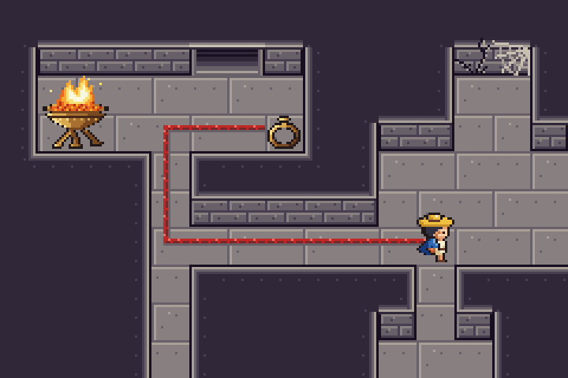
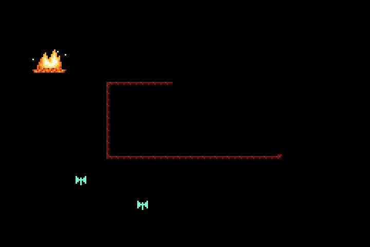

# Labyrinth tilesets: `labyrinth` and `mychos`

Daedalus's Labyrinth under Knossa (LABYRINTH.md §4-§11). This file is the `labyrinth`
tileset's catalog and the plan for both; `TILES_mychos.md` is its sister's catalog.

- **The house**: the workshop's slab floor, the vaulted arcade, and now the rings' corridor
  walls as an autotile, the bronze anchor rings and the stairs from ring to ring.
- **The rings' floor**: the slabs in the dark with Ariadne's thread, 20 twins.
- **Daedalus's workshop** (scenes D and L), unchanged.
- **The outer rings**: Ring I's braziers and threshold hearth, Ring II's sun and moon gates
  and Asterion's cracked walls, Ring III's webs and glow-marks, Ring V's skylight pools,
  niches and the fresco of the dance's steps 4-6; labrys seals and doorways.
- **Minos's tomb** (scene F) and **the Icarus Shaft** (scene L).






| Image | Shows |
|---|---|
| `img/labyrinth_scene_ring.png` | One 15 x 10 screen of a ring: corridors walled with the autotile, the thread laid from a bronze anchor ring to the player, a brazier lit in its alcove, the stair down, a cracked face, webs, glow-marks (by torchlight, the stone) |
| `img/labyrinth_scene_ring_dark.png` | The same as the player sees it: the torch's 3.5-tile radius (flash level 3) and the brazier's zone, lit for good |
| `img/labyrinth_scene_ring_doused.png` | The same with the torch doused (the `glow/` set): the flames, the thread faintly, Daedalus's labrys signs |
| `img/labyrinth_scene_hunt.png`, `_hunt_night.png` | Ring V by day and by night: the loop's corridor, a skylight pool across it (sun, then moon) with the thread through it, niches and the niche shrine, a cracked wall, the fresco of steps 4-6 in a bay |
| `img/labyrinth_scene_tomb.png` | Minos's tomb (scene F): the bier and the cap on it, the inscription, labrys stands, painted pillars, jars, dust and old footprints |
| `img/labyrinth_scene_shaft.png` | The top of the Icarus Shaft with the `dawn/` set (scene L): the courses brightening to the lip and the morning sky |
| `img/labyrinth_scene_workshop.png`, `_dawn.png` | Daedalus's workshop, scenes D and L (the first batch) |
| `img/labyrinth_scene_*_pass1.png`, `_pass2` | The earlier render-and-critique passes; the unsuffixed images are the last |
| `img/labyrinth_pieces.png`, `img/labyrinth_sheet.png` | Every structure as drawn; every metatile with its id, from the compiled tileset, on `oikos` |
| `img/labyrinth_scene_forge.png`, `_choros.png`, `_starry.png` | The sister tileset's scenes (TILES_mychos.md) |

**Two tilesets.** LABYRINTH.md §11 planned one `labyrinth` secondary; with the rings, the
rooms and the heart drawn it needs about 800 tiles, so it is split by map, as Emporion was
with Isthmos. Both draw **the house and the rings' floor at the same metatile ids** (rows
0-12 and 36-38 of the sheet), so a ring's walls, floor, thread twins, anchor rings and
stairs are the same numbers whichever it uses.

| Tileset | Maps |
|---|---|
| `labyrinth` (`gTileset_Labyrinth`) | Ring I (the Threshold), Ring II (the Runner's Ring), Ring III (the Mysteries), Daedalus's workshop, Ring V (the Hunt), Minos's tomb, the Icarus Shaft |
| `mychos` (`gTileset_Mychos`, "the innermost part of a house") | Ring IV (the Masks: the Titans' barracks and mess hall), Ring VI (the Forge: the forge, the Hall of Dials), the archive, the vault, the Mistress's shrine, Ring VII (the Choros), the Starry Chamber |

Both pair with `oikos` (any interior primary works: they use only their own tiles and
palettes 6-12, and every bottom layer is opaque).

## How it is made

- `tools/ichor/art/labyrinth_art.py` holds the palette plan, the house's masonry and the
  sheet's sections for both tilesets; `labyrinth_kit.py` the rings' house kit (walls,
  floors, thread, anchors, stairs); `labyrinth_workshop.py` the workshop;
  `labyrinth_rings.py` the outer rings' fixtures and the fresco painter; `labyrinth_deep.py`
  the tomb and the shaft; `mychos_titans.py` and `mychos_heart.py` the sister's.
- `tools/ichor/art/labyrinth_build.py [labyrinth|mychos|all]` draws, compiles (Porytiles,
  in a scratch project against an empty stand-in primary), registers the tilesets and their
  animations in `src/`, writes the variant palette sets, verifies, and rewrites these files
  and `tools/ichor/maps/labyrinth_tiles.py`. `labyrinth_scene.py` renders the mock scenes.
- Run both with `/usr/bin/python3`.

**Layers.** Floors and walls fill the bottom layer; objects stand in the middle layer over
them, so a piece on the floor costs its object tiles once and its odd twin nothing.
Nothing is drawn over sprites.

**Floor parity.** The slabs are two cells long, in a running bond: `slab_l` / `dark_l`
where x + y is even, `slab_r` / `dark_r` where odd. So every piece standing on a slab floor
comes as **twins**, `<key>` for a top-left cell where x + y is even and `<key>_odd` where
odd; they share every object tile. Where only some rows of a piece show floor, `<key>_odd`
holds just those rows; the catalog says which. `labyrinth_tiles.piece()` picks the twin.

**Walls.** `walls` (house) is an autotile. Every wall cell is a *top* (the masonry's dark
top, rim-lit where it meets a corridor: a dark seam, a lit edge, a bevel) or a *face* (the
wall seen from the south, one row tall: a coping over two courses of ashlar). A face is a
wall cell with floor south of it. Paint a wall/floor grid and let
`labyrinth_tiles.autotile(grid)` choose each cell: tops are named by the sides that meet
floor and their inner corners, faces by their two ends (`o` open, `c` continuing, `i`
meeting a wall that turns down beside them). Walls one cell thick work either way. Rooms
can still take the arcade's three-row north wall (the archive, the forge, the frescoes).

## The rings' floor and Ariadne's thread

**The floor.** The rings are "the same stone in the dark": the workshop's gypsum slabs one
shade down, in the same running bond. **Lay `thread` `dark_l` where x + y is even and
`dark_r` where odd** (`labyrinth_tiles.floor(x, y)`). Ring VII and the Starry Chamber are
starlit marble, `marble` (mychos), one square slab a cell, with no parity.

**The twins.** Each floor is followed by its ten thread twins, in the engine's order
(ENGINE_API.md §6, `src/ichor_labyrinth.c` SHAPE_*): `h`, `v`, `ne`, `nw`, `se`, `sw`,
`cap_n`, `cap_s`, `cap_w`, `cap_e` (corners by the two sides they join, caps by the one). So
a ring's ON_LOAD registers each floor with its first twin right after it:

| Floor | Tileset | Metatile | First twin | Behavior |
|---|---|---|---|---|
| `thread` `dark_l` | labyrinth | 0x320 | 0x321 | MB_NORMAL |
| `thread` `dark_r` | labyrinth | 0x32B | 0x32C | MB_NORMAL |
| `pools` `sun_l` | labyrinth | 0x338 | 0x339 | MB_ICHOR_LIGHT_POOL |
| `pools` `sun_r` | labyrinth | 0x343 | 0x344 | MB_ICHOR_LIGHT_POOL |
| `pools` `moon_l` | labyrinth | 0x34E | 0x34F | MB_ICHOR_LIGHT_POOL |
| `pools` `moon_r` | labyrinth | 0x359 | 0x35A | MB_ICHOR_LIGHT_POOL |
| `pools` `plate` | labyrinth | 0x364 | 0x365 | MB_NORMAL |
| `thread` `dark_l` | mychos | 0x320 | 0x321 | MB_NORMAL |
| `thread` `dark_r` | mychos | 0x32B | 0x32C | MB_NORMAL |
| `marble` `marble` | mychos | 0x350 | 0x351 | MB_NORMAL |

The thread is drawn as an overlay in the middle layer, a twisted two-ply red cord a little
up and left of the cell's middle with its shadow down and right, so every floor's twins
share the same ten thread tiles (the skylight pools' and the marble's cost no thread tiles
of their own). In the glow set the thread shows faintly.

**Every walkable cell of a threaded ring must be a registered floor or a bronze ring.** The
engine lays thread only onto registered floors and anchors; step onto anything else (the
workshop's slabs, dust, a decorated slab) and the thread waits at its end until the player
comes back to it. So every passage a piece opens (a gate, a seal, a dial's wall, a breach)
opens onto plain ring floor for its parity, and decorations stand on cells that block.
Stairs, doorways and the dancing floor are deliberate thread stops.

**Anchors.** `anchor` (house) is a bronze ring lying in its socket: register its cell with
`Ichor_AddThreadAnchor`. Thread is never drawn over it. `anchor_odd` on the odd parity.

## Collision and behaviors

The walk grids below give the collision to paint (`X` blocks, `.` passes, `D` is a door).
Behaviors other than `MB_NORMAL`:

| Behavior | On |
|---|---|
| `MB_ICHOR_LIGHT_POOL` | labyrinth `pools` 0x338-0x363 |
| `MB_NON_ANIMATED_DOOR` | labyrinth `arcade` 0x21C; mychos `arcade` 0x21C; mychos `dance` 0x378 |
| `MB_NORTH_ARROW_WARP` | labyrinth `stairs` 0x234-0x237; mychos `stairs` 0x234-0x237 |
| `MB_PC` | labyrinth `pithos` 0x2C8-0x2C9; labyrinth `pithos_odd` 0x2CA-0x2CB |
| `MB_SOUTH_ARROW_WARP` | labyrinth `edge` 0x225-0x226; mychos `edge` 0x225-0x226 |

Braziers, the hearth, dials, seals, gates, the bell, the lift, the heal bed and the shrine
are scripts on their cells (bg events); the beam is `Ichor_TraceBeam` (mychos).

## Palettes

LABYRINTH.md §11's seven palettes, the same in both tilesets: six slots plus timber and
papyrus, with glow as a palette *variant* set (as planned in the first batch). Every 8x8
tile draws from one group (`labyrinth_art.GROUPS`), all colors multiples of 8.

| Group | §11 name | For |
|---|---|---|
| stone | Dark stone with thread red | The masonry of every map (a cool grey limestone that warms toward the light), the rings' darker slabs, Ariadne's thread (three reds), lamp-warm and dawn-cool light on stone (the skylight pools), and the latent glow paint |
| minoan | Minoan red | Red columns, ochre, gypsum, black capitals, terracotta, horns of consecration, Minos's tomb and bier, the Mistress's shrine |
| fresco | Fresco blue | The dance frescoes, and the Icarus Shaft's dawn sky |
| bronze | Bronze and Titan | Automata, grates, dials, anchor rings, the labrys seal, helmets, shields, the vault's gold; the Titans' slate (their banners) and gold |
| fire | Forge fire | Flames, embers, molten bronze, iron (the anvils), clay (the furnace, the hearth), oak in firelight (bellows, tub). Its three bronze shades are bronze's own, so a brazier's bowl can share a tile with its flame |
| night | Starry night | Ring VII's starlit marble, the beam by night, the dancing floor, the Starry Chamber's black basin, its stars and the star-clock's gold and lapis |
| timber | Timber and papyrus | Benches, tables, bunks, shelves, wax tablets, scrolls |

**Variant sets** (in `porytiles_bin/`, written by the build; load over palettes 6-12):

| Set | Tileset | When | What it does |
|---|---|---|---|
| `glow/` | both | The torch doused (SYSTEMS.md §2) | Black but for the glow paint (the latent `lg`: by torchlight the wall tops' dark stone, doused a pale aqua), the flames, and Ariadne's thread, faint ("your own thread shows faintly when doused"). Daedalus's glow-marks (`glow`, labyrinth) are painted on the wall tops. `gTilesetPalettes_LabyrinthGlow`, `gTilesetPalettes_MychosGlow`. |
| `dawn/` | labyrinth | Scene L: the workshop's dawn, and the Icarus Shaft | Every color dimmed and cooled toward a grey morning but the dawn light (`ld0`, `ld1`) and the first light (`lw1`): the room goes dim and blue and the open shaft blazes. `gTilesetPalettes_LabyrinthDawn`. |

None is wired into the engine yet: world-act3 loads them (one `LoadPalette` over 6-12).

**Animations** (Porytiles, one step every 16 frames; `InitTilesetAnim_PorytilesManaged_*`
in `src/tileset_anims.c`):

| Tileset | Animation | Frames | On |
|---|---|---|---|
| labyrinth | `flame` | 3 | the lit braziers' and the threshold hearth's flames |
| mychos | `flame` | 3 | the Titans' oil lamps |
| mychos | `forge` | 3 | the furnace's mouth |
| mychos | `stars` | 4 (a 16-step twinkle) | the Starry Chamber's water: the star-clock's stars reflected, brightening and fading |

## Tile budget

| Tileset | Tiles used | Of 504 | Left |
|---|---|---|---|
| labyrinth | 492 | 504 | 12 |
| mychos | 495 | 504 | 9 |

The door animations own tiles 504-511, and the build fails past 504. By section (distinct
tiles a section adds, before Porytiles packs palettes; animated tiles counted once):

| Tileset | Section | Tiles |
|---|---|---|
| labyrinth | house | 105 |
| labyrinth | workshop | 192 |
| labyrinth | thread | 10 |
| labyrinth | rings | 109 |
| labyrinth | deep | 75 |
| mychos | house | 105 |
| mychos | titans | 265 |
| mychos | thread | 10 |
| mychos | choros | 57 |
| mychos | heart | 57 |

How they keep to it:
- The thread is an overlay: ten tiles serve every floor's twins.
- Every piece on a slab floor stands in the middle layer, so its odd twin costs nothing
  (the first plan's warm halos round braziers and lamps doubled every twin, and went).
- Patterns repeat on the 8 px grid (the archive's pigeonholes, the inscription's signs, the
  shaft's courses, the grates), and symmetric pieces (the beam, the dancing floor's squares,
  the star-clock's ring, the stairs) are stored once and flipped.
- Cracks, glow-marks and dust are overlay tiles shared by every wall or floor they're on.
- Any tile within two pixels of another is redrawn as that tile.

**Metatiles.** A secondary holds 512: labyrinth uses 490, mychos 355.

## Notes for the ring builders (world-act3)

- **Registering a ring.** In ON_LOAD: `Ichor_AddThreadFloor` for `dark_l` and `dark_r`
  (and Ring V's pool pair, or Ring VII's `marble`), `Ichor_AddThreadAnchor` for each
  `anchor`, `Ichor_AddCrackedWall` for each `cracked` cell with its parity's floor as the
  broken metatile, then draw broken walls and their `breach_l` / `breach_r` edges by flag,
  dials, gates, then `Ichor_DrawThread` last.
- **Ring V's pools.** By day the pools' cells are `pools` `sun_l` / `sun_r`, by night
  `moon_l` / `moon_r` (gettimeofday in ON_LOAD); register whichever pair is down (four
  floors is the engine's limit). Every pool cell and its twins carry `MB_ICHOR_LIGHT_POOL`.
- **Two engine notes.** (1) Thread drawn over a wall the Turning or a dial put on a
  committed tile uses the *first* registered floor's twins whatever the cell's parity, so a
  forced-open cell on an odd cell shows a slab's left half beside another left half: a
  one-line fix in `DrawThreadTile` would pick `dark_r` on odd cells. (2) The beam's
  metatiles (mychos) aren't registered floors, so the thread stops at a lit beam in Ring
  VII's antechamber until the player steps back; the antechamber can stay unthreaded.
- **Darkness.** Rims mark every wall in the torch's radius; every brazier, the hearth, the
  pools and the lamps are landmarks. A lit brazier's zone is a lit zone (SYSTEMS.md §2).
  The GBA's flash window shows one circle, so on a dark ("cave") map a skylight pool
  outside the torch's radius is black like the rest: for Ring V's pools to read as light
  from across the dark (LABYRINTH.md §5.2), make each pool's surround a lit zone, as the
  mock `hunt_night` shows it, or give the ring a lit header with the darkness in its art.

## Weak spots and open questions

- **No sprites yet** for Daedalus, Hyperion, Kronos, Rhea, Asterion, the mirrors or the
  crystal: the scenes stage around them. The mirrors are objects
  (`MOVEMENT_TYPE_ICHOR_MIRROR*`); the tiles give their bases and the beam's corners.
- **The corridor walls are one row tall**, lower than the workshop's three-row arcade:
  readable mazes at the cost of height. Big rooms can use the arcade.
- **Ring floors are uniform**: a threaded ring can't scatter decorated slabs on its walkable
  cells (they'd stop the thread), so its landmarks are the blocking pieces.
- **The Icarus Shaft** is a stylised side view of its back wall, five light levels from the
  grate to the sky; load the `dawn/` set there.
- **Small things at 1x**: the glow-marks, the dance's symbols in the frescoes and the
  inscription's signs are a few pixels; the object text carries them.
- **The budget**: both tilesets have about a dozen tiles left. A third secondary (the
  heart alone) is the release valve.

## Ring by ring

| Ring | Pieces |
|---|---|
| All | `walls` (autotile), `thread` `dark_l` / `dark_r`, `anchor`, `stairs`, `doorways` (jambs, the labrys seal, a grate) |
| I, the Threshold (labyrinth) | `hearth` (the threshold hearth), `brazier` (B1-B5 and the gate brazier G, cold and lit), `doorways` for the fresco door |
| II, the Runner's Ring (labyrinth) | `doorways` `sun` and `moon` (the gates), `grate` (the Long Hall's lattice), `cracked` (scene C's breach), the bronze plates are the floor (scripts) |
| III, the Mysteries (labyrinth) | `webs` (anchors either side of the web objects), `glow` (Daedalus's trail), `brazier` |
| The workshop (labyrinth) | its own section (scenes D and L) |
| IV, the Masks (mychos) | `bunk`, `helmets` (the disguise), `armory`, `mess_table`, `banners`, `lamp_stand` (the sentry posts), `grates`, `fresco_iv` (steps 1-3) |
| V, the Hunt (labyrinth) | `pools` (four skylight pools, sun and moon), `niche` (back, shrine), `cracked` (%1, %2, %3), `fresco_v` (steps 4-6) |
| Minos's tomb (labyrinth) | `tomb_pillar`, `tomb_bier` (the Helm on it; `head_empty`), `tomb_inscription`, `tomb_goods` (labrys stand, jar, dust) |
| VI, the Forge (mychos) | `forge`, `anvil` (Hyperion's), `forge_kit` (bellows, tub, runnels, mold, slag), `dials` (dials A and B, swinging walls, the reset lever), `archive`, `archive_desk`, `vault`, `shrine`, `fresco_vi` (steps 7-9) |
| VII, the Choros (mychos) | `marble`, `beam` (sun and star, mirror bases), `dance` (the 5 x 5 floor and its stair), `fresco_faded` and `fresco_iv`/`_v`/`_vi` (the whole dance) |
| The Starry Chamber (mychos) | `marble`, `basin` (the lustral pool, twinkling), `clock` (the star-clock's ring), `horns`, `star_anvil` |
| The Icarus Shaft (labyrinth) | `icarus` |

## Catalog

Each grid lists metatile ids as Porymap shows them, with the collision beside it. Each section starts on a fixed row of the sheet, so adding to one never renumbers another: house at 0x200, workshop at 0x268, thread at 0x320, rings at 0x338. `build/labyrinth/catalog.json` and `tools/ichor/maps/labyrinth_tiles.py` name every part (`names`), so a map builder can place pieces by key and name, never by raw id. Odd twins are listed with their even twin.

### The house: floors and walls

The masonry every map of the Labyrinth shares, the same at the same ids in `labyrinth` and `mychos`: the workshop's slab floor, the vaulted arcade, the side walls and the threshold; the rings' corridor walls (an autotile), the bronze anchor rings and the stairs from ring to ring.

#### Floor: gypsum slabs in red plaster

`floor`, 8 wide by 1 tall. Long gypsum slabs, two cells by one, in a running bond. **Lay `slab_l` on every cell where x + y is even and `slab_r` where it is odd**, and the slabs line up. (0) the void, near-black: the layout's border and every cell outside the rooms (block it). (3), (4) the two halves in the shadow a north wall casts, for the row in front of it. (5) a left half with a mason's labrys cut in it, the house's mark. (6) a right half, cracked. (7) a left half with an oil stain, for near the benches.

```text
ids                                               walk
0x200 0x201 0x202 0x203 0x204 0x205 0x206 0x207   X . . . . . . .
```

Parts: `void` 0x200, `slab_l` 0x201, `slab_r` 0x202, `shade_l` 0x203, `shade_r` 0x204, `labrys` 0x205, `crack` 0x206, `oil` 0x207.

#### Walls: the vaulted arcade

`arcade`, 8 wide by 3 tall. The north wall of a vaulted room, three rows tall: a pier (column 0), then a three-cell bay (columns 1-3) and its recess, and a pier with the back door cut through it (column 4: the door is (4, 2), MB_NON_ANIMATED_DOOR; put its warp there). Columns 5-7: the side walls' cells (west, east) and a pier carrying a bronze sconce, lit, on its lower face. Lay a wall as pier, bay, pier, bay... A four-cell bay is `arch4`; the Icarus Shaft and the lift use their own bays.

```text
ids                                               walk
0x208 0x209 0x20A 0x20B 0x20C 0x20D 0x20E 0x20F   X X X X X X X X
0x210 0x211 0x212 0x213 0x214 0x215 0x216 0x217   X X X X X X X X
0x218 0x219 0x21A 0x21B 0x21C 0x21D 0x21E 0x21F   X X X X D X X X
```

Door metatiles: 0x21C.

Parts: `pier` 0x208, `bay_l` 0x209, `bay_m` 0x20A, `bay_r` 0x20B, `door_pier` 0x20C, `side_w` 0x20D, `side_e` 0x20E, `pier_sconce` 0x20F.

#### Walls: a four-cell bay

`arch4`, 4 wide by 3 tall. A wider arch and recess for a four-cell bay, symmetric, for the middle of a room. The Icarus Shaft is drawn in a bay of this shape.

```text
ids                       walk
0x220 0x221 0x222 0x223   X X X X
0x228 0x229 0x22A 0x22B   X X X X
0x230 0x231 0x232 0x233   X X X X
```

Parts: `l` 0x220, `ml` 0x221, `mr` 0x222, `r` 0x223.

#### Edges: side walls by the floor, the south threshold

`edge`, 4 wide by 1 tall. (0), (3) the west and east walls beside the floor rows. (1), (2) the threshold down to the rings, for the bottom row, two cells wide: MB_SOUTH_ARROW_WARP, warps on both.

```text
ids                       walk
0x224 0x225 0x226 0x227   X . . X
```

Parts: `wall_w` 0x224, `sill_l` 0x225, `sill_r` 0x226, `wall_e` 0x227.

Behavior: MB_SOUTH_ARROW_WARP on 0x225, 0x226.

#### Walls: the corridor kit, an autotile

`walls`, 8 wide by 6 tall. Every wall cell of a ring is a **top** (the masonry's dark top, rim-lit where it meets a corridor) or a **face** (the wall seen from the south, one row tall; a wall cell with floor south of it). Paint a wall/floor grid and let `labyrinth_tiles.autotile()` pick each cell: a top's name lists the sides that meet floor (`top_nwe`) and its inner corners (`_in_nw`: floor only at that diagonal; `_in_sw`, `_in_se`: the wall turns down beside a face there); a face's two letters are its west and east ends: `o` open (the wall ends, its edge shows), `c` continuing, `i` meeting a wall that turns down beside it. `top` is solid rock: fill everything outside the rings with it. Walls one cell thick work both ways: a row of faces, or a column of `top_we` ending in `face_oo`. All block.

```text
ids                                               walk
0x238 0x239 0x23A 0x23B 0x23C 0x23D 0x23E 0x23F   X X X X X X X X
0x240 0x241 0x242 0x243 0x244 0x245 0x246 0x247   X X X X X X X X
0x248 0x249 0x24A 0x24B 0x24C 0x24D 0x24E 0x24F   X X X X X X X X
0x250 0x251 0x252 0x253 0x254 0x255 0x256 0x257   X X X X X X X X
0x258 0x259 0x25A 0x25B 0x25C 0x25D 0x25E 0x25F   X X X X X X X X
0x260 0x261 0x262 0x263 0x264 0x265 0x266 0x267   X X X X X X X X
```

Parts: `top` 0x238, `top_in_nw` 0x239, `top_in_ne` 0x23A, `top_in_nw_ne` 0x23B, `top_in_sw` 0x23C, `top_in_nw_sw` 0x23D, `top_in_ne_sw` 0x23E, `top_in_nw_ne_sw` 0x23F, `top_in_se` 0x240, `top_in_nw_se` 0x241, `top_in_ne_se` 0x242, `top_in_nw_ne_se` 0x243, `top_in_sw_se` 0x244, `top_in_nw_sw_se` 0x245, `top_in_ne_sw_se` 0x246, `top_in_nw_ne_sw_se` 0x247, `top_e` 0x248, `top_e_in_nw` 0x249, `top_e_in_sw` 0x24A, `top_e_in_nw_sw` 0x24B, `top_w` 0x24C, `top_w_in_ne` 0x24D, `top_w_in_se` 0x24E, `top_w_in_ne_se` 0x24F, `top_we` 0x250, `top_n` 0x251, `top_n_in_sw` 0x252, `top_n_in_se` 0x253, `top_n_in_sw_se` 0x254, `top_ne` 0x255, `top_ne_in_sw` 0x256, `top_nw` 0x257, `top_nw_in_se` 0x258, `top_nwe` 0x259, `face_oo` 0x25A, `face_oc` 0x25B, `face_oi` 0x25C, `face_co` 0x25D, `face_cc` 0x25E, `face_ci` 0x25F, `face_io` 0x260, `face_ic` 0x261, `face_ii` 0x262.

#### A bronze anchor ring in the floor

`anchor`, 1 wide by 1 tall. A bronze ring lying in its socket, where the thread is tied off: register its cell with `Ichor_AddThreadAnchor`. Walkable; thread is never drawn over it. `anchor_odd` where x + y is odd.

```text
ids     walk
0x22C   .
```

Parts: `ring` 0x22C.

`anchor_odd`: the odd twin, ids 0x22D.

#### Stairs from ring to ring

`stairs`, 4 wide by 1 tall. Two stairways, each two cells wide, for a face row: (0, 1) the stair **down** to the next ring, its steps dropping away into the dark; (2, 3) the stair **up** to the last, its steps climbing toward lamplight. MB_NORTH_ARROW_WARP on all four: put a warp on each cell. Their ends meet the face's open ends, so lay them in a run of faces.

```text
ids                       walk
0x234 0x235 0x236 0x237   . . . .
```

Parts: `down_l` 0x234, `down_r` 0x235, `up_l` 0x236, `up_r` 0x237.

Behavior: MB_NORTH_ARROW_WARP on 0x234, 0x235, 0x236, 0x237.

### Daedalus's workshop

The hub at the end of Ring III (LABYRINTH.md §6, scenes D and L).

#### Automaton: a bronze handmaid

`auto_kore`, 1 wide by 2 tall. A bronze handmaid in a Minoan tiered skirt on her slate plinth, tied at the ankles to a ring in it: Daedalus's statues had to be tied down or they'd walk off. Put the object text on the base.

```text
ids     walk
0x268   X
0x270   X
```

Parts: `top` 0x268, `base` 0x270.

`auto_kore_odd`: the odd twin, ids 0x269; 0x271.

#### Automaton: a bronze youth

`auto_kouros`, 1 wide by 2 tall. A bronze youth in a belted kilt, tied to his plinth.

```text
ids     walk
0x26A   X
0x272   X
```

Parts: `top` 0x26A, `base` 0x272.

`auto_kouros_odd`: the odd twin, ids 0x26B; 0x273.

#### Automaton: Number Four, the bronze hound

`auto_hound`, 1 wide by 2 tall. Number Four (IIII on her plinth, Attic numerals): a bronze hound sitting, jaws a little open, one amber eye. "Don't touch Number Four. She bites."

```text
ids     walk
0x26C   X
0x274   X
```

Parts: `top` 0x26C, `base` 0x274.

`auto_hound_odd`: the odd twin, ids 0x26D; 0x275.

#### Automaton: a lamp-bearer, lit

`auto_lamp`, 1 wide by 2 tall. A bronze youth holding up a lit clay lamp: the workshop's lights, as Homer's golden youths lit Alkinoos's hall. The flame is in the fire palette (it stays lit in the glow set).

```text
ids     walk
0x26E   X
0x276   X
```

Parts: `top` 0x26E, `base` 0x276.

`auto_lamp_odd`: the odd twin, ids 0x26F; 0x277.

#### Automaton: a lamp-bearer, burned out

`auto_lamp_cold`, 1 wide by 2 tall. The lamp-bearer at dawn (scene L): the lamp burned out.

```text
ids     walk
0x278   X
0x280   X
```

Parts: `top` 0x278, `base` 0x280.

`auto_lamp_cold_odd`: the odd twin, ids 0x279; 0x281.

#### Automaton: unfinished, on its stand

`auto_open`, 1 wide by 2 tall. A headless automaton on an iron stand, its chest open on its gears, one arm hung on a peg.

```text
ids     walk
0x27A   X
0x282   X
```

Parts: `top` 0x27A, `base` 0x282.

`auto_open_odd`: the odd twin, ids 0x27B; 0x283.

#### Automaton plinth: Number Three's, empty

`plinth_three`, 1 wide by 2 tall. III: Number Three's plinth, its rope untied. He is out in the web maze, a trainer (LABYRINTH.md §6, Ring III).

```text
ids     walk
0x27C   .
0x284   X
```

Parts: `top` 0x27C, `base` 0x284.

`plinth_three_odd`: the odd twin, ids 0x27D; 0x285.

#### Automaton plinth: Number Seven's, empty

`plinth_seven`, 1 wide by 2 tall. Attic seven: Number Seven, the other trainer in the maze.

```text
ids     walk
0x27E   .
0x286   X
```

Parts: `top` 0x27E, `base` 0x286.

`plinth_seven_odd`: the odd twin, ids 0x27F; 0x287.

#### Automaton plinth: Number Nine's, empty

`plinth_nine`, 1 wide by 2 tall. Number Nine's plinth, its rope cut: he walked off to Emporion a year ago (seed 4). The top cell is walkable floor.

```text
ids     walk
0x288   .
0x290   X
```

Parts: `top` 0x288, `base` 0x290.

`plinth_nine_odd`: the odd twin, ids 0x289; 0x291.

#### Workbench: four cells, the collar on it

`bench`, 4 wide by 2 tall. Daedalus's bench, four cells wide (top row the top, bottom row the front). Perdix's saw and a mallet at (0, 0); the collar lies across (1, 0) and (2, 0). At dawn (scene L) the collar is gone: put `bench_parts` `cloth_l` and `cloth_r` there. Any length: `bench_parts` has a plain top and fronts.

```text
ids                       walk
0x28A 0x28B 0x28C 0x28D   X X X X
0x292 0x293 0x294 0x295   X X X X
```

Parts: `tools` 0x28A, `collar_l` 0x28B, `collar_r` 0x28C, `top_r` 0x28D, `front_l` 0x292, `front_m` 0x293, `front_m2` 0x294, `front_r` 0x295.

`bench_odd`: the odd twin of row 1, ids 0x298 0x299 0x29A 0x29B.

#### Workbench parts: plain, the cloth, the vise

`bench_parts`, 4 wide by 2 tall. For benches of any length, and for scene L. Row 0: a plain top (0), the polishing cloth left spread where the collar lay (1, 2: the collar is gone at dawn), and a top with a vise holding a bronze hand (3). Row 1: the plain front (0) and the left and right ends' fronts (1, 2), and the plain front again (3).

```text
ids                       walk
0x29C 0x29D 0x29E 0x29F   X X X X
0x2A4 0x2A5 0x2A6 0x2A7   X X X X
```

Parts: `top` 0x29C, `cloth_l` 0x29D, `cloth_r` 0x29E, `vise` 0x29F, `front` 0x2A4, `front_l` 0x2A5, `front_r` 0x2A6.

`bench_parts_odd`: the odd twin of row 1, ids 0x2A0 0x2A1 0x2A2 0x2A3.

#### Drafting tables: the collar's design, a fresh sheet

`drafting`, 4 wide by 2 tall. Two drafting tables, two cells each. The left board shows the collar's design: a ring with its three sockets, measured ("That collar binds the sickle's pieces. I made it."). The right board has a fresh sheet pinned to it. The top row is the board, the bottom row its legs.

```text
ids                       walk
0x2A8 0x2A9 0x2AA 0x2AB   X X X X
0x2B0 0x2B1 0x2B2 0x2B3   X X X X
```

Parts: `design_l` 0x2A8, `design_r` 0x2A9, `fresh_l` 0x2AA, `fresh_r` 0x2AB, `legs_l` 0x2B0, `legs_r` 0x2B1.

`drafting_odd`: the odd twin of row 1, ids 0x2AC 0x2AD 0x2AE 0x2AF.

#### The bronze music box on its tripod

`music_box`, 1 wide by 2 tall. Daedalus's first music box, the prototype of Elpis's (seed 17), on a bronze tripod with lion's feet: its lid open on the steel comb and the pinned drum, its winding key on the right. Object text on either cell: "A little bronze music box. Its tune never quite reaches the end."

```text
ids     walk
0x28E   X
0x296   X
```

Parts: `top` 0x28E, `legs` 0x296.

`music_box_odd`: the odd twin, ids 0x28F; 0x297.

#### The heal bed: Daedalus's kline

`kline`, 2 wide by 2 tall. Daedalus's own bed, where the player's Pokémon rest (the heal). A timber kline with a turned headboard, linen, a blue wool blanket and a fleece at its foot.

```text
ids           walk
0x2B4 0x2B5   X X
0x2BC 0x2BD   X X
```

Parts: `head_t` 0x2B4, `foot_t` 0x2B5, `head_b` 0x2BC, `foot_b` 0x2BD.

`kline_odd`: the odd twin, ids 0x2B6 0x2B7; 0x2BE 0x2BF.

#### The Pithos: a Minoan storage jar

`pithos`, 2 wide by 3 tall. The Pithos, Pokémon storage (MB_PC on the bottom row). A tall Minoan pithos like the West Magazines', broad-shouldered, with raised rope bands, a rolled rim and a wax-sealed clay lid, a double axe painted on its shoulder.

```text
ids           walk
0x2B8 0x2B9   X X
0x2C0 0x2C1   X X
0x2C8 0x2C9   X X
```

Parts: `tl` 0x2B8, `tr` 0x2B9, `ml` 0x2C0, `mr` 0x2C1, `bl` 0x2C8, `br` 0x2C9.

Behavior: MB_PC on 0x2C8, 0x2C9.

`pithos_odd`: the odd twin, ids 0x2BA 0x2BB; 0x2C2 0x2C3; 0x2CA 0x2CB.

#### The Icarus Shaft: grated, and open at dawn

`shaft`, 8 wide by 4 tall. Two states of the same four-cell bay, for an `arch4`-sized gap in the arcade. Columns 0-3: the grate shut on the shaft's grey light (scene D). Columns 4-7: the grate drawn up and the dawn light falling (scene L). Row 3 is the sill in front of the bay, the row a north wall's shadow would be on: grey light leaks through the bars onto it when shut, and floods it when open. Swap the whole 4 x 4 block with `setmetatile` to open it.

```text
ids                                               walk
0x2D0 0x2D1 0x2D2 0x2D3 0x2D4 0x2D5 0x2D6 0x2D7   X X X X X X X X
0x2D8 0x2D9 0x2DA 0x2DB 0x2DC 0x2DD 0x2DE 0x2DF   X X X X X X X X
0x2E0 0x2E1 0x2E2 0x2E3 0x2E4 0x2E5 0x2E6 0x2E7   X X X X X X X X
0x2E8 0x2E9 0x2EA 0x2EB 0x2EC 0x2ED 0x2EE 0x2EF   . . . . . . . .
```

Parts: `shut_00` 0x2D0, `shut_01` 0x2D1, `shut_02` 0x2D2, `shut_03` 0x2D3, `shut_10` 0x2D8, `shut_11` 0x2D9, `shut_12` 0x2DA, `shut_13` 0x2DB, `shut_20` 0x2E0, `shut_21` 0x2E1, `shut_22` 0x2E2, `shut_23` 0x2E3, `shut_30` 0x2E8, `shut_31` 0x2E9, `shut_32` 0x2EA, `shut_33` 0x2EB, `open_00` 0x2D4, `open_01` 0x2D5, `open_02` 0x2D6, `open_03` 0x2D7, `open_10` 0x2DC, `open_11` 0x2DD, `open_12` 0x2DE, `open_13` 0x2DF, `open_20` 0x2E4, `open_21` 0x2E5, `open_22` 0x2E6, `open_23` 0x2E7, `open_30` 0x2EC, `open_31` 0x2ED, `open_32` 0x2EE, `open_33` 0x2EF.

#### Dawn light on the floor below the open shaft

`light_spill`, 4 wide by 1 tall. The row in front of the open shaft's sill (scene L): the slab floor with the grey dawn light fading out across it. The Icarus Shaft is unique, so it comes in one parity: lay it with its first cell where x + y is even (the shaft's own columns, as the mock does).

```text
ids                       walk
0x2C4 0x2C5 0x2C6 0x2C7   . . . .
```

Parts: `c0` 0x2C4, `c1` 0x2C5, `c2` 0x2C6, `c3` 0x2C7.

#### Walls: a pier, its sconce burned out

`pier_cold`, 1 wide by 3 tall. `arcade`'s `pier_sconce` with its lamp gone cold, for scene L.

```text
ids     walk
0x2F0   X
0x2F8   X
0x300   X
```

Parts: `top` 0x2F0, `mid` 0x2F8, `low` 0x300.

#### Bay: the Wings plan pinned up

`bay_wings`, 3 wide by 3 tall. A three-cell bay holding the plan of the Wings, pinned up, with a basket of feathers and a pot of wax below it.

```text
ids                 walk
0x2F1 0x2F2 0x2F3   X X X
0x2F9 0x2FA 0x2FB   X X X
0x301 0x302 0x303   X X X
```

Parts: `l0` 0x2F1, `m0` 0x2F2, `r0` 0x2F3, `l1` 0x2F9, `m1` 0x2FA, `r1` 0x2FB, `l2` 0x301, `m2` 0x302, `r2` 0x303.

#### Bay: the Labyrinth's plan pinned up

`bay_plan`, 3 wide by 3 tall. The Labyrinth's plan: seven rings round a star (the Starry Chamber), drawn in sinopia and charcoal (LABYRINTH.md §4).

```text
ids                 walk
0x2F4 0x2F5 0x2F6   X X X
0x2FC 0x2FD 0x2FE   X X X
0x304 0x305 0x306   X X X
```

Parts: `l0` 0x2F4, `m0` 0x2F5, `r0` 0x2F6, `l1` 0x2FC, `m1` 0x2FD, `r1` 0x2FE, `l2` 0x304, `m2` 0x305, `r2` 0x306.

#### Bay: shelves of parts

`bay_shelves`, 3 wide by 3 tall. Shelves in the recess: automaton heads, gears, a little bronze partridge (Perdix), hands, springs, oil flasks, ingots and scrolls.

```text
ids                 walk
0x308 0x309 0x30A   X X X
0x310 0x311 0x312   X X X
0x318 0x319 0x31A   X X X
```

Parts: `l0` 0x308, `m0` 0x309, `r0` 0x30A, `l1` 0x310, `m1` 0x311, `r1` 0x312, `l2` 0x318, `m2` 0x319, `r2` 0x31A.

#### Daedalus's lift

`lift`, 3 wide by 3 tall. The counterweighted lift (LABYRINTH.md §4): the platform is the bay's floor, cell (1, 2), walkable; put the lift's script there. The pulley at the crown, the counterweight hanging on the right. (1, 3) of `lift_deck` is the empty shaft, for while the platform is up at the Grand Staircase.

```text
ids                 walk
0x30B 0x30C 0x30D   X X X
0x313 0x314 0x315   X X X
0x31B 0x31C 0x31D   X . X
```

Parts: `l0` 0x30B, `m0` 0x30C, `r0` 0x30D, `l1` 0x313, `m1` 0x314, `r1` 0x315, `l2` 0x31B, `m2` 0x31C, `r2` 0x31D.

#### Daedalus's lift, the platform away

`lift_deck`, 1 wide by 1 tall. Swap it over `lift` (1, 2) while the platform is up at the Grand Staircase (before scene D, and while the player rides). The ropes and the counterweight stay as they are.

```text
ids     walk
0x2CC   X
```

Parts: `empty` 0x2CC.

#### A woven runner, Minoan red

`runner`, 2 wide by 3 tall. A runner two cells wide: (row 0) its top end, (row 1) the middle, to repeat as long as it needs, (row 2) its bottom end. It covers the floor completely, so it needs no twin; lay it anywhere.

```text
ids           walk
0x30E 0x30F   . .
0x316 0x317   . .
0x31E 0x31F   . .
```

Parts: `top_l` 0x30E, `top_r` 0x30F, `mid_l` 0x316, `mid_r` 0x317, `end_l` 0x31E, `end_r` 0x31F.

### The rings' floor and Ariadne's thread

The floor every ring is laid with, and its thread twins (LABYRINTH.md §5.1, ENGINE_API.md §6), the same at the same ids in both tilesets.

#### Floors: the rings' slabs and Ariadne's thread

`thread`, 8 wide by 3 tall. The rings' floor: the house's gypsum slabs in the dark, a shade down from the workshop's, in the same running bond: **`dark_l` where x + y is even, `dark_r` where odd**. Each is followed by its ten thread twins (the engine's order: `h`, `v`, `ne`, `nw`, `se`, `sw`, `cap_n`, `cap_s`, `cap_w`, `cap_e`), so a ring's ON_LOAD registers `Ichor_AddThreadFloor(dark_l, dark_l + 1)` and `(dark_r, dark_r + 1)`. Every walkable cell of a threaded ring must be one of the registered floors (or an anchor): the thread stops at anything else. The last two cells are void.

```text
ids                                               walk
0x320 0x321 0x322 0x323 0x324 0x325 0x326 0x327   . . . . . . . .
0x328 0x329 0x32A 0x32B 0x32C 0x32D 0x32E 0x32F   . . . . . . . .
0x330 0x331 0x332 0x333 0x334 0x335 0x336 0x337   . . . . . . X X
```

Parts: `dark_l` 0x320, `dark_l_h` 0x321, `dark_l_v` 0x322, `dark_l_ne` 0x323, `dark_l_nw` 0x324, `dark_l_se` 0x325, `dark_l_sw` 0x326, `dark_l_cap_n` 0x327, `dark_l_cap_s` 0x328, `dark_l_cap_w` 0x329, `dark_l_cap_e` 0x32A, `dark_r` 0x32B, `dark_r_h` 0x32C, `dark_r_v` 0x32D, `dark_r_ne` 0x32E, `dark_r_nw` 0x32F, `dark_r_se` 0x330, `dark_r_sw` 0x331, `dark_r_cap_n` 0x332, `dark_r_cap_s` 0x333, `dark_r_cap_w` 0x334, `dark_r_cap_e` 0x335.

### The outer rings: I to III, and V

Ring I's braziers and hearth, Ring II's sun and moon gates and Asterion's cracked walls, Ring III's webs and glow-marks, Ring V's skylight pools, niches and fresco, and the labrys seals; then, in the same rows, Minos's tomb and the Icarus Shaft.

#### Skylight pools (sun and moon) and the herald plate, with their thread twins

`pools`, 8 wide by 7 tall. Ring V's four skylight pools (LABYRINTH.md §5.2): the ring floor where a square of sky falls on it, each cell `MB_ICHOR_LIGHT_POOL` (Asterion sees 7 tiles into it by day, 5 by night), twins and all. By day lay `sun_l` / `sun_r` (x + y even / odd), by night `moon_l` / `moon_r`: in ON_LOAD, gettimeofday picks which set the pool's cells get, and registers that pair beside `dark_l` and `dark_r`: `Ichor_AddThreadFloor(sun_l, sun_l + 1)` and so on (four floors: the engine's limit). A pool is a rectangle of whole cells, the shape of the skylight. Last, Ring II's **herald plate** (LABYRINTH.md §6, Ring II): `plate`, a bronze plate set flush in the floor, a herald's staff engraved on it, and its ten twins. Step on it and its gate opens for ten steps (a coord event; the gate is `doorways` `grate` between jambs, open = ring floor). The player runs from the plate through the gate, so the plate takes thread: register `Ichor_AddThreadFloor(plate, plate + 1)` beside `dark_l` and `dark_r`. It covers its cell, so it has no parity. The last cell is void.

```text
ids                                               walk
0x338 0x339 0x33A 0x33B 0x33C 0x33D 0x33E 0x33F   . . . . . . . .
0x340 0x341 0x342 0x343 0x344 0x345 0x346 0x347   . . . . . . . .
0x348 0x349 0x34A 0x34B 0x34C 0x34D 0x34E 0x34F   . . . . . . . .
0x350 0x351 0x352 0x353 0x354 0x355 0x356 0x357   . . . . . . . .
0x358 0x359 0x35A 0x35B 0x35C 0x35D 0x35E 0x35F   . . . . . . . .
0x360 0x361 0x362 0x363 0x364 0x365 0x366 0x367   . . . . . . . .
0x368 0x369 0x36A 0x36B 0x36C 0x36D 0x36E 0x36F   . . . . . . . X
```

Parts: `sun_l` 0x338, `sun_l_h` 0x339, `sun_l_v` 0x33A, `sun_l_ne` 0x33B, `sun_l_nw` 0x33C, `sun_l_se` 0x33D, `sun_l_sw` 0x33E, `sun_l_cap_n` 0x33F, `sun_l_cap_s` 0x340, `sun_l_cap_w` 0x341, `sun_l_cap_e` 0x342, `sun_r` 0x343, `sun_r_h` 0x344, `sun_r_v` 0x345, `sun_r_ne` 0x346, `sun_r_nw` 0x347, `sun_r_se` 0x348, `sun_r_sw` 0x349, `sun_r_cap_n` 0x34A, `sun_r_cap_s` 0x34B, `sun_r_cap_w` 0x34C, `sun_r_cap_e` 0x34D, `moon_l` 0x34E, `moon_l_h` 0x34F, `moon_l_v` 0x350, `moon_l_ne` 0x351, `moon_l_nw` 0x352, `moon_l_se` 0x353, `moon_l_sw` 0x354, `moon_l_cap_n` 0x355, `moon_l_cap_s` 0x356, `moon_l_cap_w` 0x357, `moon_l_cap_e` 0x358, `moon_r` 0x359, `moon_r_h` 0x35A, `moon_r_v` 0x35B, `moon_r_ne` 0x35C, `moon_r_nw` 0x35D, `moon_r_se` 0x35E, `moon_r_sw` 0x35F, `moon_r_cap_n` 0x360, `moon_r_cap_s` 0x361, `moon_r_cap_w` 0x362, `moon_r_cap_e` 0x363, `plate` 0x364, `plate_h` 0x365, `plate_v` 0x366, `plate_ne` 0x367, `plate_nw` 0x368, `plate_se` 0x369, `plate_sw` 0x36A, `plate_cap_n` 0x36B, `plate_cap_s` 0x36C, `plate_cap_w` 0x36D, `plate_cap_e` 0x36E.

Behavior: MB_ICHOR_LIGHT_POOL on every cell.

#### Fresco: the dance's steps 4-6 (Ring V)

`fresco_v`, 3 wide by 3 tall. Ring V's fresco niche (LABYRINTH.md §5.7): three dancers holding up the dance's steps 4-6, rosette, wave, lily, in a three-cell bay of the arcade (lay it between piers as `arcade`'s bay). Each step is one bay column, so the order reads left to right.

```text
ids                 walk
0x3A0 0x3A1 0x3A2   X X X
0x3A8 0x3A9 0x3AA   X X X
0x3B0 0x3B1 0x3B2   X X X
```

Parts: `l0` 0x3A0, `m0` 0x3A1, `r0` 0x3A2, `l1` 0x3A8, `m1` 0x3A9, `r1` 0x3AA, `l2` 0x3B0, `m2` 0x3B1, `r2` 0x3B2.

#### Braziers: bronze tripods, cold and lit

`brazier`, 4 wide by 2 tall. A Minoan bronze tripod brazier, 2 x 2: columns 0-1 **cold** (ash in the bowl), columns 2-3 **lit** (coals glowing, its flames animated). **Each lit cell is its cold cell + 2.** Swap all four cells together when it lights (ENGINE_API.md §2, braziers) and keep them impassable; put the brazier's bg event on its bottom row. On the odd parity use `brazier_odd`.

```text
ids                       walk
0x3A3 0x3A4 0x3A5 0x3A6   X X X X
0x3AB 0x3AC 0x3AD 0x3AE   X X X X
```

Parts: `cold_tl` 0x3A3, `cold_tr` 0x3A4, `cold_bl` 0x3AB, `cold_br` 0x3AC, `lit_tl` 0x3A5, `lit_tr` 0x3A6, `lit_bl` 0x3AD, `lit_br` 0x3AE.

Animated: flame.

`brazier_odd`: the odd twin, ids 0x3B3 0x3B4 0x3B5 0x3B6; 0x3BB 0x3BC 0x3BD 0x3BE.

#### The threshold hearth

`hearth`, 2 wide by 2 tall. Ring I's threshold hearth, the house's oldest fire (LABYRINTH.md §6, Ring I): a low round hearth of fired clay ringed with stones, a bed of embers, a steady flame (animated). It never goes out. Its bg event relights the torch. `hearth_odd` on the odd parity.

```text
ids           walk
0x376 0x377   X X
0x37E 0x37F   X X
```

Parts: `tl` 0x376, `tr` 0x377, `bl` 0x37E, `br` 0x37F.

Animated: flame.

`hearth_odd`: the odd twin, ids 0x386 0x387; 0x38E 0x38F.

#### Glow-marks: Daedalus's labrys signs

`glow`, 8 wide by 1 tall. Daedalus's marks for his own way through Ring III (LABYRINTH.md §6, the back way): labrys signs and arrows painted on the wall tops in the latent glow paint, invisible by torchlight and bright in the doused `glow/` palettes. Use them in place of the plain kit top of the same name: (0) `top`, (1) `top_n`, (2) `top_w`, (3) `top_e`, (4) `top_we` (on a one-cell wall); (5-7) `arrow_n`, `arrow_w`, `arrow_e` on a `top`, pointing the way (an arrow south is `arrow_n` turned: use `top` there). All block.

```text
ids                                               walk
0x3E0 0x3E1 0x3E2 0x3E3 0x3E4 0x3E5 0x3E6 0x3E7   X X X X X X X X
```

Parts: `top` 0x3E0, `top_n` 0x3E1, `top_w` 0x3E2, `top_e` 0x3E3, `top_we` 0x3E4, `arrow_n` 0x3E5, `arrow_w` 0x3E6, `arrow_e` 0x3E7.

#### Cracked walls, and the breach a charge leaves

`cracked`, 7 wide by 1 tall. Walls Asterion's charge can break (LABYRINTH.md §5.3), one cell thick. (0) `face`: a cracked face, for a charge from the south; (1) `top_we`: a cracked one-cell wall seen from above, for a charge from the east or west; (2) `top_n`, (3) `top_w`, (4) `top_e`: a cracked wall top's rim, for a charge from the north, west or east into a thicker wall's side. Register each with `Ichor_AddCrackedWall` and give it the ring floor for its parity (`thread` `dark_l` or `dark_r`) as its broken metatile, so the thread can be laid through the breach. Then, in ON_LOAD when its flag is set, swap the faces either side of a breach in a row of faces for its broken edges: (5) `breach_r` west of it, (6) `breach_l` east of it (a breach in a one-cell wall of tops needs nothing more: autotile it). All block.

```text
ids                                         walk
0x3E8 0x3E9 0x3EA 0x3EB 0x3EC 0x3ED 0x3EE   X X X X X X X
```

Parts: `face` 0x3E8, `top_we` 0x3E9, `top_n` 0x3EA, `top_w` 0x3EB, `top_e` 0x3EC, `breach_r` 0x3ED, `breach_l` 0x3EE.

#### Doorways: jambs, the labrys seal, a grate, the sun and moon gates

`doorways`, 6 wide by 1 tall. Doorways in a face row, one cell wide: lay `jamb_l`, the door, `jamb_r`. (0, 1) the jambs, dressed doorposts; (2) `seal`: a bronze door with a labrys-shaped socket (the Labrys opens it: EventScript_IchorLabrysSeal; swap it for the ring floor, or stand the seal object on the floor between the jambs instead); (3) `grate`: a bronze grille in a doorway, for a view through (Ring II's lattice) or a locked way. (4) `sun`: the sun gate's stone door, carved with a rayed disc, open 06:00-19:59; (5) `moon`: the moon gate's, carved with a crescent, open 20:00-05:59 (gettimeofday in ON_LOAD, LABYRINTH.md §5.5). Open, a door is the ring floor for its parity, between its jambs.

```text
ids                                   walk
0x3F0 0x3F1 0x3F2 0x3F3 0x3F4 0x3F5   X X X X X X
```

Parts: `jamb_l` 0x3F0, `jamb_r` 0x3F1, `seal` 0x3F2, `grate` 0x3F3, `sun` 0x3F4, `moon` 0x3F5.

#### Webs anchored on the walls

`webs`, 6 wide by 1 tall. Webbing anchored on Ring III's walls, either side of a web curtain (the curtain is an object on the floor between them, burned with the Torch: EventScript_IchorCobweb). (0) `face`: on a face, webbing hung from its coping, for a curtain south of it; (1) `top_n`: on a wall top's north rim, for a curtain north of it; (2) `top_e`: on a top's east rim, for a curtain east of it; (3) `top_w`: west; (4) `face_l`, (5) `face_r`: a face's corner thick with old web, for dead ends. All block.

```text
ids                                   walk
0x3F8 0x3F9 0x3FA 0x3FB 0x3FC 0x3FD   X X X X X X
```

Parts: `face` 0x3F8, `top_n` 0x3F9, `top_e` 0x3FA, `top_w` 0x3FB, `face_l` 0x3FC, `face_r` 0x3FD.

#### Niches: the back of an alcove, plain and a shrine

`niche`, 3 wide by 1 tall. A niche is one cell cut into a wall at least two cells thick: its floor is ring floor (walkable, threaded), and the cell north of it, which the autotile makes `face_ii`, is the niche's back: put one of these there. (0) `back`: an arched recess in shadow; (1) `shrine`: a clay lamp, lit, and a little Minoan goddess, arms raised, on a ledge (Ring V's niche shrine, a landmark); (2) `lamp_out`: the same, its lamp burned out.

```text
ids                 walk
0x3B8 0x3B9 0x3BA   X X X
```

Parts: `back` 0x3B8, `shrine` 0x3B9, `lamp_out` 0x3BA.

### Minos's tomb and the Icarus Shaft

The tomb behind Ring V's cracked wall (scene F), and the shaft above the workshop (scene L).

#### The Icarus Shaft, foot to mouth

`icarus`, 6 wide by 6 tall. The shaft Icarus flew from (scene L), 10 wide: column 0 its west wall, 1-8 its back wall (repeat the middle cell), 9 its east wall. Build it from the foot up: `foot` (the grate drawn up, bronze bars hanging over the dark), then `band0` repeated, `fade1`, `band1`, `fade2`... each band a step brighter toward the dawn, up to `band4`, then `lip` (the shaft's mouth, the first sunlight on its edge) and `sky` on the top row. Each row's three cells are named `<row>_w`, `<row>_m`, `<row>_e` (the sheet holds the top six rows in columns 0-2 and the bottom six in 3-5). The middle is walkable (the flight is scripted). Load the `dawn/` palettes here, as in scene L: the courses below go grey and the top of the shaft blazes.

```text
ids                                   walk
0x370 0x371 0x372 0x373 0x374 0x375   X . X X . X
0x378 0x379 0x37A 0x37B 0x37C 0x37D   X . X X . X
0x380 0x381 0x382 0x383 0x384 0x385   X . X X . X
0x388 0x389 0x38A 0x38B 0x38C 0x38D   X . X X . X
0x390 0x391 0x392 0x393 0x394 0x395   X . X X . X
0x398 0x399 0x39A 0x39B 0x39C 0x39D   X . X X . X
```

Parts: `sky_w` 0x370, `sky_m` 0x371, `sky_e` 0x372, `lip_w` 0x378, `lip_m` 0x379, `lip_e` 0x37A, `band4_w` 0x380, `band4_m` 0x381, `band4_e` 0x382, `fade4_w` 0x388, `fade4_m` 0x389, `fade4_e` 0x38A, `band3_w` 0x390, `band3_m` 0x391, `band3_e` 0x392, `fade3_w` 0x398, `fade3_m` 0x399, `fade3_e` 0x39A, `band2_w` 0x373, `band2_m` 0x374, `band2_e` 0x375, `fade2_w` 0x37B, `fade2_m` 0x37C, `fade2_e` 0x37D, `band1_w` 0x383, `band1_m` 0x384, `band1_e` 0x385, `fade1_w` 0x38B, `fade1_m` 0x38C, `fade1_e` 0x38D, `band0_w` 0x393, `band0_m` 0x394, `band0_e` 0x395, `foot_w` 0x39B, `foot_m` 0x39C, `foot_e` 0x39D.

#### Minos's tomb: the bier, and the cap on it

`tomb_bier`, 4 wide by 2 tall. Minos's bier, three cells wide (columns 0-2): the gypsum couch, a faded purple cloth folded on it, and at its head, (0, 0), the dark leather cap that is the Helm of Darkness. Its front is carved with the palace's half-rosette frieze. (3, 0) `head_empty`: swap it over (0, 0) once the player has taken the Helm. Put the scene's bg event on the front row. `tomb_bier_odd` on the odd parity.

```text
ids                       walk
0x3C0 0x3C1 0x3C2 0x3C3   X X X X
0x3C8 0x3C9 0x3CA 0x3CB   X X X X
```

Parts: `head` 0x3C0, `top_m` 0x3C1, `top_r` 0x3C2, `head_empty` 0x3C3, `front_l` 0x3C8, `front_m` 0x3C9, `front_r` 0x3CA.

`tomb_bier_odd`: the odd twin of row 1, ids 0x3C4 0x3C5 0x3C6 0x3C7.

#### Minos's tomb: a labrys stand, a jar, dust

`tomb_goods`, 3 wide by 2 tall. (0, 0) `labrys_top` over (0, 1) `labrys_base`: a bronze double axe on a tall pole in a stepped stone base, as stood either side of an altar (blocks). (1, 0) `jar`: a terracotta jar, banded in black (blocks). Dust older than the palace, on floor cells (walkable; the tomb isn't threaded): (2, 0) `dust` in soft drifts, (1, 1) `drift` heaped against a wall to the north, (2, 1) `prints`: dust with bare footprints in it, someone's, long ago. `tomb_goods_odd` on the odd parity.

```text
ids                 walk
0x3CC 0x3CD 0x3CE   X X .
0x3D4 0x3D5 0x3D6   X . .
```

Parts: `labrys_top` 0x3CC, `jar` 0x3CD, `dust` 0x3CE, `labrys_base` 0x3D4, `drift` 0x3D5, `prints` 0x3D6.

`tomb_goods_odd`: the odd twin, ids 0x3D0 0x3D1 0x3D2; 0x3D8 0x3D9 0x3DA.

#### Minos's tomb: a painted pillar

`tomb_pillar`, 1 wide by 2 tall. A Minoan column, two cells: the black cushion capital and a painted zigzag band at its neck, the red shaft tapering down to a gypsum base. Blocks. `tomb_pillar_odd` on the odd parity.

```text
ids     walk
0x396   X
0x39E   X
```

Parts: `top` 0x396, `base` 0x39E.

`tomb_pillar_odd`: the odd twin, ids 0x397; 0x39F.

#### Minos's tomb: the inscription over the bier

`tomb_inscription`, 3 wide by 1 tall. A face row, three cells, set over the bier: a gypsum panel cut with two lines of signs, MINOS, WHO JUDGES. WHAT IS HIDDEN, HE SEES (scene F). Put the sign's bg event on its middle. Its ends meet faces that run on.

```text
ids                 walk
0x3DB 0x3DC 0x3DD   X X X
```

Parts: `l` 0x3DB, `m` 0x3DC, `r` 0x3DD.
