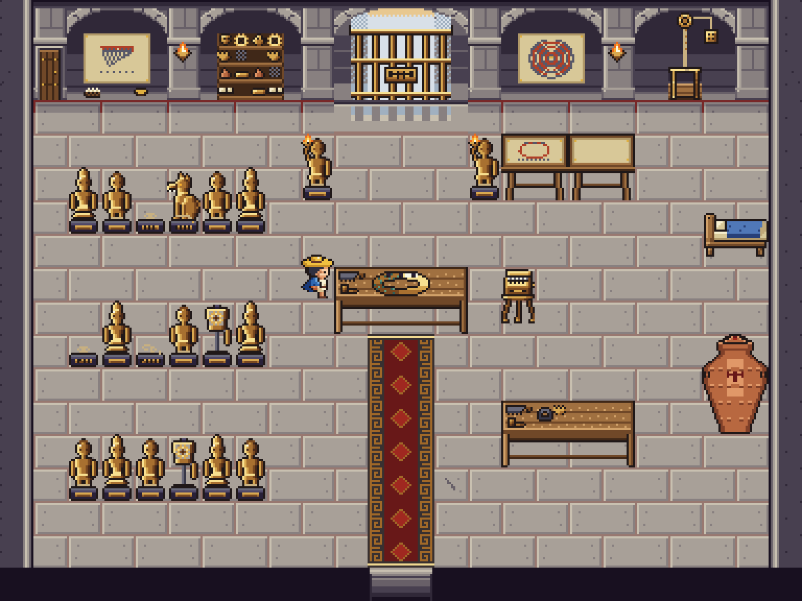
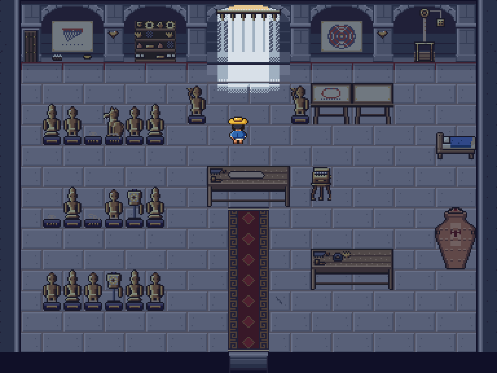

# Labyrinth tileset: `labyrinth`

`gTileset_Labyrinth` is Daedalus's Labyrinth under Knossa (LABYRINTH.md §11). This first
batch draws **Daedalus's workshop**, the hub at the end of Ring III, for scenes D and L:
"A long vaulted room. Rows of bronze automata stand still. On the bench sits a
half-polished bronze collar. A grate seals a shaft of grey light. A music box ticks."
The rings, the forge, the archive, the tomb and the Starry Chamber come later into the
same tileset; its palettes and sections are planned for all of it now.





| Image | Shows |
|---|---|
| `img/labyrinth_scene_workshop.png` | The 24 x 18 workshop as scene D stages it, lit and quiet, rendered on `oikos` at 3x |
| `img/labyrinth_scene_workshop_dawn.png` | The same room for scene L: the grate open, grey dawn light down the shaft, the lamps out, the collar gone, with the dawn palette set |
| `img/labyrinth_scene_*_pass1.png`, `_pass2` | The first two render-and-critique passes; the unsuffixed images are the third and final |
| `img/labyrinth_pieces.png` | Every structure as drawn |
| `img/labyrinth_sheet.png` | Every metatile with its id, from the compiled tileset, on `oikos` |

## How it is made

- `tools/ichor/art/labyrinth_art.py` holds the palette plan, the house's masonry (floor,
  arcade, edges) and the sheet's sections; `labyrinth_workshop.py` holds the workshop.
- `tools/ichor/art/labyrinth_build.py` draws it, compiles it with Porytiles in a scratch
  project against an empty stand-in primary, writes the variant palette sets, verifies it
  and rewrites this file. `labyrinth_scene.py` renders the mock scenes.
- Run both with `/usr/bin/python3`.

**Works on any primary.** It uses only its own tiles and palettes 6-12, and every bottom
layer is opaque. It is drawn for `oikos`.

**Layers.** Floors and walls fill the bottom layer; objects stand in the middle layer over
them. Surfaces that carry objects (the bench tops, the shelving, the lift's deck) fill the
bottom layer so the objects on them can be in another palette. Nothing is drawn over
sprites.

**Floor parity.** The floor's gypsum slabs are two cells long, laid in a running bond:
`floor` `slab_l` goes where x + y is even and `slab_r` where it is odd. So every piece that
stands on the floor comes as **twins**: `<key>` for a top-left cell where x + y is even, and
`<key>_odd` where it is odd. The twins share every object tile and differ only in the floor
under them; pick by parity, or the slabs under the piece won't line up. Where only some rows
of a piece show floor (a bench's front, not its top), `<key>_odd` holds just those rows and
`<key>`'s other rows serve both parities; the catalog says which rows. The runner covers
the floor whole and needs no twin; the dawn light under the Icarus Shaft comes in one
parity, the shaft's own.

**Collision and behaviors.** The walk grids below give the collision to paint (`X` blocks,
`.` passes, `D` is a door). `MB_NON_ANIMATED_DOOR` is on the back door, `MB_SOUTH_ARROW_WARP`
on the threshold, `MB_PC` on the Pithos's bottom row; every other metatile is `MB_NORMAL`.
The heal bed, the music box, the lift and the grate are scripts.

## Palettes

LABYRINTH.md §11 plans seven palettes. Six are slots. The seventh, **glow**, is a palette
*variant*: SYSTEMS.md §2 says each dark tileset needs "one extra palette set" for the doused
torch, loaded over 6-12, as the Temple of Demeter's is. That frees the seventh slot, which
this plan gives to **timber and papyrus**: the workshop's furniture, and later the archive's
shelves and the Titans' tables and bunks, which none of the six covers. Every 8x8 tile draws
from one group (`labyrinth_art.GROUPS`), all colors multiples of 8.

| Group | §11 name | For |
|---|---|---|
| stone | Dark stone with thread red | The masonry of every map (a cool grey limestone that warms toward the light), the floor's red plaster, Ariadne's thread (three reds), lamp-warm and dawn-cool light on stone, and the latent glow paint |
| minoan | Minoan red | Red columns, ochre, gypsum, black capitals, terracotta (the Pithos), horns of consecration, labrys seals, Minos's tomb |
| fresco | Fresco blue | Blue grounds, dolphins, lilies, saffron, bull-leapers, blue monkeys, griffins (not drawn yet) |
| bronze | Bronze and Titan | The automata, grates, dials, the bell, mirrors, anchor rings, tools, the collar, the music box; the Titans' slate and gold |
| fire | Forge fire | Flames, embers, molten bronze, iron, clay lamps. Its three bronze shades are bronze's own, so a hand or a lamp's dish can share a tile with its flame |
| night | Starry night | The Starry Chamber, its black lustral pool, moonlit marble (not drawn yet) |
| timber | Timber and papyrus | Benches, drafting tables, plans and their sinopia and charcoal lines, shelves, the bed and its blue blanket, the lift's deck, scrolls |

**Variant sets** (in `porytiles_bin/`, written by the build; load over palettes 6-12):

| Set | When | What it does |
|---|---|---|
| `glow/` | The torch doused (SYSTEMS.md §2) | Black but for the glow paint (a latent color that by torchlight is the dark stone it is painted on), the flames, and Ariadne's thread, faint: Ring III's "your own thread shows faintly when doused". No glow-marks are drawn yet; the color is reserved in `stone`. |
| `dawn/` | Scene L, the workshop's dawn | Every color dimmed and cooled toward a grey morning but the dawn light (`ld0`, `ld1`) and the first light at the top of the shaft (`lw1`), which stay as drawn: the room goes dim and blue and the open shaft blazes. The map's scene-L state loads it in `ON_LOAD` (one `LoadPalette` over 6-12, as for the glow set); nothing is wired yet. |

## Tile budget

**262 of 504 tiles are used** by this batch (the door animations own 504-511, and the
build fails past 504). **242 are left** for the rest of the Labyrinth. The later batches
are budgeted to these allowances, which sum to 232, leaving 10 spare:

| Section | For | Tiles |
|---|---|---|
| house | The rings' dark corridor kit: wall tops and faces seen from every side, inner and outer corners, rim-lit edges. Rings reuse the arcade, the slab floor and the side walls as drawn; a niche is an arcade bay | 24 |
| house | The thread twins (§5.1): straights, corners and end caps on the slab's two halves, 20 metatiles. Run the thread through each cell's upper tile row so a straight changes two tiles | 30 |
| rings | Braziers 2x2 lit and unlit, anchor rings, cracked walls whole and broken, labrys seals, dial walls A and B, web anchors | 38 |
| rings | Skylight pools by day and night, glow-marks (the latent `lg`), sun and moon gates | 22 |
| rings | Mirror bases (four facings) and the 5x5 dancing floor, five symbols lit and unlit | 22 |
| rooms | Ring IV's Titan barracks and mess hall (bunks are the kline, tables the bench), sickle banners, bronze grates | 14 |
| rooms | Ring VI's forge, the archive (its shelves are the workshop's rack with scrolls) and the vault | 32 |
| rooms | Minos's tomb (painted pillars, the bier) and the frescoes that carry clues | 26 |
| heart | The Starry Chamber: the lustral pool (its twinkles are tile animations swapped over base tiles) and the star-clock's ring | 24 |
| | **Total for the rest** | **232** |

How the workshop keeps to its share:
- The floor is one slab two cells long: a handful of tiles for the whole floor, and every
  floor piece's twin costs no tiles at all.
- Patterns that repeat (the grate's bars, the shaft's light, the shelving, the runner's
  border, the bench planks) repeat on the 8 px tile grid, so each row is one tile, and the
  Icarus Shaft, the Pithos and the runner are mirror-symmetric about a tile edge.
- The arcade's arches are symmetric about the middle of the bay, so the right half is the
  left half flipped and stored once; every bay shares one arch.
- Benches are a top and a front that repeat; the items on them are overlays.
- Any tile within two pixels of another is redrawn as that tile.

**Metatiles.** A secondary holds 512. This batch draws 226, packed first-fit into the
sheet's house rows (0-12) and workshop rows (13-35); the rings are held rows 36-49, the
rooms 50-58 and the heart 59-63.

If the rest of the Labyrinth outgrows its allowance, split it as Emporion and Isthmos
were split: keep the rings and the workshop here and move the Titan rooms and the Starry
Chamber to a sister tileset sharing `labyrinth_art`'s house kit.

## Weak spots and open questions

- **No Daedalus sprite yet**, so both scenes stage around his absence: in scene D he would
  stand behind his bench, in scene L by the shaft.
- **The dawn depends on the `dawn/` set.** Without it the open shaft is pale light on a
  lit room and much less of an event. world-act3 has to load it for scene L.
- **The floor's running bond** still reads a little like brickwork where the floor is bare;
  the runner and the furniture carry the room.
- **The open shaft's light** falls in even streaks; a true falloff down the shaft would cost
  another eight or so tiles.
- **Small things at 1x**: the music box and the plans' drawings are only a few pixels at the
  game's real size, so their object text carries them. The Labyrinth plan reads more as
  rings than as a maze.
- **No pools of lamplight** on the floor: warm halos round the lamp-bearers cost about
  twenty tiles a parity, which the budget can't spare.
- **The budget is tight.** The rest of the Labyrinth's allowance leaves only a few tiles
  spare; the sister-tileset fallback above is the release valve.
- **The seventh slot.** This plan reads §11's "glow, a palette variant" as a variant set and
  spends the seventh slot on timber and papyrus. If the creative director wanted glow as a
  slot, timber has to fold into bronze, which costs the furniture its own browns.

## Scenes D and L, piece by piece

| The scene needs | Pieces |
|---|---|
| A long vaulted room | `arcade` (piers, three-cell bays, the back door's pier, the side walls), `arch4`, `floor`, `edge` |
| Rows of bronze automata, standing still | `auto_kore`, `auto_kouros`, `auto_open`, and the empty plinths `plinth_three`, `plinth_seven`, `plinth_nine`; every automaton tied to its plinth at the ankles |
| "Don't touch Number Four. She bites." | `auto_hound`, IIII on her plinth (Attic numerals) |
| A half-polished bronze collar on the bench | `bench` (`collar_l`, `collar_r`), with Perdix's saw and a mallet; `bench_parts` for the cloth left where the collar lay (scene L), a vise holding a bronze hand, plain tops and fronts for benches of any length |
| A grate seals a shaft of grey light | `shaft`, shut |
| Scene L: the grate open, grey dawn light down the shaft | `shaft`, open, and `light_spill` on the floor below; `auto_lamp_cold` and `pier_cold` for the burned-out lamps; the `dawn/` palette set |
| A music box ticks | `music_box`: the prototype of Elpis's box, on a bronze tripod |
| The heal bed, the Pithos | `kline`; `pithos` (`MB_PC` on its bottom row) |
| The lift that opens after scene D | `lift` (the platform's cell is walkable), and `lift_deck`, the empty shaft, to swap into its platform cell while it is away |
| Drafting tables; plans pinned up: the Wings, the Labyrinth's rings | `drafting` (the collar's design, a fresh sheet), `bay_wings`, `bay_plan` |
| The way in from the front, Ring III's web maze | `edge`'s threshold, and `runner` from it to the bench |
| Shelves of parts, lamps, the back door | `bay_shelves` (with Perdix's bronze partridge), `auto_lamp` and the sconces, the door in `arcade`'s `door_pier` |

## Catalog

Each grid lists metatile ids as Porymap shows them, with the collision beside it. Each section starts on a fixed row of the sheet, so adding to one never renumbers another: house at 0x200, workshop at 0x268; reserved: rings at 0x320, rooms at 0x390, heart at 0x3D8. `build/labyrinth/catalog.json` names every part (`names`), so a map builder can place pieces by key and name, never by raw id. Odd twins are listed with their even twin.

### The house: floors and walls

The masonry every map of the Labyrinth shares: the slab floor, the vaulted arcade, the side walls and the threshold. The rings' dark corridor kit and the thread twins (LABYRINTH.md §5.1) will join this section.

#### Floor: gypsum slabs in red plaster

`floor`, 8 wide by 1 tall. Long gypsum slabs, two cells by one, in a running bond. **Lay `slab_l` on every cell where x + y is even and `slab_r` where it is odd**, and the slabs line up. (0) the void, near-black: the layout's border and every cell outside the rooms (block it). (3), (4) the two halves in the shadow a north wall casts, for the row in front of it. (5) a left half with a mason's labrys cut in it, the house's mark. (6) a right half, cracked. (7) a left half with an oil stain, for near the benches.

```text
ids                                               walk
0x200 0x201 0x202 0x203 0x204 0x205 0x206 0x207   X . . . . . . .
```

Parts: `void` 0x200, `slab_l` 0x201, `slab_r` 0x202, `shade_l` 0x203, `shade_r` 0x204, `labrys` 0x205, `crack` 0x206, `oil` 0x207.

#### Walls: the vaulted arcade

`arcade`, 8 wide by 3 tall. The north wall of a vaulted room, three rows tall: a pier (column 0), then a three-cell bay (columns 1-3) and its recess, and a pier with the back door cut through it (column 4: the door is (4, 2), MB_NON_ANIMATED_DOOR; put its warp there). Columns 5-7: the side walls' cells (west, east) and a pier carrying a bronze sconce, lit, on its lower face. Lay a wall as pier, bay, pier, bay... A four-cell bay is `arch4`; the Icarus Shaft and the lift use their own bays.

```text
ids                                               walk
0x208 0x209 0x20A 0x20B 0x20C 0x20D 0x20E 0x20F   X X X X X X X X
0x210 0x211 0x212 0x213 0x214 0x215 0x216 0x217   X X X X X X X X
0x218 0x219 0x21A 0x21B 0x21C 0x21D 0x21E 0x21F   X X X X D X X X
```

Door metatiles: 0x21C.

Parts: `pier` 0x208, `bay_l` 0x209, `bay_m` 0x20A, `bay_r` 0x20B, `door_pier` 0x20C, `side_w` 0x20D, `side_e` 0x20E, `pier_sconce` 0x20F.

#### Walls: a four-cell bay

`arch4`, 4 wide by 3 tall. A wider arch and recess for a four-cell bay, symmetric, for the middle of a room. The Icarus Shaft is drawn in a bay of this shape.

```text
ids                       walk
0x220 0x221 0x222 0x223   X X X X
0x228 0x229 0x22A 0x22B   X X X X
0x230 0x231 0x232 0x233   X X X X
```

Parts: `l` 0x220, `ml` 0x221, `mr` 0x222, `r` 0x223.

#### Edges: side walls by the floor, the south threshold

`edge`, 4 wide by 1 tall. (0), (3) the west and east walls beside the floor rows. (1), (2) the threshold down to the rings, for the bottom row, two cells wide: MB_SOUTH_ARROW_WARP, warps on both.

```text
ids                       walk
0x224 0x225 0x226 0x227   X . . X
```

Parts: `wall_w` 0x224, `sill_l` 0x225, `sill_r` 0x226, `wall_e` 0x227.

### Daedalus's workshop

The hub at the end of Ring III (LABYRINTH.md §6, scenes D and L).

#### Automaton: a bronze handmaid

`auto_kore`, 1 wide by 2 tall. A bronze handmaid in a Minoan tiered skirt on her slate plinth, tied at the ankles to a ring in it: Daedalus's statues had to be tied down or they'd walk off. Put the object text on the base.

```text
ids     walk
0x268   X
0x270   X
```

Parts: `top` 0x268, `base` 0x270.

`auto_kore_odd`: the odd twin, ids 0x269; 0x271.

#### Automaton: a bronze youth

`auto_kouros`, 1 wide by 2 tall. A bronze youth in a belted kilt, tied to his plinth.

```text
ids     walk
0x26A   X
0x272   X
```

Parts: `top` 0x26A, `base` 0x272.

`auto_kouros_odd`: the odd twin, ids 0x26B; 0x273.

#### Automaton: Number Four, the bronze hound

`auto_hound`, 1 wide by 2 tall. Number Four (IIII on her plinth, Attic numerals): a bronze hound sitting, jaws a little open, one amber eye. "Don't touch Number Four. She bites."

```text
ids     walk
0x26C   X
0x274   X
```

Parts: `top` 0x26C, `base` 0x274.

`auto_hound_odd`: the odd twin, ids 0x26D; 0x275.

#### Automaton: a lamp-bearer, lit

`auto_lamp`, 1 wide by 2 tall. A bronze youth holding up a lit clay lamp: the workshop's lights, as Homer's golden youths lit Alkinoos's hall. The flame is in the fire palette (it stays lit in the glow set).

```text
ids     walk
0x26E   X
0x276   X
```

Parts: `top` 0x26E, `base` 0x276.

`auto_lamp_odd`: the odd twin, ids 0x26F; 0x277.

#### Automaton: a lamp-bearer, burned out

`auto_lamp_cold`, 1 wide by 2 tall. The lamp-bearer at dawn (scene L): the lamp burned out.

```text
ids     walk
0x278   X
0x280   X
```

Parts: `top` 0x278, `base` 0x280.

`auto_lamp_cold_odd`: the odd twin, ids 0x279; 0x281.

#### Automaton: unfinished, on its stand

`auto_open`, 1 wide by 2 tall. A headless automaton on an iron stand, its chest open on its gears, one arm hung on a peg.

```text
ids     walk
0x27A   X
0x282   X
```

Parts: `top` 0x27A, `base` 0x282.

`auto_open_odd`: the odd twin, ids 0x27B; 0x283.

#### Automaton plinth: Number Three's, empty

`plinth_three`, 1 wide by 2 tall. III: Number Three's plinth, its rope untied. He is out in the web maze, a trainer (LABYRINTH.md §6, Ring III).

```text
ids     walk
0x27C   .
0x284   X
```

Parts: `top` 0x27C, `base` 0x284.

`plinth_three_odd`: the odd twin, ids 0x27D; 0x285.

#### Automaton plinth: Number Seven's, empty

`plinth_seven`, 1 wide by 2 tall. Attic seven: Number Seven, the other trainer in the maze.

```text
ids     walk
0x27E   .
0x286   X
```

Parts: `top` 0x27E, `base` 0x286.

`plinth_seven_odd`: the odd twin, ids 0x27F; 0x287.

#### Automaton plinth: Number Nine's, empty

`plinth_nine`, 1 wide by 2 tall. Number Nine's plinth, its rope cut: he walked off to Emporion a year ago (seed 4). The top cell is walkable floor.

```text
ids     walk
0x288   .
0x290   X
```

Parts: `top` 0x288, `base` 0x290.

`plinth_nine_odd`: the odd twin, ids 0x289; 0x291.

#### Workbench: four cells, the collar on it

`bench`, 4 wide by 2 tall. Daedalus's bench, four cells wide (top row the top, bottom row the front). Perdix's saw and a mallet at (0, 0); the collar lies across (1, 0) and (2, 0). At dawn (scene L) the collar is gone: put `bench_parts` `cloth_l` and `cloth_r` there. Any length: `bench_parts` has a plain top and fronts.

```text
ids                       walk
0x28A 0x28B 0x28C 0x28D   X X X X
0x292 0x293 0x294 0x295   X X X X
```

Parts: `tools` 0x28A, `collar_l` 0x28B, `collar_r` 0x28C, `top_r` 0x28D, `front_l` 0x292, `front_m` 0x293, `front_m2` 0x294, `front_r` 0x295.

`bench_odd`: the odd twin of row 1, ids 0x298 0x299 0x29A 0x29B.

#### Workbench parts: plain, the cloth, the vise

`bench_parts`, 4 wide by 2 tall. For benches of any length, and for scene L. Row 0: a plain top (0), the polishing cloth left spread where the collar lay (1, 2: the collar is gone at dawn), and a top with a vise holding a bronze hand (3). Row 1: the plain front (0) and the left and right ends' fronts (1, 2), and the plain front again (3).

```text
ids                       walk
0x29C 0x29D 0x29E 0x29F   X X X X
0x2A4 0x2A5 0x2A6 0x2A7   X X X X
```

Parts: `top` 0x29C, `cloth_l` 0x29D, `cloth_r` 0x29E, `vise` 0x29F, `front` 0x2A4, `front_l` 0x2A5, `front_r` 0x2A6.

`bench_parts_odd`: the odd twin of row 1, ids 0x2A0 0x2A1 0x2A2 0x2A3.

#### Drafting tables: the collar's design, a fresh sheet

`drafting`, 4 wide by 2 tall. Two drafting tables, two cells each. The left board shows the collar's design: a ring with its three sockets, measured ("That collar binds the sickle's pieces. I made it."). The right board has a fresh sheet pinned to it. The top row is the board, the bottom row its legs.

```text
ids                       walk
0x2A8 0x2A9 0x2AA 0x2AB   X X X X
0x2B0 0x2B1 0x2B2 0x2B3   X X X X
```

Parts: `design_l` 0x2A8, `design_r` 0x2A9, `fresh_l` 0x2AA, `fresh_r` 0x2AB, `legs_l` 0x2B0, `legs_r` 0x2B1.

`drafting_odd`: the odd twin of row 1, ids 0x2AC 0x2AD 0x2AE 0x2AF.

#### The bronze music box on its tripod

`music_box`, 1 wide by 2 tall. Daedalus's first music box, the prototype of Elpis's (seed 17), on a bronze tripod with lion's feet: its lid open on the steel comb and the pinned drum, its winding key on the right. Object text on either cell: "A little bronze music box. Its tune never quite reaches the end."

```text
ids     walk
0x28E   X
0x296   X
```

Parts: `top` 0x28E, `legs` 0x296.

`music_box_odd`: the odd twin, ids 0x28F; 0x297.

#### The heal bed: Daedalus's kline

`kline`, 2 wide by 2 tall. Daedalus's own bed, where the player's Pokémon rest (the heal). A timber kline with a turned headboard, linen, a blue wool blanket and a fleece at its foot.

```text
ids           walk
0x2B4 0x2B5   X X
0x2BC 0x2BD   X X
```

Parts: `head_t` 0x2B4, `foot_t` 0x2B5, `head_b` 0x2BC, `foot_b` 0x2BD.

`kline_odd`: the odd twin, ids 0x2B6 0x2B7; 0x2BE 0x2BF.

#### The Pithos: a Minoan storage jar

`pithos`, 2 wide by 3 tall. The Pithos, Pokémon storage (MB_PC on the bottom row). A tall Minoan pithos like the West Magazines', broad-shouldered, with raised rope bands, a rolled rim and a wax-sealed clay lid, a double axe painted on its shoulder.

```text
ids           walk
0x2B8 0x2B9   X X
0x2C0 0x2C1   X X
0x2C8 0x2C9   X X
```

Parts: `tl` 0x2B8, `tr` 0x2B9, `ml` 0x2C0, `mr` 0x2C1, `bl` 0x2C8, `br` 0x2C9.

`pithos_odd`: the odd twin, ids 0x2BA 0x2BB; 0x2C2 0x2C3; 0x2CA 0x2CB.

#### The Icarus Shaft: grated, and open at dawn

`shaft`, 8 wide by 4 tall. Two states of the same four-cell bay, for an `arch4`-sized gap in the arcade. Columns 0-3: the grate shut on the shaft's grey light (scene D). Columns 4-7: the grate drawn up and the dawn light falling (scene L). Row 3 is the sill in front of the bay, the row a north wall's shadow would be on: grey light leaks through the bars onto it when shut, and floods it when open. Swap the whole 4 x 4 block with `setmetatile` to open it.

```text
ids                                               walk
0x2D0 0x2D1 0x2D2 0x2D3 0x2D4 0x2D5 0x2D6 0x2D7   X X X X X X X X
0x2D8 0x2D9 0x2DA 0x2DB 0x2DC 0x2DD 0x2DE 0x2DF   X X X X X X X X
0x2E0 0x2E1 0x2E2 0x2E3 0x2E4 0x2E5 0x2E6 0x2E7   X X X X X X X X
0x2E8 0x2E9 0x2EA 0x2EB 0x2EC 0x2ED 0x2EE 0x2EF   . . . . . . . .
```

Parts: `shut_00` 0x2D0, `shut_01` 0x2D1, `shut_02` 0x2D2, `shut_03` 0x2D3, `shut_10` 0x2D8, `shut_11` 0x2D9, `shut_12` 0x2DA, `shut_13` 0x2DB, `shut_20` 0x2E0, `shut_21` 0x2E1, `shut_22` 0x2E2, `shut_23` 0x2E3, `shut_30` 0x2E8, `shut_31` 0x2E9, `shut_32` 0x2EA, `shut_33` 0x2EB, `open_00` 0x2D4, `open_01` 0x2D5, `open_02` 0x2D6, `open_03` 0x2D7, `open_10` 0x2DC, `open_11` 0x2DD, `open_12` 0x2DE, `open_13` 0x2DF, `open_20` 0x2E4, `open_21` 0x2E5, `open_22` 0x2E6, `open_23` 0x2E7, `open_30` 0x2EC, `open_31` 0x2ED, `open_32` 0x2EE, `open_33` 0x2EF.

#### Dawn light on the floor below the open shaft

`light_spill`, 4 wide by 1 tall. The row in front of the open shaft's sill (scene L): the slab floor with the grey dawn light fading out across it. The Icarus Shaft is unique, so it comes in one parity: lay it with its first cell where x + y is even (the shaft's own columns, as the mock does).

```text
ids                       walk
0x2C4 0x2C5 0x2C6 0x2C7   . . . .
```

Parts: `c0` 0x2C4, `c1` 0x2C5, `c2` 0x2C6, `c3` 0x2C7.

#### Walls: a pier, its sconce burned out

`pier_cold`, 1 wide by 3 tall. `arcade`'s `pier_sconce` with its lamp gone cold, for scene L.

```text
ids     walk
0x2F0   X
0x2F8   X
0x300   X
```

Parts: `top` 0x2F0, `mid` 0x2F8, `low` 0x300.

#### Bay: the Wings plan pinned up

`bay_wings`, 3 wide by 3 tall. A three-cell bay holding the plan of the Wings, pinned up, with a basket of feathers and a pot of wax below it.

```text
ids                 walk
0x2F1 0x2F2 0x2F3   X X X
0x2F9 0x2FA 0x2FB   X X X
0x301 0x302 0x303   X X X
```

Parts: `l0` 0x2F1, `m0` 0x2F2, `r0` 0x2F3, `l1` 0x2F9, `m1` 0x2FA, `r1` 0x2FB, `l2` 0x301, `m2` 0x302, `r2` 0x303.

#### Bay: the Labyrinth's plan pinned up

`bay_plan`, 3 wide by 3 tall. The Labyrinth's plan: seven rings round a star (the Starry Chamber), drawn in sinopia and charcoal (LABYRINTH.md §4).

```text
ids                 walk
0x2F4 0x2F5 0x2F6   X X X
0x2FC 0x2FD 0x2FE   X X X
0x304 0x305 0x306   X X X
```

Parts: `l0` 0x2F4, `m0` 0x2F5, `r0` 0x2F6, `l1` 0x2FC, `m1` 0x2FD, `r1` 0x2FE, `l2` 0x304, `m2` 0x305, `r2` 0x306.

#### Bay: shelves of parts

`bay_shelves`, 3 wide by 3 tall. Shelves in the recess: automaton heads, gears, a little bronze partridge (Perdix), hands, springs, oil flasks, ingots and scrolls.

```text
ids                 walk
0x308 0x309 0x30A   X X X
0x310 0x311 0x312   X X X
0x318 0x319 0x31A   X X X
```

Parts: `l0` 0x308, `m0` 0x309, `r0` 0x30A, `l1` 0x310, `m1` 0x311, `r1` 0x312, `l2` 0x318, `m2` 0x319, `r2` 0x31A.

#### Daedalus's lift

`lift`, 3 wide by 3 tall. The counterweighted lift (LABYRINTH.md §4): the platform is the bay's floor, cell (1, 2), walkable; put the lift's script there. The pulley at the crown, the counterweight hanging on the right. (1, 3) of `lift_deck` is the empty shaft, for while the platform is up at the Grand Staircase.

```text
ids                 walk
0x30B 0x30C 0x30D   X X X
0x313 0x314 0x315   X X X
0x31B 0x31C 0x31D   X . X
```

Parts: `l0` 0x30B, `m0` 0x30C, `r0` 0x30D, `l1` 0x313, `m1` 0x314, `r1` 0x315, `l2` 0x31B, `m2` 0x31C, `r2` 0x31D.

#### Daedalus's lift, the platform away

`lift_deck`, 1 wide by 1 tall. Swap it over `lift` (1, 2) while the platform is up at the Grand Staircase (before scene D, and while the player rides). The ropes and the counterweight stay as they are.

```text
ids     walk
0x2CC   X
```

Parts: `empty` 0x2CC.

#### A woven runner, Minoan red

`runner`, 2 wide by 3 tall. A runner two cells wide: (row 0) its top end, (row 1) the middle, to repeat as long as it needs, (row 2) its bottom end. It covers the floor completely, so it needs no twin; lay it anywhere.

```text
ids           walk
0x30E 0x30F   . .
0x316 0x317   . .
0x31E 0x31F   . .
```

Parts: `top_l` 0x30E, `top_r` 0x30F, `mid_l` 0x316, `mid_r` 0x317, `end_l` 0x31E, `end_r` 0x31F.
