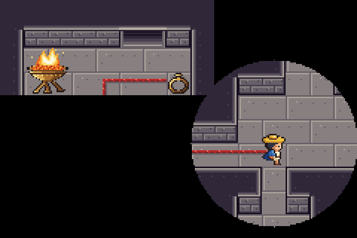

# Labyrinth tilesets: `labyrinth` and `mychos`

Daedalus's Labyrinth under Knossa (LABYRINTH.md §4-§11). This file is the `labyrinth`
tileset's catalog and the plan for both; `TILES_mychos.md` is its sister's catalog.

- **The house**: the workshop's slab floor, the vaulted arcade, and now the rings' corridor
  walls as an autotile, the bronze anchor rings and the stairs from ring to ring.
- **The rings' floor**: the slabs in the dark with Ariadne's thread, 20 twins.
- **Daedalus's workshop** (scenes D and L), unchanged.
- **The outer rings**: Ring I's braziers and threshold hearth, Ring II's sun and moon gates
  and Asterion's cracked walls, Ring III's webs and glow-marks, Ring V's skylight pools,
  niches and the fresco of the dance's steps 4-6; labrys seals and doorways.
- **Minos's tomb** (scene F) and **the Icarus Shaft** (scene L).





| Image | Shows |
|---|---|
| `img/labyrinth_scene_ring.png` | One 15 x 10 screen of a ring: corridors walled with the autotile, the thread laid from a bronze anchor ring to the player, a brazier lit in its alcove, the stair down, a cracked face, webs, glow-marks (by torchlight, the stone) |
| `img/labyrinth_scene_ring_dark.png` | The same as the player sees it: the torch's 3.5-tile radius (flash level 3) and the brazier's zone, lit for good |
| `img/labyrinth_scene_ring_doused.png` | The same with the torch doused (the `glow/` set): the flames, the thread faintly, Daedalus's labrys signs |
| `img/labyrinth_scene_hunt.png`, `_hunt_night.png` | Ring V by day and by night: the loop's corridor, a skylight pool across it (sun, then moon) with the thread through it, niches and the niche shrine, a cracked wall, the fresco of steps 4-6 in a bay |
| `img/labyrinth_scene_tomb.png` | Minos's tomb (scene F): the bier and the cap on it, the inscription, labrys stands, painted pillars, jars, dust and old footprints |
| `img/labyrinth_scene_shaft.png` | The top of the Icarus Shaft with the `dawn/` set (scene L): the courses brightening to the lip and the morning sky |
| `img/labyrinth_scene_workshop.png`, `_dawn.png` | Daedalus's workshop, scenes D and L (the first batch) |
| `img/labyrinth_scene_*_pass1.png`, `_pass2` | The earlier render-and-critique passes; the unsuffixed images are the last |
| `img/labyrinth_pieces.png`, `img/labyrinth_sheet.png` | Every structure as drawn; every metatile with its id, from the compiled tileset, on `oikos` |
| `img/labyrinth_scene_forge.png`, `_choros.png`, `_starry.png` | The sister tileset's scenes (TILES_mychos.md) |

**Two tilesets.** LABYRINTH.md §11 planned one `labyrinth` secondary; with the rings, the
rooms and the heart drawn it needs about 800 tiles, so it is split by map, as Emporion was
with Isthmos. Both draw **the house and the rings' floor at the same metatile ids** (rows
0-12 and 36-38 of the sheet), so a ring's walls, floor, thread twins, anchor rings and
stairs are the same numbers whichever it uses.

| Tileset | Maps |
|---|---|
| `labyrinth` (`gTileset_Labyrinth`) | Ring I (the Threshold), Ring II (the Runner's Ring), Ring III (the Mysteries), Daedalus's workshop, Ring V (the Hunt), Minos's tomb, the Icarus Shaft |
| `mychos` (`gTileset_Mychos`, "the innermost part of a house") | Ring IV (the Masks: the Titans' barracks and mess hall), Ring VI (the Forge: the forge, the Hall of Dials), the archive, the vault, the Mistress's shrine, Ring VII (the Choros), the Starry Chamber |

Both pair with `oikos` (any interior primary works: they use only their own tiles and
palettes 6-12, and every bottom layer is opaque).

## How it is made

- `tools/ichor/art/labyrinth_art.py` holds the palette plan, the house's masonry and the
  sheet's sections for both tilesets; `labyrinth_kit.py` the rings' house kit (walls,
  floors, thread, anchors, stairs); `labyrinth_workshop.py` the workshop;
  `labyrinth_rings.py` the outer rings' fixtures and the fresco painter; `labyrinth_deep.py`
  the tomb and the shaft; `mychos_titans.py` and `mychos_heart.py` the sister's.
- `tools/ichor/art/labyrinth_build.py [labyrinth|mychos|all]` draws, compiles (Porytiles,
  in a scratch project against an empty stand-in primary), registers the tilesets and their
  animations in `src/`, writes the variant palette sets, verifies, and rewrites these files
  and `tools/ichor/maps/labyrinth_tiles.py`. `labyrinth_scene.py` renders the mock scenes.
- Run both with `/usr/bin/python3`.

**Layers.** Floors and walls fill the bottom layer; objects stand in the middle layer over
them, so a piece on the floor costs its object tiles once and its odd twin nothing.
Nothing is drawn over sprites.

**Floor parity.** The slabs are two cells long, in a running bond: `slab_l` / `dark_l`
where x + y is even, `slab_r` / `dark_r` where odd. So every piece standing on a slab floor
comes as **twins**, `<key>` for a top-left cell where x + y is even and `<key>_odd` where
odd; they share every object tile. Where only some rows of a piece show floor, `<key>_odd`
holds just those rows; the catalog says which. `labyrinth_tiles.piece()` picks the twin.

**Walls.** `walls` (house) is an autotile. Every wall cell is a *top* (the masonry's dark
top, rim-lit where it meets a corridor: a dark seam, a lit edge, a bevel) or a *face* (the
wall seen from the south, one row tall: a coping over two courses of ashlar). A face is a
wall cell with floor south of it. Paint a wall/floor grid and let
`labyrinth_tiles.autotile(grid)` choose each cell: tops are named by the sides that meet
floor and their inner corners, faces by their two ends (`o` open, `c` continuing, `i`
meeting a wall that turns down beside them). Walls one cell thick work either way. Rooms
can still take the arcade's three-row north wall (the archive, the forge, the frescoes).

## The rings' floor and Ariadne's thread

**The floor.** The rings are "the same stone in the dark": the workshop's gypsum slabs one
shade down, in the same running bond. **Lay `thread` `dark_l` where x + y is even and
`dark_r` where odd** (`labyrinth_tiles.floor(x, y)`). Ring VII and the Starry Chamber are
starlit marble, `marble` (mychos), one square slab a cell, with no parity.

**The twins.** Each floor is followed by its ten thread twins, in the engine's order
(ENGINE_API.md §6, `src/ichor_labyrinth.c` SHAPE_*): `h`, `v`, `ne`, `nw`, `se`, `sw`,
`cap_n`, `cap_s`, `cap_w`, `cap_e` (corners by the two sides they join, caps by the one). So
a ring's ON_LOAD registers each floor with its first twin right after it:

| Floor | Tileset | Metatile | First twin | Behavior |
|---|---|---|---|---|
| `cave_floors` `earth` | labyrinth | 0x2E8 | 0x2E9 | MB_NORMAL |
| `cave_floors` `gravel` | labyrinth | 0x2F3 | 0x2F4 | MB_NORMAL |
| `cave_floors` `beam_h` | labyrinth | 0x2FE | 0x2FF | MB_NORMAL |
| `cave_floors` `beam_v` | labyrinth | 0x309 | 0x30A | MB_NORMAL |
| `thread` `dark_l` | labyrinth | 0x320 | 0x321 | MB_NORMAL |
| `thread` `dark_r` | labyrinth | 0x32B | 0x32C | MB_NORMAL |
| `plate` `plate` | labyrinth | 0x350 | 0x351 | MB_NORMAL |

The thread is drawn as an overlay in the middle layer, a twisted two-ply red cord a little
up and left of the cell's middle with its shadow down and right, so every floor's twins
share the same ten thread tiles (the skylight pools' and the marble's cost no thread tiles
of their own). In the glow set the thread shows faintly.

**Every walkable cell of a threaded ring must be a registered floor or a bronze ring.** The
engine lays thread only onto registered floors and anchors; step onto anything else (the
workshop's slabs, dust, a decorated slab) and the thread waits at its end until the player
comes back to it. So every passage a piece opens (a gate, a seal, a dial's wall, a breach)
opens onto plain ring floor for its parity, and decorations stand on cells that block.
Stairs, doorways and the dancing floor are deliberate thread stops.

**Anchors.** `anchor` (house) is a bronze ring lying in its socket: register its cell with
`Ichor_AddThreadAnchor`. Thread is never drawn over it. `anchor_odd` on the odd parity.

## Collision and behaviors

The walk grids below give the collision to paint (`X` blocks, `.` passes, `D` is a door).
Behaviors other than `MB_NORMAL`:

| Behavior | On |
|---|---|
| `MB_CAVE` | labyrinth `cave_floors` 0x2E8-0x2FD; labyrinth `stalagmite_tall` 0x33F; labyrinth `column` 0x397 |
| `MB_JUMP_SOUTH` | labyrinth `ledge_w` 0x3B7; labyrinth `ledge_a` 0x3C7; labyrinth `ledge_b` 0x3CE; labyrinth `ledge_e` 0x3CF |
| `MB_NON_ANIMATED_DOOR` | labyrinth `arcade` 0x21C |
| `MB_NORTH_ARROW_WARP` | labyrinth `stairs` 0x234-0x237 |
| `MB_POND_WATER` | labyrinth `cave_water` 0x2A8-0x2C7 |
| `MB_SOUTH_ARROW_WARP` | labyrinth `edge` 0x225-0x226 |

Braziers, the hearth, dials, seals, gates, the bell, the lift, the heal bed and the shrine
are scripts on their cells (bg events); the beam is `Ichor_TraceBeam` (mychos).

## Palettes

LABYRINTH.md §11's seven palettes, the same in both tilesets: six slots plus timber and
papyrus, with glow as a palette *variant* set (as planned in the first batch). Every 8x8
tile draws from one group (`labyrinth_art.GROUPS`), all colors multiples of 8.

| Group | §11 name | For |
|---|---|---|
| stone | Dark stone with thread red | The masonry of every map (a cool grey limestone that warms toward the light), the rings' darker slabs, Ariadne's thread (three reds), lamp-warm and dawn-cool light on stone (the skylight pools), and the latent glow paint |
| minoan | Minoan red | Red columns, ochre, gypsum, black capitals, terracotta, horns of consecration, Minos's tomb and bier, the Mistress's shrine |
| fresco | Fresco blue | The dance frescoes, and the Icarus Shaft's dawn sky |
| bronze | Bronze and Titan | Automata, grates, dials, anchor rings, the labrys seal, helmets, shields, the vault's gold; the Titans' slate (their banners) and gold |
| fire | Forge fire | Flames, embers, molten bronze, iron (the anvils), clay (the furnace, the hearth), oak in firelight (bellows, tub). Its three bronze shades are bronze's own, so a brazier's bowl can share a tile with its flame |
| night | Starry night | Ring VII's starlit marble, the beam by night, the dancing floor, the Starry Chamber's black basin, its stars and the star-clock's gold and lapis |
| timber | Timber and papyrus | Benches, tables, bunks, shelves, wax tablets, scrolls |

**Variant sets** (in `porytiles_bin/`, written by the build; load over palettes 6-12):

| Set | Tileset | When | What it does |
|---|---|---|---|
| `glow/` | both | The torch doused (SYSTEMS.md §2) | Black but for the glow paint (the latent `lg`: by torchlight the wall tops' dark stone, doused a pale aqua), the flames, and Ariadne's thread, faint ("your own thread shows faintly when doused"). Daedalus's glow-marks (`glow`, labyrinth) are painted on the wall tops. `gTilesetPalettes_LabyrinthGlow`, `gTilesetPalettes_MychosGlow`. |
| `dawn/` | labyrinth | Scene L: the workshop's dawn, and the Icarus Shaft | Every color dimmed and cooled toward a grey morning but the dawn light (`ld0`, `ld1`) and the first light (`lw1`): the room goes dim and blue and the open shaft blazes. `gTilesetPalettes_LabyrinthDawn`. |

None is wired into the engine yet: world-act3 loads them (one `LoadPalette` over 6-12).

**Animations** (Porytiles, one step every 16 frames; `InitTilesetAnim_PorytilesManaged_*`
in `src/tileset_anims.c`):

| Tileset | Animation | Frames | On |
|---|---|---|---|
| labyrinth | `flame` | 3 | the lit braziers' and the threshold hearth's flames |
| mychos | `flame` | 3 | the Titans' oil lamps |
| mychos | `forge` | 3 | the furnace's mouth |
| mychos | `stars` | 4 (a 16-step twinkle) | the Starry Chamber's water: the star-clock's stars reflected, brightening and fading |

## Tile budget

| Tileset | Tiles used | Of 504 | Left |
|---|---|---|---|
| labyrinth | 501 | 504 | 3 |
| daidaleion | 321 | 504 | 183 |

The door animations own tiles 504-511, and the build fails past 504. By section (distinct
tiles a section adds, before Porytiles packs palettes; animated tiles counted once):

| Tileset | Section | Tiles |
|---|---|---|
| labyrinth | house | 105 |
| labyrinth | cave | 115 |
| labyrinth | thread | 0 |
| labyrinth | titans | 84 |
| labyrinth | rings | 90 |
| labyrinth | deep | 53 |
| labyrinth | formations | 53 |
| daidaleion | house | 105 |
| daidaleion | workshop | 192 |
| daidaleion | shaft | 23 |

How they keep to it:
- The thread is an overlay: ten tiles serve every floor's twins.
- Every piece on a slab floor stands in the middle layer, so its odd twin costs nothing
  (the first plan's warm halos round braziers and lamps doubled every twin, and went).
- Patterns repeat on the 8 px grid (the archive's pigeonholes, the inscription's signs, the
  shaft's courses, the grates), and symmetric pieces (the beam, the dancing floor's squares,
  the star-clock's ring, the stairs) are stored once and flipped.
- Cracks, glow-marks and dust are overlay tiles shared by every wall or floor they're on.
- Any tile within two pixels of another is redrawn as that tile.

**Metatiles.** A secondary holds 512: labyrinth uses 471, mychos ?.

## Notes for the ring builders (world-act3)

- **Registering a ring.** In ON_LOAD: `Ichor_AddThreadFloor` for `dark_l` and `dark_r`
  (and Ring V's pool pair, or Ring VII's `marble`), `Ichor_AddThreadAnchor` for each
  `anchor`, `Ichor_AddCrackedWall` for each `cracked` cell with its parity's floor as the
  broken metatile, then draw broken walls and their `breach_l` / `breach_r` edges by flag,
  dials, gates, then `Ichor_DrawThread` last.
- **Ring V's pools.** By day the pools' cells are `pools` `sun_l` / `sun_r`, by night
  `moon_l` / `moon_r` (gettimeofday in ON_LOAD); register whichever pair is down (four
  floors is the engine's limit). Every pool cell and its twins carry `MB_ICHOR_LIGHT_POOL`.
- **Two engine notes.** (1) Thread drawn over a wall the Turning or a dial put on a
  committed tile uses the *first* registered floor's twins whatever the cell's parity, so a
  forced-open cell on an odd cell shows a slab's left half beside another left half: a
  one-line fix in `DrawThreadTile` would pick `dark_r` on odd cells. (2) The beam's
  metatiles (mychos) aren't registered floors, so the thread stops at a lit beam in Ring
  VII's antechamber until the player steps back; the antechamber can stay unthreaded.
- **Darkness.** Rims mark every wall in the torch's radius; every brazier, the hearth, the
  pools and the lamps are landmarks. A lit brazier's zone is a lit zone (SYSTEMS.md §2).
  The GBA's flash window shows one circle, so on a dark ("cave") map a skylight pool
  outside the torch's radius is black like the rest: for Ring V's pools to read as light
  from across the dark (LABYRINTH.md §5.2), make each pool's surround a lit zone, as the
  mock `hunt_night` shows it, or give the ring a lit header with the darkness in its art.

## Weak spots and open questions

- **No sprites yet** for Daedalus, Hyperion, Kronos, Rhea, Asterion, the mirrors or the
  crystal: the scenes stage around them. The mirrors are objects
  (`MOVEMENT_TYPE_ICHOR_MIRROR*`); the tiles give their bases and the beam's corners.
- **The corridor walls are one row tall**, lower than the workshop's three-row arcade:
  readable mazes at the cost of height. Big rooms can use the arcade.
- **Ring floors are uniform**: a threaded ring can't scatter decorated slabs on its walkable
  cells (they'd stop the thread), so its landmarks are the blocking pieces.
- **The Icarus Shaft** is a stylised side view of its back wall, five light levels from the
  grate to the sky; load the `dawn/` set there.
- **Small things at 1x**: the glow-marks, the dance's symbols in the frescoes and the
  inscription's signs are a few pixels; the object text carries them.
- **The budget**: both tilesets have about a dozen tiles left. A third secondary (the
  heart alone) is the release valve.

## Ring by ring

| Ring | Pieces |
|---|---|
| All | `walls` (autotile), `thread` `dark_l` / `dark_r`, `anchor`, `stairs`, `doorways` (jambs, the labrys seal, a grate) |
| I, the Threshold (labyrinth) | `hearth` (the threshold hearth), `brazier` (B1-B5 and the gate brazier G, cold and lit), `doorways` for the fresco door |
| II, the Runner's Ring (labyrinth) | `doorways` `sun` and `moon` (the gates), `grate` (the Long Hall's lattice), `cracked` (scene C's breach), the bronze plates are the floor (scripts) |
| III, the Mysteries (labyrinth) | `webs` (anchors either side of the web objects), `glow` (Daedalus's trail), `brazier` |
| The workshop (labyrinth) | its own section (scenes D and L) |
| IV, the Masks (mychos) | `bunk`, `helmets` (the disguise), `armory`, `mess_table`, `banners`, `lamp_stand` (the sentry posts), `grates`, `fresco_iv` (steps 1-3) |
| V, the Hunt (labyrinth) | `pools` (four skylight pools, sun and moon), `niche` (back, shrine), `cracked` (%1, %2, %3), `fresco_v` (steps 4-6) |
| Minos's tomb (labyrinth) | `tomb_pillar`, `tomb_bier` (the Helm on it; `head_empty`), `tomb_inscription`, `tomb_goods` (labrys stand, jar, dust) |
| VI, the Forge (mychos) | `forge`, `anvil` (Hyperion's), `forge_kit` (bellows, tub, runnels, mold, slag), `dials` (dials A and B, swinging walls, the reset lever), `archive`, `archive_desk`, `vault`, `shrine`, `fresco_vi` (steps 7-9) |
| VII, the Choros (mychos) | `marble`, `beam` (sun and star, mirror bases), `dance` (the 5 x 5 floor and its stair), `fresco_faded` and `fresco_iv`/`_v`/`_vi` (the whole dance) |
| The Starry Chamber (mychos) | `marble`, `basin` (the lustral pool, twinkling), `clock` (the star-clock's ring), `horns`, `star_anvil` |
| The Icarus Shaft (labyrinth) | `icarus` |

## Catalog

Each grid lists metatile ids as Porymap shows them, with the collision beside it. Each section starts on a fixed row of the sheet, so adding to one never renumbers another: house at 0x200, cave at 0x268, thread at 0x320, rings at 0x338. `build/labyrinth/catalog.json` and `tools/ichor/maps/labyrinth_tiles.py` name every part (`names`), so a map builder can place pieces by key and name, never by raw id. Odd twins are listed with their even twin.

### The house: floors and walls

The masonry every map of the Labyrinth shares, the same at the same ids in `labyrinth` and `mychos`: the workshop's slab floor, the vaulted arcade, the side walls and the threshold; the rings' corridor walls (an autotile), the bronze anchor rings and the stairs from ring to ring.

#### Floor: gypsum slabs in red plaster

`floor`, 8 wide by 1 tall. Long gypsum slabs, two cells by one, in a running bond. **Lay `slab_l` on every cell where x + y is even and `slab_r` where it is odd**, and the slabs line up. (0) the void, near-black: the layout's border and every cell outside the rooms (block it). (3), (4) the two halves in the shadow a north wall casts, for the row in front of it. (5) a left half with a mason's labrys cut in it, the house's mark. (6) a right half, cracked. (7) a left half with an oil stain, for near the benches.

```text
ids                                               walk
0x200 0x201 0x202 0x203 0x204 0x205 0x206 0x207   X . . . . . . .
```

Parts: `void` 0x200, `slab_l` 0x201, `slab_r` 0x202, `shade_l` 0x203, `shade_r` 0x204, `labrys` 0x205, `crack` 0x206, `oil` 0x207.

#### Walls: the vaulted arcade

`arcade`, 8 wide by 3 tall. The north wall of a vaulted room, three rows tall: a pier (column 0), then a three-cell bay (columns 1-3) and its recess, and a pier with the back door cut through it (column 4: the door is (4, 2), MB_NON_ANIMATED_DOOR; put its warp there). Columns 5-7: the side walls' cells (west, east) and a pier carrying a bronze sconce, lit, on its lower face. Lay a wall as pier, bay, pier, bay... A four-cell bay is `arch4`; the Icarus Shaft and the lift use their own bays.

```text
ids                                               walk
0x208 0x209 0x20A 0x20B 0x20C 0x20D 0x20E 0x20F   X X X X X X X X
0x210 0x211 0x212 0x213 0x214 0x215 0x216 0x217   X X X X X X X X
0x218 0x219 0x21A 0x21B 0x21C 0x21D 0x21E 0x21F   X X X X D X X X
```

Door metatiles: 0x21C.

Parts: `pier` 0x208, `bay_l` 0x209, `bay_m` 0x20A, `bay_r` 0x20B, `door_pier` 0x20C, `side_w` 0x20D, `side_e` 0x20E, `pier_sconce` 0x20F.

#### Walls: a four-cell bay

`arch4`, 4 wide by 3 tall. A wider arch and recess for a four-cell bay, symmetric, for the middle of a room. The Icarus Shaft is drawn in a bay of this shape.

```text
ids                       walk
0x220 0x221 0x222 0x223   X X X X
0x228 0x229 0x22A 0x22B   X X X X
0x230 0x231 0x232 0x233   X X X X
```

Parts: `l` 0x220, `ml` 0x221, `mr` 0x222, `r` 0x223.

#### Edges: side walls by the floor, the south threshold

`edge`, 4 wide by 1 tall. (0), (3) the west and east walls beside the floor rows. (1), (2) the threshold down to the rings, for the bottom row, two cells wide: MB_SOUTH_ARROW_WARP, warps on both.

```text
ids                       walk
0x224 0x225 0x226 0x227   X . . X
```

Parts: `wall_w` 0x224, `sill_l` 0x225, `sill_r` 0x226, `wall_e` 0x227.

Behavior: MB_SOUTH_ARROW_WARP on 0x225, 0x226.

#### Walls: the corridor kit, an autotile

`walls`, 8 wide by 6 tall. Every wall cell of a ring is a **top** (the masonry's dark top, rim-lit where it meets a corridor) or a **face** (the wall seen from the south, one row tall; a wall cell with floor south of it). Paint a wall/floor grid and let `labyrinth_tiles.autotile()` pick each cell: a top's name lists the sides that meet floor (`top_nwe`) and its inner corners (`_in_nw`: floor only at that diagonal; `_in_sw`, `_in_se`: the wall turns down beside a face there); a face's two letters are its west and east ends: `o` open (the wall ends, its edge shows), `c` continuing, `i` meeting a wall that turns down beside it. `top` is solid rock: fill everything outside the rings with it. Walls one cell thick work both ways: a row of faces, or a column of `top_we` ending in `face_oo`. All block.

```text
ids                                               walk
0x238 0x239 0x23A 0x23B 0x23C 0x23D 0x23E 0x23F   X X X X X X X X
0x240 0x241 0x242 0x243 0x244 0x245 0x246 0x247   X X X X X X X X
0x248 0x249 0x24A 0x24B 0x24C 0x24D 0x24E 0x24F   X X X X X X X X
0x250 0x251 0x252 0x253 0x254 0x255 0x256 0x257   X X X X X X X X
0x258 0x259 0x25A 0x25B 0x25C 0x25D 0x25E 0x25F   X X X X X X X X
0x260 0x261 0x262 0x263 0x264 0x265 0x266 0x267   X X X X X X X X
```

Parts: `top` 0x238, `top_in_nw` 0x239, `top_in_ne` 0x23A, `top_in_nw_ne` 0x23B, `top_in_sw` 0x23C, `top_in_nw_sw` 0x23D, `top_in_ne_sw` 0x23E, `top_in_nw_ne_sw` 0x23F, `top_in_se` 0x240, `top_in_nw_se` 0x241, `top_in_ne_se` 0x242, `top_in_nw_ne_se` 0x243, `top_in_sw_se` 0x244, `top_in_nw_sw_se` 0x245, `top_in_ne_sw_se` 0x246, `top_in_nw_ne_sw_se` 0x247, `top_e` 0x248, `top_e_in_nw` 0x249, `top_e_in_sw` 0x24A, `top_e_in_nw_sw` 0x24B, `top_w` 0x24C, `top_w_in_ne` 0x24D, `top_w_in_se` 0x24E, `top_w_in_ne_se` 0x24F, `top_we` 0x250, `top_n` 0x251, `top_n_in_sw` 0x252, `top_n_in_se` 0x253, `top_n_in_sw_se` 0x254, `top_ne` 0x255, `top_ne_in_sw` 0x256, `top_nw` 0x257, `top_nw_in_se` 0x258, `top_nwe` 0x259, `face_oo` 0x25A, `face_oc` 0x25B, `face_oi` 0x25C, `face_co` 0x25D, `face_cc` 0x25E, `face_ci` 0x25F, `face_io` 0x260, `face_ic` 0x261, `face_ii` 0x262.

#### A bronze anchor ring in the floor

`anchor`, 1 wide by 1 tall. A bronze ring lying in its socket, where the thread is tied off: register its cell with `Ichor_AddThreadAnchor`. Walkable; thread is never drawn over it. `anchor_odd` where x + y is odd.

```text
ids     walk
0x22C   .
```

Parts: `ring` 0x22C.

`anchor_odd`: the odd twin, ids 0x22D.

#### Stairs from ring to ring

`stairs`, 4 wide by 1 tall. Two stairways, each two cells wide, for a face row: (0, 1) the stair **down** to the next ring, its steps dropping away into the dark; (2, 3) the stair **up** to the last, its steps climbing toward lamplight. MB_NORTH_ARROW_WARP on all four: put a warp on each cell. Their ends meet the face's open ends, so lay them in a run of faces.

```text
ids                       walk
0x234 0x235 0x236 0x237   . . . .
```

Parts: `down_l` 0x234, `down_r` 0x235, `up_l` 0x236, `up_r` 0x237.

Behavior: MB_NORTH_ARROW_WARP on 0x234, 0x235, 0x236, 0x237.

### The cave the house was cut into

The karst under Knossa (LABYRINTH_MAZE.md §1, §4): the cave rock as an autotile, the earth and gravel floors and the beam bridges with their thread twins, the underground stream, the chasm, and the breach where ashlar breaks into rock.

#### Cave rock: the karst the house was cut into

`cave_rock`, 8 wide by 8 tall. The cave's rock in 3/4 view, an autotile (`labyrinth_tiles.cave_autotile`): `T|...` tops (sides open to floor, inner-corner nubs), and two-cell faces, `ft|l|r` over `fb|l|r`, whose ends are `end` (an outer corner), `inner` (the rock turns down beside it) or a flute. Drawn in the house's limestone ramp, so dressed walls and raw cave are one stone. All block.

```text
ids                                               walk
0x268 0x269 0x26A 0x26B 0x26C 0x26D 0x26E 0x26F   X X X X X X X X
0x270 0x271 0x272 0x273 0x274 0x275 0x276 0x277   X X X X X X X X
0x278 0x279 0x27A 0x27B 0x27C 0x27D 0x27E 0x27F   X X X X X X X X
0x280 0x281 0x282 0x283 0x284 0x285 0x286 0x287   X X X X X X X X
0x288 0x289 0x28A 0x28B 0x28C 0x28D 0x28E 0x28F   X X X X X X X X
0x290 0x291 0x292 0x293 0x294 0x295 0x296 0x297   X X X X X X X X
0x298 0x299 0x29A 0x29B 0x29C 0x29D 0x29E 0x29F   X X X X X X X X
0x2A0 0x2A1 0x2A2 0x2A3 0x2A4 0x2A5 0x2A6 0x2A7   X X X X X X X X
```

Parts: `T|...` 0x268, `T|...|nw` 0x269, `T|...|ne` 0x26A, `T|...|ne,nw` 0x26B, `T|...|sw` 0x26C, `T|...|nw,sw` 0x26D, `T|...|ne,sw` 0x26E, `T|...|se` 0x26F, `T|...|nw,se` 0x270, `T|...|ne,se` 0x271, `T|...|se,sw` 0x272, `T|..E` 0x273, `T|..E|nw` 0x274, `T|..E|sw` 0x275, `T|..E|nw,sw` 0x276, `T|.W.` 0x277, `T|.W.|ne` 0x278, `T|.W.|se` 0x279, `T|.W.|ne,se` 0x27A, `T|.WE` 0x27B, `T|N..` 0x27C, `T|N..|sw` 0x27D, `T|N..|se` 0x27E, `T|N..|se,sw` 0x27F, `T|N.E` 0x280, `T|N.E|sw` 0x281, `T|NW.` 0x282, `T|NW.|se` 0x283, `T|NWE` 0x284, `ft|A|A` 0x285, `ft|A|C` 0x286, `ft|A|end` 0x287, `ft|A|inner` 0x288, `ft|C|A` 0x289, `ft|C|C` 0x28A, `ft|C|end` 0x28B, `ft|C|inner` 0x28C, `ft|end|A` 0x28D, `ft|end|C` 0x28E, `ft|end|end` 0x28F, `ft|end|inner` 0x290, `ft|inner|A` 0x291, `ft|inner|C` 0x292, `ft|inner|end` 0x293, `ft|inner|inner` 0x294, `fb|A|A` 0x295, `fb|A|C` 0x296, `fb|A|end` 0x297, `fb|A|inner` 0x298, `fb|C|A` 0x299, `fb|C|C` 0x29A, `fb|C|end` 0x29B, `fb|C|inner` 0x29C, `fb|end|A` 0x29D, `fb|end|C` 0x29E, `fb|end|end` 0x29F, `fb|end|inner` 0x2A0, `fb|inner|A` 0x2A1, `fb|inner|C` 0x2A2, `fb|inner|end` 0x2A3, `fb|inner|inner` 0x2A4.

#### The underground stream: still water

`cave_water`, 8 wide by 4 tall. Still water with earth banks, a region autotile (`water|NSWE|nubs`): the stream that runs down through the house (LABYRINTH_MAZE.md §3). Surf with Poseidon's Conch; fish it.

```text
ids                                               walk
0x2A8 0x2A9 0x2AA 0x2AB 0x2AC 0x2AD 0x2AE 0x2AF   . . . . . . . .
0x2B0 0x2B1 0x2B2 0x2B3 0x2B4 0x2B5 0x2B6 0x2B7   . . . . . . . .
0x2B8 0x2B9 0x2BA 0x2BB 0x2BC 0x2BD 0x2BE 0x2BF   . . . . . . . .
0x2C0 0x2C1 0x2C2 0x2C3 0x2C4 0x2C5 0x2C6 0x2C7   . . . . . . . .
```

Parts: `water|....` 0x2A8, `water|....|nw` 0x2A9, `water|....|ne` 0x2AA, `water|....|sw` 0x2AB, `water|....|se` 0x2AC, `water|...E` 0x2AD, `water|...E|nw` 0x2AE, `water|...E|sw` 0x2AF, `water|..W.` 0x2B0, `water|..W.|ne` 0x2B1, `water|..W.|se` 0x2B2, `water|..WE` 0x2B3, `water|.S..` 0x2B4, `water|.S..|nw` 0x2B5, `water|.S..|ne` 0x2B6, `water|.S.E` 0x2B7, `water|.S.E|nw` 0x2B8, `water|.SW.` 0x2B9, `water|.SW.|ne` 0x2BA, `water|.SWE` 0x2BB, `water|N...` 0x2BC, `water|N...|sw` 0x2BD, `water|N...|se` 0x2BE, `water|N..E` 0x2BF, `water|N..E|sw` 0x2C0, `water|N.W.` 0x2C1, `water|N.W.|se` 0x2C2, `water|N.WE` 0x2C3, `water|NS..` 0x2C4, `water|NS.E` 0x2C5, `water|NSW.` 0x2C6, `water|NSWE` 0x2C7.

Behavior: MB_POND_WATER on every cell.

#### A chasm: the drop into the dark

`cave_pit`, 8 wide by 4 tall. The same region shapes as the water, the water a black drop between earth lips (`pit|NSWE|nubs`). Blocks; cross it on `cave_floors` `beam_h` / `beam_v`.

```text
ids                                               walk
0x2C8 0x2C9 0x2CA 0x2CB 0x2CC 0x2CD 0x2CE 0x2CF   X X X X X X X X
0x2D0 0x2D1 0x2D2 0x2D3 0x2D4 0x2D5 0x2D6 0x2D7   X X X X X X X X
0x2D8 0x2D9 0x2DA 0x2DB 0x2DC 0x2DD 0x2DE 0x2DF   X X X X X X X X
0x2E0 0x2E1 0x2E2 0x2E3 0x2E4 0x2E5 0x2E6 0x2E7   X X X X X X X X
```

Parts: `pit|....` 0x2C8, `pit|....|nw` 0x2C9, `pit|....|ne` 0x2CA, `pit|....|sw` 0x2CB, `pit|....|se` 0x2CC, `pit|...E` 0x2CD, `pit|...E|nw` 0x2CE, `pit|...E|sw` 0x2CF, `pit|..W.` 0x2D0, `pit|..W.|ne` 0x2D1, `pit|..W.|se` 0x2D2, `pit|..WE` 0x2D3, `pit|.S..` 0x2D4, `pit|.S..|nw` 0x2D5, `pit|.S..|ne` 0x2D6, `pit|.S.E` 0x2D7, `pit|.S.E|nw` 0x2D8, `pit|.SW.` 0x2D9, `pit|.SW.|ne` 0x2DA, `pit|.SWE` 0x2DB, `pit|N...` 0x2DC, `pit|N...|sw` 0x2DD, `pit|N...|se` 0x2DE, `pit|N..E` 0x2DF, `pit|N..E|sw` 0x2E0, `pit|N.W.` 0x2E1, `pit|N.W.|se` 0x2E2, `pit|N.WE` 0x2E3, `pit|NS..` 0x2E4, `pit|NS.E` 0x2E5, `pit|NSW.` 0x2E6, `pit|NSWE` 0x2E7.

#### Cave floors: earth, gravel and the beam bridges, with their thread twins

`cave_floors`, 8 wide by 6 tall. The cave's walkable floors, each followed by its ten thread twins (the engine's order, as `thread`): `earth`, packed red-brown earth, and `gravel`, the same with scattered stones (scatter it, no parity), both MB_CAVE so the wild Pokémon live in the caves and not the built corridors (LABYRINTH_MAZE.md §5); `beam_h` and `beam_v`, timbers laid across a chasm. Register every one a ring uses with `Ichor_AddThreadFloor(f, f + 1)` (eight floors at most).

```text
ids                                               walk
0x2E8 0x2E9 0x2EA 0x2EB 0x2EC 0x2ED 0x2EE 0x2EF   . . . . . . . .
0x2F0 0x2F1 0x2F2 0x2F3 0x2F4 0x2F5 0x2F6 0x2F7   . . . . . . . .
0x2F8 0x2F9 0x2FA 0x2FB 0x2FC 0x2FD 0x2FE 0x2FF   . . . . . . . .
0x300 0x301 0x302 0x303 0x304 0x305 0x306 0x307   . . . . . . . .
0x308 0x309 0x30A 0x30B 0x30C 0x30D 0x30E 0x30F   . . . . . . . .
0x310 0x311 0x312 0x313 0x314 0x315 0x316 0x317   . . . . X X X X
```

Parts: `earth` 0x2E8, `earth_h` 0x2E9, `earth_v` 0x2EA, `earth_ne` 0x2EB, `earth_nw` 0x2EC, `earth_se` 0x2ED, `earth_sw` 0x2EE, `earth_cap_n` 0x2EF, `earth_cap_s` 0x2F0, `earth_cap_w` 0x2F1, `earth_cap_e` 0x2F2, `gravel` 0x2F3, `gravel_h` 0x2F4, `gravel_v` 0x2F5, `gravel_ne` 0x2F6, `gravel_nw` 0x2F7, `gravel_se` 0x2F8, `gravel_sw` 0x2F9, `gravel_cap_n` 0x2FA, `gravel_cap_s` 0x2FB, `gravel_cap_w` 0x2FC, `gravel_cap_e` 0x2FD, `beam_h` 0x2FE, `beam_h_h` 0x2FF, `beam_h_v` 0x300, `beam_h_ne` 0x301, `beam_h_nw` 0x302, `beam_h_se` 0x303, `beam_h_sw` 0x304, `beam_h_cap_n` 0x305, `beam_h_cap_s` 0x306, `beam_h_cap_w` 0x307, `beam_h_cap_e` 0x308, `beam_v` 0x309, `beam_v_h` 0x30A, `beam_v_v` 0x30B, `beam_v_ne` 0x30C, `beam_v_nw` 0x30D, `beam_v_se` 0x30E, `beam_v_sw` 0x30F, `beam_v_cap_n` 0x310, `beam_v_cap_s` 0x311, `beam_v_cap_w` 0x312, `beam_v_cap_e` 0x313.

Behavior: MB_CAVE on every cell.

#### The breach: where the house breaks into the cave

`breach`, 4 wide by 1 tall. The house's signature piece (LABYRINTH_MAZE.md §4). (0) `to_cave`: a corridor face whose ashlar courses break off ragged into raw flowstone, masonry to the west; (1) `to_house`, the mirror. Lay them where a masonry face row meets a cave face's `fb` row. (2) `rubble`, (3) `rubble_2`: dressed blocks fallen from a broken wall onto the earth, with rough rock among them. All block.

```text
ids                       walk
0x318 0x319 0x31A 0x31B   X X X X
```

Parts: `to_cave` 0x318, `to_house` 0x319, `rubble` 0x31A, `rubble_2` 0x31B.

### The rings' floor and Ariadne's thread

The floor every ring is laid with, and its thread twins (LABYRINTH.md §5.1, ENGINE_API.md §6), the same at the same ids in both tilesets.

#### Floors: the rings' slabs and Ariadne's thread

`thread`, 8 wide by 3 tall. The rings' floor: the house's gypsum slabs in the dark, a shade down from the workshop's, in the same running bond: **`dark_l` where x + y is even, `dark_r` where odd**. Each is followed by its ten thread twins (the engine's order: `h`, `v`, `ne`, `nw`, `se`, `sw`, `cap_n`, `cap_s`, `cap_w`, `cap_e`), so a ring's ON_LOAD registers `Ichor_AddThreadFloor(dark_l, dark_l + 1)` and `(dark_r, dark_r + 1)`. Every walkable cell of a threaded ring must be one of the registered floors (or an anchor): the thread stops at anything else. The last two cells are void.

```text
ids                                               walk
0x320 0x321 0x322 0x323 0x324 0x325 0x326 0x327   . . . . . . . .
0x328 0x329 0x32A 0x32B 0x32C 0x32D 0x32E 0x32F   . . . . . . . .
0x330 0x331 0x332 0x333 0x334 0x335 0x336 0x337   . . . . . . X X
```

Parts: `dark_l` 0x320, `dark_l_h` 0x321, `dark_l_v` 0x322, `dark_l_ne` 0x323, `dark_l_nw` 0x324, `dark_l_se` 0x325, `dark_l_sw` 0x326, `dark_l_cap_n` 0x327, `dark_l_cap_s` 0x328, `dark_l_cap_w` 0x329, `dark_l_cap_e` 0x32A, `dark_r` 0x32B, `dark_r_h` 0x32C, `dark_r_v` 0x32D, `dark_r_ne` 0x32E, `dark_r_nw` 0x32F, `dark_r_se` 0x330, `dark_r_sw` 0x331, `dark_r_cap_n` 0x332, `dark_r_cap_s` 0x333, `dark_r_cap_w` 0x334, `dark_r_cap_e` 0x335.

### Rings I to IV, and Minos's tomb

Ring I's braziers and hearth, Ring II's herald plate and gates, cracked walls, Ring III's webs and glow-marks, the cave's formations, Ring IV's Titan fixtures, the labrys seals and doorways, niches; then Minos's tomb.

#### The herald plate, with its thread twins

`plate`, 8 wide by 2 tall. Last, Ring II's **herald plate** (LABYRINTH.md §6, Ring II): `plate`, a bronze plate set flush in the floor, a herald's staff engraved on it, and its ten twins. Step on it and its gate opens for ten steps (a coord event; the gate is `doorways` `grate` between jambs, open = ring floor). The player runs from the plate through the gate, so the plate takes thread: register `Ichor_AddThreadFloor(plate, plate + 1)` beside `dark_l` and `dark_r`. It covers its cell, so it has no parity. The last cell is void.

```text
ids                                               walk
0x350 0x351 0x352 0x353 0x354 0x355 0x356 0x357   . . . . . . . .
0x358 0x359 0x35A 0x35B 0x35C 0x35D 0x35E 0x35F   . . . X X X X X
```

Parts: `plate` 0x350, `plate_h` 0x351, `plate_v` 0x352, `plate_ne` 0x353, `plate_nw` 0x354, `plate_se` 0x355, `plate_sw` 0x356, `plate_cap_n` 0x357, `plate_cap_s` 0x358, `plate_cap_w` 0x359, `plate_cap_e` 0x35A.

#### Braziers: bronze tripods, cold and lit

`brazier`, 4 wide by 2 tall. A Minoan bronze tripod brazier, 2 x 2: columns 0-1 **cold** (ash in the bowl), columns 2-3 **lit** (coals glowing, its flames animated). **Each lit cell is its cold cell + 2.** Swap all four cells together when it lights (ENGINE_API.md §2, braziers) and keep them impassable; put the brazier's bg event on its bottom row. On the odd parity use `brazier_odd`.

```text
ids                       walk
0x33B 0x33C 0x33D 0x33E   X X X X
0x343 0x344 0x345 0x346   X X X X
```

Parts: `cold_tl` 0x33B, `cold_tr` 0x33C, `cold_bl` 0x343, `cold_br` 0x344, `lit_tl` 0x33D, `lit_tr` 0x33E, `lit_bl` 0x345, `lit_br` 0x346.

Animated: flame.

`brazier_odd`: the odd twin, ids 0x360 0x361 0x362 0x363; 0x368 0x369 0x36A 0x36B.

#### The threshold hearth

`hearth`, 2 wide by 2 tall. Ring I's threshold hearth, the house's oldest fire (LABYRINTH.md §6, Ring I): a low round hearth of fired clay ringed with stones, a bed of embers, a steady flame (animated). It never goes out. Its bg event relights the torch. `hearth_odd` on the odd parity.

```text
ids           walk
0x376 0x377   X X
0x37E 0x37F   X X
```

Parts: `tl` 0x376, `tr` 0x377, `bl` 0x37E, `br` 0x37F.

Animated: flame.

`hearth_odd`: the odd twin, ids 0x386 0x387; 0x38E 0x38F.

#### Glow-marks: Daedalus's labrys signs

`glow`, 8 wide by 1 tall. Daedalus's marks for his own way through Ring III (LABYRINTH.md §6, the back way): labrys signs and arrows painted on the wall tops in the latent glow paint, invisible by torchlight and bright in the doused `glow/` palettes. Use them in place of the plain kit top of the same name: (0) `top`, (1) `top_n`, (2) `top_w`, (3) `top_e`, (4) `top_we` (on a one-cell wall); (5-7) `arrow_n`, `arrow_w`, `arrow_e` on a `top`, pointing the way (an arrow south is `arrow_n` turned: use `top` there). All block.

```text
ids                                               walk
0x3B8 0x3B9 0x3BA 0x3BB 0x3BC 0x3BD 0x3BE 0x3BF   X X X X X X X X
```

Parts: `top` 0x3B8, `top_n` 0x3B9, `top_w` 0x3BA, `top_e` 0x3BB, `top_we` 0x3BC, `arrow_n` 0x3BD, `arrow_w` 0x3BE, `arrow_e` 0x3BF.

#### Cracked walls, and the breach a charge leaves

`cracked`, 7 wide by 1 tall. Walls Asterion's charge can break (LABYRINTH.md §5.3), one cell thick. (0) `face`: a cracked face, for a charge from the south; (1) `top_we`: a cracked one-cell wall seen from above, for a charge from the east or west; (2) `top_n`, (3) `top_w`, (4) `top_e`: a cracked wall top's rim, for a charge from the north, west or east into a thicker wall's side. Register each with `Ichor_AddCrackedWall` and give it the ring floor for its parity (`thread` `dark_l` or `dark_r`) as its broken metatile, so the thread can be laid through the breach. Then, in ON_LOAD when its flag is set, swap the faces either side of a breach in a row of faces for its broken edges: (5) `breach_r` west of it, (6) `breach_l` east of it (a breach in a one-cell wall of tops needs nothing more: autotile it). All block.

```text
ids                                         walk
0x3C0 0x3C1 0x3C2 0x3C3 0x3C4 0x3C5 0x3C6   X X X X X X X
```

Parts: `face` 0x3C0, `top_we` 0x3C1, `top_n` 0x3C2, `top_w` 0x3C3, `top_e` 0x3C4, `breach_r` 0x3C5, `breach_l` 0x3C6.

#### Doorways: jambs, the labrys seal, a grate, the sun and moon gates

`doorways`, 6 wide by 1 tall. Doorways in a face row, one cell wide: lay `jamb_l`, the door, `jamb_r`. (0, 1) the jambs, dressed doorposts; (2) `seal`: a bronze door with a labrys-shaped socket (the Labrys opens it: EventScript_IchorLabrysSeal; swap it for the ring floor, or stand the seal object on the floor between the jambs instead); (3) `grate`: a bronze grille in a doorway, for a view through (Ring II's lattice) or a locked way. (4) `sun`: the sun gate's stone door, carved with a rayed disc, open 06:00-19:59; (5) `moon`: the moon gate's, carved with a crescent, open 20:00-05:59 (gettimeofday in ON_LOAD, LABYRINTH.md §5.5). Open, a door is the ring floor for its parity, between its jambs.

```text
ids                                   walk
0x3C8 0x3C9 0x3CA 0x3CB 0x3CC 0x3CD   X X X X X X
```

Parts: `jamb_l` 0x3C8, `jamb_r` 0x3C9, `seal` 0x3CA, `grate` 0x3CB, `sun` 0x3CC, `moon` 0x3CD.

#### Webs anchored on the walls

`webs`, 6 wide by 1 tall. Webbing anchored on Ring III's walls, either side of a web curtain (the curtain is an object on the floor between them, burned with the Torch: EventScript_IchorCobweb). (0) `face`: on a face, webbing hung from its coping, for a curtain south of it; (1) `top_n`: on a wall top's north rim, for a curtain north of it; (2) `top_e`: on a top's east rim, for a curtain east of it; (3) `top_w`: west; (4) `face_l`, (5) `face_r`: a face's corner thick with old web, for dead ends. All block.

```text
ids                                   walk
0x3D0 0x3D1 0x3D2 0x3D3 0x3D4 0x3D5   X X X X X X
```

Parts: `face` 0x3D0, `top_n` 0x3D1, `top_e` 0x3D2, `top_w` 0x3D3, `face_l` 0x3D4, `face_r` 0x3D5.

#### Niches: the back of an alcove, plain and a shrine

`niche`, 3 wide by 1 tall. A niche is one cell cut into a wall at least two cells thick: its floor is ring floor (walkable, threaded), and the cell north of it, which the autotile makes `face_ii`, is the niche's back: put one of these there. (0) `back`: an arched recess in shadow; (1) `shrine`: a clay lamp, lit, and a little Minoan goddess, arms raised, on a ledge (Ring V's niche shrine, a landmark); (2) `lamp_out`: the same, its lamp burned out.

```text
ids                 walk
0x3B4 0x3B5 0x3B6   X X X
```

Parts: `back` 0x3B4, `shrine` 0x3B5, `lamp_out` 0x3B6.

### Minos's tomb

The tomb behind Ring V's cracked wall (scene F).

#### Minos's tomb: the bier, and the cap on it

`tomb_bier`, 4 wide by 2 tall. Minos's bier, three cells wide (columns 0-2): the gypsum couch, a faded purple cloth folded on it, and at its head, (0, 0), the dark leather cap that is the Helm of Darkness. Its front is carved with the palace's half-rosette frieze. (3, 0) `head_empty`: swap it over (0, 0) once the player has taken the Helm. Put the scene's bg event on the front row. `tomb_bier_odd` on the odd parity.

```text
ids                       walk
0x364 0x365 0x366 0x367   X X X X
0x36C 0x36D 0x36E 0x36F   X X X X
```

Parts: `head` 0x364, `top_m` 0x365, `top_r` 0x366, `head_empty` 0x367, `front_l` 0x36C, `front_m` 0x36D, `front_r` 0x36E.

`tomb_bier_odd`: the odd twin of row 1, ids 0x34B 0x34C 0x34D 0x34E.

#### Minos's tomb: a labrys stand, a jar, dust

`tomb_goods`, 3 wide by 2 tall. (0, 0) `labrys_top` over (0, 1) `labrys_base`: a bronze double axe on a tall pole in a stepped stone base, as stood either side of an altar (blocks). (1, 0) `jar`: a terracotta jar, banded in black (blocks). Dust older than the palace, on floor cells (walkable; the tomb isn't threaded): (2, 0) `dust` in soft drifts, (1, 1) `drift` heaped against a wall to the north, (2, 1) `prints`: dust with bare footprints in it, someone's, long ago. `tomb_goods_odd` on the odd parity.

```text
ids                 walk
0x37B 0x37C 0x37D   X X .
0x383 0x384 0x385   X . .
```

Parts: `labrys_top` 0x37B, `jar` 0x37C, `dust` 0x37D, `labrys_base` 0x383, `drift` 0x384, `prints` 0x385.

`tomb_goods_odd`: the odd twin, ids 0x380 0x381 0x382; 0x388 0x389 0x38A.

#### Minos's tomb: a painted pillar

`tomb_pillar`, 1 wide by 2 tall. A Minoan column, two cells: the black cushion capital and a painted zigzag band at its neck, the red shaft tapering down to a gypsum base. Blocks. `tomb_pillar_odd` on the odd parity.

```text
ids     walk
0x3AA   X
0x3B2   X
```

Parts: `top` 0x3AA, `base` 0x3B2.

`tomb_pillar_odd`: the odd twin, ids 0x3AB; 0x3B3.

#### Minos's tomb: the inscription over the bier

`tomb_inscription`, 3 wide by 1 tall. A face row, three cells, set over the bier: a gypsum panel cut with two lines of signs, MINOS, WHO JUDGES. WHAT IS HIDDEN, HE SEES (scene F). Put the sign's bg event on its middle. Its ends meet faces that run on.

```text
ids                 walk
0x3DB 0x3DC 0x3DD   X X X
```

Parts: `l` 0x3DB, `m` 0x3DC, `r` 0x3DD.

### The cave's formations

Stalagmites, columns, boulders, roof-fall, ledges and the hole down, on the cave's earth (cave_dark's, recolored).

#### Tall stalagmite

`stalagmite_tall`, 1 wide by 2 tall. Its tip is drawn over the player, who can walk behind it.

```text
ids     walk
0x33F   T
0x347   X
```

Behavior: MB_CAVE on 0x33F.

#### Column

`column`, 1 wide by 2 tall. A stalactite and stalagmite grown together. Walk behind its top.

```text
ids     walk
0x397   T
0x39F   X
```

Behavior: MB_CAVE on 0x397.

#### Fallen slab

`slab`, 2 wide by 1 tall. A slab fallen from the roof.

```text
ids           walk
0x3B0 0x3B1   X X
```

#### Stalagmite

`stalagmite`, 1 wide by 1 tall. A single stalagmite. Impassable.

```text
ids     walk
0x34F   X
```

#### Two stalagmites

`stalagmites`, 1 wide by 1 tall. A pair, one tall, one short. Impassable.

```text
ids     walk
0x38D   X
```

#### Boulder

`boulder`, 1 wide by 1 tall. Impassable.

```text
ids     walk
0x392   X
```

#### Rubble heap

`rock_pile`, 1 wide by 1 tall. Broken limestone fallen from the roof. Impassable.

```text
ids     walk
0x39C   X
```

#### Ledge (w)

`ledge_w`, 1 wide by 1 tall. A low rock step: jump south. West end, two middles, east end.

```text
ids     walk
0x3B7   J
```

Behavior: MB_JUMP_SOUTH on 0x3B7.

#### Ledge (a)

`ledge_a`, 1 wide by 1 tall. A low rock step: jump south. West end, two middles, east end.

```text
ids     walk
0x3C7   J
```

Behavior: MB_JUMP_SOUTH on 0x3C7.

#### Ledge (b)

`ledge_b`, 1 wide by 1 tall. A low rock step: jump south. West end, two middles, east end.

```text
ids     walk
0x3CE   J
```

Behavior: MB_JUMP_SOUTH on 0x3CE.

#### Ledge (e)

`ledge_e`, 1 wide by 1 tall. A low rock step: jump south. West end, two middles, east end.

```text
ids     walk
0x3CF   J
```

Behavior: MB_JUMP_SOUTH on 0x3CF.

#### A hole in the floor: the way down

`hole`, 1 wide by 1 tall. A hole broken through the floor into the ring below (LABYRINTH_MAZE.md §3): walkable; a coord event on it drops the player through. Its rough steps read as a way down.

```text
ids     walk
0x3D6   .
```

### Ring IV: the Titan wing

Team Titan's first quarters: bunks, the mess table, the helmet locker, the armory, oil lamps, sickle banners, and the fresco of the dance's steps 1-3.

#### Fresco: the dance's steps 1-3 (Ring IV)

`fresco_iv`, 3 wide by 3 tall. Ring IV's fresco alcove (LABYRINTH.md §5.7): dancers holding up the dance's steps 1-3, double axe, wave, lily, in a bay of the arcade.

```text
ids                 walk
0x338 0x339 0x33A   X X X
0x340 0x341 0x342   X X X
0x348 0x349 0x34A   X X X
```

Parts: `l0` 0x338, `m0` 0x339, `r0` 0x33A, `l1` 0x340, `m1` 0x341, `r1` 0x342, `l2` 0x348, `m2` 0x349, `r2` 0x34A.

#### Mess hall: a trestle table, laid

`mess_table`, 3 wide by 2 tall. A mess-hall table three cells long, laid with bowls of barley, flat loaves, cups and a wine jug (Ring IV; the grunts talk across it). Top row the board, bottom row its front and trestles. `mess_table_odd` holds its bottom row on the odd parity.

```text
ids                 walk
0x370 0x371 0x372   X X X
0x378 0x379 0x37A   X X X
```

Parts: `top_l` 0x370, `top_m` 0x371, `top_r` 0x372, `front_l` 0x378, `front_m` 0x379, `front_r` 0x37A.

`mess_table_odd`: the odd twin of row 1, ids 0x373 0x374 0x375.

#### Barracks: a Titan's bunk

`bunk`, 2 wide by 2 tall. A plain timber cot with a grey wool blanket and a fleece, two cells wide: the barracks' bunks (Ring IV). Blocks.

```text
ids           walk
0x38B 0x38C   X X
0x393 0x394   X X
```

Parts: `head_t` 0x38B, `foot_t` 0x38C, `head_b` 0x393, `foot_b` 0x394.

`bunk_odd`: the odd twin, ids 0x390 0x391; 0x398 0x399.

#### Barracks: the helmet locker

`helmets`, 2 wide by 2 tall. The barracks' helmet locker, two cells: an open timber press with three bronze Corinthian helmets on its shelves, crested, and a gap where the spare was. The disguise's bg event goes on its bottom row (Ring IV). `helmets_odd` on the odd parity.

```text
ids           walk
0x395 0x396   X X
0x39D 0x39E   X X
```

Parts: `tl` 0x395, `tr` 0x396, `bl` 0x39D, `br` 0x39E.

`helmets_odd`: the odd twin, ids 0x39A 0x39B; 0x3A2 0x3A3.

#### Barracks: spears and shields

`armory`, 2 wide by 2 tall. An armory rack: spears upright in a timber stand, two round bronze shields with the sickle blazon leaning against it (Ring IV's armory dead end). `armory_odd` on the odd parity.

```text
ids           walk
0x3A0 0x3A1   X X
0x3A8 0x3A9   X X
```

Parts: `tl` 0x3A0, `tr` 0x3A1, `bl` 0x3A8, `br` 0x3A9.

`armory_odd`: the odd twin, ids 0x3A4 0x3A5; 0x3AC 0x3AD.

#### A Titan oil lamp on its stand

`lamp_stand`, 1 wide by 2 tall. A tall iron lamp-stand with a bronze oil lamp burning on it (its flame animated): the Titans' light in Ring IV, beside each sentry post (a lamp marks every mandatory trainer in a dark ring). `lamp_stand_odd` on the odd parity.

```text
ids     walk
0x3A6   X
0x3AE   X
```

Parts: `top` 0x3A6, `base` 0x3AE.

Animated: flame.

`lamp_stand_odd`: the odd twin, ids 0x3A7; 0x3AF.

#### Sickle banners on the walls

`banners`, 3 wide by 1 tall. Team Titan's banners hung on a face: slate cloth, a gold sickle, gold fringe. (0) `face`: on a face that runs on; (1) `torn`: one slashed and hanging in tatters; (2) `top_n`: a banner pole bracket on a wall top's north rim (for the far side of a hall). All block.

```text
ids                 walk
0x3D8 0x3D9 0x3DA   X X X
```

Parts: `face` 0x3D8, `torn` 0x3D9, `top_n` 0x3DA.
