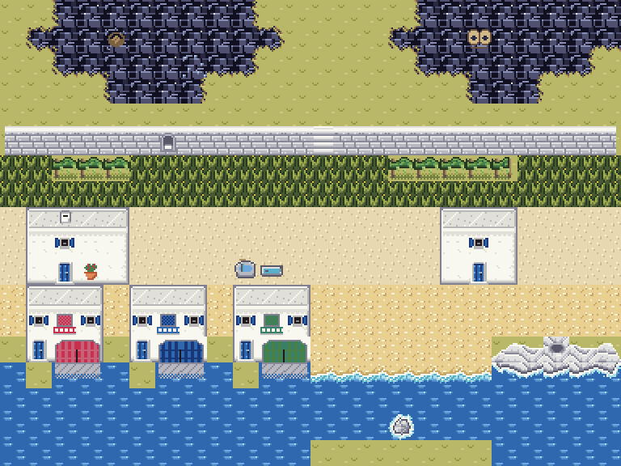

# melos tileset catalog

`gTileset_Melos` is Melos, the sea of Routes 22 and 23, and Echo's sea caves (Act III, Kythera Isle; SCRIPT.md Part 10). Pair it with the `aethos` primary, which supplies the open grass, paths, sand, sea, olives and cypresses.

**This file is generated.** `tools/ichor/art/kythera_build.py melos` paints the tileset, compiles it, registers it and rewrites this catalog. The art is in `tools/ichor/art/kythera_*.py` (and `melos_art.py`), the palette plan and the borrowed ground in `kythera_lib.py`.

| Image | Shows |
|---|---|
| [`img/melos_klima.png`](img/melos_klima.png) | Klima on Melos: boathouses, the well, the terraces and the niche, the obsidian slope, the pumice cliffs |
| [`img/melos_pieces.png`](img/melos_pieces.png) | Every structure on its ground |
| [`img/melos_sheet.png`](img/melos_sheet.png) | The numbered metatile sheet, rendered from the compiled tileset |



It is one of the Kythera family of secondaries; see [`TILES_kythera.md`](TILES_kythera.md) for why the art is split and which seams then need aethos-only strips.

## How to use it

**Ids.** Each grid lists metatile ids as Porymap shows them, row by row. Each section
starts on a fixed row of the sheet (melos at 0x200, coast at 0x300, sea at 0x360, cave at 0x380). Structures are placed first-fit in build
order, so appending a new one never moves an old one. Map builders should place pieces
by key and name, never by raw id: `tools/ichor/maps/kythera_tiles.py` holds every
Kythera-family catalog as a Python dict (`mid('melos', 'surf', 'S')`), and
`build/melos/catalog.json` is the same as JSON.

**Walk codes** (the grid beside each structure, and the cell tables):

| Code | Meaning |
|---|---|
| `X` | Impassable: set collision 1. |
| `.` | Passable. |
| `T` | Passable, drawn over the player, who walks behind it. |
| `G` | Tall grass: `MB_TALL_GRASS`, wild encounters. Passable. |
| `D` | Door: `MB_NON_ANIMATED_DOOR`. Put the warp here. |
| `W` | Sea: `MB_OCEAN_WATER`, surfable (collision 0). |
| `P` | Fresh water: `MB_POND_WATER`, surfable. |
| `F` | Waterfall: `MB_WATERFALL` (the Horn of Achelous climbs it). |
| `J` | Ledge: `MB_JUMP_SOUTH`. |

**Borrowed ground.** Cells marked *grass*, *path*, *sand*, *sea*, *shallow* or *fall*
draw no ground of their own: after Porytiles compiles, the build points their
bottom-layer tiles at aethos's grass (`0x001`), limestone path (`0x1D9`), sand
(`0x124`), animated sea (`0x170`), animated turquoise shallows (`0x0D1`) or animated
waterfall (`0x0B3`). They meet aethos ground exactly and cost no tiles. Rebuild
whenever aethos is repainted; the build checks every borrowed entry. A borrowed cell's
own art is in one layer: the middle (`COVERED`, under the player) or the top (`SPLIT`,
over the player).

**Animations.** Porytiles animations in this tileset, driven by `InitTilesetAnim_PorytilesManaged_Melos` (`include/porytiles_generated/tilesets/melos/generated_anim_code.h`): `glint`: light catching the obsidian now and then (3 frames, mostly still); `surf`: the foam on the shore, round rocks, at a fall's foot and over a weir, washing up and back (3 frames, ping-pong). Every 8x8 tile that changes between frames is an animated tile; frame 0 is the key drawn in the sheet. The sea, shallows and waterfall under them are aethos's own animations.

**Layer types** in the cell tables: `NORMAL` (bottom and middle under the player),
`COVERED` (ground under the middle layer), `SPLIT` (ground under, art over the player).

**Palettes.** Every 8x8 tile, in every animation frame, draws from one of seven color
groups, one per secondary palette (`kythera_lib.GROUPS`), passed to Porytiles as packing
hints.

| Group | Use |
|---|---|
| foam | The surf, foam lace, shingle, white rock, Aphrodite's rock, reefs, quays, pumice |
| rose | Pink stone and rose marble: sea-cliffs, the quarry, temple and stair, kerbs, moss |
| green | Myrtle, sea-grass and thrift, roses, narcissus, plane, oleander, apple |
| cyc | Whitewashed houses, Aegean doors, rose-pink frames, pots, dovecotes, sea doors |
| terra | Timber and terracotta: boats, the trireme, slips, mill wheels, bridges, gear |
| bronze | Bronze mirrors, the harbor shrine's dove, the great herm, the Minoan vault door |
| melos | Melos's obsidian slope on its earth and grass |

**Tile budget.** 503 of 504 tiles (424 metatiles). The door animations copy their
frames into tiles 504-511 (`DOOR_TILE_START_SIZE1`, `src/field_door.c`), so the build
fails past 504. Static tiles within two pixels of one another are merged.

**Scripted swaps.** The build writes the ids scripts swap to the `gTileset_Melos` block at the end of `include/constants/metatile_labels.h`: `METATILE_Melos_Brazier_Cold`, `METATILE_Melos_Brazier_Lit`.

## Melos

### The obsidian slope, soft-edged

`obsidian`, 8 wide by 6 tall. Melos's volcanic hillside: warm scree and tuff pebbles with chips of black glass, as all 47 soft-edge shapes on aethos grass (kythera_lib.blob_key gives a cell's key from a mask), its edge crumbling into the meadow. Walkable. The full interior is `1|11111111`; it glints now and then in the sun (the `glint` animation). The obsidian itself runs through it in veins (`obsidian_veins`).

Shape keys (kythera_lib.blob_key) and their ids:

| Shape key | Id |
|---|---|
| `1|00000000` | 0x200 |
| `1|00000010` | 0x201 |
| `1|00001000` | 0x202 |
| `1|00001010` | 0x203 |
| `1|00001110` | 0x204 |
| `1|00100000` | 0x205 |
| `1|00100010` | 0x206 |
| `1|00101000` | 0x207 |
| `1|00101010` | 0x208 |
| `1|00101110` | 0x209 |
| `1|00111000` | 0x20A |
| `1|00111010` | 0x20B |
| `1|00111110` | 0x20C |
| `1|10000000` | 0x20D |
| `1|10000010` | 0x20E |
| `1|10000011` | 0x20F |
| `1|10001000` | 0x210 |
| `1|10001010` | 0x211 |
| `1|10001011` | 0x212 |
| `1|10001110` | 0x213 |
| `1|10001111` | 0x214 |
| `1|10100000` | 0x215 |
| `1|10100010` | 0x216 |
| `1|10100011` | 0x217 |
| `1|10101000` | 0x218 |
| `1|10101010` | 0x219 |
| `1|10101011` | 0x21A |
| `1|10101110` | 0x21B |
| `1|10101111` | 0x21C |
| `1|10111000` | 0x21D |
| `1|10111010` | 0x21E |
| `1|10111011` | 0x21F |
| `1|10111110` | 0x220 |
| `1|10111111` | 0x221 |
| `1|11100000` | 0x222 |
| `1|11100010` | 0x223 |
| `1|11100011` | 0x224 |
| `1|11101000` | 0x225 |
| `1|11101010` | 0x226 |
| `1|11101011` | 0x227 |
| `1|11101110` | 0x228 |
| `1|11101111` | 0x229 |
| `1|11111000` | 0x22A |
| `1|11111010` | 0x22B |
| `1|11111011` | 0x22C |
| `1|11111110` | 0x22D |
| `1|11111111` | 0x22E |

Every cell: walk `.`, `MB_NORMAL`.

### Knapping pits, flakes and Theion's sacks

`obsidian_bits`, 5 wide by 1 tall. On the obsidian (each is drawn on the slope's full interior texture): `pit` and `pit_b`, old knapping pits, shallow hollows ringed with waste flakes (the dig spots); `flakes`, a scatter of chips; `sacks`, Theion's sacks of obsidian (impassable); `core`, a big worked core lying on the glass.

```text
ids                                walk
0x230 0x231 0x232 0x233 0x234   . . . X .
```

| Id | Piece | Walk | Behavior | Layer | Ground |
|---|---|---|---|---|---|
| 0x230 | `pit` | `.` | `MB_NORMAL` | COVERED |  |
| 0x231 | `pit_b` | `.` | `MB_NORMAL` | COVERED |  |
| 0x232 | `flakes` | `.` | `MB_NORMAL` | COVERED |  |
| 0x233 | `sacks` | `X` | `MB_NORMAL` | COVERED |  |
| 0x234 | `core` | `.` | `MB_NORMAL` | COVERED |  |

### Klima's boathouses

`boathouse`, 7 wide by 4 tall. Melos's boathouses at the waterline, whitewashed, built into the shore: a roof row (`R_*`), an upper floor with a painted balcony door (`U_balcony`, `U_balcony_blue`, `U_balcony_green`), and on the ground floor a pair of sea doors over the boat (`sea_red_L` `sea_red_R`, `sea_blue_*`, `sea_green_*`) with the family's `land_door` beside them (`MB_NON_ANIMATED_DOOR`). Below the sea doors, `slip_L` `slip_R` run a short stone slip into the sea (borrowed sea). A boathouse is 3 wide: `land_door` then a pair of sea doors; match the balcony's color to the doors'.

```text
ids                                            walk
0x238 0x239 0x23A 0x23B 0x23C 0x23D 0x23E   X X X X X X X
0x240 0x241 0x242 0x243 0x244 0x245 0x246   X X X X X X X
0x248 0x249 0x24A 0x24B 0x24C 0x24D 0x24E   D X X X X X X
0x250 0x251 0x252 0x253 0x254 0x255 0x256   X X X . . . .
```

| Id | Piece | Walk | Behavior | Layer | Ground |
|---|---|---|---|---|---|
| 0x238 | `R_L` | `X` | `MB_NORMAL` | COVERED |  |
| 0x239 | `R_M` | `X` | `MB_NORMAL` | COVERED |  |
| 0x23A | `R_R` | `X` | `MB_NORMAL` | COVERED |  |
| 0x23B | (3, 0) | `X` | `MB_NORMAL` | COVERED |  |
| 0x23C | (4, 0) | `X` | `MB_NORMAL` | COVERED |  |
| 0x23D | (5, 0) | `X` | `MB_NORMAL` | COVERED |  |
| 0x23E | (6, 0) | `X` | `MB_NORMAL` | COVERED |  |
| 0x240 | `U_L` | `X` | `MB_NORMAL` | COVERED |  |
| 0x241 | `U_balcony` | `X` | `MB_NORMAL` | COVERED |  |
| 0x242 | `U_R` | `X` | `MB_NORMAL` | COVERED |  |
| 0x243 | `U_balcony_blue` | `X` | `MB_NORMAL` | COVERED |  |
| 0x244 | `U_balcony_green` | `X` | `MB_NORMAL` | COVERED |  |
| 0x245 | (5, 1) | `X` | `MB_NORMAL` | COVERED |  |
| 0x246 | (6, 1) | `X` | `MB_NORMAL` | COVERED |  |
| 0x248 | `land_door` | `D` | `MB_NON_ANIMATED_DOOR` | COVERED |  |
| 0x249 | `sea_red_L` | `X` | `MB_NORMAL` | COVERED |  |
| 0x24A | `sea_red_R` | `X` | `MB_NORMAL` | COVERED |  |
| 0x24B | `sea_blue_L` | `X` | `MB_NORMAL` | COVERED |  |
| 0x24C | `sea_blue_R` | `X` | `MB_NORMAL` | COVERED |  |
| 0x24D | `sea_green_L` | `X` | `MB_NORMAL` | COVERED |  |
| 0x24E | `sea_green_R` | `X` | `MB_NORMAL` | COVERED |  |
| 0x250 | (0, 3) | `X` | `MB_NORMAL` | COVERED | sand |
| 0x251 | `slip_L` | `X` | `MB_NORMAL` | COVERED | sea |
| 0x252 | `slip_R` | `X` | `MB_NORMAL` | COVERED | sea |
| 0x253 | (3, 3) | `.` | `MB_NORMAL` | COVERED | sand |
| 0x254 | (4, 3) | `.` | `MB_NORMAL` | COVERED | sand |
| 0x255 | (5, 3) | `.` | `MB_NORMAL` | COVERED | sand |
| 0x256 | (6, 3) | `.` | `MB_NORMAL` | COVERED | sand |

### The well, vines, and Melos's tuff terraces

`village`, 5 wide by 3 tall. On borrowed path and grass. `well`, a round stone well with a bucket, and `trough`, its stone trough (the girl at the well; both impassable). `vine` and `vine_end`, vines on a trellis for the terraces (with aethos tall grass for the barley). The terrace walls are Melos's grey tuff: a `top_*` row (the upper terrace's edge, walkable) over a wall row `wall_L` `wall` `wall_R`; `wall_steps` under `top_steps` is a stair through it. `niche` is the terrace-wall niche with its low plinth where the armless statue stands (an object, 16x32: place her on the niche cell); the mirror facing her is an object too. `terrace_lip` is a lone stretch of coping on grass (walkable).

```text
ids                                walk
0x258 0x259 0x25A 0x25B 0x25C   X X X X .
0x260 0x261 0x262 0x263 0x264   X X X X .
0x268 0x269 0x26A 0x26B 0x26C   . . . . .
```

| Id | Piece | Walk | Behavior | Layer | Ground |
|---|---|---|---|---|---|
| 0x258 | `well` | `X` | `MB_NORMAL` | COVERED | path |
| 0x259 | `trough` | `X` | `MB_NORMAL` | COVERED | path |
| 0x25A | `vine` | `X` | `MB_NORMAL` | COVERED | grass |
| 0x25B | `vine_end` | `X` | `MB_NORMAL` | COVERED | grass |
| 0x25C | `terrace_lip` | `.` | `MB_NORMAL` | COVERED | grass |
| 0x260 | `wall_L` | `X` | `MB_NORMAL` | COVERED | grass |
| 0x261 | `wall` | `X` | `MB_NORMAL` | COVERED |  |
| 0x262 | `wall_R` | `X` | `MB_NORMAL` | COVERED | grass |
| 0x263 | `niche` | `X` | `MB_NORMAL` | COVERED |  |
| 0x264 | `wall_steps` | `.` | `MB_NORMAL` | COVERED |  |
| 0x268 | `top_L` | `.` | `MB_NORMAL` | COVERED | grass |
| 0x269 | `top` | `.` | `MB_NORMAL` | COVERED | grass |
| 0x26A | `top_R` | `.` | `MB_NORMAL` | COVERED | grass |
| 0x26B | `top_niche` | `.` | `MB_NORMAL` | COVERED | grass |
| 0x26C | `top_steps` | `.` | `MB_NORMAL` | COVERED | grass |

### The Cycladic house kit

`house`, 7 wide by 2 tall. Parts that snap together into whitewashed cube houses (see *House fronts* below). Rows: `R_*` the flat roof and its parapet, seen from above; `U_*` the upper wall; `G_*` and the doors, the ground-floor wall on its grey-washed foot. Columns `_L` (the lit west corner), `_M` (repeat it), `_R` (the shaded east corner). Roof extras: `R_chimney`, `R_dove` / `R_doves` (Paphia's roofs), `R_jar` (a water jar on the roof). Upper-wall extras: `U_window` (blue shutters), `U_window_pink`, `U_niche` (a little lamp niche), `U_vine` (a vine trained over the wall). Doors (`MB_NON_ANIMATED_DOOR`, put the warp here): `door` (Aegean blue in a rose-pink frame), `door_white` (the same in a white frame, for Skandeia's plainer houses), `door_arch` (an arched doorway). Ground-wall extras: `G_window`, `pot_rose`, `pot_basil` (a pot on the step), `mirror` (a polished bronze mirror by the door, Paphia's custom) and `mirror_dim` (the same, a dim figure in it), `G_bench` (a whitewashed bench), `G_shell` (a scallop shell set in the wall), `G_steps` (an outside stair up to the roof). Every cell is impassable except the doors.

```text
ids                                            walk
0x270 0x271 0x272 0x273 0x274 0x275 0x276   X X X X X X X
0x278 0x279 0x27A 0x27B 0x27C 0x27D 0x27E   X X X X D X X
```

| Id | Piece | Walk | Behavior | Layer | Ground |
|---|---|---|---|---|---|
| 0x270 | `R_L` | `X` | `MB_NORMAL` | COVERED |  |
| 0x271 | `R_M` | `X` | `MB_NORMAL` | COVERED |  |
| 0x272 | `R_R` | `X` | `MB_NORMAL` | COVERED |  |
| 0x273 | `R_chimney` | `X` | `MB_NORMAL` | COVERED |  |
| 0x274 | `U_L` | `X` | `MB_NORMAL` | COVERED |  |
| 0x275 | `U_M` | `X` | `MB_NORMAL` | COVERED |  |
| 0x276 | `U_R` | `X` | `MB_NORMAL` | COVERED |  |
| 0x278 | `U_window` | `X` | `MB_NORMAL` | COVERED |  |
| 0x279 | `G_L` | `X` | `MB_NORMAL` | COVERED |  |
| 0x27A | `G_M` | `X` | `MB_NORMAL` | COVERED |  |
| 0x27B | `G_R` | `X` | `MB_NORMAL` | COVERED |  |
| 0x27C | `door_white` | `D` | `MB_NON_ANIMATED_DOOR` | COVERED |  |
| 0x27D | `pot_basil` | `X` | `MB_NORMAL` | COVERED |  |
| 0x27E | `pot_rose` | `X` | `MB_NORMAL` | COVERED |  |

### The curved stone quay

`quay`, 6 wide by 2 tall. The stone jetty where the Euploia's boat lands: the quay kit's edges (see `TILES_skandeia.md`), its top aethos path.

```text
ids                                      walk
0x280 0x281 0x282 0x283 0x284 0x285   X X X X X X
0x288 0x289 0x28A 0x28B 0x28C 0x28D   X X . . . .
```

| Id | Piece | Walk | Behavior | Layer | Ground |
|---|---|---|---|---|---|
| 0x280 | `S` | `X` | `MB_NORMAL` | COVERED | sea |
| 0x281 | `N` | `X` | `MB_NORMAL` | COVERED | sea |
| 0x282 | `E` | `X` | `MB_NORMAL` | COVERED | sea |
| 0x283 | `W` | `X` | `MB_NORMAL` | COVERED | sea |
| 0x284 | `out_SE` | `X` | `MB_NORMAL` | COVERED | sea |
| 0x285 | `out_SW` | `X` | `MB_NORMAL` | COVERED | sea |
| 0x288 | `out_NE` | `X` | `MB_NORMAL` | COVERED | sea |
| 0x289 | `out_NW` | `X` | `MB_NORMAL` | COVERED | sea |
| 0x28A | `steps_S` | `.` | `MB_NORMAL` | COVERED | sea |
| 0x28B | `N_plank` | `.` | `MB_NORMAL` | COVERED | sea |
| 0x28C | `S_plank` | `.` | `MB_NORMAL` | COVERED | sea |
| 0x28D | (5, 1) | `.` | `MB_NORMAL` | COVERED | sea |

### A fishing boat, afloat and beached

`kaiki`, 6 wide by 2 tall. A kaiki, the island's fishing boat, bow to the east, 3 x 2 each: `afloat` on borrowed sea, `beached` drawn up on the sand (borrowed sand). Impassable.

```text
ids                                      walk
0x290 0x291 0x292 0x293 0x294 0x295   X X X X X X
0x298 0x299 0x29A 0x29B 0x29C 0x29D   X X X X X X
```

| Id | Piece | Walk | Behavior | Layer | Ground |
|---|---|---|---|---|---|
| 0x290 | `afloat` | `X` | `MB_NORMAL` | COVERED | sea |
| 0x291 | (1, 0) | `X` | `MB_NORMAL` | COVERED | sea |
| 0x292 | (2, 0) | `X` | `MB_NORMAL` | COVERED | sea |
| 0x293 | `beached` | `X` | `MB_NORMAL` | COVERED | sand |
| 0x294 | (4, 0) | `X` | `MB_NORMAL` | COVERED | sand |
| 0x295 | (5, 0) | `X` | `MB_NORMAL` | COVERED | sand |
| 0x298 | (0, 1) | `X` | `MB_NORMAL` | COVERED | sea |
| 0x299 | (1, 1) | `X` | `MB_NORMAL` | COVERED | sea |
| 0x29A | (2, 1) | `X` | `MB_NORMAL` | COVERED | sea |
| 0x29B | (3, 1) | `X` | `MB_NORMAL` | COVERED | sand |
| 0x29C | (4, 1) | `X` | `MB_NORMAL` | COVERED | sand |
| 0x29D | (5, 1) | `X` | `MB_NORMAL` | COVERED | sand |

### Veins of obsidian through the scree

`obsidian_veins`, 5 wide by 2 tall. Drawn on the slope's full interior (`obsidian` `1|11111111`), so they sit anywhere inside it. Chain pieces join the middle of two sides: `WE`, `NS`, and the bends `NE` `NW` `SE` `SW`; `end_W` (and `end_E`) is a vein coming in from that side and pinching out. `spoil` is a knapper's heap of waste flakes, `lens` a lone pod of glass. Walkable.

```text
ids                                walk
0x2A0 0x2A1 0x2A2 0x2A3 0x2A4   . . . . .
0x2A8 0x2A9 0x2AA 0x2AB 0x2AC   . . . . .
```

| Id | Piece | Walk | Behavior | Layer | Ground |
|---|---|---|---|---|---|
| 0x2A0 | `WE` | `.` | `MB_NORMAL` | COVERED |  |
| 0x2A1 | `NS` | `.` | `MB_NORMAL` | COVERED |  |
| 0x2A2 | `NE` | `.` | `MB_NORMAL` | COVERED |  |
| 0x2A3 | `NW` | `.` | `MB_NORMAL` | COVERED |  |
| 0x2A4 | `SE` | `.` | `MB_NORMAL` | COVERED |  |
| 0x2A8 | `SW` | `.` | `MB_NORMAL` | COVERED |  |
| 0x2A9 | `end_W` | `.` | `MB_NORMAL` | COVERED |  |
| 0x2AA | `end_E` | `.` | `MB_NORMAL` | COVERED |  |
| 0x2AB | `spoil` | `.` | `MB_NORMAL` | COVERED |  |
| 0x2AC | `lens` | `.` | `MB_NORMAL` | COVERED |  |

## The coast

### Foam-edged surf

`surf`, 8 wide by 2 tall. Where Kythera's sand meets the sea. Each cell borrows aethos's animated sea and draws the sand to the waterline, a rim of turquoise shallows and the foam, which washes up and back (the `surf` animation, 3 frames). Pieces are named by where the sea is: `S` (sand north, sea south; `S2` is the same with a deeper bite, to break up a long beach), `N`, `E`, `W`; `out_NW` is the south-east tip of a sand spit (sand to the north-west, sea round it), and so on; `in_SE` is a cove's corner, sea only to the south-east. The sand above meets aethos sand (0x124) exactly; the sea below meets aethos sea (0x170). Every cell is `MB_OCEAN_WATER`, like aethos's own beach edges: surf onto it, walk on the sand beside it.

```text
ids                                                  walk
0x300 0x301 0x302 0x303 0x304 0x305 0x306 0x307   W W W W W W W W
0x308 0x309 0x30A 0x30B 0x30C 0x30D 0x30E 0x30F   W W W W W W W W
```

| Id | Piece | Walk | Behavior | Layer | Ground |
|---|---|---|---|---|---|
| 0x300 | `S` | `W` | `MB_OCEAN_WATER` | COVERED | sea |
| 0x301 | `S2` | `W` | `MB_OCEAN_WATER` | COVERED | sea |
| 0x302 | `N` | `W` | `MB_OCEAN_WATER` | COVERED | sea |
| 0x303 | `E` | `W` | `MB_OCEAN_WATER` | COVERED | sea |
| 0x304 | `W` | `W` | `MB_OCEAN_WATER` | COVERED | sea |
| 0x305 | `out_NW` | `W` | `MB_OCEAN_WATER` | COVERED | sea |
| 0x306 | `out_NE` | `W` | `MB_OCEAN_WATER` | COVERED | sea |
| 0x307 | `out_SW` | `W` | `MB_OCEAN_WATER` | COVERED | sea |
| 0x308 | `out_SE` | `W` | `MB_OCEAN_WATER` | COVERED | sea |
| 0x309 | `in_SE` | `W` | `MB_OCEAN_WATER` | COVERED | sea |
| 0x30A | `in_SW` | `W` | `MB_OCEAN_WATER` | COVERED | sea |
| 0x30B | `in_NE` | `W` | `MB_OCEAN_WATER` | COVERED | sea |
| 0x30C | `in_NW` | `W` | `MB_OCEAN_WATER` | COVERED | sea |
| 0x30D | (5, 1) | `W` | `MB_OCEAN_WATER` | COVERED | sea |
| 0x30E | (6, 1) | `W` | `MB_OCEAN_WATER` | COVERED | sea |
| 0x30F | (7, 1) | `W` | `MB_OCEAN_WATER` | COVERED | sea |

### White sand: foam lace, shells and wrack

`sand_decor`, 3 wide by 1 tall. On borrowed sand, walkable: `lace`, `shells`, `wrack`.

```text
ids                    walk
0x310 0x311 0x312   . . .
```

| Id | Piece | Walk | Behavior | Layer | Ground |
|---|---|---|---|---|---|
| 0x310 | `lace` | `.` | `MB_NORMAL` | COVERED | sand |
| 0x311 | `shells` | `.` | `MB_NORMAL` | COVERED | sand |
| 0x312 | `wrack` | `.` | `MB_NORMAL` | COVERED | sand |

### Melos's white pumice cliffs

`pumice`, 4 wide by 2 tall. Melos's bay ends in white pumice worn by the sea into frozen waves. `top_*` is the cliff's crest (on borrowed grass), `mass` its body to fill a wider headland, `foot_*` where it meets the sea (borrowed sea, animated foam), `hollow` a sea-worn hollow in the mass where something might be tucked (the dead end's reward). Impassable.

```text
ids                          walk
0x313 0x314 0x315 0x316   X X X X
0x31B 0x31C 0x31D 0x31E   W W W X
```

| Id | Piece | Walk | Behavior | Layer | Ground |
|---|---|---|---|---|---|
| 0x313 | `top_L` | `X` | `MB_NORMAL` | COVERED | grass |
| 0x314 | `top` | `X` | `MB_NORMAL` | COVERED | grass |
| 0x315 | `top_R` | `X` | `MB_NORMAL` | COVERED | grass |
| 0x316 | `mass` | `X` | `MB_NORMAL` | COVERED |  |
| 0x31B | `foot_L` | `W` | `MB_OCEAN_WATER` | COVERED | sea |
| 0x31C | `foot` | `W` | `MB_OCEAN_WATER` | COVERED | sea |
| 0x31D | `foot_R` | `W` | `MB_OCEAN_WATER` | COVERED | sea |
| 0x31E | `hollow` | `X` | `MB_NORMAL` | COVERED |  |

### Tide rocks, a reef spit, white rocks, sea marks

`rocks`, 8 wide by 1 tall. `tide_rock` and `tide_rocks` stand in the surf with breathing foam (animated); `rock_sand`, `rock_grass` on land. The sea marks of Routes 22 and 23: `stake` and `stakes` (the trireme lane), `sunken_column` (a fallen capital awash), `sunken_drum` (a drum under the turquoise shallows, surfable). All on borrowed sea except where named.

```text
ids                                                  walk
0x320 0x321 0x322 0x323 0x324 0x325 0x326 0x327   X X X X X X X W
```

| Id | Piece | Walk | Behavior | Layer | Ground |
|---|---|---|---|---|---|
| 0x320 | `tide_rock` | `X` | `MB_NORMAL` | COVERED | sea |
| 0x321 | `tide_rocks` | `X` | `MB_NORMAL` | COVERED | sea |
| 0x322 | `rock_sand` | `X` | `MB_NORMAL` | COVERED | sand |
| 0x323 | `rock_grass` | `X` | `MB_NORMAL` | COVERED | grass |
| 0x324 | `stake` | `X` | `MB_NORMAL` | COVERED | sea |
| 0x325 | `stakes` | `X` | `MB_NORMAL` | COVERED | sea |
| 0x326 | `sunken_column` | `X` | `MB_NORMAL` | COVERED | sea |
| 0x327 | `sunken_drum` | `W` | `MB_OCEAN_WATER` | COVERED | shallow |

## The open sea

### Anydros's rock and the Antikythera wreck

`sea_marks`, 5 wide by 2 tall. On borrowed sea, with breathing foam (animated). `anydros` (2 x 2): Anydros, the bare rock on Route 22 with one dead fig tree clinging to it. `wreck` (3 x 2): the old wreck's ribs standing out of the water on the Antikythera reef, a spar across them. Both impassable.

```text
ids                                walk
0x360 0x361 0x362 0x363 0x364   X X X X X
0x368 0x369 0x36A 0x36B 0x36C   X X X X X
```

| Id | Piece | Walk | Behavior | Layer | Ground |
|---|---|---|---|---|---|
| 0x360 | `anydros` | `X` | `MB_NORMAL` | COVERED | sea |
| 0x361 | (1, 0) | `X` | `MB_NORMAL` | COVERED | sea |
| 0x362 | `wreck` | `X` | `MB_NORMAL` | COVERED | sea |
| 0x363 | (3, 0) | `X` | `MB_NORMAL` | COVERED | sea |
| 0x364 | (4, 0) | `X` | `MB_NORMAL` | COVERED | sea |
| 0x368 | (0, 1) | `X` | `MB_NORMAL` | COVERED | sea |
| 0x369 | (1, 1) | `X` | `MB_NORMAL` | COVERED | sea |
| 0x36A | (2, 1) | `X` | `MB_NORMAL` | COVERED | sea |
| 0x36B | (3, 1) | `X` | `MB_NORMAL` | COVERED | sea |
| 0x36C | (4, 1) | `X` | `MB_NORMAL` | COVERED | sea |

## Echo's sea caves

### Echo's sea caves

`cave`, 8 wide by 4 tall. Dark pink rock, the spring's water running down to the sea. The rock mass is `ceil` (the cave's roof seen from above), edged by `ceil_S` (its south lip, over a wall face), `ceil_E` / `ceil_W` (a wall running north-south, the floor to the east / west), `ceil_NW` / `ceil_NE` (outer corners, floor to the south-east / south-west) and `ceil_in_SE` / `ceil_in_SW` (inner corners). Below a `ceil_S` run a wall face two cells high: `wall_L` `wall` `wall_b` `wall_R` over `base_L` `base` `base_R`, where it meets the floor. `crack` is the Speaking Hall's roof crack, with `light_L` `light_R` the patch of daylight it throws on the floor. The floor: `floor`, `floor_b`, `floor_pebbles` (walkable). `pool_N` `_S` `_E` `_W` edge a cave pool (borrowed sea; named by where the water is). `wall_lamp` is a lamp in a niche by the diver; `brazier_cold` / `brazier_lit` the dark gallery's brazier (SYSTEMS §2; swap cold for lit). `stair_up` climbs back to the spring (the door). `mouth_L` `mouth_R` are the sea mouth: a low arch opening on daylit sea (borrowed sea, surfable).

```text
ids                                                  walk
0x380 0x381 0x382 0x383 0x384 0x385 0x386 0x387   X X X X X X X X
0x388 0x389 0x38A 0x38B 0x38C 0x38D 0x38E 0x38F   X X X X X X X D
0x390 0x391 0x392 0x393 0x394 0x395 0x396 0x397   X X X . . . . .
0x398 0x399 0x39A 0x39B 0x39C 0x39D 0x39E 0x39F   X X X X X X W W
```

| Id | Piece | Walk | Behavior | Layer | Ground |
|---|---|---|---|---|---|
| 0x380 | `ceil` | `X` | `MB_NORMAL` | COVERED |  |
| 0x381 | `ceil_S` | `X` | `MB_NORMAL` | COVERED |  |
| 0x382 | `ceil_S_b` | `X` | `MB_NORMAL` | COVERED |  |
| 0x383 | `ceil_E` | `X` | `MB_NORMAL` | COVERED |  |
| 0x384 | `ceil_W` | `X` | `MB_NORMAL` | COVERED |  |
| 0x385 | `ceil_NW` | `X` | `MB_NORMAL` | COVERED |  |
| 0x386 | `ceil_NE` | `X` | `MB_NORMAL` | COVERED |  |
| 0x387 | `crack` | `X` | `MB_NORMAL` | COVERED |  |
| 0x388 | `wall_L` | `X` | `MB_NORMAL` | COVERED |  |
| 0x389 | `wall` | `X` | `MB_NORMAL` | COVERED |  |
| 0x38A | `wall_b` | `X` | `MB_NORMAL` | COVERED |  |
| 0x38B | `wall_R` | `X` | `MB_NORMAL` | COVERED |  |
| 0x38C | `ceil_in_SE` | `X` | `MB_NORMAL` | COVERED |  |
| 0x38D | `ceil_in_SW` | `X` | `MB_NORMAL` | COVERED |  |
| 0x38E | `wall_lamp` | `X` | `MB_NORMAL` | COVERED |  |
| 0x38F | `stair_up` | `D` | `MB_NON_ANIMATED_DOOR` | COVERED |  |
| 0x390 | `base_L` | `X` | `MB_NORMAL` | COVERED |  |
| 0x391 | `base` | `X` | `MB_NORMAL` | COVERED |  |
| 0x392 | `base_R` | `X` | `MB_NORMAL` | COVERED |  |
| 0x393 | `floor` | `.` | `MB_NORMAL` | COVERED |  |
| 0x394 | `floor_b` | `.` | `MB_NORMAL` | COVERED |  |
| 0x395 | `floor_pebbles` | `.` | `MB_NORMAL` | COVERED |  |
| 0x396 | `light_L` | `.` | `MB_NORMAL` | COVERED |  |
| 0x397 | `light_R` | `.` | `MB_NORMAL` | COVERED |  |
| 0x398 | `pool_N` | `X` | `MB_NORMAL` | COVERED | sea |
| 0x399 | `pool_S` | `X` | `MB_NORMAL` | COVERED | sea |
| 0x39A | `pool_E` | `X` | `MB_NORMAL` | COVERED | sea |
| 0x39B | `pool_W` | `X` | `MB_NORMAL` | COVERED | sea |
| 0x39C | `brazier_cold` | `X` | `MB_NORMAL` | COVERED |  |
| 0x39D | `brazier_lit` | `X` | `MB_NORMAL` | COVERED |  |
| 0x39E | `mouth_L` | `W` | `MB_OCEAN_WATER` | COVERED | sea |
| 0x39F | `mouth_R` | `W` | `MB_OCEAN_WATER` | COVERED | sea |

### Rose briar, oleander and meadow flowers

`flowers`, 2 wide by 1 tall. On borrowed grass: `thrift` (walkable), `briar` (impassable).

```text
ids              walk
0x3A0 0x3A1   . X
```

| Id | Piece | Walk | Behavior | Layer | Ground |
|---|---|---|---|---|---|
| 0x3A0 | `thrift` | `.` | `MB_NORMAL` | COVERED | grass |
| 0x3A1 | `briar` | `X` | `MB_NORMAL` | COVERED | grass |
