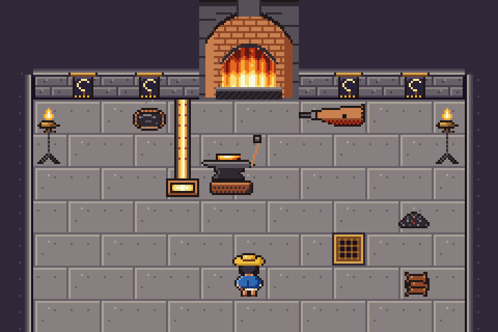
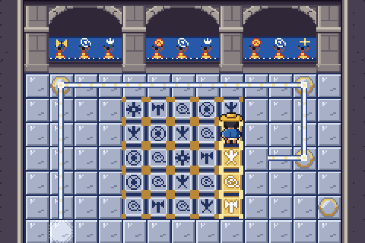
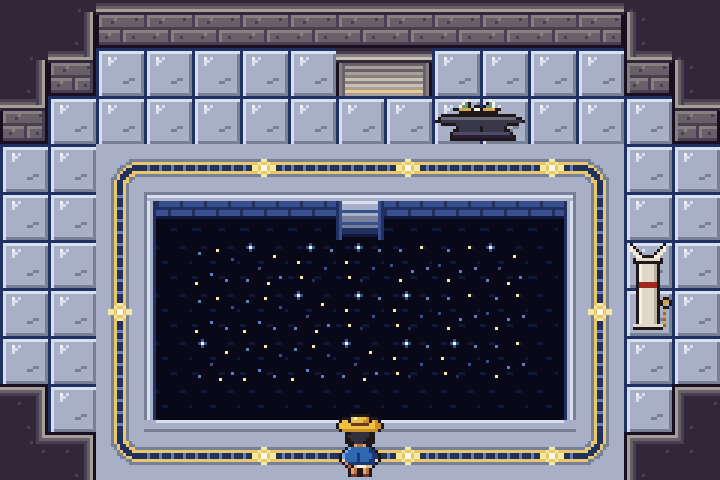

# Labyrinth tileset: `mychos`

`gTileset_Mychos` ("the innermost part of a house") is the Labyrinth's sister tileset: the
Titan wing (Rings IV and VI, the archive, the vault, the Mistress's shrine), Ring VII (the
Choros) and the Starry Chamber. Its house and floor sections are `labyrinth`'s, at the same
ids. **The plan for both, the thread, the walls, palettes, budget and notes for the ring
builders are in [TILES_labyrinth.md](TILES_labyrinth.md).**







| Image | Shows |
|---|---|
| `img/labyrinth_scene_forge.png` | Ring VI's forge (scene G), one screen: the furnace roaring in its wall between sickle banners, Hyperion's anvil, the bellows, the quench tub, a runnel of bronze into its mold, slag, a grate, the Titans' lamps |
| `img/labyrinth_scene_choros.png` | Ring VII (scene I, §5.7): the fresco of the whole dance along the north wall, the starlight beam from the shaft by three mirror bases to the floor's edge, the dancing floor revealed, E5-E2 danced |
| `img/labyrinth_scene_starry.png` | The Starry Chamber (scene J): the lustral basin full of the star-clock's stars (they twinkle in game), its gold-and-lapis ring, the anvil with the three fragments, the pillar of horns, the stair down from the Choros |
| `img/labyrinth_scene_*_pass1.png`, `_pass2` | The earlier passes |
| `img/mychos_pieces.png`, `img/mychos_sheet.png` | Every structure as drawn; every metatile with its id, from the compiled tileset |


## Catalog

Each grid lists metatile ids as Porymap shows them, with the collision beside it. Each section starts on a fixed row of the sheet, so adding to one never renumbers another: house at 0x200, titans at 0x268, thread at 0x320, choros at 0x338, heart at 0x3A0. `build/mychos/catalog.json` and `tools/ichor/maps/labyrinth_tiles.py` name every part (`names`), so a map builder can place pieces by key and name, never by raw id. Odd twins are listed with their even twin.

### The house: floors and walls

The masonry every map of the Labyrinth shares, the same at the same ids in `labyrinth` and `mychos`: the workshop's slab floor, the vaulted arcade, the side walls and the threshold; the rings' corridor walls (an autotile), the bronze anchor rings and the stairs from ring to ring.

#### Floor: gypsum slabs in red plaster

`floor`, 8 wide by 1 tall. Long gypsum slabs, two cells by one, in a running bond. **Lay `slab_l` on every cell where x + y is even and `slab_r` where it is odd**, and the slabs line up. (0) the void, near-black: the layout's border and every cell outside the rooms (block it). (3), (4) the two halves in the shadow a north wall casts, for the row in front of it. (5) a left half with a mason's labrys cut in it, the house's mark. (6) a right half, cracked. (7) a left half with an oil stain, for near the benches.

```text
ids                                               walk
0x200 0x201 0x202 0x203 0x204 0x205 0x206 0x207   X . . . . . . .
```

Parts: `void` 0x200, `slab_l` 0x201, `slab_r` 0x202, `shade_l` 0x203, `shade_r` 0x204, `labrys` 0x205, `crack` 0x206, `oil` 0x207.

#### Walls: the vaulted arcade

`arcade`, 8 wide by 3 tall. The north wall of a vaulted room, three rows tall: a pier (column 0), then a three-cell bay (columns 1-3) and its recess, and a pier with the back door cut through it (column 4: the door is (4, 2), MB_NON_ANIMATED_DOOR; put its warp there). Columns 5-7: the side walls' cells (west, east) and a pier carrying a bronze sconce, lit, on its lower face. Lay a wall as pier, bay, pier, bay... A four-cell bay is `arch4`; the Icarus Shaft and the lift use their own bays.

```text
ids                                               walk
0x208 0x209 0x20A 0x20B 0x20C 0x20D 0x20E 0x20F   X X X X X X X X
0x210 0x211 0x212 0x213 0x214 0x215 0x216 0x217   X X X X X X X X
0x218 0x219 0x21A 0x21B 0x21C 0x21D 0x21E 0x21F   X X X X D X X X
```

Door metatiles: 0x21C.

Parts: `pier` 0x208, `bay_l` 0x209, `bay_m` 0x20A, `bay_r` 0x20B, `door_pier` 0x20C, `side_w` 0x20D, `side_e` 0x20E, `pier_sconce` 0x20F.

#### Walls: a four-cell bay

`arch4`, 4 wide by 3 tall. A wider arch and recess for a four-cell bay, symmetric, for the middle of a room. The Icarus Shaft is drawn in a bay of this shape.

```text
ids                       walk
0x220 0x221 0x222 0x223   X X X X
0x228 0x229 0x22A 0x22B   X X X X
0x230 0x231 0x232 0x233   X X X X
```

Parts: `l` 0x220, `ml` 0x221, `mr` 0x222, `r` 0x223.

#### Edges: side walls by the floor, the south threshold

`edge`, 4 wide by 1 tall. (0), (3) the west and east walls beside the floor rows. (1), (2) the threshold down to the rings, for the bottom row, two cells wide: MB_SOUTH_ARROW_WARP, warps on both.

```text
ids                       walk
0x224 0x225 0x226 0x227   X . . X
```

Parts: `wall_w` 0x224, `sill_l` 0x225, `sill_r` 0x226, `wall_e` 0x227.

Behavior: MB_SOUTH_ARROW_WARP on 0x225, 0x226.

#### Walls: the corridor kit, an autotile

`walls`, 8 wide by 6 tall. Every wall cell of a ring is a **top** (the masonry's dark top, rim-lit where it meets a corridor) or a **face** (the wall seen from the south, one row tall; a wall cell with floor south of it). Paint a wall/floor grid and let `labyrinth_tiles.autotile()` pick each cell: a top's name lists the sides that meet floor (`top_nwe`) and its inner corners (`_in_nw`: floor only at that diagonal; `_in_sw`, `_in_se`: the wall turns down beside a face there); a face's two letters are its west and east ends: `o` open (the wall ends, its edge shows), `c` continuing, `i` meeting a wall that turns down beside it. `top` is solid rock: fill everything outside the rings with it. Walls one cell thick work both ways: a row of faces, or a column of `top_we` ending in `face_oo`. All block.

```text
ids                                               walk
0x238 0x239 0x23A 0x23B 0x23C 0x23D 0x23E 0x23F   X X X X X X X X
0x240 0x241 0x242 0x243 0x244 0x245 0x246 0x247   X X X X X X X X
0x248 0x249 0x24A 0x24B 0x24C 0x24D 0x24E 0x24F   X X X X X X X X
0x250 0x251 0x252 0x253 0x254 0x255 0x256 0x257   X X X X X X X X
0x258 0x259 0x25A 0x25B 0x25C 0x25D 0x25E 0x25F   X X X X X X X X
0x260 0x261 0x262 0x263 0x264 0x265 0x266 0x267   X X X X X X X X
```

Parts: `top` 0x238, `top_in_nw` 0x239, `top_in_ne` 0x23A, `top_in_nw_ne` 0x23B, `top_in_sw` 0x23C, `top_in_nw_sw` 0x23D, `top_in_ne_sw` 0x23E, `top_in_nw_ne_sw` 0x23F, `top_in_se` 0x240, `top_in_nw_se` 0x241, `top_in_ne_se` 0x242, `top_in_nw_ne_se` 0x243, `top_in_sw_se` 0x244, `top_in_nw_sw_se` 0x245, `top_in_ne_sw_se` 0x246, `top_in_nw_ne_sw_se` 0x247, `top_e` 0x248, `top_e_in_nw` 0x249, `top_e_in_sw` 0x24A, `top_e_in_nw_sw` 0x24B, `top_w` 0x24C, `top_w_in_ne` 0x24D, `top_w_in_se` 0x24E, `top_w_in_ne_se` 0x24F, `top_we` 0x250, `top_n` 0x251, `top_n_in_sw` 0x252, `top_n_in_se` 0x253, `top_n_in_sw_se` 0x254, `top_ne` 0x255, `top_ne_in_sw` 0x256, `top_nw` 0x257, `top_nw_in_se` 0x258, `top_nwe` 0x259, `face_oo` 0x25A, `face_oc` 0x25B, `face_oi` 0x25C, `face_co` 0x25D, `face_cc` 0x25E, `face_ci` 0x25F, `face_io` 0x260, `face_ic` 0x261, `face_ii` 0x262.

#### A bronze anchor ring in the floor

`anchor`, 1 wide by 1 tall. A bronze ring lying in its socket, where the thread is tied off: register its cell with `Ichor_AddThreadAnchor`. Walkable; thread is never drawn over it. `anchor_odd` where x + y is odd.

```text
ids     walk
0x22C   .
```

Parts: `ring` 0x22C.

`anchor_odd`: the odd twin, ids 0x22D.

#### Stairs from ring to ring

`stairs`, 4 wide by 1 tall. Two stairways, each two cells wide, for a face row: (0, 1) the stair **down** to the next ring, its steps dropping away into the dark; (2, 3) the stair **up** to the last, its steps climbing toward lamplight. MB_NORTH_ARROW_WARP on all four: put a warp on each cell. Their ends meet the face's open ends, so lay them in a run of faces.

```text
ids                       walk
0x234 0x235 0x236 0x237   . . . .
```

Parts: `down_l` 0x234, `down_r` 0x235, `up_l` 0x236, `up_r` 0x237.

Behavior: MB_NORTH_ARROW_WARP on 0x234, 0x235, 0x236, 0x237.

### The Titan wing: Rings IV and VI

Team Titan's quarters: the barracks, the mess hall, the sentry posts, the forge, the Hall of Dials, the archive, the vault and the Mistress's shrine.

#### The forge: the furnace in its wall

`forge`, 3 wide by 3 tall. The forge's furnace (Ring VI, scene G), built into a north wall three cells wide and three tall (as a bay of the arcade): a domed brick furnace, its mouth full of fire (animated), a hood over it and a chimney into the vault, coal heaped at its foot. Blocks; lay floor in front of it.

```text
ids                 walk
0x268 0x269 0x26A   X X X
0x270 0x271 0x272   X X X
0x278 0x279 0x27A   X X X
```

Parts: `l0` 0x268, `m0` 0x269, `r0` 0x26A, `l1` 0x270, `m1` 0x271, `r1` 0x272, `l2` 0x278, `m2` 0x279, `r2` 0x27A.

Animated: forge.

#### The archive: shelves of tablets

`archive`, 3 wide by 3 tall. Iapetos's archive (scene H): a bay of the arcade fitted with pigeonholes, each holding wax tablets on edge, each labelled. Lay it between piers as `arcade`'s bay. The bottom shelf's middle holds the one tablet sealed shut with a blob of wax (put the sealed tablet's bg event on the bay's bottom row).

```text
ids                 walk
0x26B 0x26C 0x26D   X X X
0x273 0x274 0x275   X X X
0x27B 0x27C 0x27D   X X X
```

Parts: `l0` 0x26B, `m0` 0x26C, `r0` 0x26D, `l1` 0x273, `m1` 0x274, `r1` 0x275, `l2` 0x27B, `m2` 0x27C, `r2` 0x27D.

#### Fresco: the dance's steps 1-3 (Ring IV)

`fresco_iv`, 3 wide by 3 tall. Ring IV's fresco alcove (LABYRINTH.md §5.7): dancers holding up the dance's steps 1-3, double axe, wave, lily, in a bay of the arcade.

```text
ids                 walk
0x280 0x281 0x282   X X X
0x288 0x289 0x28A   X X X
0x290 0x291 0x292   X X X
```

Parts: `l0` 0x280, `m0` 0x281, `r0` 0x282, `l1` 0x288, `m1` 0x289, `r1` 0x28A, `l2` 0x290, `m2` 0x291, `r2` 0x292.

#### Fresco: the dance's steps 7-9 (Ring VI)

`fresco_vi`, 3 wide by 3 tall. Ring VI's fresco corridor (LABYRINTH.md §5.7): the dance's steps 7-9, rosette, wave, star.

```text
ids                 walk
0x283 0x284 0x285   X X X
0x28B 0x28C 0x28D   X X X
0x293 0x294 0x295   X X X
```

Parts: `l0` 0x283, `m0` 0x284, `r0` 0x285, `l1` 0x28B, `m1` 0x28C, `r1` 0x28D, `l2` 0x293, `m2` 0x294, `r2` 0x295.

#### Mess hall: a trestle table, laid

`mess_table`, 3 wide by 2 tall. A mess-hall table three cells long, laid with bowls of barley, flat loaves, cups and a wine jug (Ring IV; the grunts talk across it). Top row the board, bottom row its front and trestles. `mess_table_odd` holds its bottom row on the odd parity.

```text
ids                 walk
0x298 0x299 0x29A   X X X
0x2A0 0x2A1 0x2A2   X X X
```

Parts: `top_l` 0x298, `top_m` 0x299, `top_r` 0x29A, `front_l` 0x2A0, `front_m` 0x2A1, `front_r` 0x2A2.

`mess_table_odd`: the odd twin of row 1, ids 0x29B 0x29C 0x29D.

#### The archive: the desk and the scraped tablet

`archive_desk`, 2 wide by 2 tall. A scribe's desk with the tablet that lies by itself, scraped and rewritten many times (Kleon's prophecy, scene H): put its bg event on the desk. A stylus, a lamp, the hook-mark of Iapetos's signature. `archive_desk_odd` on the odd parity.

```text
ids           walk
0x26E 0x26F   X X
0x276 0x277   X X
```

Parts: `tl` 0x26E, `tr` 0x26F, `bl` 0x276, `br` 0x277.

`archive_desk_odd`: the odd twin of row 1, ids 0x27E 0x27F.

#### Barracks: a Titan's bunk

`bunk`, 2 wide by 2 tall. A plain timber cot with a grey wool blanket and a fleece, two cells wide: the barracks' bunks (Ring IV). Blocks.

```text
ids           walk
0x286 0x287   X X
0x28E 0x28F   X X
```

Parts: `head_t` 0x286, `foot_t` 0x287, `head_b` 0x28E, `foot_b` 0x28F.

`bunk_odd`: the odd twin, ids 0x296 0x297; 0x29E 0x29F.

#### Barracks: the helmet locker

`helmets`, 2 wide by 2 tall. The barracks' helmet locker, two cells: an open timber press with three bronze Corinthian helmets on its shelves, crested, and a gap where the spare was. The disguise's bg event goes on its bottom row (Ring IV). `helmets_odd` on the odd parity.

```text
ids           walk
0x2A3 0x2A4   X X
0x2AB 0x2AC   X X
```

Parts: `tl` 0x2A3, `tr` 0x2A4, `bl` 0x2AB, `br` 0x2AC.

`helmets_odd`: the odd twin, ids 0x2A5 0x2A6; 0x2AD 0x2AE.

#### Barracks: spears and shields

`armory`, 2 wide by 2 tall. An armory rack: spears upright in a timber stand, two round bronze shields with the sickle blazon leaning against it (Ring IV's armory dead end). `armory_odd` on the odd parity.

```text
ids           walk
0x2A8 0x2A9   X X
0x2B0 0x2B1   X X
```

Parts: `tl` 0x2A8, `tr` 0x2A9, `bl` 0x2B0, `br` 0x2B1.

`armory_odd`: the odd twin, ids 0x2B2 0x2B3; 0x2BA 0x2BB.

#### The forge: Hyperion's anvil

`anvil`, 2 wide by 2 tall. Hyperion's anvil (scene G): a great anvil of dark iron on an oak stump, a bar glowing orange on its face and his long-handled hammer leaning on it. Stand Hyperion north of it. `anvil_odd` on the odd parity.

```text
ids           walk
0x2B4 0x2B5   X X
0x2BC 0x2BD   X X
```

Parts: `tl` 0x2B4, `tr` 0x2B5, `bl` 0x2BC, `br` 0x2BD.

`anvil_odd`: the odd twin, ids 0x2B6 0x2B7; 0x2BE 0x2BF.

#### The Mistress's shrine

`shrine`, 2 wide by 2 tall. The second heal (LABYRINTH.md §6, Ring VI): a gypsum altar, horns of consecration on it, between them a little faience goddess holding up two snakes, a honey jar and a lamp before her. The priestess stands beside it; put the heal's bg event on its bottom row. `shrine_odd` on the odd parity.

```text
ids           walk
0x2B8 0x2B9   X X
0x2C0 0x2C1   X X
```

Parts: `tl` 0x2B8, `tr` 0x2B9, `bl` 0x2C0, `br` 0x2C1.

`shrine_odd`: the odd twin, ids 0x2C2 0x2C3; 0x2CA 0x2CB.

#### A Titan oil lamp on its stand

`lamp_stand`, 1 wide by 2 tall. A tall iron lamp-stand with a bronze oil lamp burning on it (its flame animated): the Titans' light in Ring IV, beside each sentry post (a lamp marks every mandatory trainer in a dark ring). `lamp_stand_odd` on the odd parity.

```text
ids     walk
0x2A7   X
0x2AF   X
```

Parts: `top` 0x2A7, `base` 0x2AF.

Animated: flame.

`lamp_stand_odd`: the odd twin, ids 0x2C4; 0x2CC.

#### The Hall of Dials: dials, swinging walls, the reset lever

`dials`, 8 wide by 1 tall. Ring VI's dials (EventScript_IchorDial). (0) `dial_a`, (1) `dial_b`: a bronze wheel with a labrys socket on a face, its pointer up (position A) or across (B): swap with the wall it turns. The swinging walls are bronze-bound stone on a pivot: (2) `pivot`, the post they turn on (always there); (3) `face_seg`, a segment seen from the south (a horizontal run, blocking a north-south way) and (4) `face_end`, its free end; (5) `top_seg`, a segment seen from above (a vertical run, blocking an east-west way) and (6) `top_end`, its free end at the south. A segment's cells, when it swings away, are ring floor for their parity. (7) `lever`: the reset lever by the entrance, on a face. All block.

```text
ids                                               walk
0x2D0 0x2D1 0x2D2 0x2D3 0x2D4 0x2D5 0x2D6 0x2D7   X X X X X X X X
```

Parts: `dial_a` 0x2D0, `dial_b` 0x2D1, `pivot` 0x2D2, `face_seg` 0x2D3, `face_end` 0x2D4, `top_seg` 0x2D5, `top_end` 0x2D6, `lever` 0x2D7.

#### The forge: bellows, tub, runnel, mold, slag

`forge_kit`, 7 wide by 1 tall. (0, 1) `bellows_l`, `bellows_r`: a great leather bellows, its nozzle west (the bellows room; lay it against the furnace's flank); (2) `trough`: an oak quench tub of black water, steaming; (3) `runnel_h` and (4) `runnel_v`: a stone-lipped channel in the floor running with molten bronze, east-west and north-south: run it straight from the furnace's foot; (6) `mold`: where a north-south runnel ends, the bronze pouring into an ingot mold; (5) `slag`: a heap of slag and clinker (the slag heap's dead end). All block. `forge_kit_odd` on the odd parity.

```text
ids                                         walk
0x2D8 0x2D9 0x2DA 0x2DB 0x2DC 0x2DD 0x2DE   X X X X X X X
```

Parts: `bellows_l` 0x2D8, `bellows_r` 0x2D9, `trough` 0x2DA, `runnel_h` 0x2DB, `runnel_v` 0x2DC, `slag` 0x2DD, `mold` 0x2DE.

`forge_kit_odd`: the odd twin, ids 0x2E0 0x2E1 0x2E2 0x2E3 0x2E4 0x2E5 0x2E6.

#### The vault: chests, ingots, gold

`vault`, 4 wide by 1 tall. The vault's treasure (Ring VI): (0, 1) `chest_l`, `chest_r`: a cedar chest bound in bronze, two cells; (2) `ingots`: a stack of copper oxhide ingots; (3) `gold`: gold cups and staters heaped in a basket. All block; put the items on the floor in front. `vault_odd` on the odd parity.

```text
ids                       walk
0x2E8 0x2E9 0x2EA 0x2EB   X X X X
```

Parts: `chest_l` 0x2E8, `chest_r` 0x2E9, `ingots` 0x2EA, `gold` 0x2EB.

`vault_odd`: the odd twin, ids 0x2EC 0x2ED 0x2EE 0x2EF.

#### Doorways: jambs, the labrys seal, a grate

`doorways`, 4 wide by 1 tall. Doorways in a face row, one cell wide: lay `jamb_l`, the door, `jamb_r`. (0, 1) the jambs, dressed doorposts; (2) `seal`: a bronze door with a labrys-shaped socket (the Labrys opens it: EventScript_IchorLabrysSeal; swap it for the ring floor, or stand the seal object on the floor between the jambs instead); (3) `grate`: a bronze grille in a doorway, for a view through (Ring II's lattice) or a locked way. Open, a door is the ring floor for its parity, between its jambs.

```text
ids                       walk
0x2F0 0x2F1 0x2F2 0x2F3   X X X X
```

Parts: `jamb_l` 0x2F0, `jamb_r` 0x2F1, `seal` 0x2F2, `grate` 0x2F3.

#### Sickle banners on the walls

`banners`, 3 wide by 1 tall. Team Titan's banners hung on a face: slate cloth, a gold sickle, gold fringe. (0) `face`: on a face that runs on; (1) `torn`: one slashed and hanging in tatters; (2) `top_n`: a banner pole bracket on a wall top's north rim (for the far side of a hall). All block.

```text
ids                 walk
0x2C5 0x2C6 0x2C7   X X X
```

Parts: `face` 0x2C5, `torn` 0x2C6, `top_n` 0x2C7.

#### Bronze grates: in the floor and in a wall

`grates`, 3 wide by 1 tall. (0) `floor`: a bronze grate over a shaft in the floor, the forge's glow far below (blocks; it takes no thread); (1) `vent`: a face with a bronze vent grille, warm air from the forge; (2) `gallery`: a wall top's north rim with a bronze railing along it, for Ring V's grated gallery seen from below or a balcony's edge. All block.

```text
ids                 walk
0x2CD 0x2CE 0x2CF   X X X
```

Parts: `floor` 0x2CD, `vent` 0x2CE, `gallery` 0x2CF.

### The rings' floor and Ariadne's thread

The floor every ring is laid with, and its thread twins (LABYRINTH.md §5.1, ENGINE_API.md §6), the same at the same ids in both tilesets.

#### Floors: the rings' slabs and Ariadne's thread

`thread`, 8 wide by 3 tall. The rings' floor: the house's gypsum slabs in the dark, a shade down from the workshop's, in the same running bond: **`dark_l` where x + y is even, `dark_r` where odd**. Each is followed by its ten thread twins (the engine's order: `h`, `v`, `ne`, `nw`, `se`, `sw`, `cap_n`, `cap_s`, `cap_w`, `cap_e`), so a ring's ON_LOAD registers `Ichor_AddThreadFloor(dark_l, dark_l + 1)` and `(dark_r, dark_r + 1)`. Every walkable cell of a threaded ring must be one of the registered floors (or an anchor): the thread stops at anything else. The last two cells are void.

```text
ids                                               walk
0x320 0x321 0x322 0x323 0x324 0x325 0x326 0x327   . . . . . . . .
0x328 0x329 0x32A 0x32B 0x32C 0x32D 0x32E 0x32F   . . . . . . . .
0x330 0x331 0x332 0x333 0x334 0x335 0x336 0x337   . . . . . . X X
```

Parts: `dark_l` 0x320, `dark_l_h` 0x321, `dark_l_v` 0x322, `dark_l_ne` 0x323, `dark_l_nw` 0x324, `dark_l_se` 0x325, `dark_l_sw` 0x326, `dark_l_cap_n` 0x327, `dark_l_cap_s` 0x328, `dark_l_cap_w` 0x329, `dark_l_cap_e` 0x32A, `dark_r` 0x32B, `dark_r_h` 0x32C, `dark_r_v` 0x32D, `dark_r_ne` 0x32E, `dark_r_nw` 0x32F, `dark_r_se` 0x330, `dark_r_sw` 0x331, `dark_r_cap_n` 0x332, `dark_r_cap_s` 0x333, `dark_r_cap_w` 0x334, `dark_r_cap_e` 0x335.

### Ring VII: the Choros

Starlit marble, the mirrors' beam and the dancing floor (LABYRINTH.md §5.7).

#### Fresco: the dance's steps 4-6

`fresco_v`, 3 wide by 3 tall. The dance's steps 4-6, rosette, wave, lily: with `fresco_iv` and `fresco_vi`, the clear fresco of the whole dance in Ring VII's alcove, once the floor is lit.

```text
ids                 walk
0x338 0x339 0x33A   X X X
0x340 0x341 0x342   X X X
0x348 0x349 0x34A   X X X
```

Parts: `l0` 0x338, `m0` 0x339, `r0` 0x33A, `l1` 0x340, `m1` 0x341, `r1` 0x342, `l2` 0x348, `m2` 0x349, `r2` 0x34A.

#### Fresco: the whole dance, faded

`fresco_faded`, 3 wide by 3 tall. Ring VII's side alcove (LABYRINTH.md §6): the whole dance in silhouette, too faded to read; lay it three bays wide, then swap the bays for `fresco_iv`, `fresco_v` and `fresco_vi` when the dancing floor is lit.

```text
ids                 walk
0x33B 0x33C 0x33D   X X X
0x343 0x344 0x345   X X X
0x34B 0x34C 0x34D   X X X
```

Parts: `l0` 0x33B, `m0` 0x33C, `r0` 0x33D, `l1` 0x343, `m1` 0x344, `r1` 0x345, `l2` 0x34B, `m2` 0x34C, `r2` 0x34D.

#### Floors: starlit marble and its thread twins

`marble`, 8 wide by 2 tall. Ring VII's floor (and the Starry Chamber's): Cretan marble in starlight, one square slab a cell, so it has no parity: lay `marble` everywhere. Its ten thread twins follow it: `Ichor_AddThreadFloor(marble, marble + 1)` beside the ring's `dark_l` and `dark_r` if it has slab corridors too. The other cells are void.

```text
ids                                               walk
0x350 0x351 0x352 0x353 0x354 0x355 0x356 0x357   . . . . . . . .
0x358 0x359 0x35A 0x35B 0x35C 0x35D 0x35E 0x35F   . . . X X X X X
```

Parts: `marble` 0x350, `marble_h` 0x351, `marble_v` 0x352, `marble_ne` 0x353, `marble_nw` 0x354, `marble_se` 0x355, `marble_sw` 0x356, `marble_cap_n` 0x357, `marble_cap_s` 0x358, `marble_cap_w` 0x359, `marble_cap_e` 0x35A.

#### The mirrors' beam: sunlight and starlight

`beam`, 8 wide by 2 tall. Ring VII's beam (ichor_beam.c, `Ichor_TraceBeam` with VAR_0x8005 = the first of six): row 0 by **day** (sunlight), row 1 by **night** (starlight), each `ew`, `ns`, `ne`, `nw`, `se`, `sw` in the engine's order (pass `sun_ew` or `star_ew`). The straights cross marble; the corners, which only ever lie under a mirror, are drawn on its base. (6) `base`: the mirror base unlit, under every mirror object; (7) `shaft_sun` / `shaft_star`: the floor under the ceiling's light shaft, where the first mirror stands. Corners and bases block; the straights keep the floor's passability (they take no thread: Ring VII's antechamber is a thread stop while the beam is lit).

```text
ids                                               walk
0x360 0x361 0x362 0x363 0x364 0x365 0x366 0x367   . . X X X X X X
0x368 0x369 0x36A 0x36B 0x36C 0x36D 0x36E 0x36F   . . X X X X X X
```

Parts: `sun_ew` 0x360, `sun_ns` 0x361, `sun_ne` 0x362, `sun_nw` 0x363, `sun_se` 0x364, `sun_sw` 0x365, `star_ew` 0x368, `star_ns` 0x369, `star_ne` 0x36A, `star_nw` 0x36B, `star_se` 0x36C, `star_sw` 0x36D, `base` 0x366, `base_b` 0x36E, `shaft_sun` 0x367, `shaft_star` 0x36F.

#### Ariadne's dancing floor: the Choros

`dance`, 6 wide by 2 tall. The 5 x 5 dancing floor (LABYRINTH.md §5.7): every square polished marble in a gold-cornered border. Row 0: (0) `blank`, every square before the beam reaches the crystal ("until lit, the floor's symbols are blank"); (1-5) `x`, `w`, `l`, `r`, `s` revealed: double axe, wave, lily, rosette, star. Row 1: (1-5) the same **lit**, gold, for a square stepped on in the dance: **each lit square is its revealed square + 8**. (0, 1) `stair`: the spiral stair the finished dance opens at the star in the middle (C3), MB_NON_ANIMATED_DOOR: its warp goes down to the Starry Chamber. The squares take no thread: the thread stops at the floor's edge, and the stair is the way on.

```text
ids                                   walk
0x370 0x371 0x372 0x373 0x374 0x375   . . . . . .
0x378 0x379 0x37A 0x37B 0x37C 0x37D   D . . . . .
```

Door metatiles: 0x378.

Parts: `blank` 0x370, `x` 0x371, `w` 0x372, `l` 0x373, `r` 0x374, `s` 0x375, `stair` 0x378, `x_lit` 0x379, `w_lit` 0x37A, `l_lit` 0x37B, `r_lit` 0x37C, `s_lit` 0x37D.

### The heart: the Starry Chamber

The black lustral pool under Daedalus's star-clock (LABYRINTH.md §6, scene J).

#### The Starry Chamber: the lustral basin

`basin`, 6 wide by 3 tall. The black lustral basin (scene J), the Minoan sunken pool, a rectangle of any size: (0-2, 0-2) its frame round `water`, nw n ne / w water e / sw s se; repeat `n`, `s`, `w`, `e` and the water to size. The north side shows the basin's inner wall going down to the water; the others its rim. Its water twinkles with the star-clock's stars (animated): mix `water`, `water_b`, `water_c`, `water_d` (3-5, 0-1 and 3, 2) so the stars don't repeat. (4, 2) `steps_n`: gypsum steps down into it, for the north side. All block.

```text
ids                                   walk
0x3A0 0x3A1 0x3A2 0x3A3 0x3A4 0x3A5   X X X X X X
0x3A8 0x3A9 0x3AA 0x3AB 0x3AC 0x3AD   X X X X X X
0x3B0 0x3B1 0x3B2 0x3B3 0x3B4 0x3B5   X X X X X X
```

Parts: `nw` 0x3A0, `n` 0x3A1, `ne` 0x3A2, `w` 0x3A8, `water` 0x3A9, `e` 0x3AA, `sw` 0x3B0, `s` 0x3B1, `se` 0x3B2, `water_b` 0x3A3, `water_c` 0x3A4, `water_d` 0x3A5, `water_e` 0x3AB, `water_f` 0x3AC, `water_g` 0x3AD, `water_h` 0x3B3, `steps_n` 0x3B4, `s_lone` 0x3B5.

Animated: stars.

#### The Starry Chamber: the star-clock's ring

`clock`, 4 wide by 2 tall. Daedalus's star-clock (LABYRINTH.md §6, the heart) is painted on the ceiling and turns; its ring is inlaid in the marble round the basin, a gold band set with lapis stars, the hours marked. A rectangle one cell out from the basin's rim: corners `nw`, `ne`, `sw`, `se`; along it `h` and `h_star` (north and south sides), `v` and `v_star` (west and east), alternating. Walkable.

```text
ids                       walk
0x3B8 0x3B9 0x3BA 0x3BB   . . . .
0x3C0 0x3C1 0x3C2 0x3C3   . . . .
```

Parts: `nw` 0x3B8, `ne` 0x3B9, `sw` 0x3C0, `se` 0x3C1, `h` 0x3BA, `h_star` 0x3BB, `v` 0x3C2, `v_star` 0x3C3.

#### The Starry Chamber: the pillar of horns

`horns`, 1 wide by 2 tall. A square gypsum pillar crowned with horns of consecration, a bronze ring and chain at its foot: Asterion is chained to it, Rhea holds the chain (scene J). Blocks.

```text
ids     walk
0x3A6   X
0x3AE   X
```

Parts: `top` 0x3A6, `base` 0x3AE.

#### The Starry Chamber: the anvil and the three fragments

`star_anvil`, 4 wide by 1 tall. Kronos's anvil at the basin's edge (scene J), two cells: (0, 1) with the three adamant fragments on it, joined by Daedalus's bronze collar; (2, 3) `empty_l`, `empty_r`, the same once the Harpe is forged and lifted into its case. Blocks; Kronos stands north of it.

```text
ids                       walk
0x3BC 0x3BD 0x3BE 0x3BF   X X X X
```

Parts: `l` 0x3BC, `r` 0x3BD, `empty_l` 0x3BE, `empty_r` 0x3BF.
