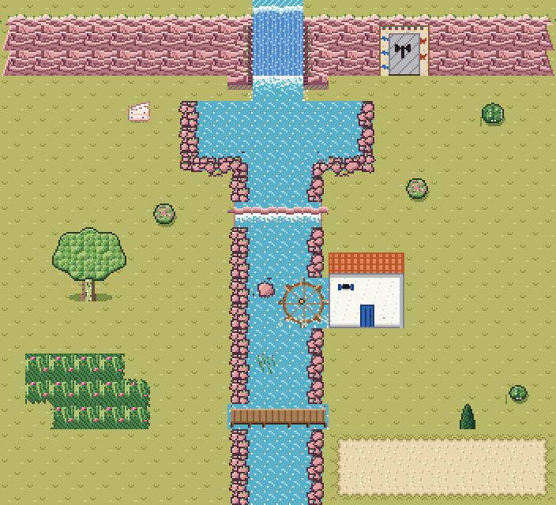

# neraida tileset catalog

`gTileset_Neraida` is the Neraida falls (Act III, Kythera Isle; SCRIPT.md Part 10). Pair it with the `aethos` primary, which supplies the open grass, paths, sand, sea, olives and cypresses.

**This file is generated.** `tools/ichor/art/kythera_build.py neraida` paints the tileset, compiles it, registers it and rewrites this catalog. The art is in `tools/ichor/art/kythera_*.py` (and `melos_art.py`), the palette plan and the borrowed ground in `kythera_lib.py`.

| Image | Shows |
|---|---|
| [`img/neraida_falls.png`](img/neraida_falls.png) | The Neraida ravine: the falls, the plunge pool and the Naiads' altar, the weir, Myles's mill, the plank bridge, the vault door |
| [`img/neraida_pieces.png`](img/neraida_pieces.png) | Every structure on its ground |
| [`img/neraida_sheet.png`](img/neraida_sheet.png) | The numbered metatile sheet, rendered from the compiled tileset |



It is one of the Kythera family of secondaries; see [`TILES_kythera.md`](TILES_kythera.md) for why the art is split and which seams then need aethos-only strips.

## How to use it

**Ids.** Each grid lists metatile ids as Porymap shows them, row by row. Each section
starts on a fixed row of the sheet (water at 0x200, coast at 0x2B0, land at 0x2D0). Structures are placed first-fit in build
order, so appending a new one never moves an old one. Map builders should place pieces
by key and name, never by raw id: `tools/ichor/maps/kythera_tiles.py` holds every
Kythera-family catalog as a Python dict (`mid('neraida', 'surf', 'S')`), and
`build/neraida/catalog.json` is the same as JSON.

**Walk codes** (the grid beside each structure, and the cell tables):

| Code | Meaning |
|---|---|
| `X` | Impassable: set collision 1. |
| `.` | Passable. |
| `T` | Passable, drawn over the player, who walks behind it. |
| `G` | Tall grass: `MB_TALL_GRASS`, wild encounters. Passable. |
| `D` | Door: `MB_NON_ANIMATED_DOOR`. Put the warp here. |
| `W` | Sea: `MB_OCEAN_WATER`, surfable (collision 0). |
| `P` | Fresh water: `MB_POND_WATER`, surfable. |
| `F` | Waterfall: `MB_WATERFALL` (the Horn of Achelous climbs it). |
| `J` | Ledge: `MB_JUMP_SOUTH`. |

**Borrowed ground.** Cells marked *grass*, *path*, *sand*, *sea*, *shallow* or *fall*
draw no ground of their own: after Porytiles compiles, the build points their
bottom-layer tiles at aethos's grass (`0x001`), limestone path (`0x1D9`), sand
(`0x124`), animated sea (`0x170`), animated turquoise shallows (`0x0D1`) or animated
waterfall (`0x0B3`). They meet aethos ground exactly and cost no tiles. Rebuild
whenever aethos is repainted; the build checks every borrowed entry. A borrowed cell's
own art is in one layer: the middle (`COVERED`, under the player) or the top (`SPLIT`,
over the player).

**Animations.** Porytiles animations in this tileset, driven by `InitTilesetAnim_PorytilesManaged_Neraida` (`include/porytiles_generated/tilesets/neraida/generated_anim_code.h`): `surf`: the foam on the shore, round rocks, at a fall's foot and over a weir, washing up and back (3 frames, ping-pong); `wheel`: the mill's paddle wheel turning (4 frames). Every 8x8 tile that changes between frames is an animated tile; frame 0 is the key drawn in the sheet. The sea, shallows and waterfall under them are aethos's own animations.

**Layer types** in the cell tables: `NORMAL` (bottom and middle under the player),
`COVERED` (ground under the middle layer), `SPLIT` (ground under, art over the player).

**Palettes.** Every 8x8 tile, in every animation frame, draws from one of seven color
groups, one per secondary palette (`kythera_lib.GROUPS`), passed to Porytiles as packing
hints.

| Group | Use |
|---|---|
| foam | The surf, foam lace, shingle, white rock, Aphrodite's rock, reefs, quays, pumice |
| rose | Pink stone and rose marble: sea-cliffs, the quarry, temple and stair, kerbs, moss |
| green | Myrtle, sea-grass and thrift, roses, narcissus, plane, oleander, apple |
| cyc | Whitewashed houses, Aegean doors, rose-pink frames, pots, dovecotes, sea doors |
| terra | Timber and terracotta: boats, the trireme, slips, mill wheels, bridges, gear |
| bronze | Bronze mirrors, the harbor shrine's dove, the great herm, the Minoan vault door |
| melos | Melos's obsidian slope on its earth and grass |

**Tile budget.** 365 of 504 tiles (312 metatiles). The door animations copy their
frames into tiles 504-511 (`DOOR_TILE_START_SIZE1`, `src/field_door.c`), so the build
fails past 504. Static tiles within two pixels of one another are merged.

**Scripted swaps.** The build writes the ids scripts swap to the `gTileset_Neraida` block at the end of `include/constants/metatile_labels.h`: `METATILE_Neraida_Altar_Horn`, `METATILE_Neraida_Altar_Empty`, `METATILE_Neraida_MillWheel_TL`, `METATILE_Neraida_MillWheelStill_TL`.

## Fresh water

### Waterfalls, and the Foam Road's spring basin

`falls`, 6 wide by 2 tall. Falling water is aethos's waterfall (0x0B3, `MB_WATERFALL`, animated): build a fall's column from it, two wide for the Neraida falls. These finish it. `lip_L` `lip_R` sit at the top, where the river curls over (borrowed waterfall). `foot_L` `foot_R` at the bottom, the plunge churning white in turquoise water (borrowed shallows, animated foam, `MB_POND_WATER`). The pink cliff beside a fall: `face_fall_L` (the face to the fall's west, wet and mossy at its east edge) and `face_fall_R`, and at their feet `foot_face_L` / `_R`. `thin_fall` is a thin cascade, one cell wide, rock on either side of a narrow stream (the spring's fall, and the Foam Road's Horn gate); `thin_foot` its foot in a pool, `thin_sea` its foot in the sea (borrowed sea). `basin` is the Foam Road's rest point: the freshwater spring's stone basin under the cliff's `seep` (borrowed shallows; impassable, read it).

```text
ids                                      walk
0x200 0x201 0x202 0x203 0x204 0x205   F F X X F X
0x208 0x209 0x20A 0x20B 0x20C 0x20D   P P X X P W
```

| Id | Piece | Walk | Behavior | Layer | Ground |
|---|---|---|---|---|---|
| 0x200 | `lip_L` | `F` | `MB_WATERFALL` | COVERED | fall |
| 0x201 | `lip_R` | `F` | `MB_WATERFALL` | COVERED | fall |
| 0x202 | `face_fall_L` | `X` | `MB_NORMAL` | COVERED |  |
| 0x203 | `face_fall_R` | `X` | `MB_NORMAL` | COVERED |  |
| 0x204 | `thin_fall` | `F` | `MB_WATERFALL` | COVERED | fall |
| 0x205 | `basin` | `X` | `MB_NORMAL` | COVERED | shallow |
| 0x208 | `foot_L` | `P` | `MB_POND_WATER` | COVERED | shallow |
| 0x209 | `foot_R` | `P` | `MB_POND_WATER` | COVERED | shallow |
| 0x20A | `foot_face_L` | `X` | `MB_NORMAL` | COVERED |  |
| 0x20B | `foot_face_R` | `X` | `MB_NORMAL` | COVERED |  |
| 0x20C | `thin_foot` | `P` | `MB_POND_WATER` | COVERED | shallow |
| 0x20D | `thin_sea` | `W` | `MB_OCEAN_WATER` | COVERED | sea |

### Mossy stone kerbs for pools and the river

`kerb`, 8 wide by 2 tall. Rounded pink stones with moss on their crowns, edging aethos's turquoise shallows (borrowed, animated): the plunge pools, the upper pool, the Neraida river's banks. Edges are named by where the water is: `S` has grass to the north and water to the south. Corners are named as the pool's corners: `NW` is a pool's north-west corner (water to its south-east); `in_NW` is the corner of a tongue of land reaching into the water (land only to the north-west). `stones` and `stones_b` are stepping stones (walkable, borrowed water round them); `reeds` a clump of reeds in the shallows; `lily` lily pads. Kerb cells are impassable.

```text
ids                                                  walk
0x210 0x211 0x212 0x213 0x214 0x215 0x216 0x217   X X X X X X X X
0x218 0x219 0x21A 0x21B 0x21C 0x21D 0x21E 0x21F   X X X X . . P P
```

| Id | Piece | Walk | Behavior | Layer | Ground |
|---|---|---|---|---|---|
| 0x210 | `S` | `X` | `MB_NORMAL` | COVERED | shallow |
| 0x211 | `N` | `X` | `MB_NORMAL` | COVERED | shallow |
| 0x212 | `E` | `X` | `MB_NORMAL` | COVERED | shallow |
| 0x213 | `W` | `X` | `MB_NORMAL` | COVERED | shallow |
| 0x214 | `NW` | `X` | `MB_NORMAL` | COVERED | shallow |
| 0x215 | `NE` | `X` | `MB_NORMAL` | COVERED | shallow |
| 0x216 | `SW` | `X` | `MB_NORMAL` | COVERED | shallow |
| 0x217 | `SE` | `X` | `MB_NORMAL` | COVERED | shallow |
| 0x218 | `in_NW` | `X` | `MB_NORMAL` | COVERED | shallow |
| 0x219 | `in_NE` | `X` | `MB_NORMAL` | COVERED | shallow |
| 0x21A | `in_SW` | `X` | `MB_NORMAL` | COVERED | shallow |
| 0x21B | `in_SE` | `X` | `MB_NORMAL` | COVERED | shallow |
| 0x21C | `stones` | `.` | `MB_NORMAL` | COVERED | shallow |
| 0x21D | `stones_b` | `.` | `MB_NORMAL` | COVERED | shallow |
| 0x21E | `reeds` | `P` | `MB_POND_WATER` | COVERED | shallow |
| 0x21F | `lily` | `P` | `MB_POND_WATER` | COVERED | shallow |

### A plank bridge and the weirs

`bridge_weir`, 4 wide by 3 tall. Over borrowed turquoise water. The plank bridge on posts: `bridge_W` `bridge` `bridge_E` east-west, `bridge_N` `bridge_V` `bridge_S` north-south (all walkable). The weirs: a low sill of pink stone across the river with water spilling over it in foam (animated): `weir_W` `weir` `weir_E` (the sill's bank ends are impassable, its middle is water) and `weir_low_*`, a lower, broken one.

```text
ids                          walk
0x220 0x221 0x222 0x223   . . . .
0x228 0x229 0x22A 0x22B   X P X .
0x230 0x231 0x232 0x233   X P X .
```

| Id | Piece | Walk | Behavior | Layer | Ground |
|---|---|---|---|---|---|
| 0x220 | `bridge_W` | `.` | `MB_NORMAL` | COVERED | shallow |
| 0x221 | `bridge` | `.` | `MB_NORMAL` | COVERED | shallow |
| 0x222 | `bridge_E` | `.` | `MB_NORMAL` | COVERED | shallow |
| 0x223 | `bridge_N` | `.` | `MB_NORMAL` | COVERED | shallow |
| 0x228 | `weir_W` | `X` | `MB_NORMAL` | COVERED | shallow |
| 0x229 | `weir` | `P` | `MB_POND_WATER` | COVERED | shallow |
| 0x22A | `weir_E` | `X` | `MB_NORMAL` | COVERED | shallow |
| 0x22B | `bridge_V` | `.` | `MB_NORMAL` | COVERED | shallow |
| 0x230 | `weir_low_W` | `X` | `MB_NORMAL` | COVERED | shallow |
| 0x231 | `weir_low` | `P` | `MB_POND_WATER` | COVERED | shallow |
| 0x232 | `weir_low_E` | `X` | `MB_NORMAL` | COVERED | shallow |
| 0x233 | `bridge_S` | `.` | `MB_NORMAL` | COVERED | shallow |

### The water-mill

`mill`, 5 wide by 5 tall. Myles's mill: a whitewashed mill house under a terracotta roof (3 x 3), its door at (1, 2), and a paddle wheel (2 x 2 at (3, 1)) on the river beside it, turning (the `wheel` animation) in borrowed turquoise water. The idle mills of the ravine use the same house with `wheel_still` (2 x 2 at (3, 3)), its wheel stopped and missing paddles. The house and wheels are impassable; the water at a wheel's foot is `MB_POND_WATER`.

```text
ids                                walk
0x238 0x239 0x23A 0x23B 0x23C   X X X X X
0x240 0x241 0x242 0x243 0x244   X X X X X
0x248 0x249 0x24A 0x24B 0x24C   X D X P P
0x250 0x251 0x252 0x253 0x254   . . . X X
0x258 0x259 0x25A 0x25B 0x25C   . . . P P
```

| Id | Piece | Walk | Behavior | Layer | Ground |
|---|---|---|---|---|---|
| 0x238 | `house` | `X` | `MB_NORMAL` | COVERED |  |
| 0x239 | (1, 0) | `X` | `MB_NORMAL` | COVERED |  |
| 0x23A | (2, 0) | `X` | `MB_NORMAL` | COVERED |  |
| 0x23B | (3, 0) | `X` | `MB_NORMAL` | COVERED | grass |
| 0x23C | (4, 0) | `X` | `MB_NORMAL` | COVERED | grass |
| 0x240 | (0, 1) | `X` | `MB_NORMAL` | COVERED |  |
| 0x241 | (1, 1) | `X` | `MB_NORMAL` | COVERED |  |
| 0x242 | (2, 1) | `X` | `MB_NORMAL` | COVERED |  |
| 0x243 | `wheel` | `X` | `MB_NORMAL` | COVERED | shallow |
| 0x244 | (4, 1) | `X` | `MB_NORMAL` | COVERED | shallow |
| 0x248 | (0, 2) | `X` | `MB_NORMAL` | COVERED |  |
| 0x249 | `door` | `D` | `MB_NON_ANIMATED_DOOR` | COVERED |  |
| 0x24A | (2, 2) | `X` | `MB_NORMAL` | COVERED |  |
| 0x24B | (3, 2) | `P` | `MB_POND_WATER` | COVERED | shallow |
| 0x24C | (4, 2) | `P` | `MB_POND_WATER` | COVERED | shallow |
| 0x250 | (0, 3) | `.` | `MB_NORMAL` | COVERED | grass |
| 0x251 | (1, 3) | `.` | `MB_NORMAL` | COVERED | grass |
| 0x252 | (2, 3) | `.` | `MB_NORMAL` | COVERED | grass |
| 0x253 | `wheel_still` | `X` | `MB_NORMAL` | COVERED | shallow |
| 0x254 | (4, 3) | `X` | `MB_NORMAL` | COVERED | shallow |
| 0x258 | (0, 4) | `.` | `MB_NORMAL` | COVERED | grass |
| 0x259 | (1, 4) | `.` | `MB_NORMAL` | COVERED | grass |
| 0x25A | (2, 4) | `.` | `MB_NORMAL` | COVERED | grass |
| 0x25B | (3, 4) | `P` | `MB_POND_WATER` | COVERED | shallow |
| 0x25C | (4, 4) | `P` | `MB_POND_WATER` | COVERED | shallow |

### The Minoan vault door, the cave stair

`vault`, 2 wide by 2 tall. The Minoan vault door in the cliff behind the upper pool (2 x 2): no handle, only a hollow shaped like a double axe; round its frame old paint flakes, blue dolphins and red bulls. Set it into a pink cliff face. `vault_door` (1, 1) is the door (`MB_NON_ANIMATED_DOOR`): the script opens it with the Labrys.

```text
ids              walk
0x206 0x207   X X
0x20E 0x20F   X D
```

| Id | Piece | Walk | Behavior | Layer | Ground |
|---|---|---|---|---|---|
| 0x206 | `vault_TL` | `X` | `MB_NORMAL` | COVERED |  |
| 0x207 | `vault_TR` | `X` | `MB_NORMAL` | COVERED |  |
| 0x20E | `vault_BL` | `X` | `MB_NORMAL` | COVERED |  |
| 0x20F | `vault_door` | `D` | `MB_NON_ANIMATED_DOOR` | COVERED |  |

### The Naiads' altar

`naiad_altar`, 2 wide by 1 tall. The Naiads' shrine at the plunge pool (beat III-1H): a mossy marble altar with the Horn of Achelous laid on it (`horn`), and the same once the horn is taken (`empty`: swap it in when `FLAG_ICHOR_GOT_HORN_OF_ACHELOUS` is set). On borrowed grass; impassable, read it.

```text
ids              walk
0x224 0x225   X X
```

| Id | Piece | Walk | Behavior | Layer | Ground |
|---|---|---|---|---|---|
| 0x224 | `horn` | `X` | `MB_NORMAL` | COVERED | grass |
| 0x225 | `empty` | `X` | `MB_NORMAL` | COVERED | grass |

## The coast

### Low pink sea-cliffs

`cliff`, 8 wide by 2 tall. The pink cliff kit (see `TILES_kythera.md`): a south-facing cliff is `lip` over `face` over the ground (`foot_grass`); `_L` / `_R` end a run; `side_E` / `side_W`, `back` and its corners finish a plateau; `corner_in_*` turn a face north. Build the falls' cliffs from it, with `falls.face_fall_*` beside the water. `spring_lip`: a jutting rock lip a thin fall pours from.

```text
ids                                                  walk
0x2B0 0x2B1 0x2B2 0x2B3 0x2B4 0x2B5 0x2B6 0x2B7   X X X X X X X X
0x2B8 0x2B9 0x2BA 0x2BB 0x2BC 0x2BD 0x2BE 0x2BF   X X X X X . X .
```

| Id | Piece | Walk | Behavior | Layer | Ground |
|---|---|---|---|---|---|
| 0x2B0 | `lip_L` | `X` | `MB_NORMAL` | COVERED | grass |
| 0x2B1 | `lip` | `X` | `MB_NORMAL` | COVERED | grass |
| 0x2B2 | `lip_R` | `X` | `MB_NORMAL` | COVERED | grass |
| 0x2B3 | `side_E` | `X` | `MB_NORMAL` | COVERED | grass |
| 0x2B4 | `side_W` | `X` | `MB_NORMAL` | COVERED | grass |
| 0x2B5 | `back` | `X` | `MB_NORMAL` | COVERED | grass |
| 0x2B6 | `back_NW` | `X` | `MB_NORMAL` | COVERED | grass |
| 0x2B7 | `back_NE` | `X` | `MB_NORMAL` | COVERED | grass |
| 0x2B8 | `face_L` | `X` | `MB_NORMAL` | COVERED | grass |
| 0x2B9 | `face` | `X` | `MB_NORMAL` | COVERED |  |
| 0x2BA | `face_R` | `X` | `MB_NORMAL` | COVERED | grass |
| 0x2BB | `corner_in_E` | `X` | `MB_NORMAL` | COVERED | grass |
| 0x2BC | `corner_in_W` | `X` | `MB_NORMAL` | COVERED | grass |
| 0x2BD | `foot_grass` | `.` | `MB_NORMAL` | COVERED | grass |
| 0x2BE | `spring_lip` | `X` | `MB_NORMAL` | COVERED |  |
| 0x2BF | `foot_sand_rocks` | `.` | `MB_NORMAL` | COVERED | sand |

## The land

### Myrtle hedges

`myrtle`, 8 wide by 1 tall. Myrtle on borrowed grass: a run `L` `M` `R`, north-south `T` `V` `B`, a `single` clump and a smaller `bush`. Impassable.

```text
ids                                                  walk
0x2D0 0x2D1 0x2D2 0x2D3 0x2D4 0x2D5 0x2D6 0x2D7   X X X X X X X X
```

| Id | Piece | Walk | Behavior | Layer | Ground |
|---|---|---|---|---|---|
| 0x2D0 | `L` | `X` | `MB_NORMAL` | COVERED | grass |
| 0x2D1 | `M` | `X` | `MB_NORMAL` | COVERED | grass |
| 0x2D2 | `R` | `X` | `MB_NORMAL` | COVERED | grass |
| 0x2D3 | `single` | `X` | `MB_NORMAL` | COVERED | grass |
| 0x2D4 | `bush` | `X` | `MB_NORMAL` | COVERED | grass |
| 0x2D5 | `T` | `X` | `MB_NORMAL` | COVERED | grass |
| 0x2D6 | `V` | `X` | `MB_NORMAL` | COVERED | grass |
| 0x2D7 | `B` | `X` | `MB_NORMAL` | COVERED | grass |

### Rose briar, oleander and meadow flowers

`flowers`, 5 wide by 1 tall. On borrowed grass: `briar` (wild rose) and `oleander` (the ravine's pink shrub), impassable; `thrift`, `narcissus` and `petals`, walkable.

```text
ids                                walk
0x2D8 0x2D9 0x2DA 0x2DB 0x2DC   X X . . .
```

| Id | Piece | Walk | Behavior | Layer | Ground |
|---|---|---|---|---|---|
| 0x2D8 | `briar` | `X` | `MB_NORMAL` | COVERED | grass |
| 0x2D9 | `oleander` | `X` | `MB_NORMAL` | COVERED | grass |
| 0x2DA | `thrift` | `.` | `MB_NORMAL` | COVERED | grass |
| 0x2DB | `narcissus` | `.` | `MB_NORMAL` | COVERED | grass |
| 0x2DC | `petals` | `.` | `MB_NORMAL` | COVERED | grass |

### Sea-grass and thrift (tall grass), soft-edged

`seagrass`, 8 wide by 6 tall. Kythera's tall grass: blue-green sea-grass with sea-pink thrift, as all 47 soft-edge shapes on aethos grass (kythera_lib.blob_key gives a cell's key from a mask). `MB_TALL_GRASS` throughout: wild encounters follow the cells while the outline stays soft. The full interior is `1|11111111`.

Shape keys (kythera_lib.blob_key) and their ids:

| Shape key | Id |
|---|---|
| `1|00000000` | 0x2E0 |
| `1|00000010` | 0x2E1 |
| `1|00001000` | 0x2E2 |
| `1|00001010` | 0x2E3 |
| `1|00001110` | 0x2E4 |
| `1|00100000` | 0x2E5 |
| `1|00100010` | 0x2E6 |
| `1|00101000` | 0x2E7 |
| `1|00101010` | 0x2E8 |
| `1|00101110` | 0x2E9 |
| `1|00111000` | 0x2EA |
| `1|00111010` | 0x2EB |
| `1|00111110` | 0x2EC |
| `1|10000000` | 0x2ED |
| `1|10000010` | 0x2EE |
| `1|10000011` | 0x2EF |
| `1|10001000` | 0x2F0 |
| `1|10001010` | 0x2F1 |
| `1|10001011` | 0x2F2 |
| `1|10001110` | 0x2F3 |
| `1|10001111` | 0x2F4 |
| `1|10100000` | 0x2F5 |
| `1|10100010` | 0x2F6 |
| `1|10100011` | 0x2F7 |
| `1|10101000` | 0x2F8 |
| `1|10101010` | 0x2F9 |
| `1|10101011` | 0x2FA |
| `1|10101110` | 0x2FB |
| `1|10101111` | 0x2FC |
| `1|10111000` | 0x2FD |
| `1|10111010` | 0x2FE |
| `1|10111011` | 0x2FF |
| `1|10111110` | 0x300 |
| `1|10111111` | 0x301 |
| `1|11100000` | 0x302 |
| `1|11100010` | 0x303 |
| `1|11100011` | 0x304 |
| `1|11101000` | 0x305 |
| `1|11101010` | 0x306 |
| `1|11101011` | 0x307 |
| `1|11101110` | 0x308 |
| `1|11101111` | 0x309 |
| `1|11111000` | 0x30A |
| `1|11111010` | 0x30B |
| `1|11111011` | 0x30C |
| `1|11111110` | 0x30D |
| `1|11111111` | 0x30E |

Every cell: walk `G`, `MB_TALL_GRASS`.

### Plane tree and apple trees

`plane`, 3 wide by 3 tall. The oriental plane (3 x 3): a broad crown of maple-like leaves over a mottled pale trunk. Its top row is drawn over the player (`T`); the rest is impassable.

```text
ids                    walk
0x310 0x311 0x312   T T T
0x318 0x319 0x31A   X X X
0x320 0x321 0x322   X X X
```

| Id | Piece | Walk | Behavior | Layer | Ground |
|---|---|---|---|---|---|
| 0x310 | `plane_00` | `T` | `MB_NORMAL` | SPLIT | grass |
| 0x311 | `plane_10` | `T` | `MB_NORMAL` | SPLIT | grass |
| 0x312 | `plane_20` | `T` | `MB_NORMAL` | SPLIT | grass |
| 0x318 | `plane_01` | `X` | `MB_NORMAL` | COVERED | grass |
| 0x319 | `plane_11` | `X` | `MB_NORMAL` | COVERED | grass |
| 0x31A | `plane_21` | `X` | `MB_NORMAL` | COVERED | grass |
| 0x320 | `plane_02` | `X` | `MB_NORMAL` | COVERED | grass |
| 0x321 | `plane_12` | `X` | `MB_NORMAL` | COVERED | grass |
| 0x322 | `plane_22` | `X` | `MB_NORMAL` | COVERED | grass |

### Pink-stone terrace walls

`terrace`, 7 wide by 2 tall. A retaining wall one cell high between two terraces, in pink rubble with a lit coping. Lay a `top_*` row (the upper terrace's edge, walkable, on borrowed grass) above a wall row: `L` `M` (`M2`) `R`. `steps` cuts a stair through the wall (walkable) under `top_steps`. `niche` is an arched niche with a low plinth, for a statue or a votive (Melos's armless goddess stands in one); `spout` is a lion-less spring spout dribbling into a trough.

```text
ids                                            walk
0x328 0x329 0x32A 0x32B 0x32C 0x32D 0x32E   X X X X . X X
0x330 0x331 0x332 0x333 0x334 0x335 0x336   . . . . T . .
```

| Id | Piece | Walk | Behavior | Layer | Ground |
|---|---|---|---|---|---|
| 0x328 | `L` | `X` | `MB_NORMAL` | COVERED | grass |
| 0x329 | `M` | `X` | `MB_NORMAL` | COVERED |  |
| 0x32A | `M2` | `X` | `MB_NORMAL` | COVERED |  |
| 0x32B | `R` | `X` | `MB_NORMAL` | COVERED | grass |
| 0x32C | `steps` | `.` | `MB_NORMAL` | COVERED |  |
| 0x32D | `niche` | `X` | `MB_NORMAL` | COVERED |  |
| 0x32E | `spout` | `X` | `MB_NORMAL` | COVERED |  |
| 0x330 | `top_L` | `.` | `MB_NORMAL` | COVERED | grass |
| 0x331 | `top` | `.` | `MB_NORMAL` | COVERED | grass |
| 0x332 | `top_M2` | `.` | `MB_NORMAL` | COVERED | grass |
| 0x333 | `top_R` | `.` | `MB_NORMAL` | COVERED | grass |
| 0x334 | `top_steps` | `T` | `MB_NORMAL` | COVERED | grass |
| 0x335 | `top_niche` | `.` | `MB_NORMAL` | COVERED | grass |
| 0x336 | `top_spout` | `.` | `MB_NORMAL` | COVERED | grass |
