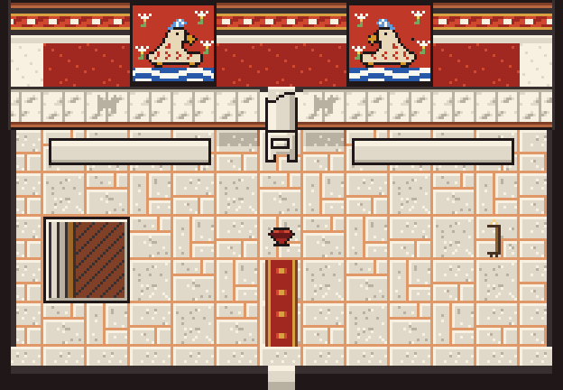

# palace_rooms tileset catalog

`gTileset_PalaceRooms` is the Palace of Minos's rooms and the Bull Road vault (Act III, Knossa; LABYRINTH.md §2-§3, §11; SCRIPT.md Part 10). It serves the Throne Room, the West Magazines, the Queen's Megaron and the Grand Staircase (`MAP_KNOSSA_PALACE_THRONE_ROOM`, `_WEST_MAGAZINES`, `_QUEENS_MEGARON`, `_GRAND_STAIRCASE`), and the Bull Road vault (`MAP_KNOSSA_BULL_ROAD_VAULT`). Pair it with the `oikos` primary.

**This file is generated.** `tools/ichor/art/knossa_build.py palace_rooms` paints the tileset, compiles it, registers it and rewrites this catalog. The art is in `tools/ichor/art/knossa_*.py`, the palette plan in `knossa_lib.py`, what each tileset holds in `knossa_specs.py`; `knossa_scene.py` renders the mock scenes.

| Image | Shows |
|---|---|
| [`img/knossa_throne_room.png`](img/knossa_throne_room.png) | The Throne Room for scene A: the gypsum throne between its griffins, the benches, the lustral basin |
| [`img/knossa_magazines_megaron.png`](img/knossa_magazines_megaron.png) | The West Magazines with the Titans' camp among the pithoi; the Queen's Megaron's dolphins; the Grand Staircase going down |
| [`img/palace_rooms_pieces.png`](img/palace_rooms_pieces.png) | Every structure on its ground |
| [`img/palace_rooms_sheet.png`](img/palace_rooms_sheet.png) | The numbered metatile sheet, rendered from the compiled tileset |



It is one of the Knossa family of secondaries; see [`TILES_amnisos.md`](TILES_amnisos.md) for why the art is split and which seams then need aethos-only strips.

## How to use it

**Ids.** Each grid lists metatile ids as Porymap shows them, row by row. Each section
starts on a fixed row of the sheet (rooms at 0x200). Structures are placed first-fit in build
order, so appending a new one never moves an old one. Map builders should place pieces
by key and name, never by raw id: `tools/ichor/maps/knossa_tiles.py` holds every Knossa
catalog as a Python dict (`mid('palace_rooms', 'house', 'corbel', ...)`, `place(...)`, `front(...)`),
and `build/palace_rooms/catalog.json` is the same as JSON.

**Walk codes** (the grid beside each structure, and the cell tables):

| Code | Meaning |
|---|---|
| `X` | Impassable: set collision 1. |
| `.` | Passable. |
| `T` | Passable, drawn over the player, who walks behind it. |
| `G` | Tall grass: `MB_TALL_GRASS`, wild encounters. Passable. |
| `D` | Door: `MB_NON_ANIMATED_DOOR`. Put the warp here. |
| `W` | Sea: `MB_OCEAN_WATER`, surfable (collision 0). |
| `P` | Fresh water: `MB_POND_WATER`, surfable. |
| `J` | Ledge: `MB_JUMP_SOUTH`. |
| `^` | Ledge down to the north: `MB_JUMP_NORTH`. |
| `S` | Sand: `MB_SAND`. |

**Its own ground.** It borrows nothing: every bottom layer is opaque and every tile
is its own, so it works on any primary (it is drawn for `oikos`, as the labyrinth is).

**Animations.** None of its own.

**Layer types** in the cell tables: `NORMAL` (bottom and middle under the player),
`COVERED` (ground under the middle layer), `SPLIT` (ground under, art over the player).

**Palettes.** Every 8x8 tile, in every animation frame, draws from one of these color
groups, one per secondary palette (`knossa_lib.GROUPS`), passed to Porytiles as packing
hints:

| Group | Use |
|---|---|
| minoan | Minoan red, ochre, gypsum, black and terracotta (labyrinth_art's): red columns, black capitals, horns of consecration, labrys marks, pithoi, the houses, the hives |
| fresco | Fresco blue, white, saffron and skin (labyrinth_art's): dolphins, lilies, bull-leapers, the lily prince, saffron gatherers, blue monkeys, griffins |
| bronze | Bronze and verdigris (Talos's foot, the Kouretes' shields, door fittings), and the marble herm |
| terra | Kythera's timber and terracotta: boats, the triremes, nets, trellis posts |
| titan | Titan slate and gold, timber and canvas: the West Magazines' camp |

**Tile budget.** 335 of 504 tiles (104 metatiles). The door animations copy their
frames into tiles 504-511 (`DOOR_TILE_START_SIZE1`, `src/field_door.c`), so the build
fails past 504. Static tiles within two pixels of one another are merged.

## The rooms

### The rooms' floors and walls

`house`, 8 wide by 4 tall. The house kit for every palace room. **Floors** (walkable): gypsum slabs set in red plaster, `floor_A` to `floor_D` in a mix, `shade` / `shade_b` for the row in front of the north wall, `rug` (a woven runner). `void` is the black outside the rooms (the layout's border; block it). **The north wall** is three rows tall: `frieze_*` (a band of red, black and ochre under the ceiling beam), over `field` (white plaster, where frescoes hang; `field_red` is the red-painted kind), over `dado` (veined gypsum slabs on a baseboard; `dado_b` a slab with a mason's double axe). `_L` and `_R` turn the wall into the side walls. `door_top` over `door` is a doorway in the north wall to the next room (`MB_NON_ANIMATED_DOOR`, put the warp on `door`). **Side walls**: `side_W` `side_E`, dark strips beside the floor; the south wall is `south_W` `south` `south_E`, its doorway `exit` (`MB_SOUTH_ARROW_WARP`, the warp out). **The Bull Road vault**: `lilies` and `lilies_red`, a field painted with lilies, bright as the day they were done; `corbel`, the vault's corbelled stone overhead in place of a frieze; `niche`, a lamp niche in a field; `lamp`, a clay lamp on a bracket.

```text
ids                                                  walk
0x200 0x201 0x202 0x203 0x204 0x205 0x206 0x207   X . . . . . . .
0x208 0x209 0x20A 0x20B 0x20C 0x20D 0x20E 0x20F   X X X X X X X D
0x210 0x211 0x212 0x213 0x214 0x215 0x216 0x217   X X X X X X X .
0x218 0x219 0x21A 0x21B 0x21C 0x21D 0x21E 0x21F   X X X X X X X X
```

| Id | Piece | Walk | Behavior | Layer | Ground |
|---|---|---|---|---|---|
| 0x200 | `void` | `X` | `MB_NORMAL` | COVERED |  |
| 0x201 | `floor_A` | `.` | `MB_NORMAL` | COVERED |  |
| 0x202 | `floor_B` | `.` | `MB_NORMAL` | COVERED |  |
| 0x203 | `floor_C` | `.` | `MB_NORMAL` | COVERED |  |
| 0x204 | `floor_D` | `.` | `MB_NORMAL` | COVERED |  |
| 0x205 | `shade` | `.` | `MB_NORMAL` | COVERED |  |
| 0x206 | `shade_b` | `.` | `MB_NORMAL` | COVERED |  |
| 0x207 | `rug` | `.` | `MB_NORMAL` | COVERED |  |
| 0x208 | `frieze_L` | `X` | `MB_NORMAL` | COVERED |  |
| 0x209 | `frieze` | `X` | `MB_NORMAL` | COVERED |  |
| 0x20A | `frieze_R` | `X` | `MB_NORMAL` | COVERED |  |
| 0x20B | `field` | `X` | `MB_NORMAL` | COVERED |  |
| 0x20C | `field_red` | `X` | `MB_NORMAL` | COVERED |  |
| 0x20D | `dado` | `X` | `MB_NORMAL` | COVERED |  |
| 0x20E | `dado_b` | `X` | `MB_NORMAL` | COVERED |  |
| 0x20F | `door` | `D` | `MB_NON_ANIMATED_DOOR` | COVERED |  |
| 0x210 | `field_L` | `X` | `MB_NORMAL` | COVERED |  |
| 0x211 | `door_top` | `X` | `MB_NORMAL` | COVERED |  |
| 0x212 | `field_R` | `X` | `MB_NORMAL` | COVERED |  |
| 0x213 | `dado_L` | `X` | `MB_NORMAL` | COVERED |  |
| 0x214 | `dado_R` | `X` | `MB_NORMAL` | COVERED |  |
| 0x215 | `side_W` | `X` | `MB_NORMAL` | COVERED |  |
| 0x216 | `side_E` | `X` | `MB_NORMAL` | COVERED |  |
| 0x217 | `exit` | `.` | `MB_SOUTH_ARROW_WARP` | COVERED |  |
| 0x218 | `south_W` | `X` | `MB_NORMAL` | COVERED |  |
| 0x219 | `south` | `X` | `MB_NORMAL` | COVERED |  |
| 0x21A | `south_E` | `X` | `MB_NORMAL` | COVERED |  |
| 0x21B | `lilies` | `X` | `MB_NORMAL` | COVERED |  |
| 0x21C | `lilies_red` | `X` | `MB_NORMAL` | COVERED |  |
| 0x21D | `corbel` | `X` | `MB_NORMAL` | COVERED |  |
| 0x21E | `niche` | `X` | `MB_NORMAL` | COVERED |  |
| 0x21F | `lamp` | `X` | `MB_NORMAL` | COVERED |  |

### The griffins, the dolphins, the saffron gatherer, the blue monkey

`frescoes`, 8 wide by 2 tall. Panels for the north wall's `frieze` and `field` rows (each panel is two rows: lay it over a frieze and a field cell, the dado below). **The griffins** (LABYRINTH §3; Griffins are décor, not forms): `griffin_*` faces east and `griffin2_*` west; hang one either side of the throne, couchant among lilies on a red ground. **The dolphins** (`dolphins_*`, 3 x 2), the Queen's Megaron's fresco: dolphins and little fish over a sea-blue band. `saffron`: a saffron gatherer, a girl picking crocuses; `monkey`: a blue monkey among papyrus (one-cell panels for a `field` row, the West Magazines' and the Grand Staircase's walls). All impassable; bg events.

```text
ids                                                  walk
0x220 0x221 0x222 0x223 0x224 0x225 0x226 0x227   X X X X X X X X
0x228 0x229 0x22A 0x22B 0x22C 0x22D 0x22E 0x22F   X X X X X X X X
```

| Id | Piece | Walk | Behavior | Layer | Ground |
|---|---|---|---|---|---|
| 0x220 | `griffin_TL` | `X` | `MB_NORMAL` | COVERED |  |
| 0x221 | `griffin_TR` | `X` | `MB_NORMAL` | COVERED |  |
| 0x222 | `griffin2_TL` | `X` | `MB_NORMAL` | COVERED |  |
| 0x223 | `griffin2_TR` | `X` | `MB_NORMAL` | COVERED |  |
| 0x224 | `dolphins_TL` | `X` | `MB_NORMAL` | COVERED |  |
| 0x225 | `dolphins_T` | `X` | `MB_NORMAL` | COVERED |  |
| 0x226 | `dolphins_TR` | `X` | `MB_NORMAL` | COVERED |  |
| 0x227 | `saffron` | `X` | `MB_NORMAL` | COVERED |  |
| 0x228 | `griffin_BL` | `X` | `MB_NORMAL` | COVERED |  |
| 0x229 | `griffin_BR` | `X` | `MB_NORMAL` | COVERED |  |
| 0x22A | `griffin2_BL` | `X` | `MB_NORMAL` | COVERED |  |
| 0x22B | `griffin2_BR` | `X` | `MB_NORMAL` | COVERED |  |
| 0x22C | `dolphins_BL` | `X` | `MB_NORMAL` | COVERED |  |
| 0x22D | `dolphins_B` | `X` | `MB_NORMAL` | COVERED |  |
| 0x22E | `dolphins_BR` | `X` | `MB_NORMAL` | COVERED |  |
| 0x22F | `monkey` | `X` | `MB_NORMAL` | COVERED |  |

### The throne, the pithoi, the Titans' camp, Ariadne's rooms

`furniture`, 8 wide by 4 tall. Standing on the rooms' floor (`house.floor_A` under each). **The Throne Room** (scene A): `throne_back` (its wavy high back, set in the dado row against the north wall) over `throne` (the gypsum seat); `bench_L` `bench` `bench_R`, the gypsum benches along the walls; `bowl`, the porphyry basin before the throne; the lustral basin, `basin_TL` `basin_TR` over `basin_BL` `basin_BR`, a sunken bath stepping down. **The West Magazines**: `pithos_top` over `pithos`, one giant jar; `pithoi_top` over `pithoi`, two side by side, for the long rows; `cist` (a stone-lined pit in the floor, lidded) and `cist_open`. **The Titans' camp** among them: `bedroll`, `crate` (a sickle burnt in its lid), `banner` (the sickle banner, hung on a `field`), `table_L` `table_R` (a slate-draped table), `spears` (a rack), `brazier`, `wall_spears` (hung on a `field`). **The Queen's Megaron**: `bed_top` over `bed` (Ariadne's, a saffron coverlet bordered in red), `bath` (a painted clay tub), `chest`, `loom`, `stand` (a lamp stand), and a light well, `well_TL` `well_TR` (open to the sky, a red column going down; lay it over two floor cells). All impassable.

```text
ids                                                  walk
0x230 0x231 0x232 0x233 0x234 0x235 0x236 0x237   X X X X X X X X
0x238 0x239 0x23A 0x23B 0x23C 0x23D 0x23E 0x23F   X X X X X X X X
0x240 0x241 0x242 0x243 0x244 0x245 0x246 0x247   X X X X X X X X
0x248 0x249 0x24A 0x24B 0x24C 0x24D 0x24E 0x24F   X X X X X X X X
```

| Id | Piece | Walk | Behavior | Layer | Ground |
|---|---|---|---|---|---|
| 0x230 | `throne_back` | `X` | `MB_NORMAL` | COVERED |  |
| 0x231 | `bowl` | `X` | `MB_NORMAL` | COVERED |  |
| 0x232 | `basin_TL` | `X` | `MB_NORMAL` | COVERED |  |
| 0x233 | `basin_TR` | `X` | `MB_NORMAL` | COVERED |  |
| 0x234 | `pithos_top` | `X` | `MB_NORMAL` | COVERED |  |
| 0x235 | `pithoi_top` | `X` | `MB_NORMAL` | COVERED |  |
| 0x236 | `cist` | `X` | `MB_NORMAL` | COVERED |  |
| 0x237 | `cist_open` | `X` | `MB_NORMAL` | COVERED |  |
| 0x238 | `throne` | `X` | `MB_NORMAL` | COVERED |  |
| 0x239 | `bench_L` | `X` | `MB_NORMAL` | COVERED |  |
| 0x23A | `bench` | `X` | `MB_NORMAL` | COVERED |  |
| 0x23B | `bench_R` | `X` | `MB_NORMAL` | COVERED |  |
| 0x23C | `pithos` | `X` | `MB_NORMAL` | COVERED |  |
| 0x23D | `pithoi` | `X` | `MB_NORMAL` | COVERED |  |
| 0x23E | `bedroll` | `X` | `MB_NORMAL` | COVERED |  |
| 0x23F | `crate` | `X` | `MB_NORMAL` | COVERED |  |
| 0x240 | `banner` | `X` | `MB_NORMAL` | COVERED |  |
| 0x241 | `table_L` | `X` | `MB_NORMAL` | COVERED |  |
| 0x242 | `table_R` | `X` | `MB_NORMAL` | COVERED |  |
| 0x243 | `spears` | `X` | `MB_NORMAL` | COVERED |  |
| 0x244 | `bed_top` | `X` | `MB_NORMAL` | COVERED |  |
| 0x245 | `bath` | `X` | `MB_NORMAL` | COVERED |  |
| 0x246 | `chest` | `X` | `MB_NORMAL` | COVERED |  |
| 0x247 | `loom` | `X` | `MB_NORMAL` | COVERED |  |
| 0x248 | `well_TL` | `X` | `MB_NORMAL` | COVERED |  |
| 0x249 | `well_TR` | `X` | `MB_NORMAL` | COVERED |  |
| 0x24A | `basin_BL` | `X` | `MB_NORMAL` | COVERED |  |
| 0x24B | `basin_BR` | `X` | `MB_NORMAL` | COVERED |  |
| 0x24C | `bed` | `X` | `MB_NORMAL` | COVERED |  |
| 0x24D | `stand` | `X` | `MB_NORMAL` | COVERED |  |
| 0x24E | `brazier` | `X` | `MB_NORMAL` | COVERED |  |
| 0x24F | `wall_spears` | `X` | `MB_NORMAL` | COVERED |  |

### The Grand Staircase

`staircase`, 5 wide by 3 tall. The Grand Staircase (LABYRINTH §3, scene B): flights of broad gypsum treads going down to the north, darker as they go, beside a balustrade of red columns that taper downward, open to a light well. A flight is `head_*` (its top treads, lit) over `flight_*` over `deep_*` (deep in shadow); `_L` and `_R` are its sides. All walkable: going north is going down. `balustrade` (its parapet), `balustrade_col` (a short column on it), `balustrade_end` run down the flight's side (impassable). `top_col` is a column's capital rising beside the head, drawn over the player. `landing` is a half-landing's floor. `dark` is the foot of the last flight, where it turns into the dark toward Ring I: `MB_NON_ANIMATED_DOOR`, the warp down to `MAP_LABYRINTH_RING1`.

```text
ids                                walk
0x250 0x251 0x252 0x253 0x254   . . . . .
0x258 0x259 0x25A 0x25B 0x25C   . . . X .
0x260 0x261 0x262 0x263 0x264   . . . X D
```

| Id | Piece | Walk | Behavior | Layer | Ground |
|---|---|---|---|---|---|
| 0x250 | `head_L` | `.` | `MB_NORMAL` | COVERED |  |
| 0x251 | `head` | `.` | `MB_NORMAL` | COVERED |  |
| 0x252 | `head_R` | `.` | `MB_NORMAL` | COVERED |  |
| 0x253 | `balustrade` | `.` | `MB_NORMAL` | COVERED |  |
| 0x254 | `top_col` | `.` | `MB_NORMAL` | SPLIT |  |
| 0x258 | `flight_L` | `.` | `MB_NORMAL` | COVERED |  |
| 0x259 | `flight` | `.` | `MB_NORMAL` | COVERED |  |
| 0x25A | `flight_R` | `.` | `MB_NORMAL` | COVERED |  |
| 0x25B | `balustrade_col` | `X` | `MB_NORMAL` | COVERED |  |
| 0x25C | `landing` | `.` | `MB_NORMAL` | COVERED |  |
| 0x260 | `deep_L` | `.` | `MB_NORMAL` | COVERED |  |
| 0x261 | `deep` | `.` | `MB_NORMAL` | COVERED |  |
| 0x262 | `deep_R` | `.` | `MB_NORMAL` | COVERED |  |
| 0x263 | `balustrade_end` | `X` | `MB_NORMAL` | COVERED |  |
| 0x264 | `dark` | `D` | `MB_NON_ANIMATED_DOOR` | COVERED |  |
