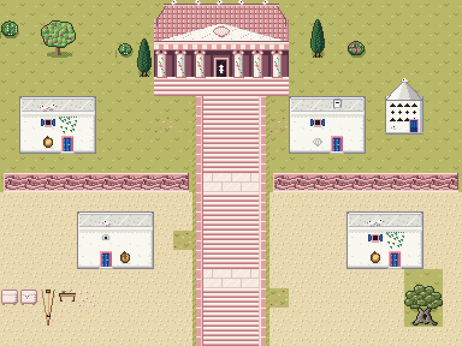

# paphia tileset catalog

`gTileset_Paphia` is Paphia, the temple town (Act III, Kythera Isle; SCRIPT.md Part 10). Pair it with the `aethos` primary, which supplies the open grass, paths, sand, sea, olives and cypresses.

**This file is generated.** `tools/ichor/art/kythera_build.py paphia` paints the tileset, compiles it, registers it and rewrites this catalog. The art is in `tools/ichor/art/kythera_*.py` (and `melos_art.py`), the palette plan and the borrowed ground in `kythera_lib.py`.

| Image | Shows |
|---|---|
| [`img/paphia_town.png`](img/paphia_town.png) | Paphia's crown: the temple, the great stair, the terraces, a dovecote, the sculptors |
| [`img/paphia_pieces.png`](img/paphia_pieces.png) | Every structure on its ground |
| [`img/paphia_sheet.png`](img/paphia_sheet.png) | The numbered metatile sheet, rendered from the compiled tileset |



It is one of the Kythera family of secondaries; see [`TILES_kythera.md`](TILES_kythera.md) for why the art is split and which seams then need aethos-only strips.

## How to use it

**Ids.** Each grid lists metatile ids as Porymap shows them, row by row. Each section
starts on a fixed row of the sheet (town at 0x200, land at 0x2B0, harbor at 0x310, coast at 0x360). Structures are placed first-fit in build
order, so appending a new one never moves an old one. Map builders should place pieces
by key and name, never by raw id: `tools/ichor/maps/kythera_tiles.py` holds every
Kythera-family catalog as a Python dict (`mid('paphia', 'surf', 'S')`), and
`build/paphia/catalog.json` is the same as JSON.

**Walk codes** (the grid beside each structure, and the cell tables):

| Code | Meaning |
|---|---|
| `X` | Impassable: set collision 1. |
| `.` | Passable. |
| `T` | Passable, drawn over the player, who walks behind it. |
| `G` | Tall grass: `MB_TALL_GRASS`, wild encounters. Passable. |
| `D` | Door: `MB_NON_ANIMATED_DOOR`. Put the warp here. |
| `W` | Sea: `MB_OCEAN_WATER`, surfable (collision 0). |
| `P` | Fresh water: `MB_POND_WATER`, surfable. |
| `F` | Waterfall: `MB_WATERFALL` (the Horn of Achelous climbs it). |
| `J` | Ledge: `MB_JUMP_SOUTH`. |

**Borrowed ground.** Cells marked *grass*, *path*, *sand*, *sea*, *shallow* or *fall*
draw no ground of their own: after Porytiles compiles, the build points their
bottom-layer tiles at aethos's grass (`0x001`), limestone path (`0x1D9`), sand
(`0x124`), animated sea (`0x170`), animated turquoise shallows (`0x0D1`) or animated
waterfall (`0x0B3`). They meet aethos ground exactly and cost no tiles. Rebuild
whenever aethos is repainted; the build checks every borrowed entry. A borrowed cell's
own art is in one layer: the middle (`COVERED`, under the player) or the top (`SPLIT`,
over the player).

**Animations.** Porytiles animations in this tileset, driven by `InitTilesetAnim_PorytilesManaged_Paphia` (`include/porytiles_generated/tilesets/paphia/generated_anim_code.h`): `surf`: the foam on the shore, round rocks, at a fall's foot and over a weir, washing up and back (3 frames, ping-pong). Every 8x8 tile that changes between frames is an animated tile; frame 0 is the key drawn in the sheet. The sea, shallows and waterfall under them are aethos's own animations.

**Layer types** in the cell tables: `NORMAL` (bottom and middle under the player),
`COVERED` (ground under the middle layer), `SPLIT` (ground under, art over the player).

**Palettes.** Every 8x8 tile, in every animation frame, draws from one of seven color
groups, one per secondary palette (`kythera_lib.GROUPS`), passed to Porytiles as packing
hints.

| Group | Use |
|---|---|
| foam | The surf, foam lace, shingle, white rock, Aphrodite's rock, reefs, quays, pumice |
| rose | Pink stone and rose marble: sea-cliffs, the quarry, temple and stair, kerbs, moss |
| green | Myrtle, sea-grass and thrift, roses, narcissus, plane, oleander, apple |
| cyc | Whitewashed houses, Aegean doors, rose-pink frames, pots, dovecotes, sea doors |
| terra | Timber and terracotta: boats, the trireme, slips, mill wheels, bridges, gear |
| bronze | Bronze mirrors, the harbor shrine's dove, the great herm, the Minoan vault door |
| melos | Melos's obsidian slope on its earth and grass |

**Tile budget.** 488 of 504 tiles (376 metatiles). The door animations copy their
frames into tiles 504-511 (`DOOR_TILE_START_SIZE1`, `src/field_door.c`), so the build
fails past 504. Static tiles within two pixels of one another are merged.

**Scripted swaps.** The build writes the ids scripts swap to the `gTileset_Paphia` block at the end of `include/constants/metatile_labels.h`: `METATILE_Paphia_AppleGold_L`, `METATILE_Paphia_AppleGold_R`, `METATILE_Paphia_Apple_TL`, `METATILE_Paphia_Apple_TR`, `METATILE_Paphia_Mirror`, `METATILE_Paphia_Mirror_Dim`.

## Town

### The Cycladic house kit

`house`, 6 wide by 5 tall. Parts that snap together into whitewashed cube houses (see *House fronts* below). Rows: `R_*` the flat roof and its parapet, seen from above; `U_*` the upper wall; `G_*` and the doors, the ground-floor wall on its grey-washed foot. Columns `_L` (the lit west corner), `_M` (repeat it), `_R` (the shaded east corner). Roof extras: `R_chimney`, `R_dove` / `R_doves` (Paphia's roofs), `R_jar` (a water jar on the roof). Upper-wall extras: `U_window` (blue shutters), `U_window_pink`, `U_niche` (a little lamp niche), `U_vine` (a vine trained over the wall). Doors (`MB_NON_ANIMATED_DOOR`, put the warp here): `door` (Aegean blue in a rose-pink frame), `door_white` (the same in a white frame, for Skandeia's plainer houses), `door_arch` (an arched doorway). Ground-wall extras: `G_window`, `pot_rose`, `pot_basil` (a pot on the step), `mirror` (a polished bronze mirror by the door, Paphia's custom) and `mirror_dim` (the same, a dim figure in it), `G_bench` (a whitewashed bench), `G_shell` (a scallop shell set in the wall), `G_steps` (an outside stair up to the roof). Every cell is impassable except the doors.

```text
ids                                      walk
0x200 0x201 0x202 0x203 0x204 0x205   X X X X X X
0x208 0x209 0x20A 0x20B 0x20C 0x20D   X X X X X X
0x210 0x211 0x212 0x213 0x214 0x215   X X X X D D
0x218 0x219 0x21A 0x21B 0x21C 0x21D   D X X X X X
0x220 0x221 0x222 0x223 0x224 0x225   X X X X X X
```

| Id | Piece | Walk | Behavior | Layer | Ground |
|---|---|---|---|---|---|
| 0x200 | `R_L` | `X` | `MB_NORMAL` | COVERED |  |
| 0x201 | `R_M` | `X` | `MB_NORMAL` | COVERED |  |
| 0x202 | `R_R` | `X` | `MB_NORMAL` | COVERED |  |
| 0x203 | `R_dove` | `X` | `MB_NORMAL` | COVERED |  |
| 0x204 | `R_doves` | `X` | `MB_NORMAL` | COVERED |  |
| 0x205 | `R_chimney` | `X` | `MB_NORMAL` | COVERED |  |
| 0x208 | `U_L` | `X` | `MB_NORMAL` | COVERED |  |
| 0x209 | `U_M` | `X` | `MB_NORMAL` | COVERED |  |
| 0x20A | `U_R` | `X` | `MB_NORMAL` | COVERED |  |
| 0x20B | `U_window` | `X` | `MB_NORMAL` | COVERED |  |
| 0x20C | `U_window_pink` | `X` | `MB_NORMAL` | COVERED |  |
| 0x20D | `U_niche` | `X` | `MB_NORMAL` | COVERED |  |
| 0x210 | `U_vine` | `X` | `MB_NORMAL` | COVERED |  |
| 0x211 | `G_L` | `X` | `MB_NORMAL` | COVERED |  |
| 0x212 | `G_M` | `X` | `MB_NORMAL` | COVERED |  |
| 0x213 | `G_R` | `X` | `MB_NORMAL` | COVERED |  |
| 0x214 | `door` | `D` | `MB_NON_ANIMATED_DOOR` | COVERED |  |
| 0x215 | `door_arch` | `D` | `MB_NON_ANIMATED_DOOR` | COVERED |  |
| 0x218 | `door_white` | `D` | `MB_NON_ANIMATED_DOOR` | COVERED |  |
| 0x219 | `mirror` | `X` | `MB_NORMAL` | COVERED |  |
| 0x21A | `mirror_dim` | `X` | `MB_NORMAL` | COVERED |  |
| 0x21B | `G_shell` | `X` | `MB_NORMAL` | COVERED |  |
| 0x21C | `pot_rose` | `X` | `MB_NORMAL` | COVERED |  |
| 0x21D | `G_bench` | `X` | `MB_NORMAL` | COVERED |  |
| 0x220 | `G_window` | `X` | `MB_NORMAL` | COVERED |  |
| 0x221 | (1, 4) | `X` | `MB_NORMAL` | COVERED |  |
| 0x222 | (2, 4) | `X` | `MB_NORMAL` | COVERED |  |
| 0x223 | (3, 4) | `X` | `MB_NORMAL` | COVERED |  |
| 0x224 | (4, 4) | `X` | `MB_NORMAL` | COVERED |  |
| 0x225 | (5, 4) | `X` | `MB_NORMAL` | COVERED |  |

### A dovecote

`dovecote`, 2 wide by 3 tall. Paphia's dovecotes: a whitewashed tower, its upper walls pierced in triangles and diamonds for the doves, a pyramid cap with doves on it (drawn over the player), a low door. 2 x 3; the door (`MB_NON_ANIMATED_DOOR`) is the dovecote household's way in.

```text
ids              walk
0x206 0x207   T T
0x20E 0x20F   X X
0x216 0x217   X D
```

| Id | Piece | Walk | Behavior | Layer | Ground |
|---|---|---|---|---|---|
| 0x206 | `top` | `T` | `MB_NORMAL` | SPLIT | grass |
| 0x207 | (1, 0) | `T` | `MB_NORMAL` | SPLIT | grass |
| 0x20E | (0, 1) | `X` | `MB_NORMAL` | COVERED |  |
| 0x20F | (1, 1) | `X` | `MB_NORMAL` | COVERED |  |
| 0x216 | (0, 2) | `X` | `MB_NORMAL` | COVERED |  |
| 0x217 | `door` | `D` | `MB_NON_ANIMATED_DOOR` | COVERED |  |

### Paphia's great stair

`great_stair`, 3 wide by 3 tall. White marble steps between rose-pink balustrades, straight up the hill's spine to the temple. A flight is `L` `M`... `R` (repeat `M` for width, stack rows for height); `land_*` is a landing between flights, `foot_*` the first, wider step at the bottom. The steps are walkable; the balustrade cells are not.

```text
ids                    walk
0x228 0x229 0x22A   X . X
0x230 0x231 0x232   X . X
0x238 0x239 0x23A   X . X
```

| Id | Piece | Walk | Behavior | Layer | Ground |
|---|---|---|---|---|---|
| 0x228 | `L` | `X` | `MB_NORMAL` | COVERED |  |
| 0x229 | `M` | `.` | `MB_NORMAL` | COVERED |  |
| 0x22A | `R` | `X` | `MB_NORMAL` | COVERED |  |
| 0x230 | `land_L` | `X` | `MB_NORMAL` | COVERED |  |
| 0x231 | `land` | `.` | `MB_NORMAL` | COVERED |  |
| 0x232 | `land_R` | `X` | `MB_NORMAL` | COVERED |  |
| 0x238 | `foot_L` | `X` | `MB_NORMAL` | COVERED |  |
| 0x239 | `foot` | `.` | `MB_NORMAL` | COVERED |  |
| 0x23A | `foot_R` | `X` | `MB_NORMAL` | COVERED |  |

### The Temple of Aphrodite

`temple_front`, 7 wide by 5 tall. Paphia's crown, alone at the top of the great stair: white marble veined with pink, a roof of rose-pink tiles with doves along its ridge (the top row is drawn over the player), a pediment carved with the goddess's scallop shell, Ionic columns with roses climbing them, and an open bronze-framed door into the cella. The door (3, 3) is `MB_NON_ANIMATED_DOOR`; the steps (bottom row) are walkable.

```text
ids                                            walk
0x240 0x241 0x242 0x243 0x244 0x245 0x246   T T T T T T T
0x248 0x249 0x24A 0x24B 0x24C 0x24D 0x24E   X X X X X X X
0x250 0x251 0x252 0x253 0x254 0x255 0x256   X X X X X X X
0x258 0x259 0x25A 0x25B 0x25C 0x25D 0x25E   X X X D X X X
0x260 0x261 0x262 0x263 0x264 0x265 0x266   . . . . . . .
```

| Id | Piece | Walk | Behavior | Layer | Ground |
|---|---|---|---|---|---|
| 0x240 | (0, 0) | `T` | `MB_NORMAL` | SPLIT | grass |
| 0x241 | (1, 0) | `T` | `MB_NORMAL` | SPLIT | grass |
| 0x242 | (2, 0) | `T` | `MB_NORMAL` | SPLIT | grass |
| 0x243 | `ridge` | `T` | `MB_NORMAL` | SPLIT | grass |
| 0x244 | (4, 0) | `T` | `MB_NORMAL` | SPLIT | grass |
| 0x245 | (5, 0) | `T` | `MB_NORMAL` | SPLIT | grass |
| 0x246 | (6, 0) | `T` | `MB_NORMAL` | SPLIT | grass |
| 0x248 | (0, 1) | `X` | `MB_NORMAL` | COVERED |  |
| 0x249 | (1, 1) | `X` | `MB_NORMAL` | COVERED |  |
| 0x24A | (2, 1) | `X` | `MB_NORMAL` | COVERED |  |
| 0x24B | (3, 1) | `X` | `MB_NORMAL` | COVERED |  |
| 0x24C | (4, 1) | `X` | `MB_NORMAL` | COVERED |  |
| 0x24D | (5, 1) | `X` | `MB_NORMAL` | COVERED |  |
| 0x24E | (6, 1) | `X` | `MB_NORMAL` | COVERED |  |
| 0x250 | (0, 2) | `X` | `MB_NORMAL` | COVERED |  |
| 0x251 | (1, 2) | `X` | `MB_NORMAL` | COVERED |  |
| 0x252 | (2, 2) | `X` | `MB_NORMAL` | COVERED |  |
| 0x253 | (3, 2) | `X` | `MB_NORMAL` | COVERED |  |
| 0x254 | (4, 2) | `X` | `MB_NORMAL` | COVERED |  |
| 0x255 | (5, 2) | `X` | `MB_NORMAL` | COVERED |  |
| 0x256 | (6, 2) | `X` | `MB_NORMAL` | COVERED |  |
| 0x258 | (0, 3) | `X` | `MB_NORMAL` | COVERED |  |
| 0x259 | (1, 3) | `X` | `MB_NORMAL` | COVERED |  |
| 0x25A | (2, 3) | `X` | `MB_NORMAL` | COVERED |  |
| 0x25B | `door` | `D` | `MB_NON_ANIMATED_DOOR` | COVERED |  |
| 0x25C | (4, 3) | `X` | `MB_NORMAL` | COVERED |  |
| 0x25D | (5, 3) | `X` | `MB_NORMAL` | COVERED |  |
| 0x25E | (6, 3) | `X` | `MB_NORMAL` | COVERED |  |
| 0x260 | (0, 4) | `.` | `MB_NORMAL` | COVERED |  |
| 0x261 | (1, 4) | `.` | `MB_NORMAL` | COVERED |  |
| 0x262 | (2, 4) | `.` | `MB_NORMAL` | COVERED |  |
| 0x263 | `steps` | `.` | `MB_NORMAL` | COVERED |  |
| 0x264 | (4, 4) | `.` | `MB_NORMAL` | COVERED |  |
| 0x265 | (5, 4) | `.` | `MB_NORMAL` | COVERED |  |
| 0x266 | (6, 4) | `.` | `MB_NORMAL` | COVERED |  |

### The sculptors' yard

`sculptors`, 6 wide by 1 tall. On borrowed path, for Paphia's carvers and Pygmalion's yard. `block`, a white marble block on chocks; `block_face`, a block with a woman's face half freed from it; `hoist` over `hoist_foot`, shear-legs with block and tackle (its top drawn over the player); `bench`, a carving bench with mallet and chisels; `chips`, marble chips and dust (walkable).

```text
ids                                      walk
0x268 0x269 0x26A 0x26B 0x26C 0x26D   X X T X . X
```

| Id | Piece | Walk | Behavior | Layer | Ground |
|---|---|---|---|---|---|
| 0x268 | `block` | `X` | `MB_NORMAL` | COVERED | path |
| 0x269 | `block_face` | `X` | `MB_NORMAL` | COVERED | path |
| 0x26A | `hoist` | `T` | `MB_NORMAL` | SPLIT | path |
| 0x26B | `bench` | `X` | `MB_NORMAL` | COVERED | path |
| 0x26C | `chips` | `.` | `MB_NORMAL` | COVERED | path |
| 0x26D | `hoist_foot` | `X` | `MB_NORMAL` | COVERED | path |

### Statues and a market stall

`props`, 4 wide by 2 tall. Paphia's agora and gardens. `statue` over `statue_base`: the goddess in white marble on a square plinth, her top drawn over the player (on borrowed path; `statue_g` / `statue_g_base` stand on grass). `stall_TL` `stall_TR` over `stall_BL` `stall_BR`: a market stall, a striped awning on poles over a counter of amphorae, fish and apples (on borrowed path). All impassable but the statues' tops.

```text
ids                          walk
0x22B 0x22C 0x22D 0x22E   T T X X
0x233 0x234 0x235 0x236   X X X X
```

| Id | Piece | Walk | Behavior | Layer | Ground |
|---|---|---|---|---|---|
| 0x22B | `statue` | `T` | `MB_NORMAL` | SPLIT | path |
| 0x22C | `statue_g` | `T` | `MB_NORMAL` | SPLIT | grass |
| 0x22D | `stall_TL` | `X` | `MB_NORMAL` | COVERED | path |
| 0x22E | `stall_TR` | `X` | `MB_NORMAL` | COVERED | path |
| 0x233 | `statue_base` | `X` | `MB_NORMAL` | COVERED | path |
| 0x234 | `statue_g_base` | `X` | `MB_NORMAL` | COVERED | grass |
| 0x235 | `stall_BL` | `X` | `MB_NORMAL` | COVERED | path |
| 0x236 | `stall_BR` | `X` | `MB_NORMAL` | COVERED | path |

### House fronts

Every house is a home (MAP_DESIGN.md §2), so each front has a door. These are arrangements of the `house` kit's parts and cost no metatiles of their own; mix the parts for more. Walk: every house cell is `X` except its door (`D`).

**A Paphian house** (`paphia_house`): Paphia: rose-pink frame, a bronze mirror by the door, doves on the roof.

```text
ids                          walk
0x200 0x204 0x201 0x202   X X X X
0x208 0x20C 0x210 0x20A   X X X X
0x211 0x219 0x214 0x213   X X D X
```

**A narrow Paphian house** (`paphia_narrow`): Paphia's terraces.

```text
ids                          walk
0x200 0x203 0x201 0x202   X X X X
0x208 0x20D 0x209 0x20A   X X X X
0x211 0x214 0x21A 0x213   X D X X
```

**A house with an arched door** (`chapel_house`): a richer house, scallop over the door.

```text
ids                          walk
0x200 0x201 0x205 0x202   X X X X
0x208 0x20C 0x209 0x20A   X X X X
0x211 0x21B 0x215 0x213   X X D X
```

**A cube house** (`cube`): the commonest Kythera house: one room, a blue door.

```text
ids                    walk
0x200 0x201 0x202   X X X
0x208 0x20B 0x20A   X X X
0x211 0x218 0x213   X D X
```

## The land

### Myrtle hedges

`myrtle`, 8 wide by 1 tall. Myrtle on borrowed grass: a run `L` `M` `R`, north-south `T` `V` `B`, a `single` clump and a smaller round `bush`. Impassable.

```text
ids                                                  walk
0x2B0 0x2B1 0x2B2 0x2B3 0x2B4 0x2B5 0x2B6 0x2B7   X X X X X X X X
```

| Id | Piece | Walk | Behavior | Layer | Ground |
|---|---|---|---|---|---|
| 0x2B0 | `L` | `X` | `MB_NORMAL` | COVERED | grass |
| 0x2B1 | `M` | `X` | `MB_NORMAL` | COVERED | grass |
| 0x2B2 | `R` | `X` | `MB_NORMAL` | COVERED | grass |
| 0x2B3 | `single` | `X` | `MB_NORMAL` | COVERED | grass |
| 0x2B4 | `bush` | `X` | `MB_NORMAL` | COVERED | grass |
| 0x2B5 | `T` | `X` | `MB_NORMAL` | COVERED | grass |
| 0x2B6 | `V` | `X` | `MB_NORMAL` | COVERED | grass |
| 0x2B7 | `B` | `X` | `MB_NORMAL` | COVERED | grass |

### Rose briar, oleander and meadow flowers

`flowers`, 5 wide by 1 tall. On borrowed grass: `briar`, `briar_L` `briar_R` (wild rose, impassable); `thrift` and `petals` (walkable).

```text
ids                                walk
0x2B8 0x2B9 0x2BA 0x2BB 0x2BC   X X X . .
```

| Id | Piece | Walk | Behavior | Layer | Ground |
|---|---|---|---|---|---|
| 0x2B8 | `briar` | `X` | `MB_NORMAL` | COVERED | grass |
| 0x2B9 | `briar_L` | `X` | `MB_NORMAL` | COVERED | grass |
| 0x2BA | `briar_R` | `X` | `MB_NORMAL` | COVERED | grass |
| 0x2BB | `thrift` | `.` | `MB_NORMAL` | COVERED | grass |
| 0x2BC | `petals` | `.` | `MB_NORMAL` | COVERED | grass |

### Plane tree and apple trees

`apple`, 2 wide by 3 tall. The orchard on Paphia's north edge: an apple tree 2 x 2 (`apple_TL` `apple_TR`, its crown's top row drawn over the player, over `apple_BL` `apple_BR`, impassable), hung with red apples. `gold_L` `gold_R` are the crown's top row in golden blossom, to swap over an apple's top row.

```text
ids              walk
0x2BD 0x2BE   T T
0x2C5 0x2C6   X X
0x2CD 0x2CE   T T
```

| Id | Piece | Walk | Behavior | Layer | Ground |
|---|---|---|---|---|---|
| 0x2BD | `apple_TL` | `T` | `MB_NORMAL` | SPLIT | grass |
| 0x2BE | `apple_TR` | `T` | `MB_NORMAL` | SPLIT | grass |
| 0x2C5 | `apple_BL` | `X` | `MB_NORMAL` | COVERED | grass |
| 0x2C6 | `apple_BR` | `X` | `MB_NORMAL` | COVERED | grass |
| 0x2CD | `gold_L` | `T` | `MB_NORMAL` | SPLIT | grass |
| 0x2CE | `gold_R` | `T` | `MB_NORMAL` | SPLIT | grass |

### Pink-stone terrace walls

`terrace`, 7 wide by 2 tall. A retaining wall one cell high between two terraces, in pink rubble with a lit coping. Lay a `top_*` row (the upper terrace's edge, walkable, on borrowed grass) above a wall row: `L` `M` (`M2`) `R`. `steps` cuts a stair through the wall (walkable) under `top_steps`. `niche` is an arched niche with a low plinth, for a statue or a votive (Melos's armless goddess stands in one); `spout` is a lion-less spring spout dribbling into a trough.

```text
ids                                            walk
0x2D0 0x2D1 0x2D2 0x2D3 0x2D4 0x2D5 0x2D6   X X X X . X X
0x2D8 0x2D9 0x2DA 0x2DB 0x2DC 0x2DD 0x2DE   . . . . T . .
```

| Id | Piece | Walk | Behavior | Layer | Ground |
|---|---|---|---|---|---|
| 0x2D0 | `L` | `X` | `MB_NORMAL` | COVERED | grass |
| 0x2D1 | `M` | `X` | `MB_NORMAL` | COVERED |  |
| 0x2D2 | `M2` | `X` | `MB_NORMAL` | COVERED |  |
| 0x2D3 | `R` | `X` | `MB_NORMAL` | COVERED | grass |
| 0x2D4 | `steps` | `.` | `MB_NORMAL` | COVERED |  |
| 0x2D5 | `niche` | `X` | `MB_NORMAL` | COVERED |  |
| 0x2D6 | `spout` | `X` | `MB_NORMAL` | COVERED |  |
| 0x2D8 | `top_L` | `.` | `MB_NORMAL` | COVERED | grass |
| 0x2D9 | `top` | `.` | `MB_NORMAL` | COVERED | grass |
| 0x2DA | `top_M2` | `.` | `MB_NORMAL` | COVERED | grass |
| 0x2DB | `top_R` | `.` | `MB_NORMAL` | COVERED | grass |
| 0x2DC | `top_steps` | `T` | `MB_NORMAL` | COVERED | grass |
| 0x2DD | `top_niche` | `.` | `MB_NORMAL` | COVERED | grass |
| 0x2DE | `top_spout` | `.` | `MB_NORMAL` | COVERED | grass |

### The rose-marble quarry and the column drums

`marble`, 6 wide by 1 tall. Marble for the sculptors' yard (the quarry's pieces, see `TILES_kythera.md`): `block` and `blocks` (on borrowed path), a column `drum_up` (walkable) and a fallen one, `drum_fallen` + `drum_fallen_R`, and `chips_grass` (chips on grass, walkable).

```text
ids                                      walk
0x2E0 0x2E1 0x2E2 0x2E3 0x2E4 0x2E5   X X . X X .
```

| Id | Piece | Walk | Behavior | Layer | Ground |
|---|---|---|---|---|---|
| 0x2E0 | `block` | `X` | `MB_NORMAL` | COVERED | path |
| 0x2E1 | `blocks` | `X` | `MB_NORMAL` | COVERED | path |
| 0x2E2 | `drum_up` | `.` | `MB_NORMAL` | COVERED | path |
| 0x2E3 | `drum_fallen` | `X` | `MB_NORMAL` | COVERED | path |
| 0x2E4 | `drum_fallen_R` | `X` | `MB_NORMAL` | COVERED | path |
| 0x2E5 | `chips_grass` | `.` | `MB_NORMAL` | COVERED | grass |

## The harbor

### The curved stone quay

`quay`, 8 wide by 2 tall. Skandeia's quay (and Paphia's jetty). Its top is aethos's limestone path (0x1D9): pave the quay with it, and these edges finish it where its wall drops into the sea (each borrows aethos's sea). Named by where the sea is: `S` (sea south; `S_b` adds a drain, `ring_S` a bronze mooring ring), `N`, `E`, `W`; `out_SE` is the quay's rounded south-east corner (the sea round it), `in_SE` the inside of a bend (sea only to the south-east): the rounded corners make the quay curve. `steps_E` and `steps_S` go down into the water for boats (walkable). `N_plank` is the north edge with a ship's gangplank landing on it (a ship moored to the north, as the Euploia's plank comes down to it), `S_plank` the south edge with a plank going down to a boat (both walkable). Edge cells are otherwise impassable: the quay's walkable top ends on the path cell behind them.

```text
ids                                                  walk
0x310 0x311 0x312 0x313 0x314 0x315 0x316 0x317   X X X X X X X X
0x318 0x319 0x31A 0x31B 0x31C 0x31D 0x31E 0x31F   X X X X . . . .
```

| Id | Piece | Walk | Behavior | Layer | Ground |
|---|---|---|---|---|---|
| 0x310 | `S` | `X` | `MB_NORMAL` | COVERED | sea |
| 0x311 | `N` | `X` | `MB_NORMAL` | COVERED | sea |
| 0x312 | `E` | `X` | `MB_NORMAL` | COVERED | sea |
| 0x313 | `W` | `X` | `MB_NORMAL` | COVERED | sea |
| 0x314 | `out_SE` | `X` | `MB_NORMAL` | COVERED | sea |
| 0x315 | `out_SW` | `X` | `MB_NORMAL` | COVERED | sea |
| 0x316 | `out_NE` | `X` | `MB_NORMAL` | COVERED | sea |
| 0x317 | `out_NW` | `X` | `MB_NORMAL` | COVERED | sea |
| 0x318 | `in_SE` | `X` | `MB_NORMAL` | COVERED | sea |
| 0x319 | `in_SW` | `X` | `MB_NORMAL` | COVERED | sea |
| 0x31A | `in_NE` | `X` | `MB_NORMAL` | COVERED | sea |
| 0x31B | `in_NW` | `X` | `MB_NORMAL` | COVERED | sea |
| 0x31C | `steps_S` | `.` | `MB_NORMAL` | COVERED | sea |
| 0x31D | `steps_E` | `.` | `MB_NORMAL` | COVERED | sea |
| 0x31E | `S_plank` | `.` | `MB_NORMAL` | COVERED | sea |
| 0x31F | (7, 1) | `.` | `MB_NORMAL` | COVERED | sea |

### The honey boat

`honey_boat`, 2 wide by 3 tall. The small sailboat Alethea takes at Paphia's jetty (beat III-1F): a single lateen sail over a short hull with jars of honey lashed aboard, on borrowed sea; its sail's top row is drawn over the player. Use the hull rows alone (and swap the top row to plain sea) once she has sailed, or make her an object.

```text
ids              walk
0x320 0x321   T T
0x328 0x329   X X
0x330 0x331   X X
```

| Id | Piece | Walk | Behavior | Layer | Ground |
|---|---|---|---|---|---|
| 0x320 | `sail` | `T` | `MB_NORMAL` | SPLIT | sea |
| 0x321 | (1, 0) | `T` | `MB_NORMAL` | SPLIT | sea |
| 0x328 | (0, 1) | `X` | `MB_NORMAL` | COVERED | sea |
| 0x329 | (1, 1) | `X` | `MB_NORMAL` | COVERED | sea |
| 0x330 | `hull` | `X` | `MB_NORMAL` | COVERED | sea |
| 0x331 | (1, 2) | `X` | `MB_NORMAL` | COVERED | sea |

### A fishing boat, afloat and beached

`kaiki`, 6 wide by 2 tall. A kaiki, the island's fishing boat, bow to the east, 3 x 2 each: `afloat` on borrowed sea, `beached` drawn up on the sand (borrowed sand). Impassable.

```text
ids                                      walk
0x322 0x323 0x324 0x325 0x326 0x327   X X X X X X
0x32A 0x32B 0x32C 0x32D 0x32E 0x32F   X X X X X X
```

| Id | Piece | Walk | Behavior | Layer | Ground |
|---|---|---|---|---|---|
| 0x322 | `afloat` | `X` | `MB_NORMAL` | COVERED | sea |
| 0x323 | (1, 0) | `X` | `MB_NORMAL` | COVERED | sea |
| 0x324 | (2, 0) | `X` | `MB_NORMAL` | COVERED | sea |
| 0x325 | `beached` | `X` | `MB_NORMAL` | COVERED | sand |
| 0x326 | (4, 0) | `X` | `MB_NORMAL` | COVERED | sand |
| 0x327 | (5, 0) | `X` | `MB_NORMAL` | COVERED | sand |
| 0x32A | (0, 1) | `X` | `MB_NORMAL` | COVERED | sea |
| 0x32B | (1, 1) | `X` | `MB_NORMAL` | COVERED | sea |
| 0x32C | (2, 1) | `X` | `MB_NORMAL` | COVERED | sea |
| 0x32D | (3, 1) | `X` | `MB_NORMAL` | COVERED | sand |
| 0x32E | (4, 1) | `X` | `MB_NORMAL` | COVERED | sand |
| 0x32F | (5, 1) | `X` | `MB_NORMAL` | COVERED | sand |

### The harbor's gear

`gear`, 3 wide by 1 tall. The fishers' gear, on borrowed path (see `TILES_skandeia.md`): `nets` with floats, a rack of `amphorae`, a fish `crate`.

```text
ids                    walk
0x332 0x333 0x334   X X X
```

| Id | Piece | Walk | Behavior | Layer | Ground |
|---|---|---|---|---|---|
| 0x332 | `nets` | `X` | `MB_NORMAL` | COVERED | path |
| 0x333 | `amphorae` | `X` | `MB_NORMAL` | COVERED | path |
| 0x334 | `crate` | `X` | `MB_NORMAL` | COVERED | path |

### Quay flagstones

`flags`, 4 wide by 1 tall. Dressed limestone flags for Paphia's main street and the temple's forecourt (Skandeia's quay paving): lay `A`, `B` and `C` in a staggered mix, with a `worn` slab here and there. Walkable; they meet aethos's limestone path softly.

```text
ids                          walk
0x338 0x339 0x33A 0x33B   . . . .
```

| Id | Piece | Walk | Behavior | Layer | Ground |
|---|---|---|---|---|---|
| 0x338 | `A` | `.` | `MB_NORMAL` | COVERED |  |
| 0x339 | `B` | `.` | `MB_NORMAL` | COVERED |  |
| 0x33A | `C` | `.` | `MB_NORMAL` | COVERED |  |
| 0x33B | `worn` | `.` | `MB_NORMAL` | COVERED |  |

## The coast

### Foam-edged surf

`surf`, 8 wide by 2 tall. Where Kythera's sand meets the sea. Each cell borrows aethos's animated sea and draws the sand to the waterline, a rim of turquoise shallows and the foam, which washes up and back (the `surf` animation, 3 frames). Pieces are named by where the sea is: `S` (sand north, sea south; `S2` is the same with a deeper bite, to break up a long beach), `N`, `E`, `W`; `out_NW` is the south-east tip of a sand spit (sand to the north-west, sea round it), and so on; `in_SE` is a cove's corner, sea only to the south-east. The sand above meets aethos sand (0x124) exactly; the sea below meets aethos sea (0x170). Every cell is `MB_OCEAN_WATER`, like aethos's own beach edges: surf onto it, walk on the sand beside it.

```text
ids                                                  walk
0x360 0x361 0x362 0x363 0x364 0x365 0x366 0x367   W W W W W W W W
0x368 0x369 0x36A 0x36B 0x36C 0x36D 0x36E 0x36F   W W W W W W W W
```

| Id | Piece | Walk | Behavior | Layer | Ground |
|---|---|---|---|---|---|
| 0x360 | `S` | `W` | `MB_OCEAN_WATER` | COVERED | sea |
| 0x361 | `S2` | `W` | `MB_OCEAN_WATER` | COVERED | sea |
| 0x362 | `N` | `W` | `MB_OCEAN_WATER` | COVERED | sea |
| 0x363 | `E` | `W` | `MB_OCEAN_WATER` | COVERED | sea |
| 0x364 | `W` | `W` | `MB_OCEAN_WATER` | COVERED | sea |
| 0x365 | `out_NW` | `W` | `MB_OCEAN_WATER` | COVERED | sea |
| 0x366 | `out_NE` | `W` | `MB_OCEAN_WATER` | COVERED | sea |
| 0x367 | `out_SW` | `W` | `MB_OCEAN_WATER` | COVERED | sea |
| 0x368 | `out_SE` | `W` | `MB_OCEAN_WATER` | COVERED | sea |
| 0x369 | `in_SE` | `W` | `MB_OCEAN_WATER` | COVERED | sea |
| 0x36A | `in_SW` | `W` | `MB_OCEAN_WATER` | COVERED | sea |
| 0x36B | `in_NE` | `W` | `MB_OCEAN_WATER` | COVERED | sea |
| 0x36C | `in_NW` | `W` | `MB_OCEAN_WATER` | COVERED | sea |
| 0x36D | (5, 1) | `W` | `MB_OCEAN_WATER` | COVERED | sea |
| 0x36E | (6, 1) | `W` | `MB_OCEAN_WATER` | COVERED | sea |
| 0x36F | (7, 1) | `W` | `MB_OCEAN_WATER` | COVERED | sea |

### White sand: foam lace, shells and wrack

`sand_decor`, 3 wide by 1 tall. On borrowed sand, walkable: `lace` (a line of dried foam), `shells`, `scallop`.

```text
ids                    walk
0x370 0x371 0x372   . . .
```

| Id | Piece | Walk | Behavior | Layer | Ground |
|---|---|---|---|---|---|
| 0x370 | `lace` | `.` | `MB_NORMAL` | COVERED | sand |
| 0x371 | `shells` | `.` | `MB_NORMAL` | COVERED | sand |
| 0x372 | `scallop` | `.` | `MB_NORMAL` | COVERED | sand |
