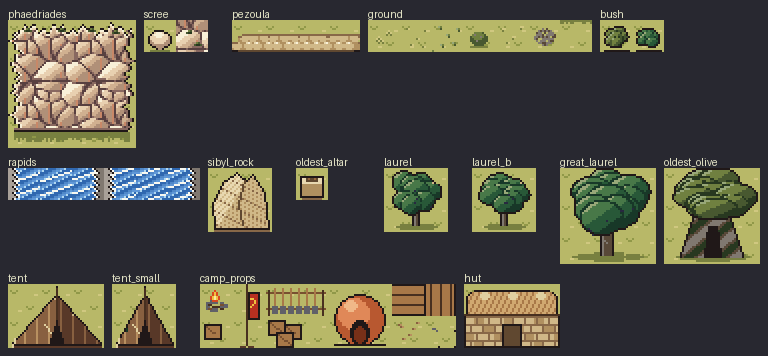

# parnassos tileset catalog

`gTileset_Parnassos` is Route 28: the Sacred Olives and the Kastalian Gorge, on the `aethos` primary. **Generated** by `tools/ichor/art/delphoi_build.py parnassos`; the art is `tools/ichor/art/delphoi_art.py`.

Built: **306** tiles of 504.

Map builders place pieces by key and name (`tools/ichor/maps/delphoi_maps.py`, `build/delphoi/catalog.json`), never by raw id.

| Key | Size | Section | What it is | Names |
|---|---|---|---|---|
| `phaedriades` | 4x4 | land | The Phaedriades: cliff kit | `crest_W`, `crest`, `crest2`, `crest_E`, `face_W`, `face`, `face2`, `face_E`, `faceb_W`, `faceb`, `faceb2`, `faceb_E`, `foot_W`, `foot`, `foot2`, `foot_E` |
| `scree` | 2x1 | land | Fallen blocks under the cliffs | `block`, `face_scrub` |
| `pezoula` | 4x1 | land | Dry-stone terrace wall (a ledge) | `W`, `M`, `M2`, `E` |
| `ground` | 7x1 | land | Ground variants on grass | `tuft`, `pebbles`, `leaves`, `thyme`, `stones`, `worn`, `shade_N` |
| `bush` | 2x1 | land | Maquis: a mastic bush, a young laurel | `mastic`, `laurel` |
| `rapids` | 6x1 | land | White water: the Kastalian's rapids (solid) | `W`, `M`, `E`, `W2`, `M2`, `E2` |
| `sibyl_rock` | 2x2 | land | The Rock of the Sibyl |  |
| `oldest_altar` | 1x1 | land | The oldest altar |  |
| `laurel` | 2x2 | trees | Bay laurel |  |
| `laurel_b` | 2x2 | trees | Bay laurel, second shape |  |
| `great_laurel` | 3x3 | trees | The great laurel of the grove |  |
| `oldest_olive` | 3x3 | trees | The oldest olive (hollow trunk) | `hollow` |
| `tent` | 3x2 | camp | A Titan tent of brown hides |  |
| `tent_small` | 2x2 | camp | A small hide tent |  |
| `camp_props` | 8x2 | camp | Camp props: cookfire, banner, shovel rack, crates, bread oven, plank bridge | `fire`, `banner_top`, `banner`, `rack_W`, `rack_E`, `crate`, `crates`, `oven_TL`, `oven_TR`, `oven_BL`, `oven_BR`, `bridge_EW`, `bridge_NS`, `trodden`, `ash` |
| `hut` | 3x2 | camp | The warden's hut | `door` |
