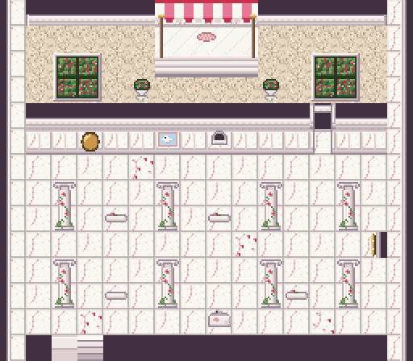

# temple_aphrodite tileset catalog

`gTileset_TempleAphrodite` is the Temple of Aphrodite, Galatea's Gallery (Act III, Kythera Isle; SCRIPT.md Part 10). Pair it with the `aethos` primary, which supplies the open grass, paths, sand, sea, olives and cypresses.

**This file is generated.** `tools/ichor/art/kythera_build.py temple_aphrodite` paints the tileset, compiles it, registers it and rewrites this catalog. The art is in `tools/ichor/art/kythera_*.py` (and `melos_art.py`), the palette plan and the borrowed ground in `kythera_lib.py`.

| Image | Shows |
|---|---|
| [`img/temple_aphrodite_gallery.png`](img/temple_aphrodite_gallery.png) | The gallery and, through its doorway, the rose court with Galatea's dais |
| [`img/temple_aphrodite_pieces.png`](img/temple_aphrodite_pieces.png) | Every structure on its ground |
| [`img/temple_aphrodite_sheet.png`](img/temple_aphrodite_sheet.png) | The numbered metatile sheet, rendered from the compiled tileset |



It is one of the Kythera family of secondaries; see [`TILES_kythera.md`](TILES_kythera.md) for why the art is split and which seams then need aethos-only strips.

## How to use it

**Ids.** Each grid lists metatile ids as Porymap shows them, row by row. Each section
starts on a fixed row of the sheet (temple at 0x200). Structures are placed first-fit in build
order, so appending a new one never moves an old one. Map builders should place pieces
by key and name, never by raw id: `tools/ichor/maps/kythera_tiles.py` holds every
Kythera-family catalog as a Python dict (`mid('temple_aphrodite', 'surf', 'S')`), and
`build/temple_aphrodite/catalog.json` is the same as JSON.

**Walk codes** (the grid beside each structure, and the cell tables):

| Code | Meaning |
|---|---|
| `X` | Impassable: set collision 1. |
| `.` | Passable. |
| `T` | Passable, drawn over the player, who walks behind it. |
| `G` | Tall grass: `MB_TALL_GRASS`, wild encounters. Passable. |
| `D` | Door: `MB_NON_ANIMATED_DOOR`. Put the warp here. |
| `W` | Sea: `MB_OCEAN_WATER`, surfable (collision 0). |
| `P` | Fresh water: `MB_POND_WATER`, surfable. |
| `F` | Waterfall: `MB_WATERFALL` (the Horn of Achelous climbs it). |
| `J` | Ledge: `MB_JUMP_SOUTH`. |

**Borrowed ground.** Cells marked *grass*, *path*, *sand*, *sea*, *shallow* or *fall*
draw no ground of their own: after Porytiles compiles, the build points their
bottom-layer tiles at aethos's grass (`0x001`), limestone path (`0x1D9`), sand
(`0x124`), animated sea (`0x170`), animated turquoise shallows (`0x0D1`) or animated
waterfall (`0x0B3`). They meet aethos ground exactly and cost no tiles. Rebuild
whenever aethos is repainted; the build checks every borrowed entry. A borrowed cell's
own art is in one layer: the middle (`COVERED`, under the player) or the top (`SPLIT`,
over the player).

**Animations.** None of its own; the borrowed sea, shallows and waterfall animate.

**Layer types** in the cell tables: `NORMAL` (bottom and middle under the player),
`COVERED` (ground under the middle layer), `SPLIT` (ground under, art over the player).

**Palettes.** Every 8x8 tile, in every animation frame, draws from one of seven color
groups, one per secondary palette (`kythera_lib.GROUPS`), passed to Porytiles as packing
hints.

| Group | Use |
|---|---|
| foam | The surf, foam lace, shingle, white rock, Aphrodite's rock, reefs, quays, pumice |
| rose | Pink stone and rose marble: sea-cliffs, the quarry, temple and stair, kerbs, moss |
| green | Myrtle, sea-grass and thrift, roses, narcissus, plane, oleander, apple |
| cyc | Whitewashed houses, Aegean doors, rose-pink frames, pots, dovecotes, sea doors |
| terra | Timber and terracotta: boats, the trireme, slips, mill wheels, bridges, gear |
| bronze | Bronze mirrors, the harbor shrine's dove, the great herm, the Minoan vault door |
| melos | Melos's obsidian slope on its earth and grass |

**Tile budget.** 212 of 504 tiles (96 metatiles). The door animations copy their
frames into tiles 504-511 (`DOOR_TILE_START_SIZE1`, `src/field_door.c`), so the build
fails past 504. Static tiles within two pixels of one another are merged.

**Scripted swaps.** The build writes the ids scripts swap to the `gTileset_TempleAphrodite` block at the end of `include/constants/metatile_labels.h`: `METATILE_TempleAphrodite_Mirror_N`, `METATILE_TempleAphrodite_Mirror_Dim`.

## Temple

### Marble floors, petals, the threshold

`floor`, 8 wide by 1 tall. Walkable white marble veined with pink: `floor` and `floor_b` (another vein, to break up a hall), `petals` and `petals_b` (rose petals on the floor, the gallery's and the court's edge), `inlay` (a scallop inlaid before the dais), `threshold` (a doorway's sill between rooms). `exit` is the entrance's marble step down (`MB_SOUTH_ARROW_WARP`: the map's bottom row, a warp on it). `void` is black, for the border.

```text
ids                                                  walk
0x200 0x201 0x202 0x203 0x204 0x205 0x206 0x207   . . . . . . S X
```

| Id | Piece | Walk | Behavior | Layer | Ground |
|---|---|---|---|---|---|
| 0x200 | `floor` | `.` | `MB_NORMAL` | COVERED |  |
| 0x201 | `floor_b` | `.` | `MB_NORMAL` | COVERED |  |
| 0x202 | `petals` | `.` | `MB_NORMAL` | COVERED |  |
| 0x203 | `petals_b` | `.` | `MB_NORMAL` | COVERED |  |
| 0x204 | `inlay` | `.` | `MB_NORMAL` | COVERED |  |
| 0x205 | `threshold` | `.` | `MB_NORMAL` | COVERED |  |
| 0x206 | `exit` | `S` | `MB_SOUTH_ARROW_WARP` | COVERED |  |
| 0x207 | `void` | `X` | `MB_NORMAL` | COVERED |  |

### Walls, the frieze, the dove fresco, doorways

`walls`, 6 wide by 3 tall. A back wall is three rows: `top` (the cornice and the dark of the roof above, `top_L` / `top_R` its corners), the frieze (`frieze`, a band of roses and doves: `frieze_rose`, `frieze_dove`), then `lower` (the polished wall above the floor). `lower_niche` is a niche with a low plinth (the pronaos's statue S1 stands in one); `fresco` is the painted dove whose eye follows you (read it). Side walls run down a room's edges: `side_L` / `side_R`, and `side_*_low` where they meet a back wall's lower row. Between rooms, a partition is the wall's top and lower rows (`part` is the partition's top seen from the room south of it); its doorway is `door_top` over `door` (walkable, the threshold into the next room; no warp needed). `inner_L` / `inner_R` are a partition's ends against the side walls.

```text
ids                                      walk
0x208 0x209 0x20A 0x20B 0x20C 0x20D   X X X X X X
0x210 0x211 0x212 0x213 0x214 0x215   X X X X X X
0x218 0x219 0x21A 0x21B 0x21C 0x21D   X X X X D X
```

| Id | Piece | Walk | Behavior | Layer | Ground |
|---|---|---|---|---|---|
| 0x208 | `top` | `X` | `MB_NORMAL` | COVERED |  |
| 0x209 | `top_L` | `X` | `MB_NORMAL` | COVERED |  |
| 0x20A | `top_R` | `X` | `MB_NORMAL` | COVERED |  |
| 0x20B | `side_L` | `X` | `MB_NORMAL` | COVERED |  |
| 0x20C | `side_R` | `X` | `MB_NORMAL` | COVERED |  |
| 0x20D | `inner_L` | `X` | `MB_NORMAL` | COVERED |  |
| 0x210 | `frieze` | `X` | `MB_NORMAL` | COVERED |  |
| 0x211 | `frieze_rose` | `X` | `MB_NORMAL` | COVERED |  |
| 0x212 | `frieze_dove` | `X` | `MB_NORMAL` | COVERED |  |
| 0x213 | `side_L_low` | `X` | `MB_NORMAL` | COVERED |  |
| 0x214 | `side_R_low` | `X` | `MB_NORMAL` | COVERED |  |
| 0x215 | `inner_R` | `X` | `MB_NORMAL` | COVERED |  |
| 0x218 | `lower` | `X` | `MB_NORMAL` | COVERED |  |
| 0x219 | `lower_niche` | `X` | `MB_NORMAL` | COVERED |  |
| 0x21A | `fresco` | `X` | `MB_NORMAL` | COVERED |  |
| 0x21B | `door_top` | `X` | `MB_NORMAL` | COVERED |  |
| 0x21C | `door` | `D` | `MB_NON_ANIMATED_DOOR` | COVERED |  |
| 0x21D | `part` | `X` | `MB_NORMAL` | COVERED |  |

### Columns, plinths, the dove altar

`gallery`, 4 wide by 2 tall. On the marble floor. `col_top` over `col_base`: an Ionic column with roses climbing it (impassable); `col_plain_*` the same without. `plinth`: a low statue plinth (walkable: the statue is an object standing on it, and steps off it when it moves); `plinth_rose`, with a rose laid on it. `altar`: the dove altar by the pronaos's door, where Charis stands (impassable; read it). `bench`: a marble bench (impassable).

```text
ids                          walk
0x220 0x221 0x222 0x223   X X X X
0x228 0x229 0x22A 0x22B   X X . .
```

| Id | Piece | Walk | Behavior | Layer | Ground |
|---|---|---|---|---|---|
| 0x220 | `col_top` | `X` | `MB_NORMAL` | COVERED |  |
| 0x221 | `col_plain_top` | `X` | `MB_NORMAL` | COVERED |  |
| 0x222 | `altar` | `X` | `MB_NORMAL` | COVERED |  |
| 0x223 | `bench` | `X` | `MB_NORMAL` | COVERED |  |
| 0x228 | `col_base` | `X` | `MB_NORMAL` | COVERED |  |
| 0x229 | `col_plain_base` | `X` | `MB_NORMAL` | COVERED |  |
| 0x22A | `plinth` | `.` | `MB_NORMAL` | COVERED |  |
| 0x22B | `plinth_rose` | `.` | `MB_NORMAL` | COVERED |  |

### Wall-hung bronze mirrors

`mirrors`, 4 wide by 2 tall. Polished bronze, on the walls. `mirror_tall_top` over `mirror_tall`: M0, the pronaos's tall mirror on its end wall (frieze row, then lower row), facing south. `mirror_N_top` over `mirror_N`: a smaller wall mirror on a back wall (W1), facing south. `mirror_E`: a mirror on a room's east side wall, facing west (W2), seen edge-on; `mirror_W` on a west wall, facing east. `mirror_S`: the back of one hung on a partition's south face. `mirror_dim`: a back-wall mirror showing a pale figure, for when it reflects a statue.

```text
ids                          walk
0x224 0x225 0x226 0x227   X X X X
0x22C 0x22D 0x22E 0x22F   X X X X
```

| Id | Piece | Walk | Behavior | Layer | Ground |
|---|---|---|---|---|---|
| 0x224 | `mirror_tall_top` | `X` | `MB_NORMAL` | COVERED |  |
| 0x225 | `mirror_N_top` | `X` | `MB_NORMAL` | COVERED |  |
| 0x226 | `mirror_E` | `X` | `MB_NORMAL` | COVERED |  |
| 0x227 | `mirror_W` | `X` | `MB_NORMAL` | COVERED |  |
| 0x22C | `mirror_tall` | `X` | `MB_NORMAL` | COVERED |  |
| 0x22D | `mirror_N` | `X` | `MB_NORMAL` | COVERED |  |
| 0x22E | `mirror_S` | `X` | `MB_NORMAL` | COVERED |  |
| 0x22F | `mirror_dim` | `X` | `MB_NORMAL` | COVERED |  |

### The rose court: gravel paths, rose beds

`court`, 8 wide by 3 tall. The open courtyard. `gravel`, `gravel_b`, `gravel_petals`: its paths (walkable). `edge_N` `edge_S` `edge_W` `edge_E`: a path's marble kerb along a bed or wall (walkable). The rose beds, low marble kerbs full of roses (impassable): `bed` (inside), `bed_N` `bed_S` `bed_E` `bed_W` (an edge, named by the side the kerb is on), `bed_NW` ... `bed_SE` (corners), `bed_single` (a bed one cell big). `urn`: a marble urn of roses (impassable).

```text
ids                                                  walk
0x230 0x231 0x232 0x233 0x234 0x235 0x236 0x237   . . . . . . . .
0x238 0x239 0x23A 0x23B 0x23C 0x23D 0x23E 0x23F   X X X X X X X X
0x240 0x241 0x242 0x243 0x244 0x245 0x246 0x247   X X X X X X X .
```

| Id | Piece | Walk | Behavior | Layer | Ground |
|---|---|---|---|---|---|
| 0x230 | `gravel` | `.` | `MB_NORMAL` | COVERED |  |
| 0x231 | `gravel_b` | `.` | `MB_NORMAL` | COVERED |  |
| 0x232 | `gravel_petals` | `.` | `MB_NORMAL` | COVERED |  |
| 0x233 | `edge_N` | `.` | `MB_NORMAL` | COVERED |  |
| 0x234 | `bed_single` | `.` | `MB_NORMAL` | COVERED |  |
| 0x235 | `edge_S` | `.` | `MB_NORMAL` | COVERED |  |
| 0x236 | `edge_W` | `.` | `MB_NORMAL` | COVERED |  |
| 0x237 | `edge_E` | `.` | `MB_NORMAL` | COVERED |  |
| 0x238 | `bed` | `X` | `MB_NORMAL` | COVERED |  |
| 0x239 | `bed_N` | `X` | `MB_NORMAL` | COVERED |  |
| 0x23A | `bed_S` | `X` | `MB_NORMAL` | COVERED |  |
| 0x23B | `bed_E` | `X` | `MB_NORMAL` | COVERED |  |
| 0x23C | `bed_W` | `X` | `MB_NORMAL` | COVERED |  |
| 0x23D | `bed_NW` | `X` | `MB_NORMAL` | COVERED |  |
| 0x23E | `bed_NE` | `X` | `MB_NORMAL` | COVERED |  |
| 0x23F | `urn` | `X` | `MB_NORMAL` | COVERED |  |
| 0x240 | (0, 2) | `X` | `MB_NORMAL` | COVERED |  |
| 0x241 | (1, 2) | `X` | `MB_NORMAL` | COVERED |  |
| 0x242 | (2, 2) | `X` | `MB_NORMAL` | COVERED |  |
| 0x243 | (3, 2) | `X` | `MB_NORMAL` | COVERED |  |
| 0x244 | (4, 2) | `X` | `MB_NORMAL` | COVERED |  |
| 0x245 | `bed_SW` | `X` | `MB_NORMAL` | COVERED |  |
| 0x246 | `bed_SE` | `X` | `MB_NORMAL` | COVERED |  |
| 0x247 | (7, 2) | `.` | `MB_NORMAL` | COVERED |  |

### Galatea's dais under the awning

`dais`, 4 wide by 3 tall. The rose court's north end: a raised marble dais under a striped rose-and-white awning on bronze-capped poles (4 x 3). Galatea stands on `stand` (1, 1); the bottom row is the dais's steps, walkable, which is where she steps down (beat III-1G). The awning's top row and its poles are impassable.

```text
ids                          walk
0x248 0x249 0x24A 0x24B   X X X X
0x250 0x251 0x252 0x253   X . . X
0x258 0x259 0x25A 0x25B   . . . .
```

| Id | Piece | Walk | Behavior | Layer | Ground |
|---|---|---|---|---|---|
| 0x248 | `awning_L` | `X` | `MB_NORMAL` | COVERED |  |
| 0x249 | (1, 0) | `X` | `MB_NORMAL` | COVERED |  |
| 0x24A | (2, 0) | `X` | `MB_NORMAL` | COVERED |  |
| 0x24B | (3, 0) | `X` | `MB_NORMAL` | COVERED |  |
| 0x250 | (0, 1) | `X` | `MB_NORMAL` | COVERED |  |
| 0x251 | `stand` | `.` | `MB_NORMAL` | COVERED |  |
| 0x252 | (2, 1) | `.` | `MB_NORMAL` | COVERED |  |
| 0x253 | (3, 1) | `X` | `MB_NORMAL` | COVERED |  |
| 0x258 | `steps_L` | `.` | `MB_NORMAL` | COVERED |  |
| 0x259 | (1, 2) | `.` | `MB_NORMAL` | COVERED |  |
| 0x25A | (2, 2) | `.` | `MB_NORMAL` | COVERED |  |
| 0x25B | (3, 2) | `.` | `MB_NORMAL` | COVERED |  |
