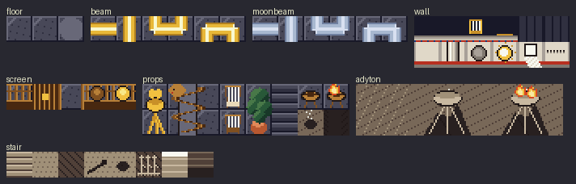

# temple_apollo tileset catalog

`gTileset_Temple_apollo` is the Temple of Apollo and the Omphalos stair (on oikos), on the `aethos` primary. **Generated** by `tools/ichor/art/delphoi_build.py temple_apollo`; the art is `tools/ichor/art/delphoi_art.py`.

Built: **204** tiles of 504.

Map builders place pieces by key and name (`tools/ichor/maps/delphoi_maps.py`, `build/delphoi/catalog.json`), never by raw id.

| Key | Size | Section | What it is | Names |
|---|---|---|---|---|
| `floor` | 3x1 | floor | Dark marble floor, and the light patch under the smoke-hole | `floor`, `floor2`, `light` |
| `beam` | 6x1 | floor | The sun's beam on the floor | `EW`, `NS`, `NE`, `NW`, `SE`, `SW` |
| `moonbeam` | 6x1 | floor | The moon's beam on the floor | `EW`, `NS`, `NE`, `NW`, `SE`, `SW` |
| `wall` | 6x2 | walls | Walls: cornice, face, pilaster, disc dark and lit, window, inscription, lyre | `top`, `top2`, `wall`, `pilaster`, `disc`, `disc_lit`, `window`, `inscription`, `lyre`, `top_disc`, `side_W`, `side_E` |
| `screen` | 5x1 | walls | Bronze screens: grille, gate shut, gate open, disc in a screen | `grille`, `shut`, `open`, `disc`, `disc_lit` |
| `props` | 8x2 | things | Tripods, the serpent pillar, laurels, lyres, steps | `tripod_top`, `tripod`, `serpent_TL`, `serpent_TR`, `serpent_BL`, `serpent_BR`, `laurel_top`, `laurel`, `lyre`, `kithara`, `steps`, `steps2`, `brazier`, `brazier_lit`, `vent`, `chasm` |
| `adyton` | 8x2 | things | The adyton: rock floor, and the tripod over the chasm (cold, lit) | `rock`, `rock2`, `rock3`, `rock4`, `tripod_TL`, `tripod_lit_TL`, `tripod_TC`, `tripod_TR`, `tripod_BL`, `tripod_BC`, `tripod_BR`, `tripod_lit_TC`, `tripod_lit_TR`, `tripod_lit_BL`, `tripod_lit_BC`, `tripod_lit_BR` |
| `stair` | 8x1 | things | The Omphalos stair: steps, rock, the torch, the knot, the carving, the way up and down | `steps`, `landing`, `rock`, `torch`, `knot`, `carving`, `way_up`, `way_down` |
