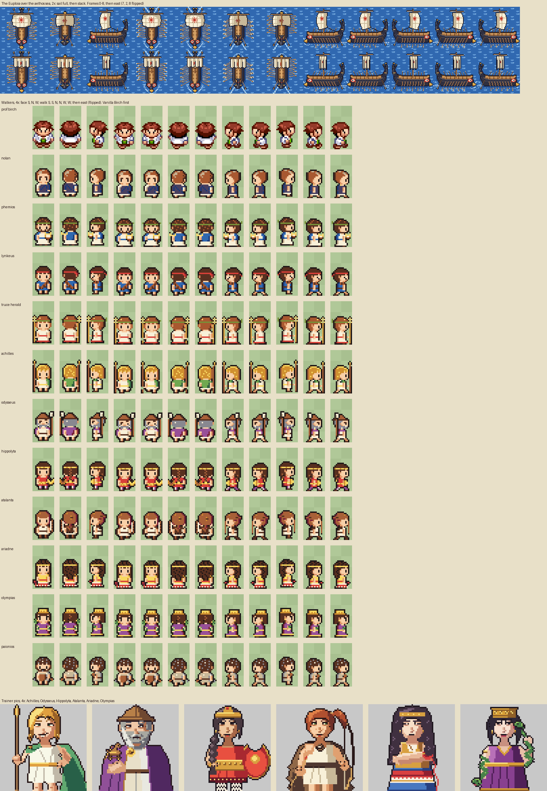
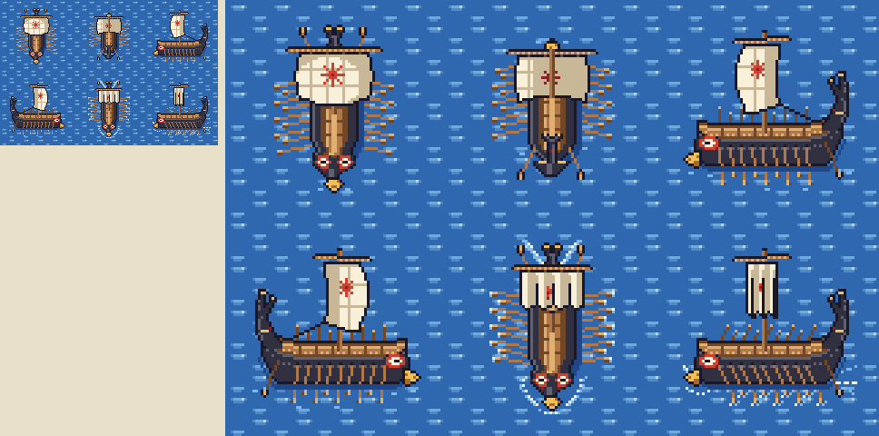
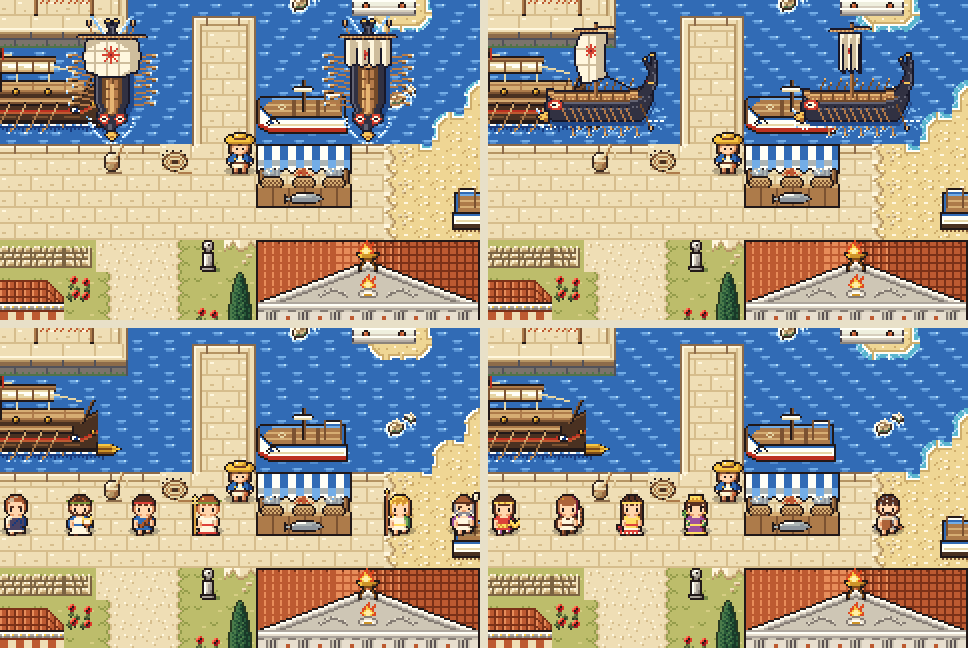

# The post-game's first sprites

Batch 1's sprites: the *Euploia* at sea for the sailing layer, the ship's three new crew, the herald of the Olympic truce, and Olympia's cast ahead of batch 2 (walkers for seven, portraits for the five Brains and Olympias). The post-game build plan is `BUILD.md`; the house style for walkers is `design/phase1/SPRITES_npc.md`.

## Sources and rebuilding

| Script | Draws | Writes |
|---|---|---|
| `tools/ichor/art/sprites_pg_ship.py` | the *Euploia*, both sheets | `graphics/object_events/pics/ichor/pg_euploia*.png`, `palettes/ichor_euploia.pal` |
| `tools/ichor/art/sprites_pg_walkers.py` | the eleven walkers | `graphics/object_events/pics/ichor/pg_<name>.png`, `palettes/ichor_olympia.pal` |
| `tools/ichor/art/sprites_pg_portraits.py` | the six trainer pics | `graphics/trainers/front_pics/ichor_pg_<name>.png` |
| `tools/ichor/art/sprites_pg_previews.py` | the review images | `design/postgame/img/sprites_*.png` |

Run each with `--write`. The walkers and the ship also take `--preview DIR`, and the portraits `--preview DIR [--pass N]`. Re-run `sprites_pg_previews.py` after `tools/ichor/tests/pg_sprites.sh`; it takes its in-game frames from that test's screenshots.

## Palettes

Two new OBJ palette tags. The post-game's tags start at 0x1148, high in Ichor's range (0x1134–0x114F), because the act branches count up from 0x1137 (world-act2 holds 0x1137 for its wine palette). The next post-game tag is 0x114A.

| Tag | Value | File | Who |
|---|---|---|---|
| `OBJ_EVENT_PAL_TAG_ICHOR_OLYMPIA` | 0x1148 | `ichor_olympia.pal` | Achilles, Odysseus, Hippolyta, Atalanta, Ariadne, Olympias, Paionios |
| `OBJ_EVENT_PAL_TAG_ICHOR_EUPLOIA` | 0x1149 | `ichor_euploia.pal` | the *Euploia*, both sheets |
| `OBJ_EVENT_PAL_TAG_ICHOR_CAST` (existing) | 0x1134 | `ichor_cast.pal` | Nolan, Phemios, Lynkeus, the truce herald |

**Why the crew and the herald use the cast palette:**
- **The crew** stand below deck beside Alethea and the other cast-palette crew, so they cost no extra slot aboard.
- **The herald** stands in every town beside the townsfolk.

The Altis needs one slot for all seven of Olympia's people, and the ship needs one at sea.

**The Olympia palette** keeps the cast palette's letters and roles where they match. It adds the colors the cast palette lacks: a brighter gold, ash gray for beards and marble dust, two greens, and Olympias's purple.

| # | Char | Name | RGB | Used for |
|---|---|---|---|---|
| 1 | `k` | ink | 32 24 24 | outlines, eyes, black hair |
| 2 | `b` | brown | 88 48 32 | hair, leather, boots, the bearskin |
| 3 | `r` | wine | 120 32 56 | crimson's and purple's shade |
| 4 | `u` | umber | 168 96 56 | auburn hair, wood, felt, the apron |
| 5 | `c` | crimson | 216 64 56 | Hippolyta's tunic, Ariadne's thread |
| 6 | `s` | skin_d | 224 152 104 | skin shadow |
| 7 | `S` | skin_l | 248 208 168 | skin |
| 8 | `o` | bronze | 208 144 48 | bronze, gold's shade |
| 9 | `O` | gold | 248 216 96 | crowns, belts, Achilles's hair |
| 10 | `l` | linen_d | 200 184 152 | linen shade, dusty wool |
| 11 | `L` | linen_l | 248 240 216 | linen, marble dust |
| 12 | `a` | ash | 136 136 144 | gray beards, iron, dust in shade |
| 13 | `v` | green_d | 48 96 64 | serpents' and the cloak's shade |
| 14 | `g` | green | 112 168 80 | serpents, Achilles's cloak |
| 15 | `p` | purple | 152 80 152 | Olympias's peplos, Odysseus's cloak |

**The Euploia palette.** Pitch black for the hull, with a lit sheen. Three oak tones for deck, mast, yard and oars. Bronze and gold for the ram and the gilt. Red for the cheeks and the star, linen for the sail and the eyes' whites. Last, a dark sea blue for the hull's shadow on the water, with spray and foam for the wake. The sea itself is the map's, so the hull's shadow and the wake are the only blues the sprite carries.

## The *Euploia* at sea

| Constant | Sheet | |
|---|---|---|
| `OBJ_EVENT_GFX_ICHOR_EUPLOIA` | `pics/ichor/pg_euploia.png` | the sail full: bellied, with the Dioskouroi's star (the sailor's sign of fair weather) |
| `OBJ_EVENT_GFX_ICHOR_EUPLOIA_SLACK` | `pics/ichor/pg_euploia_slack.png` | the sail slack: hanging in folds between the brails, half brailed up, a sliver of the star in a fold |

**Layout.** Each sheet is 576×64: nine 64×64 frames in the standard order.

| Frame | 0 | 1 | 2 | 3 | 4 | 5 | 6 | 7 | 8 |
|---|---|---|---|---|---|---|---|---|---|
| | face south | face north | face west | walk south A | walk south B | walk north A | walk north B | walk west A | walk west B |

- **Animation.** Both sheets play `sAnimTable_Standard`. East is west flipped. They are the same size, frame order and palette, so `ObjectEventSetGraphicsId` swaps them in place when the wind drops or fills.
- **Graphics info.** `size` 2048, 64×64, `gObjectEventBaseOam_64x64`, `sOamTables_64x64`.
- **Shadow and tracks.** `SHADOW_SIZE_NONE` and `TRACKS_NONE`: the sheet draws its own shadow on the water and its own wake.

**The ship.** A black-hulled trireme seen from above at three-quarters, as Homer paints them:
- **Hull and bow.** A black hull (*melaina naus*), red-cheeked (*miltoparēos*), with a painted eye on each cheek at the bow and the three-finned bronze ram at the waterline.
- **Deck.** Oak planking with a lit gangway down the middle, between black wales.
- **Stern.** The aphlaston curls over the stern, with gilt tips, and two steering oars trail aft.
- **Rig.** The mast and yard carry a linen sail on a grid of brails and stitched bands.
- **Oars.** Two banks, long and short alternating, nine to a side facing north and south.

**Motion.** The oars carry the walk cycle:
- **The three frames.** The standing frame holds the oars square to the hull. Walk A sweeps them aft, at the end of the stroke, with a splash at each blade. Walk B sweeps them forward, at the catch.
- **The cycle.** `sAnim_Go*` plays A, stand, B, stand, so the banks row.
- **Wake.** While she moves, a broken V of foam streams from the stern and a white bow wave curls round the ram. At rest, a few ripples ring the hull.

**Where she sits.** A 64×64 object stands on the bottom-middle 16×16 of its frame (rows 48–63, columns 24–39). So the player's tile is:

| Heading | On the player's tile |
|---|---|
| South | the bow and the ram |
| North | the stern |
| West or east | midships |

The hull runs about three tiles behind that tile, facing north or south. If the sailing layer wants the hull centered on the player's tile instead, it should offset the sprite, not redraw the sheet.

**The read at GBA size.** The black hull, white sail and red star read clearly on the aethos sea, the left panel above at 1x.
- **Fit.** She is bigger than Akti's small boats and the right size beside the moored trireme in Akti's harbor.
- **On the real water.** The in-game shots below, from the test, show her there.
- **The Aegean kit.** The Aegean `melos` sea kit is on world-act3's branch, not this one. Its water is a deeper blue than aethos's, which only strengthens the contrast with the hull and sail.

## Walkers

All eleven are standard 16×32 walkers: nine frames, `sAnimTable_Standard`, `SHADOW_SIZE_M`, `TRACKS_FOOT`. Each is built on a `sprites_folk.py` body archetype (`tunic`, `midi` or `robe`), with its own head per direction and its costume and props painted on as overlays.

| Constant | Sheet | Palette | Look |
|---|---|---|---|
| `OBJ_EVENT_GFX_ICHOR_NOLAN` | `pg_nolan.png` | cast | Christopher Nolan. Light-brown hair swept back from a high forehead, a steady stare, a dark slate himation pinned neatly at the left shoulder with a bronze pin, and a pale chiton at his right shoulder and arm and at the hem. |
| `OBJ_EVENT_GFX_ICHOR_PHEMIOS` | `pg_phemios.png` | cast | Dark curls and a short beard under a laurel wreath, a long linen robe girt in blue, a blue mantle, and a bronze lyre with a tortoiseshell sound box in his left arm. |
| `OBJ_EVENT_GFX_ICHOR_LYNKEUS` | `pg_lynkeus.png` | cast | Black hair under a crimson headband whose tails fly at the back, keen eyes, a short blue exomis, and a lynx pelt slung from shoulder to hip. |
| `OBJ_EVENT_GFX_ICHOR_TRUCE_HERALD` | `pg_truce_herald.png` | cast | A spondophoros: auburn hair under the olive wreath, a long white robe with a crimson girdle and hem, and the bronze kerykeion with its serpents knotted at the top. |
| `OBJ_EVENT_GFX_ICHOR_ACHILLES` | `pg_achilles.png` | Olympia | Bronze-gold hair loose to the jaw, beardless, a short white chiton girt with gold, a sea-green chlamys (Thetis's color), and his ash spear. |
| `OBJ_EVENT_GFX_ICHOR_ODYSSEUS` | `pg_odysseus.png` | Olympia | Broad, gray-bearded, a felt pilos, Homer's purple cloak with a gold brooch over a linen tunic, and an oar on his shoulder (Teiresias's oar). |
| `OBJ_EVENT_GFX_ICHOR_HIPPOLYTA` | `pg_hippolyta.png` | Olympia | Black hair in a long braid under a gold diadem, a crimson tunic, the gold war-belt, patterned leggings, high boots, and a bronze pelta on her left arm. |
| `OBJ_EVENT_GFX_ICHOR_ATALANTA` | `pg_atalanta.png` | Olympia | Auburn hair tied high, a short linen chiton, the bearskin over her shoulders, tall hunting boots, and her bow. |
| `OBJ_EVENT_GFX_ICHOR_ARIADNE` | `pg_ariadne.png` | Olympia | Long black curls bound with gold, a Minoan gold bodice, a flounced skirt in linen and crimson bands, and the red spool of her thread. |
| `OBJ_EVENT_GFX_ICHOR_OLYMPIAS` | `pg_olympias.png` | Olympia | A tall gold polos over black hair, stern brows, gold earrings, a purple peplos with gold girdle and hem, green serpents about both forearms, and one risen at her shoulder. |
| `OBJ_EVENT_GFX_ICHOR_PAIONIOS` | `pg_paionios.png` | Olympia | Dark curls and beard whitened with marble dust, his mouth open mid-story, a dusty exomis under a leather apron, a chisel in one hand and a mallet in the other. |

**Mirrored props.** As for every Gen 3 walker, the east frames are the west frames flipped, so props held on one side swap hands facing east: Achilles's spear, the herald's staff, Phemios's lyre, Atalanta's bow.

## Trainer pics

64×64 front pics, cut at the knee as Emerald's Frontier Brains are, so the faces have room. Each has its own 16-color palette, read from its PNG (`INCGFX_U16(..., ".gbapal")`), as the slice's cast pics do.

| Constant | File | The picture |
|---|---|---|
| `TRAINER_PIC_ICHOR_ACHILLES` | `ichor_pg_achilles.png` | Spear upright in one hand, the other on his hip, the green chlamys flaring behind; green eyes, one brow cocked, a lopsided grin |
| `TRAINER_PIC_ICHOR_ODYSSEUS` | `ichor_pg_odysseus.png` | The pilos, a curled gray beard, one brow up over narrowed eyes and a wry half-smile; the purple cloak and gold brooch; a little wooden horse on wheels in his hand (he's the Horse's Brain) |
| `TRAINER_PIC_ICHOR_HIPPOLYTA` | `ichor_pg_hippolyta.png` | Upright and composed: the diadem with a red gem, the braid over her shoulder, one hand on the plaqued war-belt, the crimson pelta with its bronze boss, zigzag leggings |
| `TRAINER_PIC_ICHOR_ATALANTA` | `ichor_pg_atalanta.png` | Unbothered, eyes slid aside: auburn hair in a swinging tail, the shaggy bearskin with its paws knotted at her breast, the bow in one hand and an arrow held low in the other |
| `TRAINER_PIC_ICHOR_ARIADNE` | `ichor_pg_ariadne.png` | Arms folded, a flat, level look; black curls to the waist, the gold band, the Minoan bodice and flounced skirt; the red thread runs from the spool in her hand out of the frame |
| `TRAINER_PIC_ICHOR_OLYMPIAS` | `ichor_pg_olympias.png` | Chin up under the polos, heavy-lidded, a thin knowing smile; a serpent wound up her raised arm with its head turned to her, a second round the other arm |

Nothing displays them yet. There are no post-game trainers in batch 1, and batch 2's Olympiad points the Brains at them.

### Three passes on each face

The script paints each portrait in three layers (`--pass 1` blocking, `2` form and features, `3` finish). Each face also went through three rounds of critique, kept as images:

| Round | Image | What changed |
|---|---|---|
| 1 | `img/sprites_portraits_round1.png` | The first complete set: larger faces than the first try (eyes four pixels wide with whites and irises), every costume blocked in |
| 2 | `img/sprites_portraits_round2.png` | Cleaner faces: Achilles's blotchy cheeks and Atalanta's freckles toned down, Achilles's grin closed and lopsided; Atalanta's bear ears gone (they read as hair buns), her tail smaller; Ariadne's curls drawn as strokes, not rings; Olympias's polos lower, flared and banded; Hippolyta's floating spear point removed |
| 3 | `img/sprites_portraits_round3.png` | Odysseus's wooden horse drawn pixel by pixel, on a plank with wheels; the serpents thickened, banded and given heads with eyes and tongues; Atalanta's bearskin draped over the shoulders with shaggy edges; zigzag bands on Hippolyta's leggings; Achilles's chiton shaded in a narrower band |

The walkers had their own rounds. The first draft gave Nolan near-white hair (he read as an old man) and put a red cross where Lynkeus's headband tails fall. The second recolored Nolan's hair light brown, swung the tails to one side, and gave Atalanta a bolder bow and a bearskin at the shoulders. The third, after the portraits, gave Odysseus's walker the portrait's purple cloak and gold brooch.

## In game

**Check.** `tools/ichor/tests/pg_sprites.sh` runs headlessly at noon, so the shots show the sprites' own colors rather than the evening tint. It works on Akti's harbor quay:
1. It clears away the map's own people.
2. It spawns both ships, sail full in the west basin and slack in the east water, rowing in place to each heading in turn. Then it spawns the eleven walkers in two groups on the quay.
3. For every object and heading, it checks:
   - the object spawns from its own graphics id;
   - the walk frames it shows over 96 frames (south 0, 3, 4; north 1, 5, 6; west and east 2, 7, 8);
   - one probe color from the palette its sprite actually shows.
4. It checks the six `TRAINER_PIC_ICHOR_*` entries point at a front pic and a palette in the ROM.

It passes 166 checks and leaves 13 screenshots in `build/test_pg_sprites/shots/`.

## Not drawn, or drawn differently

- **Nobody here exists on another branch.** I searched world-act1, world-act2, world-act3 and world-oikoumene. None of them has a walker or portrait for any of the eleven.
- **`OBJ_EVENT_GFX_ICHOR_HERALD` is taken.** world-act2 already defines it for a different herald: Route 6's runner in a short chiton with a red fillet and the barrier pole (`design/phase3/SPRITES.md`). The truce herald is a long-robed spondophoros with the kerykeion and the olive wreath. It is registered as `OBJ_EVENT_GFX_ICHOR_TRUCE_HERALD` so the two can't collide when the branches meet. Scripts that wrote `OBJ_EVENT_GFX_ICHOR_HERALD` from BUILD.md's interface table should use `_TRUCE_HERALD`.
- **Olympias.** LABORS §6 lists her portrait and walker as existing "(Pantheon)", but no branch has drawn the Twelve yet. Both are drawn here. Whoever draws the Pantheon should reuse them or redraw them to match.

## Still open

- **The Great Bear's stars.** BUILD.md's sprites row lists a small star sprite for the night sky at sea. It isn't drawn in this pass.
- **Portraits for the rest of the Labors' cast.** Paionios, Augeas, Diomedes, Helios and the others listed in LABORS §9 still need portraits.
- **The Brains' extra poses.** A bow, or a frame for the Olympiad's lobby animations, if batch 2 wants them.
- **Not opened in Porymap yet.** The entries follow the vanilla format exactly.

## ROM

`make`'s ROM line was 22,174,100 B (66.08%) before and 22,241,364 B (66.28%) after: +67,264 B. Most of that is the ship: two uncompressed 64×64 sheets, 36,864 B. The eleven walkers are 25,344 B, and the six compressed portraits with their palettes about 5 KiB.
