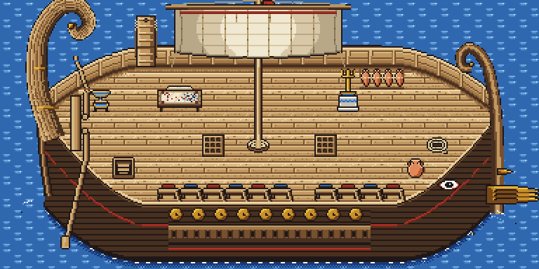
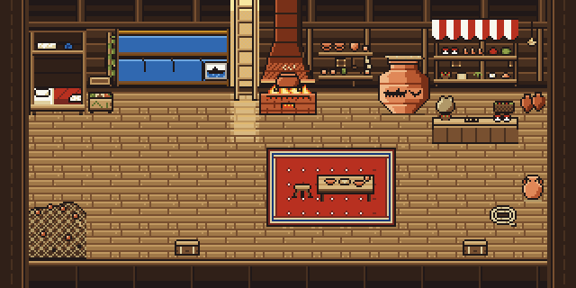

# Euploia tileset catalog

`gTileset_Euploia` is the *Euploia* refitted for the post-game: her deck and her
quarters below, a secondary on the `aethos` primary for `MAP_EUPLOIA_DECK` and
`MAP_EUPLOIA_BELOW`.

<!-- generated: euploia_build.py -->
**This section is generated** by `tools/ichor/art/euploia_build.py`, which draws the
tileset (`euploia_deck.py`, `euploia_below.py`), compiles it and rewrites the catalog
between these markers. Everything outside the markers is written by hand.





## How it works

**Scenes, not structures** (as world-act1's trireme). The ship is drawn as two whole
pictures, the deck (24×12 cells) and below deck (20×10), each in three layers. The build
slices them into 16×16 cells and keeps one metatile per distinct cell, so the maps are
the scenes cell for cell (`build/euploia/catalog.json`, `scenes`).
`tools/ichor/maps/euploia.py` writes the layouts from there and places events by the
named pieces below, never by raw id.

**Variants.** Below deck is also drawn in eight other states. Only the cells that differ
from the plain scene become metatiles, and the catalog lists them as `(x, y, id)` for
`setmetatile`: `hearth_cold` (Lampon not aboard) and `keepsake_<name>` (each keepsake on
its spot). `tools/ichor/maps/euploia.py` writes them into below deck's `scripts.pory` as
small scripts, between generated markers.

**Borrowed sea.** Every deck cell on the water points its bottom layer at aethos's open
sea (`0x170`), so the sea round the hull animates with aethos's water and costs no tiles.
Open water with nothing on it is `0x170` itself. Rebuild the ship whenever aethos is
repainted.

**Mirrored hull.** The hull is symmetric about the ship's middle, so the bow's curves are
the stern's tiles flipped. The ram, eye and stem, and the aphlaston and steering oars, are
drawn after the mirror and are their own.

**Walk codes.** In the grids below: `X` solid; `.` walkable; `~` open sea (solid); `w`
the hatch and the ladder (`MB_LADDER`: the warps); `c` the stall's counter (`MB_COUNTER`).

## Palettes

Seven groups, one per secondary palette (6-12). Every 8×8 tile draws from one group.

| Group | Colors | Use |
|---|---|---|
| wood | 15: `ink` (32, 24, 24), `wd0` (72, 48, 32), `wd1` (120, 80, 48), `pk1` (160, 120, 72), `pk2` (192, 152, 96), `pk3` (216, 184, 128), `pk4` (240, 216, 168), `rp` (224, 208, 160), `rd` (184, 48, 32), `rd0` (120, 40, 32), `br` (120, 72, 24), `g0` (200, 144, 40), `g1` (240, 192, 64), `w0` (248, 248, 240), `b1` (48, 104, 176) | Deck planks, bulwarks, the hull's side, the mast, the stern timbers, the helm, the benches, the gangplank, bronze shields, the eye and the wale |
| water | 15: `ink` (32, 24, 24), `wd0` (72, 48, 32), `wd1` (120, 80, 48), `pk2` (192, 152, 96), `pk3` (216, 184, 128), `br` (120, 72, 24), `g0` (200, 144, 40), `g1` (240, 192, 64), `b0` (24, 56, 120), `b1` (48, 104, 176), `wr` (80, 136, 200), `b2` (112, 168, 224), `b3` (176, 216, 240), `w0` (248, 248, 240), `rd` (184, 48, 32) | Where the ship meets the sea: waterline foam, shadow on the water, the ram, the steering oar's blade |
| sail | 15: `ink` (32, 24, 24), `w0` (248, 248, 240), `ln1` (240, 232, 208), `ln2` (216, 200, 168), `ln3` (184, 168, 136), `ln4` (136, 120, 96), `rd` (184, 48, 32), `rd0` (120, 40, 32), `wd0` (72, 48, 32), `wd1` (120, 80, 48), `pk2` (192, 152, 96), `rp` (224, 208, 160), `rp1` (176, 152, 104), `b1` (48, 104, 176), `g1` (240, 192, 64) | The linen sail, its yard, lifts, sheets and red head band; the chart table and Odysseus's Periplous on it |
| cargo | 15: `ink` (32, 24, 24), `w0` (248, 248, 240), `tc0` (120, 48, 24), `tc1` (184, 88, 48), `tc2` (224, 136, 88), `tc3` (240, 184, 136), `wd0` (72, 48, 32), `wd1` (120, 80, 48), `pk2` (192, 152, 96), `pk3` (216, 184, 128), `rp` (224, 208, 160), `rp1` (176, 152, 104), `rd` (184, 48, 32), `ol1` (96, 112, 48), `ol2` (144, 160, 72) | Amphorae, the water jar, coiled rope, the Pithos, the mess's bowls and table, Kydon's goods and awning, Diktys's nets, Iaso's chest, the sea chests |
| shrine | 15: `ink` (32, 24, 24), `w0` (248, 248, 240), `m2` (200, 192, 176), `m3` (168, 160, 152), `m4` (128, 120, 112), `b1` (48, 104, 176), `b2` (112, 168, 224), `g0` (200, 144, 40), `g1` (240, 192, 64), `br` (120, 72, 24), `wd0` (72, 48, 32), `wd1` (120, 80, 48), `pn1` (232, 144, 168), `pn2` (176, 80, 112), `ol2` (144, 160, 72) | Poseidon's altar and trident; the trophy shelf and its seven keepsakes |
| hold | 15: `ink` (32, 24, 24), `hd0` (48, 32, 24), `wd0` (72, 48, 32), `wd1` (120, 80, 48), `pk1` (160, 120, 72), `pk2` (192, 152, 96), `pk3` (216, 184, 128), `fc` (248, 232, 160), `lt1` (224, 184, 112), `rd` (184, 48, 32), `rd0` (120, 40, 32), `b0` (24, 56, 120), `b1` (48, 104, 176), `rp` (224, 208, 160), `w0` (248, 248, 240) | Below deck's dark timber, its floor and lamp, the bunk with its fleece and blanket, the rug |
| hearth | 15: `ink` (32, 24, 24), `hd0` (48, 32, 24), `wd0` (72, 48, 32), `wd1` (120, 80, 48), `pk1` (160, 120, 72), `pk2` (192, 152, 96), `pk3` (216, 184, 128), `fc` (248, 232, 160), `lt1` (224, 184, 112), `tc0` (120, 48, 24), `tc1` (184, 88, 48), `tc2` (224, 136, 88), `rp` (224, 208, 160), `fl` (216, 72, 32), `g1` (240, 192, 64) | Hestia's fire: the hearth, its clay hood, pot and flames; the ladder and the daylight down the hatch |

## Tile budget

**493 of 504 tiles**, 253 metatiles (of 512). The door animations own tiles 504-511, so the build fails past 504. Neither map has a door. Tiles within four pixels of another are redrawn as that one before Porytiles dedups them.

## Pieces

### The bow: ram, eye and stem post

`bow`, deck (19, 2), 5 wide by 9 tall. The bronze ram at the waterline with the proembolion above it, the painted eye on the starboard bow, the stem post curling back into a gilded scroll, and the foredeck narrowing between the bulwarks. Walkable to x = 21 (row 5).

```text
0x230 0x231 0x232 0x170 0x170   ~ ~ ~ ~ ~
0x240 0x241 0x242 0x243 0x170   X ~ ~ ~ ~
0x24D 0x24E 0x24F 0x250 0x170   . . X ~ ~
0x256 0x256 0x257 0x258 0x170   . . X ~ ~
0x25E 0x25F 0x260 0x261 0x170   X . X ~ ~
0x268 0x269 0x26A 0x26B 0x170   . X X ~ ~
0x276 0x277 0x278 0x279 0x27A   X X X ~ ~
0x287 0x288 0x289 0x28A 0x28B   X X ~ ~ ~
0x288 0x293 0x294 0x170 0x170   X ~ ~ ~ ~
```

### Midship cross-section

`midship`, deck (9, 2), 2 wide by 10 tall. Port bulwark from inside (row 2), the deck (rows 3-8, oak planks on a 32 px repeat), the starboard rail with bronze shields (row 9), the oarbox with its ports (row 10), the black hull and red wale down to the waterline (row 11).

```text
0x226 0x227   X X
0x238 0x238   . .
0x248 0x248   . .
0x254 0x254   . .
0x25C 0x248   . .
0x254 0x254   . .
0x271 0x272   X X
0x283 0x283   X X
0x290 0x290   X X
0x29B 0x29B   ~ ~
```

### The stern: aphlaston, steering oars, helm

`stern`, deck (0, 0), 4 wide by 12 tall. The aphlaston's timbers rising and curling forward with a gilded tip, the starboard steering oar through the quarter with its blade in the water, the port oar's loom over the far bulwark, both tillers resting on the helmsman's bench at x = 3 (rows 4-6, solid). Nausikles stands at (4,5).

```text
0x170 0x200 0x201 0x202   ~ ~ ~ ~
0x170 0x20E 0x20F 0x210   ~ ~ ~ ~
0x170 0x21E 0x21F 0x220   ~ ~ ~ ~
0x170 0x233 0x234 0x235   ~ ~ ~ ~
0x170 0x244 0x245 0x246   ~ ~ X X
0x170 0x251 0x252 0x253   ~ ~ . X
0x170 0x259 0x25A 0x25B   ~ ~ X X
0x170 0x262 0x263 0x264   ~ ~ X X
0x170 0x26C 0x26D 0x26E   ~ ~ X X
0x27B 0x27C 0x27D 0x27E   ~ ~ ~ X
0x170 0x170 0x28C 0x28D   ~ ~ ~ ~
0x170 0x170 0x295 0x296   ~ ~ ~ ~
```

### Mast and sail

`sail`, deck (7, 0), 10 wide by 3 tall. The yard, the lifts, the square linen sail with its red head band and brails, and the pennant, on the top layer over the sea and the port bulwark.

```text
0x205 0x206 0x207 0x208 0x209 0x20A 0x20B 0x20C 0x20D 0x170   ~ ~ ~ ~ ~ ~ ~ ~ ~ ~
0x213 0x214 0x215 0x216 0x217 0x218 0x219 0x21A 0x21B 0x170   ~ ~ ~ ~ ~ ~ ~ ~ ~ ~
0x224 0x225 0x226 0x227 0x228 0x229 0x22A 0x22B 0x22C 0x22D   X X X X X X X X X X
```

### Mast pole and foot

`mast`, deck (11, 3), 1 wide by 4 tall. The pole over the deck (top layer, walk behind it) and the collar at its foot with the halyards belayed. The foot (11,6) is solid.

```text
0x23B   .
0x24B   .
0x255   .
0x25D   X
```

### Hatch down

`hatch`, deck (5, 7), 1 wide by 1 tall. A raised coaming round the ladder down. MB_LADDER: warp 0, to below deck's ladder.

```text
0x266   w
```

### The gangplank

`gangplank`, deck (6, 0), 1 wide by 3 tall. Run out over the port bulwark and away north over the water, cleated, with rope handrails. Solid; its bg event at (6,2) runs EventScript_IchorLeaveShip, read from (6,3).

```text
0x204   ~
0x212   ~
0x223   ~
```

### Alethea's chart table

`chart_table`, deck (7, 3), 2 wide by 2 tall. Odysseus's Periplous spread on the table: the east inked and washed blue, Alethea's corrections in red, the west blank but for a question mark. A rolled chart and a stylus on the back edge (top layer). The table (row 4) is solid.

```text
0x239 0x23A   . .
0x249 0x24A   X X
```

### Poseidon's altar

`altar`, deck (15, 3), 1 wide by 2 tall. A marble block with a blue wave frieze and a bronze bowl, the bronze trident standing behind it with its tines in the row above (top layer). The altar (15,4) is solid.

```text
0x23C   .
0x24C   X
```

### The oarsmen's benches

`benches`, deck (7, 8), 2 wide by 1 tall. A thwart along the starboard rail with a cushion (red and blue alternating) and the oar shipped, its loom angled down past the rail. Row 8, x = 7-12 and 14-17. Solid.

```text
0x271 0x272   X X
```

### The rail where Lynkeus watches

`rail_gap`, deck (13, 8), 1 wide by 2 tall. No bench at x = 13: Lynkeus stands at the rail at (13,8).

```text
0x273   .
0x283   X
```

### Grating over the quarters below

`grating`, deck (9, 6), 1 wide by 1 tall. Walkable. Also at (14,6).

```text
0x25C   .
```

### Amphorae lashed in a rack

`amphorae`, deck (16, 3), 2 wide by 1 tall. Solid.

```text
0x23D 0x23E   X X
```

### The crew's water jar

`water_jar`, deck (18, 7), 1 wide by 1 tall. Solid.

```text
0x267   X
```

### The captain's klepsydra

`klepsydra`, deck (4, 4), 1 wide by 1 tall. A bronze bowl dripping into a second bowl, by the helm. Solid.

```text
0x247   X
```

### A coil of rope

`rope_coil`, deck (19, 6), 1 wide by 1 tall. Solid.

```text
0x25E   X
```

### The bunk

`bunk`, below (1, 1), 2 wide by 3 tall. A box bed against the stern, a fleece over it, a linen pillow and a red blanket folded at the foot; a shelf above with a rolled fleece and a kitbag. The bed (row 3) is solid; its bg events rest the party, read from row 4.

```text
0x2AB 0x2AC   X X
0x2BD 0x2BE   X X
0x2CE 0x2CF   X X
```

### Iaso's chest and staff

`iaso_chest`, below (3, 1), 1 wide by 3 tall. Her chest, open on herbs, linen and a little jar, a snake painted on its front; the staff of Asclepius leaning on the wall above. The chest (3,3) is solid.

```text
0x2AD   X
0x2BF   X
0x2D0   X
```

### The trophy shelf

`trophy_shelf`, below (4, 1), 4 wide by 2 tall. Two tiers between side boards: seven keepsake spots, drawn empty (the keepsake_* variants fill them), and the ship's own painted plaque at (7,2). Bg events on row 2, read from row 3.

```text
0x2AE 0x2AF 0x2B0 0x2B1   X X X X
0x2C0 0x2C1 0x2C2 0x2C3   X X X X
```

### The ladder up to the hatch

`ladder`, below (8, 0), 1 wide by 4 tall. Daylight down the ladder's column and onto the floor at its foot. The foot (8,3) is MB_LADDER: warp 0, up to the deck's hatch.

```text
0x2A4   X
0x2B2   X
0x2B2   X
0x2D2   w
```

### Lampon's hearth

`hearth`, below (9, 0), 2 wide by 4 tall. A raised clay hearth with a cooking pot on three stones over the flames, a clay hood and flue up through the beams. The hearth (row 3) is solid. Variant hearth_cold: ash and a dark pot.

```text
0x2A5 0x2A6   X X
0x2B3 0x2B4   X X
0x2C4 0x2C5   X X
0x2D3 0x2D4   X X
```

### The mess rack

`mess`, below (11, 1), 2 wide by 2 tall. Bowls, cups and a jug on two shelves, a jar of oil, a ladle on its hook, a string of onions. On the wall.

```text
0x2B5 0x2B6   X X
0x2C6 0x2C7   X X
```

### The mess table and stool

`mess_table`, below (10, 6), 3 wide by 1 tall. Bowls, a loaf and a cup on the table; a three-legged stool. Solid.

```text
0x2E3 0x2E4 0x2E5   X X X
```

### The Pithos

`pithos`, below (13, 1), 2 wide by 3 tall. A great storage jar, its lid roped down, relief bands and a black-figure ship sailing round it. Its two floor cells (row 3) are solid and carry the Pithos's bg events.

```text
0x2B7 0x2B8   X X
0x2C8 0x2C9   X X
0x2D5 0x2D6   X X
```

### Kydon's stall

`stall`, below (15, 0), 3 wide by 5 tall. A striped awning from the beam; shelves of Poké Balls, potions, wine, olive oil, berries, barley cakes, laurel and incense; a sack and a basket either side of Kydon at (16,3); the counter (row 4, MB_COUNTER) across.

```text
0x2A7 0x2A8 0x2A7   X X X
0x2B9 0x2BA 0x2BB   X X X
0x2CA 0x2CB 0x2CC   X X X
0x2D7 0x2D1 0x2D8   X . X
0x2DC 0x2DD 0x2DE   c c c
```

### Diktys's nets

`nets`, below (1, 7), 2 wide by 2 tall. Heaped against the stern bulkhead: the mesh, cork floats, lead weights, a mending needle. Solid.

```text
0x2E7 0x2E8   X X
0x2EC 0x2ED   X X
```

### Stores in the bow

`jars`, below (18, 3), 1 wide by 1 tall. Two jars. Solid.

```text
0x2D9   X
```

### The dark beyond the quarters

`void`, void (0, 0), 1 wide by 1 tall. Below deck's border.

```text
0x2FC   X
```

## Variants

| Variant | Cells | (x, y) → metatile |
|---|---|---|
| `hearth_cold` | 4 | (9,2)→0x2F1, (10,2)→0x2F2, (9,3)→0x2F3, (10,3)→0x2F4 |
| `keepsake_fleece` | 1 | (4,1)→0x2F5 |
| `keepsake_lotus` | 1 | (5,1)→0x2F6 |
| `keepsake_cord` | 1 | (6,1)→0x2F7 |
| `keepsake_feather` | 1 | (7,1)→0x2F8 |
| `keepsake_tooth` | 1 | (4,2)→0x2F9 |
| `keepsake_cup` | 1 | (5,2)→0x2FA |
| `keepsake_oar` | 1 | (6,2)→0x2FB |

<!-- end generated -->
